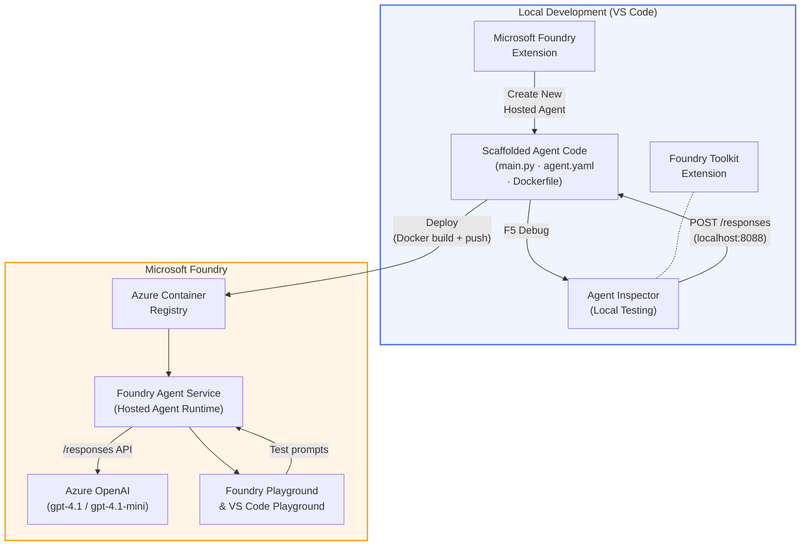

# ورشة عمل Foundry Toolkit + Foundry Hosted Agents

[](https://www.python.org/)
[](https://github.com/microsoft/agents)
[](https://learn.microsoft.com/azure/foundry/agents/concepts/hosted-agents)
[](https://ai.azure.com/)
[](https://learn.microsoft.com/azure/ai-services/openai/)
[](https://learn.microsoft.com/cli/azure/install-azure-cli)
[](https://learn.microsoft.com/azure/developer/azure-developer-cli/install-azd)
[](https://www.docker.com/)
[](https://marketplace.visualstudio.com/items?itemName=ms-windows-ai-studio.windows-ai-studio)
[](../../LICENSE)

بناء واختبار ونشر وكلاء الذكاء الاصطناعي إلى **خدمة وكلاء Microsoft Foundry** كـ **وكلاء مستضافين** - كل ذلك من داخل VS Code باستخدام **ملحق Microsoft Foundry** و**Foundry Toolkit**.

> **الوكلاء المستضافون متاحون حاليًا في المعاينة.** المناطق المدعومة محدودة - راجع [توفر المناطق](https://learn.microsoft.com/azure/foundry/agents/concepts/hosted-agents#region-availability).

> يتم إنشاء مجلد `agent/` داخل كل مختبر **آليًا** بواسطة امتداد Foundry - بعد ذلك تقوم بتخصيص الكود، اختباره محليًا، ونشره.

### 🌐 دعم متعدد اللغات

#### مدعوم عبر GitHub Action (مؤتمت ومحدث دائمًا)

<!-- CO-OP TRANSLATOR LANGUAGES TABLE START -->
[العربية](./README.md) | [البنغالية](../bn/README.md) | [البلغارية](../bg/README.md) | [البورمية (ميانمار)](../my/README.md) | [الصينية (مبسطة)](../zh-CN/README.md) | [الصينية (تقليدية، هونغ كونغ)](../zh-HK/README.md) | [الصينية (تقليدية، ماكاو)](../zh-MO/README.md) | [الصينية (تقليدية، تايوان)](../zh-TW/README.md) | [الكرواتية](../hr/README.md) | [التشيكية](../cs/README.md) | [الدانمركية](../da/README.md) | [الهولندية](../nl/README.md) | [الإستونية](../et/README.md) | [الفنلندية](../fi/README.md) | [الفرنسية](../fr/README.md) | [الألمانية](../de/README.md) | [اليونانية](../el/README.md) | [العبرية](../he/README.md) | [الهندية](../hi/README.md) | [الهنغارية](../hu/README.md) | [الإندونيسية](../id/README.md) | [الإيطالية](../it/README.md) | [اليابانية](../ja/README.md) | [الكنّادية](../kn/README.md) | [الخميرية](../km/README.md) | [الكورية](../ko/README.md) | [اللتوانية](../lt/README.md) | [الماليزية](../ms/README.md) | [المالايالامية](../ml/README.md) | [الماراثية](../mr/README.md) | [النيبالية](../ne/README.md) | [البيجن النيجيري](../pcm/README.md) | [النرويجية](../no/README.md) | [الفارسية (فارسی)](../fa/README.md) | [البولندية](../pl/README.md) | [البرتغالية (البرازيل)](../pt-BR/README.md) | [البرتغالية (البرتغال)](../pt-PT/README.md) | [البنجابية (Gurmukhi)](../pa/README.md) | [الرومانية](../ro/README.md) | [الروسية](../ru/README.md) | [الصربية (السيريلية)](../sr/README.md) | [السلوفاكية](../sk/README.md) | [السلوفينية](../sl/README.md) | [الإسبانية](../es/README.md) | [السواحيلية](../sw/README.md) | [السويدية](../sv/README.md) | [التغالوغ (الفلبينية)](../tl/README.md) | [التاميلية](../ta/README.md) | [التيلوغو](../te/README.md) | [التايلاندية](../th/README.md) | [التركية](../tr/README.md) | [الأوكرانية](../uk/README.md) | [الأردية](../ur/README.md) | [الفيتنامية](../vi/README.md)

> **هل تُفضل الاستنساخ محليًا؟**
>
> يتضمن هذا المستودع أكثر من 50 ترجمة للغات مما يزيد حجم التنزيل بشكل كبير. للاستنساخ بدون الترجمات، استخدم sparse checkout:
>
> **Bash / macOS / Linux:**
> ```bash
> git clone --filter=blob:none --sparse https://github.com/microsoft-foundry/Foundry_Toolkit_for_VSCode_Lab.git
> cd Foundry_Toolkit_for_VSCode_Lab
> git sparse-checkout set --no-cone '/*' '!translations' '!translated_images'
> ```
>
> **CMD (Windows):**
> ```cmd
> git clone --filter=blob:none --sparse https://github.com/microsoft-foundry/Foundry_Toolkit_for_VSCode_Lab.git
> cd Foundry_Toolkit_for_VSCode_Lab
> git sparse-checkout set --no-cone "/*" "!translations" "!translated_images"
> ```
>
> سيعطيك هذا كل ما تحتاجه لإكمال الدورة مع تنزيل أسرع بكثير.
<!-- CO-OP TRANSLATOR LANGUAGES TABLE END -->

---

## البنية المعمارية



**التدفق:** يقوم امتداد Foundry بتهيئة الوكيل → تقوم بتخصيص الكود والتعليمات → الاختبار محليًا باستخدام Agent Inspector → النشر إلى Foundry (صورة Docker تُدفع إلى ACR) → التحقق في Playground.

---

## ما الذي ستبنيه

| المختبر | الوصف | الحالة |
|-----|-------------|--------|
| **المعمل 01 - وكيل واحد** | بناء **"اشرحها وكأنني مدير تنفيذي"**، اختباره محليًا، ونشره إلى Foundry | ✅ متاح |
| **المعمل 02 - سير عمل متعدد الوكلاء** | بناء **"مقيّم الملائمة للسيرة الذاتية → الوظيفة"** - 4 وكلاء يتعاونون لتقييم مدى ملاءمة السيرة الذاتية وإنشاء خارطة طريق للتعلّم | ✅ متاح |

---

## تعرّف على وكيل المدير التنفيذي

في هذه الورشة ستبني **وكيل "اشرحها وكأنني مدير تنفيذي"** - وكيل ذكاء اصطناعي يأخذ المصطلحات التقنية المعقدة ويحوّلها إلى ملخصات هادئة جاهزة للاجتماعات التنفيذية. ولنعترف بالحق، لا أحد في المستوى التنفيذي يريد سماع تفاصيل مثل "استنفاد مجموعة الخيوط الناتج عن استدعاءات متزامنة أُضيفت في الإصدار v3.2."

بنيت هذا الوكيل بعد تكرار عدة حوادث حيث تلقى تقرير التحليل التفصيلي رداً مثل: *"فهل... الموقع معطّل أم لا؟"*

### كيف يعمل

تزوده بتحديث تقني. يعيد لك ملخصًا تنفيذيًا - ثلاث بنود نقطية، بدون مصطلحات فنية معقدة، بدون تتبعات الأخطاء، وبدون إثارة القلق الوجودي. فقط **ما حدث**، **تأثير العمل**، و**الخطوة التالية**.

### شاهدها أثناء التنفيذ

**أنت تقول:**
> "ازدادت زمن استجابة واجهة برمجة التطبيقات بسبب استنفاد مجموعة الخيوط الناتج عن استدعاءات متزامنة أُضيفت في v3.2."

**يجيب الوكيل:**

> **الملخص التنفيذي:**
> - **ما حدث:** بعد الإصدار الأخير، تباطأ النظام.
> - **تأثير العمل:** بعض المستخدمين شعروا بتأخيرات أثناء استخدام الخدمة.
> - **الخطوة التالية:** تم التراجع عن التغيير ويتم تحضير إصلاح قبل إعادة النشر.

### لماذا هذا الوكيل؟

إنه وكيل بسيط للغاية ومصمم لهدف واحد - مثالي لتعلّم سير عمل الوكلاء المستضافين من البداية إلى النهاية دون الغوص في سلاسل أدوات معقدة. وبصراحة؟ كل فريق هندسي يمكنه الاستفادة من واحد كهذا.

---

## هيكل الورشة

```
📂 Foundry_Toolkit_for_VSCode_Lab/
├── 📄 README.md                      ← You are here
└── 📂 workshop/
    ├── 📂 lab01-single-agent/        ← Full lab: docs + agent code
    │   ├── README.md                 ← Hands-on lab instructions
    │   ├── 📂 docs/                  ← Step-by-step tutorial modules
    │   │   ├── 00-prerequisites.md
    │   │   ├── 01-setup.md
    │   │   ├── 02-create-hosted-agent.md
    │   │   ├── 03-configure-and-code.md
    │   │   ├── 04-test-locally.md
    │   │   ├── 05-deploy-to-foundry.md
    │   │   ├── 06-verify-in-playground.md
    │   │   ├── 07-summary.md
    │   │   └── 08-troubleshooting.md
    │   └── 📂 agent/                 ← Reference solution (auto-scaffolded by Foundry extension)
    │       ├── agent.yaml
    │       ├── Dockerfile
    │       ├── main.py
    │       └── requirements.txt
    └── 📂 lab02-multi-agent/         ← Resume → Job Fit Evaluator
        ├── README.md                 ← Hands-on lab instructions (end-to-end)
        ├── 📂 docs/                  ← Step-by-step tutorial modules
        │   ├── 00-prerequisites.md
        │   ├── 01-understand-multi-agent.md
        │   ├── 02-scaffold-multi-agent.md
        │   ├── 03-configure-agents.md
        │   ├── 04-orchestration-patterns.md
        │   ├── 05-test-locally.md
        │   ├── 06-deploy-to-foundry.md
        │   ├── 07-verify-in-playground.md
        │   └── 08-troubleshooting.md
        └── 📂 PersonalCareerCopilot/ ← Reference solution (multi-agent workflow)
            ├── agent.yaml
            ├── Dockerfile
            ├── main.py
            └── requirements.txt
```

> **ملاحظة:** المجلد `agent/` داخل كل مختبر هو ما يولّده **امتداد Microsoft Foundry** عند تشغيل `Microsoft Foundry: Create a New Hosted Agent` من لوحة الأوامر. ثم تُخصص الملفات بتعليمات وكيلك، الأدوات، والتكوين. يوضح المختبر 01 كيفية إعادة إنشاء هذا من الصفر.

---

## البدء

### 1. استنساخ المستودع

```bash
git clone https://github.com/microsoft-foundry/Foundry_Toolkit_for_VSCode_Lab.git
cd Foundry_Toolkit_for_VSCode_Lab
```

### 2. إعداد بيئة افتراضية بايثون

```bash
python -m venv venv
```

قم بتنشيطها:

- **Windows (PowerShell):**
  ```powershell
  .\venv\Scripts\Activate.ps1
  ```
- **macOS / Linux:**
  ```bash
  source venv/bin/activate
  ```

### 3. تثبيت التبعيات

```bash
pip install -r workshop/lab01-single-agent/agent/requirements.txt
```

### 4. تكوين متغيرات البيئة

انسخ ملف المثال `.env` داخل مجلد الوكيل واملأ قيمك:

```bash
cp workshop/lab01-single-agent/agent/.env.example workshop/lab01-single-agent/agent/.env
```

حرّر `workshop/lab01-single-agent/agent/.env`:

```env
AZURE_AI_PROJECT_ENDPOINT=https://<your-account>.services.ai.azure.com/api/projects/<your-project>
AZURE_AI_MODEL_DEPLOYMENT_NAME=<your-model-deployment-name>
```

### 5. اتبع مختبرات الورشة

كل مختبر مستقل ويحتوي على وحداته الخاصة. ابدأ بـ **المعمل 01** لتعلّم الأساسيات، ثم انتقل إلى **المعمل 02** لسير العمل متعدد الوكلاء.

#### المعمل 01 - وكيل واحد ([التعليمات الكاملة](workshop/lab01-single-agent/README.md))

| # | الوحدة | الرابط |
|---|--------|------|
| 1 | اقرأ المتطلبات المسبقة | [00-prerequisites.md](workshop/lab01-single-agent/docs/00-prerequisites.md) |
| 2 | تثبيت Foundry Toolkit وامتداد Foundry | [01-setup.md](workshop/lab01-single-agent/docs/01-setup.md) |
| 3 | إنشاء مشروع Foundry | [01-setup.md](workshop/lab01-single-agent/docs/01-setup.md) |
| 4 | إنشاء وكيل مستضاف | [02-create-hosted-agent.md](workshop/lab01-single-agent/docs/02-create-hosted-agent.md) |
| 5 | تكوين التعليمات والبيئة | [03-configure-and-code.md](workshop/lab01-single-agent/docs/03-configure-and-code.md) |
| 6 | الاختبار محليًا | [04-test-locally.md](workshop/lab01-single-agent/docs/04-test-locally.md) |
| 7 | النشر إلى Foundry | [05-deploy-to-foundry.md](workshop/lab01-single-agent/docs/05-deploy-to-foundry.md) |
| 8 | التحقق في البيئة التجريبية | [06-verify-in-playground.md](workshop/lab01-single-agent/docs/06-verify-in-playground.md) |
| 9 | استكشاف الأخطاء وإصلاحها | [08-troubleshooting.md](workshop/lab01-single-agent/docs/08-troubleshooting.md) |

#### المعمل 02 - سير عمل متعدد الوكلاء ([التعليمات الكاملة](workshop/lab02-multi-agent/README.md))

| # | الوحدة | الرابط |
|---|--------|------|
| 1 | المتطلبات المسبقة (المعمل 02) | [00-prerequisites.md](workshop/lab02-multi-agent/docs/00-prerequisites.md) |
| 2 | فهم بنية نظام متعدد الوكلاء | [01-understand-multi-agent.md](workshop/lab02-multi-agent/docs/01-understand-multi-agent.md) |
| 3 | تهيئة مشروع متعدد الوكلاء | [02-scaffold-multi-agent.md](workshop/lab02-multi-agent/docs/02-scaffold-multi-agent.md) |
| 4 | تكوين الوكلاء والبيئة | [03-configure-agents.md](workshop/lab02-multi-agent/docs/03-configure-agents.md) |
| 5 | أنماط التنسيق | [04-orchestration-patterns.md](workshop/lab02-multi-agent/docs/04-orchestration-patterns.md) |
| 6 | الاختبار محليًا (متعدد الوكلاء) | [05-test-locally.md](workshop/lab02-multi-agent/docs/05-test-locally.md) |
| 7 | النشر إلى Foundry | [06-deploy-to-foundry.md](workshop/lab02-multi-agent/docs/06-deploy-to-foundry.md) |
| 8 | التحقق في البيئة التجريبية | [07-verify-in-playground.md](workshop/lab02-multi-agent/docs/07-verify-in-playground.md) |
| 9 | استكشاف الأخطاء وإصلاحها (متعدد الوكلاء) | [08-troubleshooting.md](workshop/lab02-multi-agent/docs/08-troubleshooting.md) |

---

## المشرف

<table>
<tr>
    <td align="center"><a href="https://github.com/ShivamGoyal03">
        <br />
        <sub><b>Shivam Goyal</b></sub>
    </a><br />
    </td>
</tr>
</table>

---

## الأذونات المطلوبة (مرجع سريع)

| السيناريو | الأدوار المطلوبة |
|----------|---------------|
| إنشاء مشروع Foundry جديد | **Azure AI Owner** على مورد Foundry |
| النشر إلى مشروع موجود (موارد جديدة) | **Azure AI Owner** + **Contributor** على الاشتراك |
| النشر إلى مشروع مُكوَّن بالكامل | **Reader** على الحساب + **Azure AI User** على المشروع |

> **مهم:** أدوار Azure `Owner` و `Contributor` تتضمن أذونات *إدارية* فقط، وليست أذونات *تطوير* (إجراءات البيانات). تحتاج إلى **Azure AI User** أو **Azure AI Owner** لبناء ونشر الوكلاء.

---

## مراجع

- [البدء السريع: نشر وكيلك المستضاف الأول (VS Code)](https://learn.microsoft.com/azure/foundry/agents/quickstarts/quickstart-hosted-agent)
- [ما المقصود بالوكلاء المستضافين؟](https://learn.microsoft.com/azure/foundry/agents/concepts/hosted-agents)
- [إنشاء سير عمل للوكلاء المستضافين في VS Code](https://learn.microsoft.com/azure/foundry/agents/how-to/vs-code-agents-workflow-pro-code)
- [نشر وكيل مستضاف](https://learn.microsoft.com/azure/foundry/agents/how-to/deploy-hosted-agent)
- [RBAC لـ Microsoft Foundry](https://learn.microsoft.com/azure/foundry/concepts/rbac-foundry)
- [مثال لوكيل مراجعة البنية](https://github.com/Azure-Samples/agent-architecture-review-sample) - وكيل مستضاف واقعي مع أدوات MCP ومخططات Excalidraw ونشر مزدوج

---


## الترخيص

[MIT](../../LICENSE)

---

<!-- CO-OP TRANSLATOR DISCLAIMER START -->
**تنويه**:
تمت ترجمة هذا المستند باستخدام خدمة الترجمة بالذكاء الاصطناعي [Co-op Translator](https://github.com/Azure/co-op-translator). بينما نسعى للدقة، يرجى العلم أن الترجمات الآلية قد تحتوي على أخطاء أو عدم دقة. يجب اعتبار المستند الأصلي بلغته الأصلية المصدر الرسمي والمعتمد. للمعلومات الهامة، يُنصح بالاستعانة بترجمة بشرية محترفة. نحن غير مسؤولين عن أي سوء فهم أو تفسير ناتج عن استخدام هذه الترجمة.
<!-- CO-OP TRANSLATOR DISCLAIMER END -->
