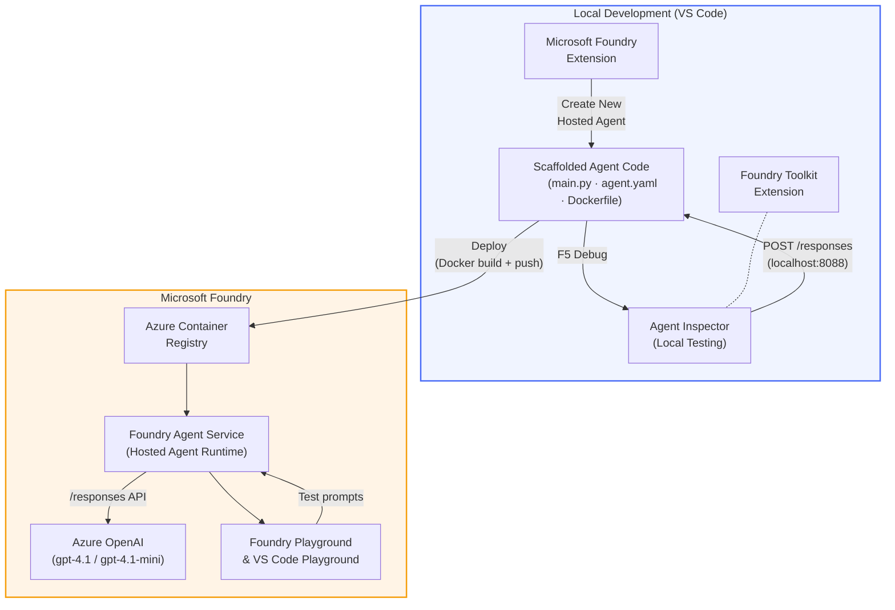

# ورشة عمل Foundry Toolkit + وكلاء Foundry المستضافين

[](https://www.python.org/)
[](https://learn.microsoft.com/agent-framework/)
[](https://learn.microsoft.com/azure/foundry/agents/concepts/hosted-agents)
[](https://ai.azure.com/)
[](https://learn.microsoft.com/azure/ai-services/openai/)
[](https://learn.microsoft.com/cli/azure/install-azure-cli)
[](https://learn.microsoft.com/azure/developer/azure-developer-cli/install-azd)
[](https://www.docker.com/)
[](https://marketplace.visualstudio.com/items?itemName=ms-windows-ai-studio.windows-ai-studio)
[](LICENSE)

بِنْيَة، اختبار، ونشر وكلاء الذكاء الاصطناعي إلى **خدمة وكلاء Microsoft Foundry** كـ **وكلاء مستضافين** - بالكامل من VS Code باستخدام **ملحق Microsoft Foundry** و **Foundry Toolkit**.

> **الوكلاء المستضافون في المعاينة حالياً.** المناطق المدعومة محدودة - راجع [توافر المناطق](https://learn.microsoft.com/azure/foundry/agents/concepts/hosted-agents#region-availability).

> مجلد `agent/` داخل كل مختبر يتم **إنشاؤه تلقائياً** بواسطة ملحق Foundry – ثم تقوم بتخصيص الكود، واختباره محلياً، ثم نشره.

### 🌐 دعم متعدد اللغات

#### مدعوم عبر GitHub Action (آلي ودائم التحديث)

<!-- CO-OP TRANSLATOR LANGUAGES TABLE START -->
[Arabic](./README.md) | [Bengali](../bn/README.md) | [Bulgarian](../bg/README.md) | [Burmese (Myanmar)](../my/README.md) | [Chinese (Simplified)](../zh-CN/README.md) | [Chinese (Traditional, Hong Kong)](../zh-HK/README.md) | [Chinese (Traditional, Macau)](../zh-MO/README.md) | [Chinese (Traditional, Taiwan)](../zh-TW/README.md) | [Croatian](../hr/README.md) | [Czech](../cs/README.md) | [Danish](../da/README.md) | [Dutch](../nl/README.md) | [Estonian](../et/README.md) | [Finnish](../fi/README.md) | [French](../fr/README.md) | [German](../de/README.md) | [Greek](../el/README.md) | [Hebrew](../he/README.md) | [Hindi](../hi/README.md) | [Hungarian](../hu/README.md) | [Indonesian](../id/README.md) | [Italian](../it/README.md) | [Japanese](../ja/README.md) | [Kannada](../kn/README.md) | [Khmer](../km/README.md) | [Korean](../ko/README.md) | [Lithuanian](../lt/README.md) | [Malay](../ms/README.md) | [Malayalam](../ml/README.md) | [Marathi](../mr/README.md) | [Nepali](../ne/README.md) | [Nigerian Pidgin](../pcm/README.md) | [Norwegian](../no/README.md) | [Persian (Farsi)](../fa/README.md) | [Polish](../pl/README.md) | [Portuguese (Brazil)](../pt-BR/README.md) | [Portuguese (Portugal)](../pt-PT/README.md) | [Punjabi (Gurmukhi)](../pa/README.md) | [Romanian](../ro/README.md) | [Russian](../ru/README.md) | [Serbian (Cyrillic)](../sr/README.md) | [Slovak](../sk/README.md) | [Slovenian](../sl/README.md) | [Spanish](../es/README.md) | [Swahili](../sw/README.md) | [Swedish](../sv/README.md) | [Tagalog (Filipino)](../tl/README.md) | [Tamil](../ta/README.md) | [Telugu](../te/README.md) | [Thai](../th/README.md) | [Turkish](../tr/README.md) | [Ukrainian](../uk/README.md) | [Urdu](../ur/README.md) | [Vietnamese](../vi/README.md)

> **تفضل الاستنساخ محلياً؟**
>
> يحتوي هذا المستودع على ترجمات لأكثر من 50 لغة، مما يزيد بشكل كبير من حجم التنزيل. لاستنساخ بدون الترجمات، استخدم فحص متفرق:
>
> **Bash / ماك أو إس / لينكس:**
> ```bash
> git clone --filter=blob:none --sparse https://github.com/microsoft-foundry/Foundry_Toolkit_for_VSCode_Lab.git
> cd Foundry_Toolkit_for_VSCode_Lab
> git sparse-checkout set --no-cone '/*' '!translations' '!translated_images'
> ```
>
> **CMD (ويندوز):**
> ```cmd
> git clone --filter=blob:none --sparse https://github.com/microsoft-foundry/Foundry_Toolkit_for_VSCode_Lab.git
> cd Foundry_Toolkit_for_VSCode_Lab
> git sparse-checkout set --no-cone "/*" "!translations" "!translated_images"
> ```
>
> هذا يمنحك كل ما تحتاجه لإتمام الدورة بتنزيل أسرع بكثير.
<!-- CO-OP TRANSLATOR LANGUAGES TABLE END -->

---

## البنية المعمارية



**التدفق:** ملحق Foundry ينشئ الوكيل → تقوم بتخصيص الكود والتعليمات → اختبار محلي باستخدام Agent Inspector → نشر إلى Foundry (تم دفع صورة Docker إلى ACR) → التحقق في ساحة اللعب.

---

## ما الذي ستبنيه

| المختبر | الوصف | الحالة |
|-----|-------------|--------|
| **المختبر 01 - وكيل واحد** | بناء **وكيل "اشرح وكأنني تنفيذي"**، اختباره محلياً، ونشره إلى Foundry | ✅ متاح |
| **المختبر 02 - سير عمل متعدد الوكلاء** | بناء **"تقييم تناسب السيرة الذاتية للوظيفة"** - أربعة وكلاء يتعاونون لتقييم تناسب السيرة الذاتية وإنشاء خارطة طريق تعليمية | ✅ متاح |

---

## تعرّف على وكيل التنفيذي

في هذه الورشة ستبني **وكيل "اشرح وكأنني تنفيذي"** - وكيل ذكاء اصطناعي يأخذ المصطلحات التقنية المعقدة ويترجمها إلى ملخصات هادئة جاهزة لقاعة الاجتماعات. لأن لنكن صرحاء، لا أحد في الإدارة العليا يرغب بسماع "نفاذ تجميع الخيوط بسبب المكالمات المتزامنة التي أدخلت في الإصدار 3.2."

بنيت هذا الوكيل بعد حادثة كثيرة حيث كانت المراجعة التي أعددتها بعناية تحصل على الرد: *"إذاً... هل الموقع معطل أم لا؟"*

### كيف يعمل

تزوده بتحديث تقني. يعيد ملخصاً تنفيذياً - ثلاث نقاط، بدون مصطلحات معقدة، بدون تتبع الأخطاء، بدون رعب وجودي. فقط **ما حدث**، **تأثير العمل**، و **الخطوة التالية**.

### شاهده في العمل

**أنت تقول:**
> "زد تأخير API بسبب نفاذ تجميع الخيوط الناجم عن المكالمات المتزامنة التي أدخلت في الإصدار 3.2."

**يرد الوكيل:**

> **الملخص التنفيذي:**
> - **ما حدث:** بعد الإصدار الأخير، تباطأ النظام.
> - **تأثير العمل:** واجه بعض المستخدمين تأخيرات أثناء استخدام الخدمة.
> - **الخطوة التالية:** تم التراجع عن التغيير ويتم إعداد إصلاح قبل إعادة النشر.

### لماذا هذا الوكيل؟

هو وكيل بسيط للغاية، ذو غرض واحد - مثالي لتعلم سير عمل الوكلاء المستضافين من البداية إلى النهاية بدون التعقيدات المعقدة لسلاسل الأدوات. وبصراحة؟ كل فريق هندسي يمكنه الاستفادة من واحد منهم.

---

## هيكل الورشة

```
📂 Foundry_Toolkit_for_VSCode_Lab/
├── 📄 README.md                      ← You are here
└── 📂 workshop/
    ├── 📂 lab01-single-agent/        ← Full lab: docs + agent code
    │   ├── README.md                 ← Hands-on lab instructions
    │   ├── 📂 docs/                  ← Step-by-step tutorial modules
    │   │   ├── 00-prerequisites.md
    │   │   ├── 01-setup.md
    │   │   ├── 02-create-hosted-agent.md
    │   │   ├── 03-configure-and-code.md
    │   │   ├── 04-test-locally.md
    │   │   ├── 05-deploy-to-foundry.md
    │   │   ├── 06-verify-in-playground.md
    │   │   ├── 07-summary.md
    │   │   └── 08-troubleshooting.md
    │   └── 📂 agent/                 ← Reference solution (auto-scaffolded by Foundry extension)
    │       ├── agent.yaml
    │       ├── Dockerfile
    │       ├── main.py
    │       └── requirements.txt
    └── 📂 lab02-multi-agent/         ← Resume → Job Fit Evaluator
        ├── README.md                 ← Hands-on lab instructions (end-to-end)
        ├── 📂 docs/                  ← Step-by-step tutorial modules
        │   ├── 00-prerequisites.md
        │   ├── 01-understand-multi-agent.md
        │   ├── 02-scaffold-multi-agent.md
        │   ├── 03-configure-agents.md
        │   ├── 04-orchestration-patterns.md
        │   ├── 05-test-locally.md
        │   ├── 06-deploy-to-foundry.md
        │   ├── 07-verify-in-playground.md
        │   ├── 08-troubleshooting.md
        │   └── 09-summary.md
        └── 📂 PersonalCareerCopilot/ ← Reference solution (multi-agent workflow)
            ├── agent.yaml
            ├── Dockerfile
            ├── main.py
            └── requirements.txt
```

> **ملاحظة:** مجلد `agent/` داخل كل مختبر هو ما يولده **ملحق Microsoft Foundry** عند تشغيل `Microsoft Foundry: Create a New Hosted Agent` من لوحة الأوامر. ثم يتم تخصيص الملفات مع تعليمات و أدوات وتكوينات الوكيل. يرافقك المختبر 01 خطوة بخطوة لإعادة إنشاء هذا من الصفر.

---

## بدء الاستخدام

### 1. استنساخ المستودع

```bash
git clone https://github.com/microsoft-foundry/Foundry_Toolkit_for_VSCode_Lab.git
cd Foundry_Toolkit_for_VSCode_Lab
```

### 2. إعداد بيئة بايثون افتراضية

```bash
python -m venv venv
```

فعلها:

- **ويندوز (PowerShell):**
  ```powershell
  .\venv\Scripts\Activate.ps1
  ```
- **ماك أو إس / لينكس:**
  ```bash
  source venv/bin/activate
  ```

### 3. تثبيت التبعيات

```bash
pip install -r workshop/lab01-single-agent/agent/requirements.txt
```

### 4. تكوين متغيرات البيئة

انسخ ملف `.env` النموذجي داخل مجلد الوكيل واملأ القيم الخاصة بك:

```bash
cp workshop/lab01-single-agent/agent/.env.example workshop/lab01-single-agent/agent/.env
```

حرر `workshop/lab01-single-agent/agent/.env`:

```env
FOUNDRY_PROJECT_ENDPOINT=https://<your-account>.services.ai.azure.com/api/projects/<your-project>
AZURE_AI_MODEL_DEPLOYMENT_NAME=<your-model-deployment-name>
```

### 5. تابع مختبرات الورشة

كل مختبر مستقل مع وحداته الخاصة. ابدأ بـ **المختبر 01** لتعلم الأساسيات، ثم انتقل إلى **المختبر 02** لسير عمل متعدد الوكلاء.

#### المختبر 01 - وكيل واحد ([التعليمات الكاملة](workshop/lab01-single-agent/README.md))

| # | الوحدة | الرابط |
|---|--------|------|
| 1 | اقرأ المتطلبات الأساسية | [00-prerequisites.md](workshop/lab01-single-agent/docs/00-prerequisites.md) |
| 2 | تثبيت Foundry Toolkit وملحق Foundry | [01-setup.md](workshop/lab01-single-agent/docs/01-setup.md) |
| 3 | إنشاء مشروع Foundry | [01-setup.md](workshop/lab01-single-agent/docs/01-setup.md) |
| 4 | إنشاء وكيل مستضاف | [02-create-hosted-agent.md](workshop/lab01-single-agent/docs/02-create-hosted-agent.md) |
| 5 | تكوين التعليمات و البيئة | [03-configure-and-code.md](workshop/lab01-single-agent/docs/03-configure-and-code.md) |
| 6 | اختبار محلي | [04-test-locally.md](workshop/lab01-single-agent/docs/04-test-locally.md) |
| 7 | نشر إلى Foundry | [05-deploy-to-foundry.md](workshop/lab01-single-agent/docs/05-deploy-to-foundry.md) |
| 8 | التحقق في ساحة اللعب | [06-verify-in-playground.md](workshop/lab01-single-agent/docs/06-verify-in-playground.md) |
| 9 | ملخص والخطوات التالية | [07-summary.md](workshop/lab01-single-agent/docs/07-summary.md) |
| 10 | استكشاف الأخطاء وإصلاحها | [08-troubleshooting.md](workshop/lab01-single-agent/docs/08-troubleshooting.md) |

#### المختبر 02 - سير عمل متعدد الوكلاء ([التعليمات الكاملة](workshop/lab02-multi-agent/README.md))

| # | الوحدة | الرابط |
|---|--------|------|
| 1 | المتطلبات الأساسية (المختبر 02) | [00-prerequisites.md](workshop/lab02-multi-agent/docs/00-prerequisites.md) |
| 2 | فهم بنية الوكلاء المتعددين | [01-understand-multi-agent.md](workshop/lab02-multi-agent/docs/01-understand-multi-agent.md) |
| 3 | إنشاء مشروع متعدد الوكلاء | [02-scaffold-multi-agent.md](workshop/lab02-multi-agent/docs/02-scaffold-multi-agent.md) |
| 4 | تكوين الوكلاء والبيئة | [03-configure-agents.md](workshop/lab02-multi-agent/docs/03-configure-agents.md) |
| 5 | أنماط التنسيق | [04-orchestration-patterns.md](workshop/lab02-multi-agent/docs/04-orchestration-patterns.md) |
| 6 | اختبار محلي (متعدد الوكلاء) | [05-test-locally.md](workshop/lab02-multi-agent/docs/05-test-locally.md) |
| 7 | نشر إلى Foundry | [06-deploy-to-foundry.md](workshop/lab02-multi-agent/docs/06-deploy-to-foundry.md) |
| 8 | التحقق في ساحة اللعب | [07-verify-in-playground.md](workshop/lab02-multi-agent/docs/07-verify-in-playground.md) |
| 9 | استكشاف الأخطاء وإصلاحها (متعدد الوكلاء) | [08-troubleshooting.md](workshop/lab02-multi-agent/docs/08-troubleshooting.md) |
| 10 | ملخص والخطوات التالية | [09-summary.md](workshop/lab02-multi-agent/docs/09-summary.md) |

---

## المسؤول

<table>
<tr>
    <td align="center"><a href="https://github.com/ShivamGoyal03">
        <br />
        <sub><b>شيفام جويال</b></sub>
    </a><br />
    </td>
</tr>
</table>

---

## الأذونات المطلوبة (مرجع سريع)

| السيناريو | الأدوار المطلوبة |
|----------|---------------|
| إنشاء مشروع Foundry جديد | **مالك Azure AI** على مورد Foundry |
| النشر إلى مشروع موجود (موارد جديدة) | **مالك Azure AI** + **مساهم** على الاشتراك |
| النشر إلى مشروع مُكوَّن بالكامل | **قارئ** على الحساب + **مستخدم Azure AI** على المشروع |

> **مهم:** أدوار Azure `Owner` و `Contributor` تشمل فقط أذونات *الإدارة*، وليست أذونات *التطوير* (إجراءات البيانات). تحتاج إلى **مستخدم Azure AI** أو **مالك Azure AI** لبناء ونشر الوكلاء.

---

## المراجع

- [البدء السريع: نشر وكيل مستضاف أول لك (VS Code)](https://learn.microsoft.com/azure/foundry/agents/quickstarts/quickstart-hosted-agent)
- [ما هي الوكلاء المستضافة؟](https://learn.microsoft.com/azure/foundry/agents/concepts/hosted-agents)
- [إنشاء سير عمل الوكيل المستضاف في VS Code](https://learn.microsoft.com/azure/foundry/agents/how-to/vs-code-agents-workflow-pro-code)
- [نشر وكيل مستضاف](https://learn.microsoft.com/azure/foundry/agents/how-to/deploy-hosted-agent)
- [RBAC لـ Microsoft Foundry](https://learn.microsoft.com/azure/foundry/concepts/rbac-foundry)
- [عينة وكيل مراجعة الهندسة المعمارية](https://github.com/Azure-Samples/agent-architecture-review-sample) - وكيل مستضاف في العالم الحقيقي مع أدوات MCP، مخططات Excalidraw، ونشر مزدوج

---


## الترخيص

[MIT](../../LICENSE)

---

<!-- CO-OP TRANSLATOR DISCLAIMER START -->
**تنويه**:
تمت ترجمة هذا المستند باستخدام خدمة الترجمة بالذكاء الاصطناعي [Co-op Translator](https://github.com/Azure/co-op-translator). بينما نسعى للدقة، يرجى العلم أن الترجمات الآلية قد تحتوي على أخطاء أو عدم دقة. يجب اعتبار المستند الأصلي بلغته الأصلية المصدر الرسمي والمعتمد. للمعلومات الهامة، يُنصح بالاستعانة بترجمة بشرية محترفة. نحن غير مسؤولين عن أي سوء فهم أو تفسير ناتج عن استخدام هذه الترجمة.
<!-- CO-OP TRANSLATOR DISCLAIMER END -->