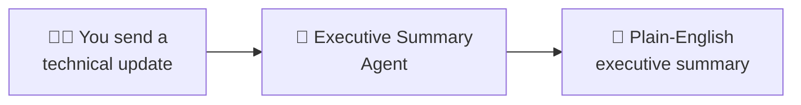

# الوحدة 0 - المقدمة

⏱️ ~10 دقائق

> [!WARNING]
> **معاينة والقيود:** [العوامل المستضافة](https://learn.microsoft.com/azure/foundry/agents/concepts/hosted-agents) حاليا في **المعاينة العامة** - غير موصى بها للأحمال الإنتاجية. كن على علم بالتالي:
> - **المناطق المدعومة محدودة** - تحقق من [توفر المنطقة](https://learn.microsoft.com/azure/foundry/agents/concepts/hosted-agents#region-availability) قبل إنشاء الموارد. إذا اخترت منطقة غير مدعومة، ستفشل عملية النشر.
> - حزمة `agent-framework-foundry-hosting` في إصدار ما قبل الإصدار - قد تتغير واجهات برمجة التطبيقات بين الإصدارات.
> - حدود التدرج: العوامل المستضافة تدعم من 0 إلى 5 نسخ متماثلة (بما في ذلك التدرج للصفر).
> - قد تتغير بعض الميزات المعروضة في هذا الورشة مع تقدم الخدمة نحو الإصدار العام.

## ماذا ستبني

في هذه الورشة، ستبني عاملًا **"اشرح لي كأنني مسؤول تنفيذي"** - عامل ذكاء اصطناعي مستضاف يأخذ تحديثات تقنية معقدة ويعيد كتابتها كملخصات تنفيذية بالإنجليزية البسيطة.

**العامل يستخدم:**
- **إطار عمل العوامل من مايكروسوفت** - للمنطق والهيكلية
- **مجموعة Foundry لأدوات VS Code** - لإعداد الهيكل، والاختبار محليًا، والنشر
- **نموذج ذكاء اصطناعي** (مثلاً `gpt-4.1-mini/gpt-5-mini`) - لتوليد الملخصات

بحلول نهاية هذا المختبر، سيكون لديك عامل يعمل يمكنك اختباره محليًا عبر Agent Inspector، وبإمكانك اختياريًا نشره في السحابة.

---

## ما هي العوامل المستضافة؟

**العامل المستضاف** هو عامل ذكاء اصطناعي يعمل كخدمة مُدارة في Microsoft Foundry. بدلاً من إدارة البنية التحتية الخاصة بك، تقوم بتغليف كود العامل داخل حاوية ويتولى Foundry التعامل مع التدرج والاستضافة وتعريضه عبر نقطة نهاية HTTP قياسية.

| المفهوم | ما يعنيه |
|---------|--------------|
| **العامل** | كود بايثون الخاص بك الذي يستقبل رسالة المستخدم، يستدعي نموذج الذكاء الاصطناعي، ويرجع استجابة منظمة |
| **مستضاف** | Foundry يشغل الحاوية الخاصة بك نيابة عنك - لا أجهزة افتراضية، لا Kubernetes، لا إدارة للبنية التحتية |
| **بروتوكول الاستجابة** | API HTTP قياسي (`POST /responses`) يمكن لأي عميل استدعاؤه للتفاعل مع العامل الخاص بك |
| **Agent Inspector** | واجهة اختبار محلية (مدمجة في Foundry Toolkit) تتيح لك الدردشة مع العامل قبل النشر |

في هذه الورشة، ستنتقل من الصفر إلى عامل مستضاف بالكامل — أو تتوقف عند الاختبار المحلي إذا فضلت ذلك.

---

## اختر مسارك

> ⚠️ **اختر مسارًا واحدًا قبل المتابعة.** اختيارك يحدد الأدوات التي ستثبتها والوحدات التي تنطبق عليك. يمكنك التبديل من المسار ب → المسار أ لاحقًا إذا حصلت على اشتراك.

<strong>🅰️ المسار أ - سحابة Azure (يتطلب اشتراك Azure)</strong>

| | التفاصيل |
|---|---|
| **لمن هذا؟** | لديك اشتراك Azure نشط ويمكنك إنشاء موارد Foundry |
| **النموذج** | Azure OpenAI عبر Foundry (مثلاً `gpt-4.1-mini/gpt-5-mini`) |
| **الوحدات المغطاة** | جميع الوحدات (00–07) |
| **النشر في السحابة؟** | ✅ نعم - نشر شامل من البداية إلى النهاية |

<strong>🅱️ المسار ب - محلي / الطبقة المجانية (لا يحتاج اشتراك Azure)</strong>

| | التفاصيل |
|---|---|
| **لمن هذا؟** | MVPs، الطلاب، أو أي شخص بدون وصول إلى Azure |
| **النموذج** | **Foundry Local** (مجاني، يعمل على جهازك) |
| **الوحدات المغطاة** | الوحدات 00–04 (تخطي النشر والتحقق في السحابة) |
| **النشر في السحابة؟** | ❌ لا - اختبار محلي فقط عبر Agent Inspector |

---

## جميع المسارات: الأدوات المطلوبة

ثبت كل أداة أدناه. بعد التثبيت، تحقق من عملها عن طريق تشغيل أمر التحقق.

| # | الأداة | الإصدار | التثبيت | التحقق (الناتج المتوقع) |
|---|------|---------|---------|---------------------------|
| 1 | **Visual Studio Code** | الأحدث | [code.visualstudio.com](https://code.visualstudio.com/) | يفتح بدون أخطاء |
| 2 | **Python** | 3.12 أو أعلى| [python.org/downloads](https://www.python.org/downloads/) | `python --version` $\rightarrow$ `Python 3.12.x` |
| 3 | **Foundry Toolkit for VS Code** | الأحدث | معرف الإضافة: `ms-windows-ai-studio.windows-ai-studio` | أيقونة Foundry في شريط النشاط |
| 4 | **إضافة Python لـ VS Code** | الأحدث | معرف الإضافة: `ms-python.python` | مثبتة في لوحة الإضافات |

> [!TIP]
> **نصائح احترافية للتثبيت:**
> - **مسار Python (ويندوز):** تحقق دائمًا من تحديد **"Add Python to PATH"** في الشاشة الأولى لمثبت Python. بدون هذا، لن يتعرف على `python` في الطرفية الخاصة بك.
> - **إصدارات Python متعددة:** إذا كان لديك Python 3.10 و 3.12 مثبتان، استخدم `python3.12 -m venv .venv` لضمان استخدام الإصدار الصحيح لبيئة العمل الافتراضية.
> - **Docker WSL 2 (ويندوز):** أثناء تثبيت Docker Desktop، تأكد من اختيار **WSL 2 backend**. Docker مع Hyper-V أبطأ وقد يسبب مشكلات في إنشاء حاويات Foundry.
> - **Docker لا يبدأ؟** انتظر 30–60 ثانية بعد تشغيل Docker Desktop. شغّل `docker info` - إذا ظهرت الرسالة "Cannot connect to the Docker daemon"، فهذا يعني أن Docker لا يزال يبدأ.
> - **ملحقات VS Code لا تعمل؟** بعد تثبيت الإضافات، أعد تحميل النافذة: `Ctrl+Shift+P` → `Developer: Reload Window`.

> **مستخدمو ويندوز:** تحقق من تحديد **"Add Python to PATH"** أثناء تثبيت Python.

**التالي:** [01 - الإعداد →](01-setup.md)

---

<!-- CO-OP TRANSLATOR DISCLAIMER START -->
**تنويه**:
تمت ترجمة هذا المستند باستخدام خدمة الترجمة بالذكاء الاصطناعي [Co-op Translator](https://github.com/Azure/co-op-translator). بينما نسعى للدقة، يرجى العلم أن الترجمات الآلية قد تحتوي على أخطاء أو عدم دقة. يجب اعتبار المستند الأصلي بلغته الأصلية المصدر الرسمي والمعتمد. للمعلومات الهامة، يُنصح بالاستعانة بترجمة بشرية محترفة. نحن غير مسؤولين عن أي سوء فهم أو تفسير ناتج عن استخدام هذه الترجمة.
<!-- CO-OP TRANSLATOR DISCLAIMER END -->