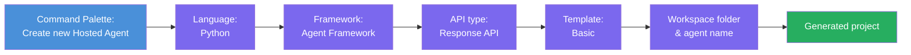
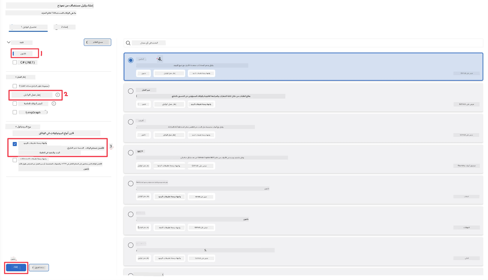
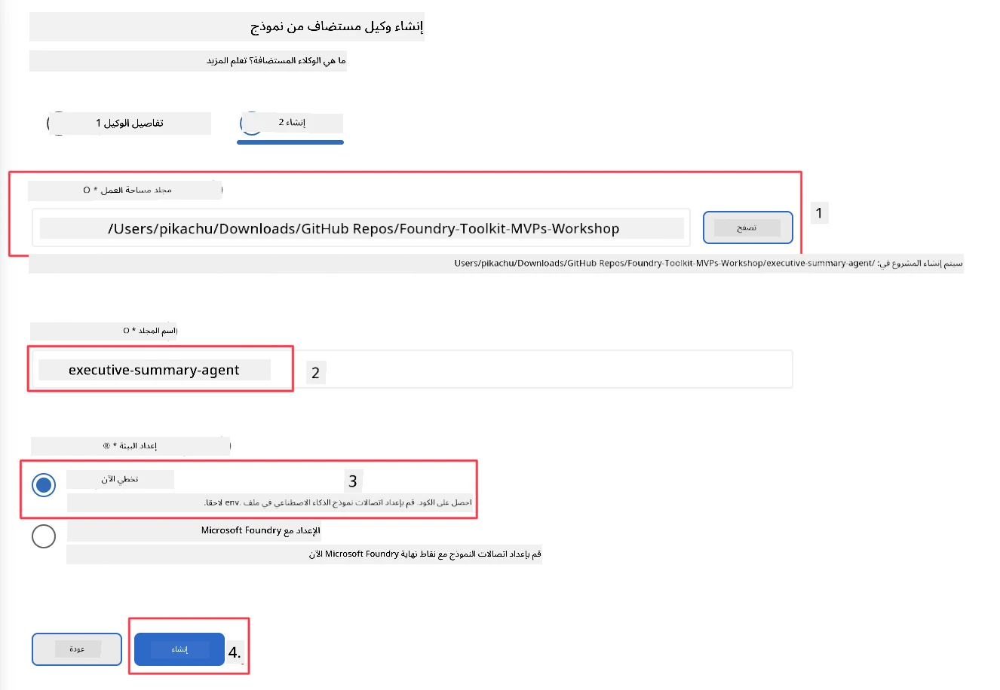

# الوحدة 2 - إنشاء وكيل مستضاف جديد

⏱️ ~5 دقائق

في هذه الوحدة، تستخدم Foundry Toolkit لـ **إنشاء مشروع وكيل مستضاف**. يقوم الهيكل بإنشاء هيكل المشروع الكامل - `agent.yaml` و`main.py` و`Dockerfile` و`requirements.txt` بالإضافة إلى تكوين التصحيح في VS Code - حتى تتمكن من التركيز على تخصيص سلوك الوكيل.

> **المفهوم الرئيسي:** مجلد `agent/` في هذا المختبر هو مثال لما يولده Foundry Toolkit. أنت لا تكتب هذه الملفات من الصفر.

### تدفق معالج الهيكلة



---

## الخطوة 1: افتح معالج إنشاء وكيل مستضاف

1. اضغط على `Ctrl+Shift+P` لفتح **لوحة الأوامر**.
2. اكتب: **Foundry Toolkit: Create new Hosted Agent** واختره.

> **بديل: الإنشاء عبر بوابة Foundry**
> إذا فضلت المتصفح، يمكنك إنشاء مشروعك على [https://ai.azure.com](https://ai.azure.com). بمجرد إنشاء المشروع، عد إلى VS Code واستخدم الشريط الجانبي لـ **Foundry Toolkit** للاتصال به.

> **بديل:** في الشريط الجانبي لـ Foundry Toolkit، مرر فوق **Agents** ضمن مشروعك، وانقر على أيقونة **+**، ثم اختر **Create in Code With Template**.

## الخطوة 2: اختر الإعدادات



1. في قسم التنقل/الخيارات على اليسار اختر التالي:

| القائمة | الاختيار | ملاحظات |
|--------|-----------|-------|
| **اللغة** | Python | C# مدعوم أيضًا |
| **إطار العمل** | Agent Framework | نقطة بداية بسيطة باستخدام Agent Framework SDK |
| **نوع API** | Response API | `POST /responses` - محادثة، مع سجل مُدار من قبل المنصة |
| **القالب** | Basic | نقطة بداية بسيطة باستخدام Agent Framework SDK |

2. بعد الاختيار، انقر على **التالي**



3. في النافذة التالية، اختر التالي:

| القائمة | الاختيار | ملاحظات |
|--------|-----------|-------|
| **مجلد مساحة العمل** | اختر مجلد الهدف | مثال: `/workspace/Foundry_Toolkit_for_VSCode_Lab/` أو مجلد فرعي ضمن هذا المستودع |
| **اسم الوكيل** | أدخل اسمًا | مثال: `executive-summary-agent` |
| **إعداد البيئة** | تخطى الإعداد الآن |  |

انقر على **إنشاء** لإنشاء وكيلنا. سيتم إنشاء مجلد جديد باسم الوكيل المستضاف.

## الخطوة 3: تفقد المشروع المنشأ

بعد اكتمال الهيكلة، تأكد من رؤية هذه الملفات في المستعرض (`Ctrl+Shift+E`):

```
📂 executive-summary-agent/
├── .env                ← Environment variables (placeholders)
├── .vscode/
│   ├── launch.json     ← Debug config (F5 → run + Agent Inspector)
│   └── tasks.json      ← VS Code task definitions
├── agent.yaml          ← Agent definition (kind: hosted)
├── Dockerfile          ← Container config for deployment
├── main.py             ← Agent entry point (your main code)
└── requirements.txt    ← Python dependencies
```

### شرح الملفات الرئيسية

| الملف | الغرض |
|------|---------|
| `agent.yaml` | يعلن الوكيل كـ `kind: hosted`، يربط متغيرات البيئة، يعرّف بروتوكول `/responses` |
| `main.py` | ينشئ `FoundryChatClient` → يلفّه في `Agent` مع تعليمات → يخدم عبر `ResponsesHostServer` على المنفذ 8088 |
| `Dockerfile` | يستخدم `python:3.12-slim`، يثبت التبعيات، يعرض المنفذ 8088، يشغّل `main.py` |
| `requirements.txt` | `agent-framework-foundry`، `agent-framework-foundry-hosting`، `mcp`، `debugpy` |

> **مهم:** افتح مجلد الوكيل المهيكل مباشرة في VS Code (مجلد `agent/` نفسه) بحيث تعمل `.vscode/launch.json` و`tasks.json` بشكل صحيح لتصحيح F5.

---

### ✅ نقطة تحقق

- [ ] تم إنشاء المشروع الهيكلي مع جميع الملفات المتوقعة
- [ ] `agent.yaml` يعرض `kind: hosted` و `protocol: responses`
- [ ] `main.py` يستورد `Agent`، `FoundryChatClient`، `ResponsesHostServer`
- [ ] مجلد الوكيل مفتوح في VS Code كجذر مساحة عمل

---

**السابق:** [01 - الإعداد](01-setup.md) · **التالي:** [03 - التكوين والبرمجة →](03-configure-and-code.md)

---

<!-- CO-OP TRANSLATOR DISCLAIMER START -->
**تنويه**:
تمت ترجمة هذا المستند باستخدام خدمة الترجمة بالذكاء الاصطناعي [Co-op Translator](https://github.com/Azure/co-op-translator). بينما نسعى للدقة، يرجى العلم أن الترجمات الآلية قد تحتوي على أخطاء أو عدم دقة. يجب اعتبار المستند الأصلي بلغته الأصلية المصدر الرسمي والمعتمد. للمعلومات الهامة، يُنصح بالاستعانة بترجمة بشرية محترفة. نحن غير مسؤولين عن أي سوء فهم أو تفسير ناتج عن استخدام هذه الترجمة.
<!-- CO-OP TRANSLATOR DISCLAIMER END -->