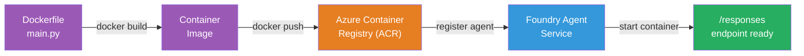
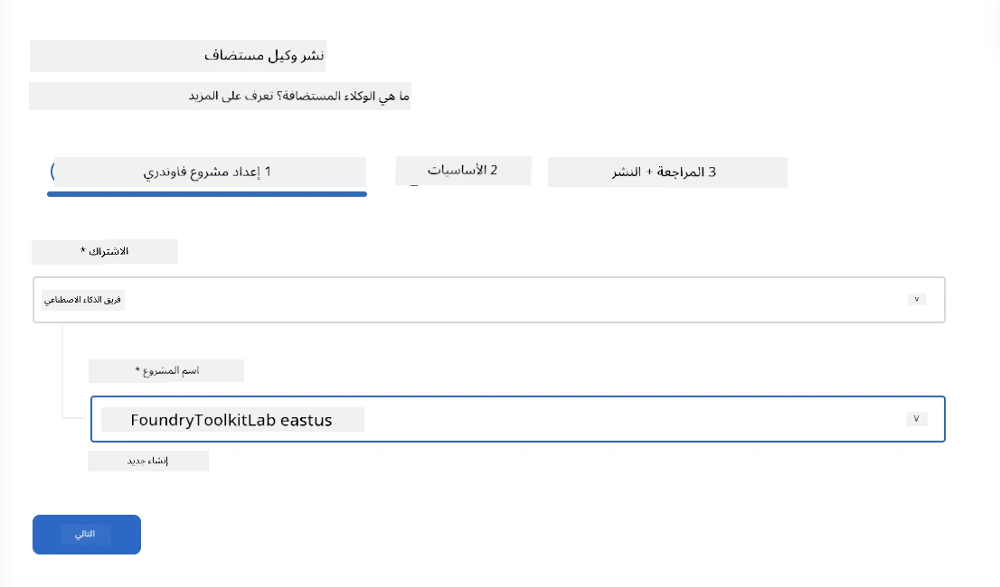
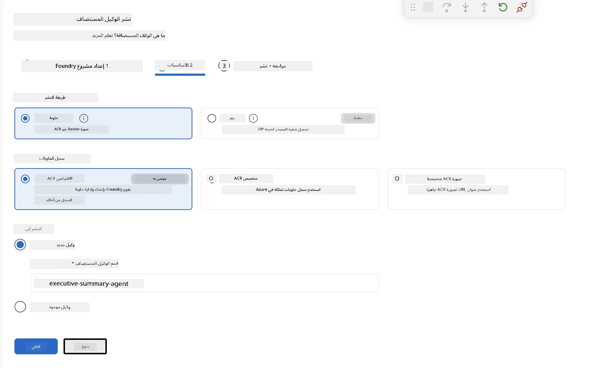
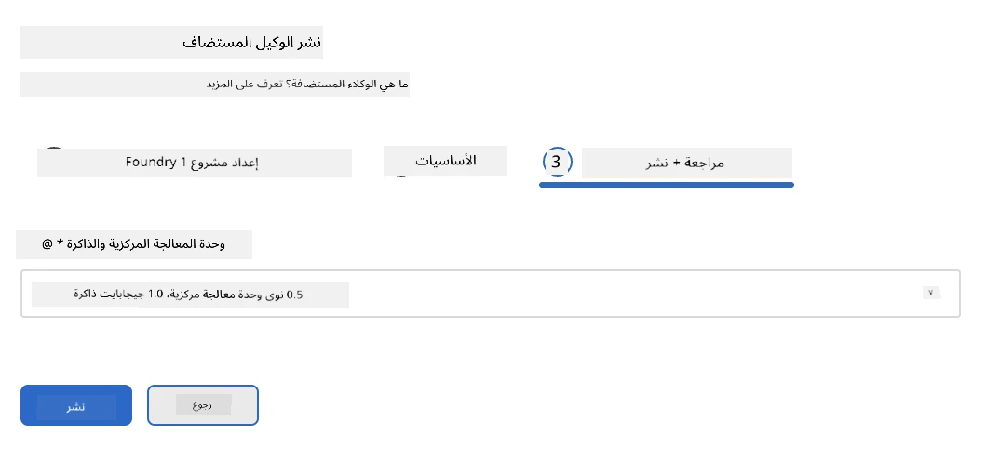
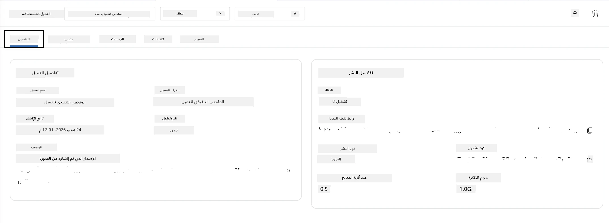

# الوحدة 5 - النشر إلى خدمة Foundry Agent

⏱️ ~10 دقائق

> ⚠️ **لمستخدمي المسار B:** تتطلب هذه الوحدة اشتراكًا في Foundry. إذا كنت تستخدم Foundry Local، تخطَّ إلى [الوحدة 07 - الملخص](07-summary.md). لقد أكملت بنجاح سير عمل التطوير المحلي!

في هذه الوحدة، تقوم بنشر العميل الذي تم اختباره محليًا إلى Microsoft Foundry كـ **عميل مستضاف**. يقوم النشر ببناء صورة حاوية، ودفعها إلى Azure Container Registry، وتشغيل العميل في البنية التحتية المدارة من Foundry.

### خط أنابيب النشر

---

## التحقق من المتطلبات المسبقة

قبل النشر، تحقق من:

- [ ] مرور العميل بجميع السيناريوهات الثلاثة المحلية من [الوحدة 04](04-test-locally.md)
- [ ] لديك دور **Azure AI User** على مستوى المشروع ([الوحدة 01، تعيين RBAC](01-setup.md#deploy-a-model--assign-rbac))
- [ ] أنت مسجل الدخول إلى Azure في VS Code (يعرض رمز الحساب اسمك)

---

## الخطوة 1: بدء النشر

### الخيار أ: النشر من Agent Inspector (موصى به)

إذا كان Agent Inspector مفتوحًا (من الاختبار):
1. انقر زر **النشر** في الزاوية العليا اليمنى (رمز السحابة ↑).

### الخيار ب: النشر من لوحة الأوامر

1. اضغط `Ctrl+Shift+P` → **Foundry Toolkit: Deploy Hosted Agent**.

---

## الخطوة 2: تكوين النشر

يطالبك المعالج بـ:

| الطلب | الاختيار |
|--------|-----------|
| **الاشتراك** | اشتراك Azure الخاص بك |
| **المشروع المستهدف** | مشروع Foundry الخاص بك (مثلاً `workshop-agents`) |

انقر **التالي** لتكوين العميل الخاص بك.

| الطلب | الاختيار |
|--------|-----------|
| **طريقة النشر** | الحاوية |
| **سجل الحاويات** | **ACR الافتراضي** (يقوم Microsoft Foundry بإنشائه وإدارته لك) |
| **النشر إلى** | عميل جديد (الاسم، `executive-summary-agent`) |

انقر **التالي** للمراجعة والنشر.

| الطلب | الاختيار |
|--------|-----------|
| **وحدة المعالجة المركزية والذاكرة** | **0.5 نواة CPU، 1.0 جيجابايت ذاكرة** (الإعداد الافتراضي - كافٍ للورشة) |

---

## الخطوة 3: النشر والمراقبة

1. انقر **نشر**.
2. شاهد لوحة **المخرجات** (اختر **Microsoft Foundry** من القائمة المنسدلة).
3. يمر النشر بالمراحل التالية:
   - **بناء Docker** - يبني الحاوية من Dockerfile الخاص بك
   - **دفع Docker** - يدفع الصورة إلى ACR (1–3 دقائق في أول نشر)
   - **تسجيل العميل** - ينشئ العميل المستضاف في Foundry
   - **بدء الحاوية** - يبدأ باستخدام الهوية المُدارة من النظام

4. عند الانتهاء، تظهر إشعار:
   > **تنفيذ-agent-summary-نفذ النشر بنجاح.** `View logs` `Run agent`

5. انقر **تشغيل العميل** لفتح منطقة تجارب العميل.

### قيم حالة النشر

| الحالة | المعنى |
|--------|---------|
| **تشغيل** | الحاوية جاهزة، العميل يستجيب |
| **معلق** | الحاوية تبدأ - انتظر 30–60 ثانية |
| **فشل** | تحقق من السجلات (انظر استكشاف الأخطاء أدناه) |

---

## الأخطاء الشائعة في النشر

| الخطأ | السبب الجذري | الحل |
|-------|-----------|-----|
| `agents/write` تم رفض الإذن | فقدان دور **Azure AI User** على مستوى المشروع | [الوحدة 01، تعيين RBAC](01-setup.md#deploy-a-model--assign-rbac) |
| Docker غير شغّال | لم يتم بدء Docker Desktop | ابدأ Docker Desktop → تحقق `docker info` |
| ترخيص ACR | الهوية المُدارة لا تستطيع سحب الصورة | راجع [الوحدة 08 - استكشاف الأخطاء](08-troubleshooting.md) |

---

### ✅ نقطة تحقق

- [ ] تم الانتهاء من النشر بدون أخطاء
- [ ] يظهر العميل في تبويب **العميل المستضاف** عند النقر على **العملاء** تحت مشروعك في شريط أدوات Foundry
- [ ] حالة الحاوية تظهر **تشغيل**
- [ ] تم فتح تبويب منطقة تجارب العميل تُظهر تفاصيل العميل وعنوان URL للنقطة النهائية

---

**السابق:** [04 - الاختبار محليًا](04-test-locally.md) · **التالي:** [06 - التحقق في منطقة التجارب →](06-verify-in-playground.md)

---

<!-- CO-OP TRANSLATOR DISCLAIMER START -->
**تنويه**:
تمت ترجمة هذا المستند باستخدام خدمة الترجمة بالذكاء الاصطناعي [Co-op Translator](https://github.com/Azure/co-op-translator). بينما نسعى للدقة، يرجى العلم أن الترجمات الآلية قد تحتوي على أخطاء أو عدم دقة. يجب اعتبار المستند الأصلي بلغته الأصلية المصدر الرسمي والمعتمد. للمعلومات الهامة، يُنصح بالاستعانة بترجمة بشرية محترفة. نحن غير مسؤولين عن أي سوء فهم أو تفسير ناتج عن استخدام هذه الترجمة.
<!-- CO-OP TRANSLATOR DISCLAIMER END -->