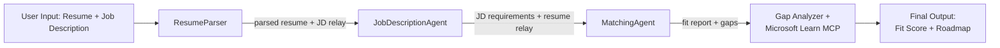

# PersonalCareerCopilot - تقييم ملاءمة السيرة الذاتية للوظيفة

تطبيق متعدد الوكلاء يركز على سير العمل يقوم بتقييم مدى تطابق السيرة الذاتية مع وصف الوظيفة، ثم يولد خارطة طريق تعلم شخصية لسد الفجوات.

---

## الوكلاء

| الوكيل | الدور | الأدوات |
|-------|------|-------|
| **ResumeParser** | يستخرج المهارات المنظمة، الخبرة، الشهادات من نص السيرة الذاتية | - |
| **JobDescriptionAgent** | يستخرج المهارات والخبرات والشهادات المطلوبة/المفضلة من وصف الوظيفة | - |
| **MatchingAgent** | يقارن الملف الشخصي مقابل المتطلبات → درجة الملاءمة (0-100) + المهارات المطابقة/الناقصة | - |
| **GapAnalyzer** | يبني خارطة طريق تعلم شخصية باستخدام موارد Microsoft Learn | `search_microsoft_learn_for_plan` (MCP) |

## سير العمل



---

## بداية سريعة

### 1. إعداد البيئة

هذا المجلد هو التنفيذ المرجعي لهكيل سير العمل لمختبر 02. يستخدم `main.py` كتل المطالبات الموجودة بالإضافة إلى `WorkflowBuilder` لربط الوكلاء الأربعة معًا.

```powershell
cd workshop\lab02-multi-agent\PersonalCareerCopilot
python -m venv .venv
.\.venv\Scripts\Activate.ps1          # Windows PowerShell
# source .venv/bin/activate            # macOS / Linux
pip install -r requirements.txt
```

### 2. تكوين بيانات الاعتماد

أنشئ ملف `.env` في هذا المجلد:

```powershell
copy .env .env.bak 2>$null; echo $null > .env
```

حرر `.env`:

```env
FOUNDRY_PROJECT_ENDPOINT=https://<your-account>.services.ai.azure.com/api/projects/<your-project>
AZURE_AI_MODEL_DEPLOYMENT_NAME=gpt-4.1-mini
```

| القيمة | مكان العثور عليها |
|-------|------------------|
| `FOUNDRY_PROJECT_ENDPOINT` | شريط أدوات Foundry → انقر بزر الماوس الأيمن على مشروعك → **نسخ نقطة النهاية للمشروع** |
| `AZURE_AI_MODEL_DEPLOYMENT_NAME` | شريط Foundry → توسيع المشروع → **النماذج + نقاط النهاية** → اسم النشر |

### 3. التشغيل محليًا

```powershell
python -m debugpy --listen 127.0.0.1:5679 main.py --port 8088
```

أو استخدم مهمة VS Code: `Ctrl+Shift+P` → **المهام: تشغيل مهمة** → **تشغيل خادم وكيل HTTP**.

للتصحيح باستخدام F5، استخدم **تصحيح خادم وكيل HTTP المحلي**.

### 4. الاختبار باستخدام Agent Inspector

افتح Agent Inspector: `Ctrl+Shift+P` → **Foundry Toolkit: فتح Agent Inspector**.

الصق هذه المطالبة الاختبارية:

```
Resume:
Jane Doe
Senior Software Engineer with 5 years of experience in Python, Django, and AWS.
Built microservices handling 10K+ requests/second. Led a team of 4 developers.
Certifications: AWS Solutions Architect Associate.
Education: B.S. Computer Science, State University.

Job Description:
Senior Cloud Engineer at Contoso Ltd.
Required: Python, Azure, Kubernetes, Terraform, CI/CD pipelines.
Preferred: Go, monitoring (Prometheus/Grafana), cost optimization.
Experience: 5+ years in cloud infrastructure.
Certifications: Azure Solutions Architect Expert preferred.
```

**المتوقع:** درجة ملاءمة (0-100)، المهارات المطابقة/الناقصة، وخارطة طريق تعلم شخصية مع روابط Microsoft Learn.

### 5. النشر إلى Foundry

`Ctrl+Shift+P` → **Foundry Toolkit: نشر وكيل مستضاف** → اختر مشروعك → تأكيد.

---

## هيكل المشروع

```
PersonalCareerCopilot/
├── .env                ← Your credentials (git-ignored)
├── agent.yaml          ← Hosted agent definition (name, resources, env vars)
├── Dockerfile          ← Container image for Foundry deployment
├── main.py             ← 4-agent workflow (instructions, MCP tool, WorkflowBuilder)
└── requirements.txt    ← Python dependencies
```

## الملفات الأساسية

### `agent.yaml`

يحدد الوكيل المستضاف لخدمة وكلاء Foundry:
- `kind: hosted` - يعمل كحاوية مُدارة
- `protocols` - بروتوكول `responses` مع `version: 2.0.0`، يعرض نقطة نهاية HTTP `/responses`
- `environment_variables` - `AZURE_AI_MODEL_DEPLOYMENT_NAME` معلن هنا؛ `FOUNDRY_PROJECT_ENDPOINT` يُحقن تلقائيًا وقت النشر

### `main.py`

يحتوي على:
- **تعليمات الوكيل** - أربعة ثوابت `*_INSTRUCTIONS`، واحد لكل وكيل
- **أداة MCP** - `search_microsoft_learn_for_plan()` تستدعي `https://learn.microsoft.com/api/mcp` عبر HTTP Streamable
- **إنشاء الوكيل** - أربعة مثيلات `Agent()` + `AgentExecutor()` تشترك في `FoundryChatClient` واحد
- **رسم سير العمل** - `WorkflowBuilder` يربط الوكلاء كأنبوب تسلسلي: ResumeParser → وكيل JD → MatchingAgent → GapAnalyzer
- **بدء الخادم** - `ResponsesHostServer` يعمل على المنفذ 8088

### `requirements.txt`

| الحزمة | الغرض |
|---------|----------|
| `agent-framework-foundry` | بيئة التشغيل الأساسية: `Agent`, `AgentExecutor`, `WorkflowBuilder`, `@tool`, `FoundryChatClient` |
| `agent-framework-foundry-hosting` | دمج استضافة Foundry + `ResponsesHostServer` |
| `mcp<2,>=1.24.0` | عميل MCP لـ GapAnalyzer (`streamable_http_client`) |
| `debugpy` | تصحيح بايثون (F5 في VS Code) |

---

## استكشاف الأخطاء وإصلاحها

| المشكلة | الحل |
|-------|-----|
| `KeyError: 'FOUNDRY_PROJECT_ENDPOINT'` أو `KeyError: 'AZURE_AI_MODEL_DEPLOYMENT_NAME'` | أنشئ `.env` مع إعداد كل من `FOUNDRY_PROJECT_ENDPOINT` و `AZURE_AI_MODEL_DEPLOYMENT_NAME` |
| `ModuleNotFoundError: No module named 'agent_framework'` | فعّل venv وشغّل `pip install -r requirements.txt` |
| لا توجد روابط Microsoft Learn في المخرجات | تحقق من اتصال الإنترنت إلى `https://learn.microsoft.com/api/mcp` |
| بطاقة فجوة واحدة فقط (مقتطعة) | تأكد أن `GAP_ANALYZER_INSTRUCTIONS` تتضمن كتلة `CRITICAL:` |
| المنفذ 8088 مستخدم | أوقف الخوادم الأخرى: `netstat -ano \| findstr :8088` |

لاستكشاف الأخطاء بشكل تفصيلي، راجع [الوحدة 8 - استكشاف الأخطاء وإصلاحها](../docs/08-troubleshooting.md).

---

**المشي الكامل:** [مستندات مختبر 02](../docs/README.md) · **العودة إلى:** [ملخص مختبر 02](../README.md) · [الصفحة الرئيسية للورشة](../../../README.md)

---

<!-- CO-OP TRANSLATOR DISCLAIMER START -->
**تنويه**:
تمت ترجمة هذا المستند باستخدام خدمة الترجمة بالذكاء الاصطناعي [Co-op Translator](https://github.com/Azure/co-op-translator). بينما نسعى للدقة، يرجى العلم أن الترجمات الآلية قد تحتوي على أخطاء أو عدم دقة. يجب اعتبار المستند الأصلي بلغته الأصلية المصدر الرسمي والمعتمد. للمعلومات الهامة، يُنصح بالاستعانة بترجمة بشرية محترفة. نحن غير مسؤولين عن أي سوء فهم أو تفسير ناتج عن استخدام هذه الترجمة.
<!-- CO-OP TRANSLATOR DISCLAIMER END -->