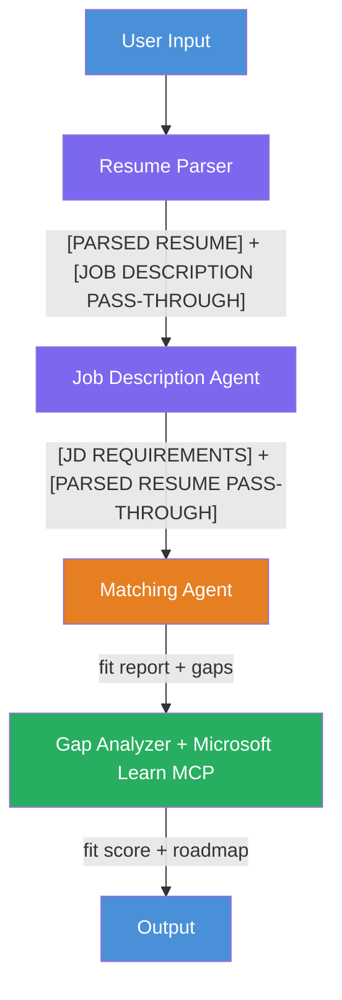

# المختبر 02 - سير عمل متعدد الوكلاء: المُقيّم المناسب للوظيفة بناءً على السيرة الذاتية

## نظرة عامة

في هذا المختبر العملي، ستقوم ببناء **تطبيق متعدد الوكلاء مُرتكز على سير العمل** باستخدام Foundry Toolkit في VS Code ونشره على خدمة وكيل Microsoft Foundry.

**ما ستقوم ببنائه:** مُقيّم مناسب الوظيفة بناءً على السيرة الذاتية يقوم بتحليل السيرة الذاتية ووصف الوظيفة، ويُقيّم توافقهما، وينتج خارطة تعلم مخصصة باستخدام موارد Microsoft Learn.

---

## الهيكلية

**كيف يعمل:**
1. يلصق المستخدم السيرة الذاتية ووصف الوظيفة.
2. يقوم **ResumeParser** بتحليل السيرة الذاتية ونسخ وصف الوظيفة كما هو في قسم `[JOB DESCRIPTION PASS-THROUGH]`.
3. يستخلص **JD Agent** المتطلبات المنظمة من المحتوى المار، ثم ينقل `[PARSED RESUME]` للأمام كـ `[PARSED RESUME PASS-THROUGH]`.
4. يقارن **MatchingAgent** بين `[PARSED RESUME PASS-THROUGH]` و `[JD REQUIREMENTS]` وينتج درجة التوافق.
5. يحول **GapAnalyzer** الفجوات إلى خارطة طريق عملية ويجلب روابط حقيقية من Microsoft Learn عبر MCP.

---

## المتطلبات المسبقة

أتمم المختبر 01 أولاً:

- [المختبر 01 - وكيل واحد](../lab01-single-agent/README.md)

---

## الجزء 1: قراءة الوحدات بالترتيب

اطلع على مسار التعلم الكامل في:

- [مستندات المختبر 2 - المتطلبات المسبقة](docs/00-prerequisites.md)
- [مستندات المختبر 2 - مسار التعلم الكامل](docs/README.md)
- [دليل تشغيل PersonalCareerCopilot](PersonalCareerCopilot/README.md)

---

## الجزء 2: بناء واختبار سير العمل

1. استخدم معالج Foundry Toolkit لإنشاء مشروع مرتكز على سير العمل.
2. انسخ كتل المطالبات ورسم سير العمل من `PersonalCareerCopilot/main.py` إلى مساحة العمل الخاصة بك.
3. شغّل التطبيق محليًا باستخدام Agent Inspector وتحقق من عمل الوكلاء الأربعة وأداة MCP.
4. انشر الوكيل المستضاف على Foundry عند نجاح الاختبار المحلي.

---

## أنماط التنسيق

يستخدم المختبر 02 **أنبوب تسلسلي**: مخرجات كل وكيل تغذي التالي، ويُرجع سير العمل رد الوكيل الأخير. نمطان يجعلان ذلك يعملان:

- **السلسلة التتابعية** - `WorkflowBuilder` يربط ResumeParser → JD Agent → MatchingAgent → GapAnalyzer باستدعاء `add_edge()` لكل خطوة
- **تمرير المحتوى** - لأن كل وكيل يرى فقط مخرجات الوكيل السابق مباشرة، يقوم ResumeParser وJD Agent بنسخ البيانات التي يحتاجها الوكلاء التاليون في أقسام مرور معنونة

توضح المستندات أيضًا لماذا لا يستخدم المختبر نمط fan-out/fan-in، وكيفية توسيع الرسم بوكيل آخر.

انظر [docs/04-orchestration-patterns.md](docs/04-orchestration-patterns.md).

---

**السابق:** [المختبر 01 - وكيل واحد](../lab01-single-agent/README.md) · **العودة إلى:** [الصفحة الرئيسية للورشة](../../README.md)

---

<!-- CO-OP TRANSLATOR DISCLAIMER START -->
**تنويه**:
تمت ترجمة هذا المستند باستخدام خدمة الترجمة بالذكاء الاصطناعي [Co-op Translator](https://github.com/Azure/co-op-translator). بينما نسعى للدقة، يرجى العلم أن الترجمات الآلية قد تحتوي على أخطاء أو عدم دقة. يجب اعتبار المستند الأصلي بلغته الأصلية المصدر الرسمي والمعتمد. للمعلومات الهامة، يُنصح بالاستعانة بترجمة بشرية محترفة. نحن غير مسؤولين عن أي سوء فهم أو تفسير ناتج عن استخدام هذه الترجمة.
<!-- CO-OP TRANSLATOR DISCLAIMER END -->