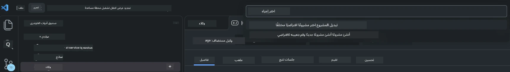

# الوحدة 0 - مقدمة

⏱️ ~10 دقائق

> [!WARNING]
> **معاينة والقيود:** [الوكلاء المستضافين](https://learn.microsoft.com/azure/foundry/agents/concepts/hosted-agents) هم حاليًا في **المعاينة العامة** - غير موصى باستخدامهم في أعباء العمل الإنتاجية. بعض الميزات المعروضة في هذا المختبر قد تتغير مع انتقال الخدمة إلى الإصدار العام.

## ما الذي ستبنيه

في هذا المختبر، تقوم بتوسيع مهارات الوكيل الواحد من المختبر 01 لبناء **تدفق عمل متعدد الوكلاء** - المقوم الملائم للسيرة الذاتية → الوظيفة.

تقوم بلصق **السيرة الذاتية** و **الوصف الوظيفي**. يقوم أربعة وكلاء متخصصين بمعالجة المدخلات بالتتابع، ثم يعيدون:
- درجة الملاءمة (0–100 مع تحليل تفصيلي للنقاط)
- قائمة بالفجوات في المهارات والشهادات
- خارطة تعلم شخصية مع روابط حقيقية من Microsoft Learn لكل فجوة

**يستخدم تدفق العمل:**
- **إطار عمل الوكلاء من مايكروسوفت** - `WorkflowBuilder` لتنظيم خط الأنابيب بالتتابع
- **أداة Foundry لـ VS Code** - الهيكلية، اختبار محلي، نشر
- **نموذج ذكاء اصطناعي** (مثلاً `gpt-4.1-mini`) - يستخدمه جميع الوكلاء الأربعة
- **خادم Microsoft Learn MCP** - يوفر روابط موارد تعليمية حقيقية لكل فجوة في المهارات

---

## اختر مسارك

> ⚠️ **تابع نفس المسار الذي استخدمته في المختبر 01.**

<details open>
<summary><strong>🅰️ المسار أ - سحابة أزور (يتطلب اشتراك أزور)</strong></summary>

| | التفاصيل |
|---|---|
| **لمن هذا؟** | أكملت المختبر 01 باستخدام اشتراك أزور |
| **النموذج** | أزور OpenAI عبر Foundry (مثل `gpt-4.1-mini`) |
| **الوحدات المشمولة** | جميع الوحدات (00–09) |
| **هل تنشر للسحابة؟** | ✅ نعم - نشر كامل من البداية للنهاية |

</details>

<details open>
<summary><strong>🅱️ المسار ب - Foundry محلي (لا يتطلب اشتراك أزور)</strong></summary>

| | التفاصيل |
|---|---|
| **لمن هذا؟** | أكملت المختبر 01 باستخدام Foundry محلي |
| **النموذج** | Foundry محلي (مجاني، يعمل على جهازك) |
| **الوحدات المشمولة** | الوحدات 00–05 (تخطي 06–07 - النشر والتحقق من السحابة) |
| **هل تنشر للسحابة؟** | ❌ لا - اختبار محلي فقط عبر Agent Inspector |

</details>

---

## تحقق من المختبر 01

يبني مختبر 02 مباشرة على المختبر 01. أكمل المختبر 01 أولاً قبل البدء هنا.

هل لم تقم بالمختبر 01 بعد؟ ابدأ هنا: [المختبر 01 - مقدمة](../../lab01-single-agent/docs/00-prerequisites.md)

<details open>
<summary><strong>🅰️ المسار أ - سحابة أزور</strong></summary>

```powershell
az account show --query "{name:name, id:id}" --output table
```

إذا فشل هذا، شغل `az login`. ثم تحقق في VS Code:

1. `Ctrl+Shift+P` → اكتب **Foundry Toolkit** → تأكد من ظهور الأوامر.
2. اضغط على أيقونة **Foundry Toolkit** → مشروعك والنموذج المنشور يظهران **تم بنجاح**.



> **RBAC:** قد عينت دور **Foundry User** في المختبر 01. إذا كنت بحاجة لإعادة تعيينه، راجع [المختبر 01، الوحدة 1](../../lab01-single-agent/docs/01-setup.md#deploy-a-model--assign-rbac). الدور كان يسمى سابقًا **Azure AI User** - نفس الأذونات.

</details>

<details open>
<summary><strong>🅱️ المسار ب - Foundry محلي</strong></summary>

```powershell
Invoke-WebRequest -Uri "http://localhost:5273/v1/health" -UseBasicParsing | Select-Object StatusCode
```

المتوقع: `StatusCode: 200`. إذا لم يكن كذلك، أعد تشغيل Foundry محلي من شريط أدوات Foundry.

> كل الاستنتاج يتم على جهازك. الاتصال الخارجي الوحيد هو أداة MCP إلى `https://learn.microsoft.com/api/mcp`.

</details>

---

## الجديد في المختبر 02

| | المختبر 01 | المختبر 02 |
|--|--------|--------|
| الوكلاء | 1 | 4 (مرتبطون باستخدام WorkflowBuilder) |
| قالب الهيكلية | أساسي - إطار عمل الوكلاء | تدفقات العمل - إطار عمل الوكلاء |
| الحزمة الجديدة | - | `mcp` |
| التنظيم | وكيل حوار واحد | خط أنابيب تتابعي (WorkflowBuilder) |
| الأداة الجديدة | - | `search_microsoft_learn_for_plan` (MCP) |

---

**التالي:** [01 - فهم البنية →](01-understand-multi-agent.md)

---

<!-- CO-OP TRANSLATOR DISCLAIMER START -->
**تنويه**:
تمت ترجمة هذا المستند باستخدام خدمة الترجمة بالذكاء الاصطناعي [Co-op Translator](https://github.com/Azure/co-op-translator). بينما نسعى للدقة، يرجى العلم أن الترجمات الآلية قد تحتوي على أخطاء أو عدم دقة. يجب اعتبار المستند الأصلي بلغته الأصلية المصدر الرسمي والمعتمد. للمعلومات الهامة، يُنصح بالاستعانة بترجمة بشرية محترفة. نحن غير مسؤولين عن أي سوء فهم أو تفسير ناتج عن استخدام هذه الترجمة.
<!-- CO-OP TRANSLATOR DISCLAIMER END -->