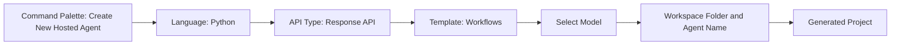
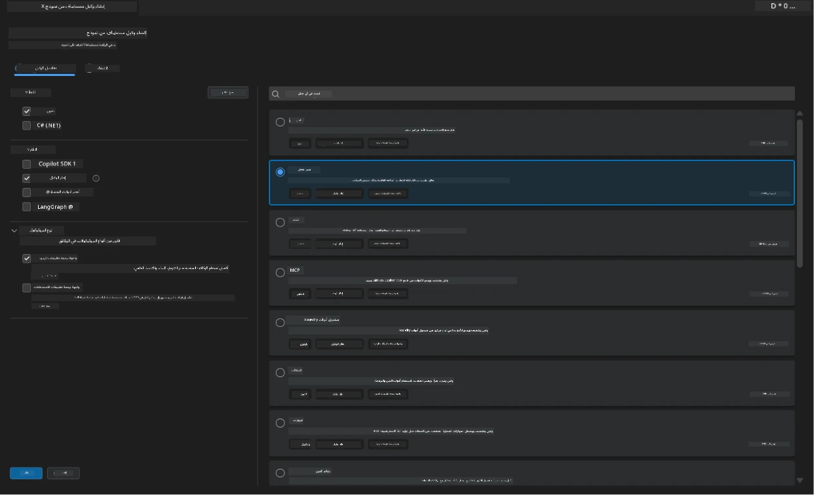
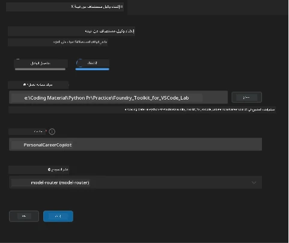

# الوحدة 2 - إعداد مشروع الوكلاء المتعددين

⏱️ ~5 دقائق

في هذه الوحدة، تستخدم [Foundry Toolkit for VS Code](https://aka.ms/foundrytk) لـ **إنشاء مشروع وكلاء متعددين**. يقوم المعالج بتوليد `agent.yaml` و `main.py` و `Dockerfile` و `requirements.txt` و `.env`، بالإضافة إلى تكوين تصحيح الأخطاء لـ VS Code - حتى تتمكن من التركيز على ربط سير العمل المكون من 4 وكلاء في الوحدة 3.

> **المفهوم الأساسي:** الهيكل الأولي هو نموذج عملي يحتوي على وكيل واحد. تستبدل المنطق النمطي بالرسم البياني `WorkflowBuilder` في الوحدة 3. لا تحتاج إلى كتابة الكود الأساسي من الصفر.

> **التنفيذ المرجعي:** [`PersonalCareerCopilot/`](../../../../../workshop/lab02-multi-agent/PersonalCareerCopilot) هو مثال عملي كامل. استخدمه للمقارنة مع عملك أثناء التقدم.

### سير عمل معالج الهيكل الأولي



---

## الخطوة 1: افتح معالج إنشاء وكيل مستضاف

1. اضغط على `Ctrl+Shift+P` لفتح **لوحة الأوامر**.
2. اكتب: **Foundry Toolkit: Create new Hosted Agent** واختره.
3. يفتح المعالج على علامة تبويب **تفاصيل الوكيل**.

> **بديل:** انقر على أيقونة **Foundry Toolkit** في شريط النشاط → انقر على أيقونة **+** بجانب **الوكلاء المستضافين** → **إنشاء وكيل مستضاف جديد**.

---

## الخطوة 2: اختر الإعدادات



1. في قسم التنقل/الخيارات على اليسار اختر ما يلي:

| القائمة | الاختيار | الملاحظات |
|--------|-----------|-------|
| **اللغة** | بايثون | يدعم أيضاً C# (.NET) |
| **الإطار** | إطار العمل الخاص بالوكيل | يوفر `Agent`، `AgentExecutor`، `WorkflowBuilder` |
| **نوع API** | API الاستجابة | `POST /responses` - سجل تدار بواسطة المنصة، دعم للبث |
| **القالب** | **سير العمل** | يعالج الطلبات عبر عدة وكلاء بالتتابع |

2. بعد الاختيار، انقر على **التالي**



3. في النافذة التالية، اختر ما يلي:

| القائمة | الاختيار | الملاحظات |
|--------|-----------|-------|
| **مجلد مساحة العمل** | تصفح إلى المجلد الهدف | على سبيل المثال `workshop/lab02-multi-agent/` في هذا المستودع |
| **اسم الوكيل** | `PersonalCareerCopilot` | هذا يصبح اسم مجلد المشروع |
| **نشر النموذج** | اختر النموذج المنشور الخاص بك | على سبيل المثال `gpt-4.1-mini` من المختبر 01 |

4. انقر على **إنشاء** لإعداد المشروع. يقوم VS Code بإنشاء الملفات وفتح المجلد.

> **نصيحة:** [`gpt-4.1-mini`](https://learn.microsoft.com/azure/foundry/foundry-models/concepts/models-sold-directly-by-azure#gpt-41-series) يوزّن بين السرعة والجودة بشكل جيد لتطوير الوكلاء المتعددين.

---

## الخطوة 3: تفقد المشروع المنشأ

بعد إكمال البناء، تحقق من ظهور هذه الملفات في المستكشف (`Ctrl+Shift+E`):

```
📂 <your-agent-name>/
├── .azdignore          ← Files excluded from Azure Developer CLI deployments
├── .dockerignore       ← Files excluded from Docker builds
├── .env                ← Environment variables (placeholders - fill in Module 3)
├── .vscode/
│   ├── launch.json     ← Debug config (F5 → run + Agent Inspector)
│   └── tasks.json      ← VS Code task definitions
├── agent.yaml          ← Agent definition (kind: hosted, protocol: responses)
├── Dockerfile          ← Container config for deployment
├── main.py             ← Stub agent entry point (replace with WorkflowBuilder in Module 3)
└── requirements.txt    ← Python dependencies
```

> **مهم:** افتح هذا المجلد المنشأ مباشرة في VS Code حتى يتم تطبيق `.vscode/launch.json` و `tasks.json` بشكل صحيح لتصحيح الأخطاء باستخدام F5.

### شرح الملفات الرئيسية

| الملف | الغرض |
|------|---------|
| `agent.yaml` | يعلن `kind: hosted`، يربط متغيرات البيئة، يعرّف بروتوكول `/responses` |
| `main.py` | نموذج: وكيل واحد `FoundryChatClient` → `Agent` → `ResponsesHostServer`. تستبدل هذا بـ4 وكلاء + `WorkflowBuilder` في الوحدة 3 |
| `Dockerfile` | `python:3.12-slim`، يثبت `requirements.txt`، يفتح المنفذ 8088، يشغل `python main.py` |
| `requirements.txt` | `agent-framework-foundry`، `agent-framework-foundry-hosting`، `mcp<2,>=1.24.0`، `debugpy` |

> **مرجع:** انظر [`PersonalCareerCopilot/agent.yaml`](../../../../../workshop/lab02-multi-agent/PersonalCareerCopilot/agent.yaml) و [`PersonalCareerCopilot/requirements.txt`](../../../../../workshop/lab02-multi-agent/PersonalCareerCopilot/requirements.txt) لمحتوى كامل المنشأ.

---

### ✅ نقطة تحقق

- [ ] تم إنهاء معالج الهيكل الأولي - مجلد المشروع الجديد ظاهر في المستكشف
- [ ] جميع الملفات المتوقعة موجودة: `agent.yaml`، `main.py`، `Dockerfile`، `requirements.txt`، `.env`
- [ ] `agent.yaml` يعرض `kind: hosted` و `protocol: responses`
- [ ] `main.py` يستورد `Agent`، `FoundryChatClient`، `ResponsesHostServer`
- [ ] تم فتح المجلد المنشأ كمجلد جذر لمساحة عمل VS Code
- [ ] أنت تفهم أن `main.py` هو نموذج - يتم إضافة `WorkflowBuilder` في الوحدة 3

---

**السابق:** [01 - فهم بنية الوكلاء المتعددين](01-understand-multi-agent.md) · **التالي:** [03 - تكوين الوكلاء والبيئة →](03-configure-agents.md)

---

<!-- CO-OP TRANSLATOR DISCLAIMER START -->
**تنويه**:
تمت ترجمة هذا المستند باستخدام خدمة الترجمة بالذكاء الاصطناعي [Co-op Translator](https://github.com/Azure/co-op-translator). بينما نسعى للدقة، يرجى العلم أن الترجمات الآلية قد تحتوي على أخطاء أو عدم دقة. يجب اعتبار المستند الأصلي بلغته الأصلية المصدر الرسمي والمعتمد. للمعلومات الهامة، يُنصح بالاستعانة بترجمة بشرية محترفة. نحن غير مسؤولين عن أي سوء فهم أو تفسير ناتج عن استخدام هذه الترجمة.
<!-- CO-OP TRANSLATOR DISCLAIMER END -->