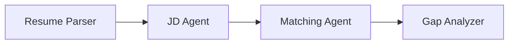
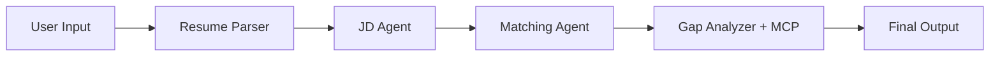

# الوحدة 4 - أنماط التنسيق

⏱️ ~10 دقائق

في هذه الوحدة، تستكشف أنماط التنسيق المستخدمة في Resume Job Fit Evaluator وتتعلم كيفية قراءة وتعديل وتمديد رسم سير العمل. فهم هذه الأنماط ضروري لتصحيح مشاكل تدفق البيانات وبناء [سير عمل متعدد الوكلاء](https://learn.microsoft.com/agent-framework/workflows/) خاص بك.

---

## النمط 1: السلسلة المتتابعة

النمط الأساسي في سير العمل هو **سلسلة متتابعة** - إخراج كل وكيل يغذي مباشرة الوكيل التالي.



في الشيفرة، ينشئ كل استدعاء `add_edge()` خطوة في السلسلة:

```python
.add_edge(resume_executor, jd_executor)       # ResumeParser output → JD Agent
.add_edge(jd_executor, matching_executor)     # JD Agent output → MatchingAgent
.add_edge(matching_executor, gap_executor)    # MatchingAgent output → GapAnalyzer
```

> **لماذا متتابعة وليس توزيع/تجميع؟** يستخدم `WorkflowBuilder` **دلالات OR** للحواف الواردة: ينفذ الوكيل التحتي بمجرد أن يُكمل **أي** وكيل سابق. إذا كان لدى `matching_executor` حافتان واردتان (من كل من `resume_executor` و `jd_executor`)، فسوف ينفذ مرتين - مرة عند انتهاء ResumeParser ومرة عند انتهاء JD Agent - مما يسبب تشغيل GapAnalyzer مرتين وظهور الإخراج مرتين. الخط المتتابع يتجنب هذا تمامًا.

## النمط 2: تمرير المحتوى

بما أن `context_mode="last_agent"` يعني أن كل منفذ يرى فقط إخراج **الوكيل السابق المباشر**، يجب على الوكلاء في السلسلة المتتابعة تمرير أي بيانات يحتاجها الوكلاء في الأسفل صراحةً.

في هذا سير العمل:
- **ResumeParser** ينسخ JD كما هو إلى `[JOB DESCRIPTION PASS-THROUGH]` (حتى يتمكن JD Agent من العثور عليه).
- **JD Agent** ينسخ `[PARSED RESUME]` كما هو إلى `[PARSED RESUME PASS-THROUGH]` (حتى يستطيع MatchingAgent مقارنة كلا الملفين الشخصيين).

```
ResumeParser output
└─ [PARSED RESUME]               ← extracted by JD Agent
└─ [JOB DESCRIPTION PASS-THROUGH] ← extracted by JD Agent

JD Agent output
└─ [JD REQUIREMENTS]             ← extracted by MatchingAgent
└─ [PARSED RESUME PASS-THROUGH]  ← extracted by MatchingAgent
```

يجب نسخ كل قسم تمرير **كما هو** - تلخيصه أو إعادة صياغته يكسر الوكيل الأسفل الذي يعتمد عليه.

---

## الرسم الكامل

الجمع بين نمط السلسلة المتتابعة وتمرير المحتوى ينتج سير العمل الكامل:



يعرض Agent Inspector نفس بنية الرسم البياني عندما يكون الوكيل قيد التشغيل محليًا. ارجع إلى [الوحدة 5 - الاختبار محليًا](05-test-locally.md) لصور الشاشة.

---

## قراءة شفرة WorkflowBuilder

يتم بناء رسم سير العمل في الدالة `main()` في [`PersonalCareerCopilot/main.py`](../../../../../workshop/lab02-multi-agent/PersonalCareerCopilot/main.py). تبني ثلاث مكالمات `add_edge()` خط الأنابيب المتتابع:

| # | الحافة | التأثير |
|---|------|--------|
| 1 | `resume_executor → jd_executor` | يستلم JD Agent `[PARSED RESUME]` + `[JOB DESCRIPTION PASS-THROUGH]` |
| 2 | `jd_executor → matching_executor` | يستلم MatchingAgent `[JD REQUIREMENTS]` + `[PARSED RESUME PASS-THROUGH]` |
| 3 | `matching_executor → gap_executor` | يستلم GapAnalyzer تقرير الملاءمة + قائمة الفجوات |

---

## تعديل الرسم البياني

### إضافة وكيل جديد

لإضافة وكيل خامس (مثلاً، **InterviewPrepAgent** بعد GapAnalyzer):

1. عرف ثابت `INTERVIEW_PREP_INSTRUCTIONS`.
2. أنشئ كائنات `Agent` + `AgentExecutor` (بنفس نمط الأربعة الموجودين).
3. أضف `.add_edge(gap_executor, interview_exec)` في `WorkflowBuilder`.
4. حدث `output_executors=[interview_exec]`.

> **مهم:** `start_executor` هو الوكيل الوحيد الذي يستلم إدخال المستخدم الخام. كل الوكلاء الآخرين يستلمون المخرجات من الحافة العلوية الخاصة بهم.

---

## أخطاء شائعة في الرسم البياني

| الخطأ | العرض | الحل |
|---------|---------|-----|
| فقدان الحافة إلى `output_executors` | يعمل الوكيل لكن الإخراج فارغ | تأكد من أن هناك مسار من `start_executor` إلى كل وكيل في `output_executors` |
| اعتماد دائري | حلقة لا نهائية أو انتهاء المهلة | تحقق من عدم إعادة تغذية أي وكيل إلى وكيل علوي |
| وكيل في `output_executors` بدون حافة واردة | إخراج فارغ | أضف على الأقل `add_edge(source, that_agent)` واحد |
| عدة `output_executors` بدون تجميع | الإخراج يحتوي فقط على رد وكيل واحد | استخدم وكيل إخراج واحد يجمع، أو استقبل عدة مخرجات |
| فقدان `start_executor` | `ValueError` وقت البناء | دائمًا حدد `start_executor` في `WorkflowBuilder()` |

---

## تصحيح الرسم البياني

### استخدام Agent Inspector

1. شغّل الوكيل محليًا بالضغط على F5.
2. افتح Agent Inspector (`Ctrl+Shift+P` → **Foundry Toolkit: Open Agent Inspector**).
3. أرسل رسالة اختبار.
4. في لوحة استجابة المفتش، ابحث عن **الإخراج المتدفق** - يعرض مساهمة كل وكيل بالتتابع.


### استخدام التسجيلات

أضف تسجيلات إلى `main.py` لتتبع تدفق البيانات:

```python
import logging
logger = logging.getLogger("resume-job-fit")

# In main(), after building the workflow:
logger.info("Workflow graph built with edges: RP→JD, JD→MA, MA→GA")
```

تُظهر سجلات الخادم ترتيب تنفيذ الوكيل ومكالمات أدوات MCP:

```
INFO:agent_framework:Executing agent: ResumeParser
INFO:agent_framework:Executing agent: JobDescriptionAgent
INFO:agent_framework:Executing agent: MatchingAgent
INFO:agent_framework:Executing agent: GapAnalyzer
INFO:agent_framework:Tool call: search_microsoft_learn_for_plan(skill="Kubernetes")
POST https://learn.microsoft.com/api/mcp → 200
INFO:agent_framework:Tool call: search_microsoft_learn_for_plan(skill="Terraform")
POST https://learn.microsoft.com/api/mcp → 200
```

---

### نقطة التحقق

- [ ] يمكنك تحديد نمطي التنسيق في سير العمل: السلسلة المتتابعة وتمرير المحتوى
- [ ] تفهم لماذا يحتاج `context_mode="last_agent"` إلى تمرير بيانات صريح بين الوكلاء
- [ ] يمكنك قراءة شفرة `WorkflowBuilder` ومطابقة كل مكالمة `add_edge()` بالرسم البياني المرئي
- [ ] تعرف كيفية إضافة وكيل جديد إلى نهاية خط الأنابيب
- [ ] يمكنك التعرف على أخطاء الرسم الشائعة وأعراضها

---

**السابق:** [03 - تكوين الوكلاء والبيئة](03-configure-agents.md) · **التالي:** [05 - الاختبار محليًا →](05-test-locally.md)

---

<!-- CO-OP TRANSLATOR DISCLAIMER START -->
**تنويه**:
تمت ترجمة هذا المستند باستخدام خدمة الترجمة بالذكاء الاصطناعي [Co-op Translator](https://github.com/Azure/co-op-translator). بينما نسعى للدقة، يرجى العلم أن الترجمات الآلية قد تحتوي على أخطاء أو عدم دقة. يجب اعتبار المستند الأصلي بلغته الأصلية المصدر الرسمي والمعتمد. للمعلومات الهامة، يُنصح بالاستعانة بترجمة بشرية محترفة. نحن غير مسؤولين عن أي سوء فهم أو تفسير ناتج عن استخدام هذه الترجمة.
<!-- CO-OP TRANSLATOR DISCLAIMER END -->