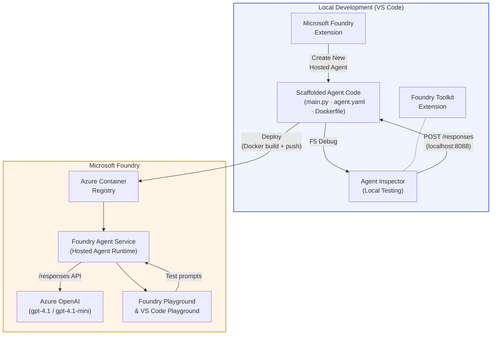

# Foundry Toolkit + Foundry Hosted Agents Workshop

[](https://www.python.org/)
[](https://github.com/microsoft/agents)
[](https://learn.microsoft.com/azure/foundry/agents/concepts/hosted-agents)
[](https://ai.azure.com/)
[](https://learn.microsoft.com/azure/ai-services/openai/)
[](https://learn.microsoft.com/cli/azure/install-azure-cli)
[](https://learn.microsoft.com/azure/developer/azure-developer-cli/install-azd)
[](https://www.docker.com/)
[](https://marketplace.visualstudio.com/items?itemName=ms-windows-ai-studio.windows-ai-studio)
[](LICENSE)

Създавайте, тествайте и разгръщайте AI агенти в **Microsoft Foundry Agent Service** като **Hosted Agents** - изцяло от VS Code с помощта на **Microsoft Foundry разширението** и **Foundry Toolkit**.

> **Hosted Agents в момента са в предварителен преглед.** Поддържаните региони са ограничени - вижте [наличност за региона](https://learn.microsoft.com/azure/foundry/agents/concepts/hosted-agents#region-availability).

> Папката `agent/` във всяка лаборатория е **автоматично създадена** от Foundry разширението - след това персонализирате кода, тествате локално и разгръщате.

### 🌐 Многоезична поддръжка

#### Поддържа се чрез GitHub Action (Автоматизирано и винаги актуално)

<!-- CO-OP TRANSLATOR LANGUAGES TABLE START -->
[Arabic](../ar/README.md) | [Bengali](../bn/README.md) | [Bulgarian](./README.md) | [Burmese (Myanmar)](../my/README.md) | [Chinese (Simplified)](../zh-CN/README.md) | [Chinese (Traditional, Hong Kong)](../zh-HK/README.md) | [Chinese (Traditional, Macau)](../zh-MO/README.md) | [Chinese (Traditional, Taiwan)](../zh-TW/README.md) | [Croatian](../hr/README.md) | [Czech](../cs/README.md) | [Danish](../da/README.md) | [Dutch](../nl/README.md) | [Estonian](../et/README.md) | [Finnish](../fi/README.md) | [French](../fr/README.md) | [German](../de/README.md) | [Greek](../el/README.md) | [Hebrew](../he/README.md) | [Hindi](../hi/README.md) | [Hungarian](../hu/README.md) | [Indonesian](../id/README.md) | [Italian](../it/README.md) | [Japanese](../ja/README.md) | [Kannada](../kn/README.md) | [Khmer](../km/README.md) | [Korean](../ko/README.md) | [Lithuanian](../lt/README.md) | [Malay](../ms/README.md) | [Malayalam](../ml/README.md) | [Marathi](../mr/README.md) | [Nepali](../ne/README.md) | [Nigerian Pidgin](../pcm/README.md) | [Norwegian](../no/README.md) | [Persian (Farsi)](../fa/README.md) | [Polish](../pl/README.md) | [Portuguese (Brazil)](../pt-BR/README.md) | [Portuguese (Portugal)](../pt-PT/README.md) | [Punjabi (Gurmukhi)](../pa/README.md) | [Romanian](../ro/README.md) | [Russian](../ru/README.md) | [Serbian (Cyrillic)](../sr/README.md) | [Slovak](../sk/README.md) | [Slovenian](../sl/README.md) | [Spanish](../es/README.md) | [Swahili](../sw/README.md) | [Swedish](../sv/README.md) | [Tagalog (Filipino)](../tl/README.md) | [Tamil](../ta/README.md) | [Telugu](../te/README.md) | [Thai](../th/README.md) | [Turkish](../tr/README.md) | [Ukrainian](../uk/README.md) | [Urdu](../ur/README.md) | [Vietnamese](../vi/README.md)

> **Предпочитате да клонирате локално?**
>
> Това хранилище включва преводи на над 50 езика, което значително увеличава размера за изтегляне. За клониране без преводи използвайте sparse checkout:
>
> **Bash / macOS / Linux:**
> ```bash
> git clone --filter=blob:none --sparse https://github.com/microsoft-foundry/Foundry_Toolkit_for_VSCode_Lab.git
> cd Foundry_Toolkit_for_VSCode_Lab
> git sparse-checkout set --no-cone '/*' '!translations' '!translated_images'
> ```
>
> **CMD (Windows):**
> ```cmd
> git clone --filter=blob:none --sparse https://github.com/microsoft-foundry/Foundry_Toolkit_for_VSCode_Lab.git
> cd Foundry_Toolkit_for_VSCode_Lab
> git sparse-checkout set --no-cone "/*" "!translations" "!translated_images"
> ```
>
> Това ви дава всичко необходимо за завършване на курса с много по-бързо изтегляне.
<!-- CO-OP TRANSLATOR LANGUAGES TABLE END -->

---

## Архитектура



**Поток:** Foundry разширението създава скелета на агента → вие персонализирате кода и инструкциите → тествате локално с Agent Inspector → разгръщате в Foundry (Docker изображението се изпраща в ACR) → проверявате в Playground.

---

## Какво ще създадете

| Лаборатория | Описание | Статус |
|-----|-------------|--------|
| **Лаб 01 - Един агент** | Създайте агента **"Обясни като на изпълнителен директор"**, тествайте локално и разположете във Foundry | ✅ Наличен |
| **Лаб 02 - Многоагентен работен процес** | Създайте **"Оценител на съвпадение за работа от CV"** - 4 агента работят заедно, за да оценят съответствието на CV и създадат учебен път | ✅ Наличен |

---

## Запознайте се с агента Изпълнителен директор

В този workshop ще създадете агента **"Обясни като на изпълнителен директор"** - AI агент, който превежда сложен технически жаргон в спокойни, готови за управителния съвет обобщения. Защото честно казано, никой в C-suite не иска да слуша за "изчерпване на thread pool, причинено от синхронни повиквания, въведени във v3.2."

Създадох този агент след твърде много случаи, в които моето прекрасно написано пост-мортем получаваше отговор: *"Та... сайтът изключен ли е или не?"*

### Как работи

Подавате му техническо обновление. Той връща служебно обобщение - три основни точки, без жаргон, без стек трасове, без екзистенциална паника. Просто **какво се е случило**, **бизнес въздействие** и **следваща стъпка**.

### Вижте го в действие

**Вие казвате:**
> "Забавянето на API се увеличи поради изчерпване на thread pool, причинено от синхронни повиквания, въведени във v3.2."

**Агентът отговаря:**

> **Служебно обобщение:**
> - **Какво се е случило:** След последното издание системата забави скоростта.
> - **Бизнес въздействие:** Някои потребители изпитаха забавяне при използване на услугата.
> - **Следваща стъпка:** Промяната е върната назад и се подготвя поправка преди повторно разгръщане.

### Защо този агент?

Това е много прост, едноцелеви агент - перфектен за учене на хостван workflow от начало до край без да се забивате в сложни тулчейнове. И честно? Във всеки инженеринг екип може да се използва такъв агент.

---

## Структура на workshop-а

```
📂 Foundry_Toolkit_for_VSCode_Lab/
├── 📄 README.md                      ← You are here
└── 📂 workshop/
    ├── 📂 lab01-single-agent/        ← Full lab: docs + agent code
    │   ├── README.md                 ← Hands-on lab instructions
    │   ├── 📂 docs/                  ← Step-by-step tutorial modules
    │   │   ├── 00-prerequisites.md
    │   │   ├── 01-setup.md
    │   │   ├── 02-create-hosted-agent.md
    │   │   ├── 03-configure-and-code.md
    │   │   ├── 04-test-locally.md
    │   │   ├── 05-deploy-to-foundry.md
    │   │   ├── 06-verify-in-playground.md
    │   │   ├── 07-summary.md
    │   │   └── 08-troubleshooting.md
    │   └── 📂 agent/                 ← Reference solution (auto-scaffolded by Foundry extension)
    │       ├── agent.yaml
    │       ├── Dockerfile
    │       ├── main.py
    │       └── requirements.txt
    └── 📂 lab02-multi-agent/         ← Resume → Job Fit Evaluator
        ├── README.md                 ← Hands-on lab instructions (end-to-end)
        ├── 📂 docs/                  ← Step-by-step tutorial modules
        │   ├── 00-prerequisites.md
        │   ├── 01-understand-multi-agent.md
        │   ├── 02-scaffold-multi-agent.md
        │   ├── 03-configure-agents.md
        │   ├── 04-orchestration-patterns.md
        │   ├── 05-test-locally.md
        │   ├── 06-deploy-to-foundry.md
        │   ├── 07-verify-in-playground.md
        │   └── 08-troubleshooting.md
        └── 📂 PersonalCareerCopilot/ ← Reference solution (multi-agent workflow)
            ├── agent.yaml
            ├── Dockerfile
            ├── main.py
            └── requirements.txt
```

> **Забележка:** Папката `agent/` във всяка лаборатория е това, което **Microsoft Foundry разширението** генерира когато изпълните `Microsoft Foundry: Create a New Hosted Agent` от Command Palette. Файловете след това се персонализират с инструкцията, инструментите и конфигурацията на агента. Лаб 01 ви превежда през създаването на това стъпка по стъпка.

---

## Започване

### 1. Клонирайте хранилището

```bash
git clone https://github.com/microsoft-foundry/Foundry_Toolkit_for_VSCode_Lab.git
cd Foundry_Toolkit_for_VSCode_Lab
```

### 2. Създайте Python виртуална среда

```bash
python -m venv venv
```

Активирайте я:

- **Windows (PowerShell):**
  ```powershell
  .\venv\Scripts\Activate.ps1
  ```
- **macOS / Linux:**
  ```bash
  source venv/bin/activate
  ```

### 3. Инсталирайте зависимости

```bash
pip install -r workshop/lab01-single-agent/agent/requirements.txt
```

### 4. Конфигурирайте променливите на средата

Копирайте примерния файл `.env` вътре в папката на агента и попълнете своите стойности:

```bash
cp workshop/lab01-single-agent/agent/.env.example workshop/lab01-single-agent/agent/.env
```

Редактирайте `workshop/lab01-single-agent/agent/.env`:

```env
AZURE_AI_PROJECT_ENDPOINT=https://<your-account>.services.ai.azure.com/api/projects/<your-project>
AZURE_AI_MODEL_DEPLOYMENT_NAME=<your-model-deployment-name>
```

### 5. Следвайте лабораториите от workshop-а

Всяка лаборатория е самостоятелна със собствените си модули. Започнете с **Лаб 01** за да научите основите, след това преминете към **Лаб 02** за многоагентни работни процеси.

#### Лаб 01 - Един агент ([пълни инструкции](workshop/lab01-single-agent/README.md))

| # | Модул | Линк |
|---|--------|------|
| 1 | Прочетете предпоставките | [00-prerequisites.md](workshop/lab01-single-agent/docs/00-prerequisites.md) |
| 2 | Инсталирайте Foundry Toolkit & Foundry разширението | [01-setup.md](workshop/lab01-single-agent/docs/01-setup.md) |
| 3 | Създайте Foundry проект | [01-setup.md](workshop/lab01-single-agent/docs/01-setup.md) |
| 4 | Създайте хостван агент | [02-create-hosted-agent.md](workshop/lab01-single-agent/docs/02-create-hosted-agent.md) |
| 5 | Конфигурирайте инструкции и среда | [03-configure-and-code.md](workshop/lab01-single-agent/docs/03-configure-and-code.md) |
| 6 | Тествайте локално | [04-test-locally.md](workshop/lab01-single-agent/docs/04-test-locally.md) |
| 7 | Разположете във Foundry | [05-deploy-to-foundry.md](workshop/lab01-single-agent/docs/05-deploy-to-foundry.md) |
| 8 | Проверете в playground | [06-verify-in-playground.md](workshop/lab01-single-agent/docs/06-verify-in-playground.md) |
| 9 | Отстраняване на проблеми | [08-troubleshooting.md](workshop/lab01-single-agent/docs/08-troubleshooting.md) |

#### Лаб 02 - Многоагентен работен процес ([пълни инструкции](workshop/lab02-multi-agent/README.md))

| # | Модул | Линк |
|---|--------|------|
| 1 | Предпоставки (Лаб 02) | [00-prerequisites.md](workshop/lab02-multi-agent/docs/00-prerequisites.md) |
| 2 | Разберете многоагентната архитектура | [01-understand-multi-agent.md](workshop/lab02-multi-agent/docs/01-understand-multi-agent.md) |
| 3 | Създайте структурата на многоагентния проект | [02-scaffold-multi-agent.md](workshop/lab02-multi-agent/docs/02-scaffold-multi-agent.md) |
| 4 | Конфигурирайте агентите и средата | [03-configure-agents.md](workshop/lab02-multi-agent/docs/03-configure-agents.md) |
| 5 | Шаблони за оркестрация | [04-orchestration-patterns.md](workshop/lab02-multi-agent/docs/04-orchestration-patterns.md) |
| 6 | Тествайте локално (многоагентен) | [05-test-locally.md](workshop/lab02-multi-agent/docs/05-test-locally.md) |
| 7 | Разположете във Foundry | [06-deploy-to-foundry.md](workshop/lab02-multi-agent/docs/06-deploy-to-foundry.md) |
| 8 | Проверете в playground | [07-verify-in-playground.md](workshop/lab02-multi-agent/docs/07-verify-in-playground.md) |
| 9 | Отстраняване на проблеми (многоагентен) | [08-troubleshooting.md](workshop/lab02-multi-agent/docs/08-troubleshooting.md) |

---

## Поддръжник

<table>
<tr>
    <td align="center"><a href="https://github.com/ShivamGoyal03">
        <br />
        <sub><b>Shivam Goyal</b></sub>
    </a><br />
    </td>
</tr>
</table>

---

## Изисквани разрешения (бърза справка)

| Сценарий | Изисквани роли |
|----------|---------------|
| Създаване на нов Foundry проект | **Azure AI Owner** за Foundry ресурс |
| Разгръщане в съществуващ проект (нови ресурси) | **Azure AI Owner** + **Contributor** за абонамент |
| Разгръщане в напълно конфигуриран проект | **Reader** за акаунт + **Azure AI User** за проект |

> **Важно:** Ролите Azure `Owner` и `Contributor` включват само *управленски* разрешения, не и *развойни* (действия с данни) разрешения. Трябва ви **Azure AI User** или **Azure AI Owner**, за да създавате и разгръщате агенти.

---

## Референции

- [Бърз старт: Разгръщане на първия ви хостван агент (VS Code)](https://learn.microsoft.com/azure/foundry/agents/quickstarts/quickstart-hosted-agent)
- [Какво са хоствани агенти?](https://learn.microsoft.com/azure/foundry/agents/concepts/hosted-agents)
- [Създаване на работни потоци за хоствани агенти във VS Code](https://learn.microsoft.com/azure/foundry/agents/how-to/vs-code-agents-workflow-pro-code)
- [Разгръщане на хостван агент](https://learn.microsoft.com/azure/foundry/agents/how-to/deploy-hosted-agent)
- [RBAC за Microsoft Foundry](https://learn.microsoft.com/azure/foundry/concepts/rbac-foundry)
- [Пример за агент за преглед на архитектура](https://github.com/Azure-Samples/agent-architecture-review-sample) - Реален хостван агент с MCP инструменти, диаграми на Excalidraw и двоен разгръщане

---


## Лиценз

[MIT](../../LICENSE)

---

<!-- CO-OP TRANSLATOR DISCLAIMER START -->
**Отказ от отговорност**:
Този документ е преведен с помощта на AI преводачески услуга [Co-op Translator](https://github.com/Azure/co-op-translator). Въпреки че се стремим към точност, моля имайте предвид, че автоматизираните преводи могат да съдържат грешки или неточности. Оригиналният документ на неговия роден език трябва да се счита за авторитетен източник. За критична информация се препоръчва професионален човешки превод. Ние не носим отговорност за каквито и да е недоразумения или неправилни тълкувания, произтичащи от използването на този превод.
<!-- CO-OP TRANSLATOR DISCLAIMER END -->
