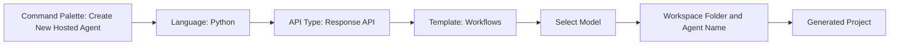
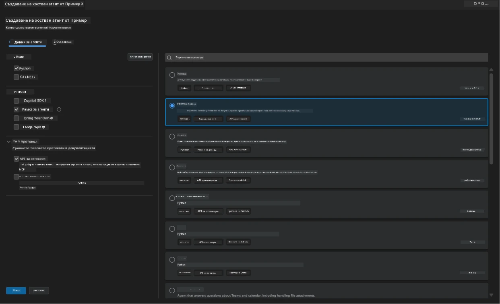
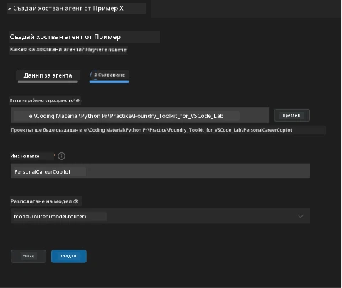

# Модул 2 - Създаване на скелет за мулти-агент проект

⏱️ ~5 мин

В този модул използвате [Foundry Toolkit for VS Code](https://aka.ms/foundrytk), за да **създадете скелет на мулти-агент проект**. Асистентът генерира `agent.yaml`, `main.py`, `Dockerfile`, `requirements.txt`, `.env` и конфигурация за дебъгване във VS Code - за да можете да се съсредоточите върху свързването на работния процес с 4 агента в Модул 3.

> **Ключова концепция:** Скелетът е работещ заглушител с един агент. Вие заменяте плейсхолдърната логика с графа `WorkflowBuilder` в Модул 3. Не пишете базовия код от нулата.

> **Пример за референция:** [`PersonalCareerCopilot/`](../../../../../workshop/lab02-multi-agent/PersonalCareerCopilot) е пълен работещ пример. Използвайте го, за да сравнявате своята работа в процеса.

### Поток на асистента за създаване на скелет



---

## Стъпка 1: Отворете асистента за създаване на Hosted Agent

1. Натиснете `Ctrl+Shift+P`, за да отворите **Command Palette**.
2. Въведете: **Foundry Toolkit: Create a New Hosted Agent** и го изберете.
3. Асистентът се отваря на таба **Agent Details**.

> **Алтернатива:** Кликнете върху иконата на **Foundry Toolkit** в Activity Bar → кликнете върху иконата **+** до **Hosted Agents** → **Create New Hosted Agent**.

---

## Стъпка 2: Избор на настройки



1. В навигационната/опционална секция от лявата страна изберете следното:

| Меню | Избор | Бележки |
|--------|-----------|-------|
| **Език** | Python | Поддържа се и C# (.NET) |
| **Фреймуърк** | Agent Framework | Осигурява `Agent`, `AgentExecutor`, `WorkflowBuilder` |
| **Тип API** | Response API | `POST /responses` - история, управлявана от платформата, поддръжка на стрийминг |
| **Шаблон** | **Workflows** | Обработва заявки през няколко агента последователно |

2. След избора, кликнете **Next**



3. В следващия прозорец изберете следното:

| Меню | Избор | Бележки |
|--------|-----------|-------|
| **Работна папка** | Навигирайте до целевата папка | напр. `workshop/lab02-multi-agent/` в това хранилище |
| **Име на агента** | `PersonalCareerCopilot` | Това става името на директорията на проекта |
| **Деплоймент на модел** | Изберете вашия деплойнат модел | напр. `gpt-4.1-mini` от Лаборатория 01 |

4. Натиснете **Create**, за да създадете скелета на проекта. VS Code генерира файловете и отваря папката.

> **Съвет:** [`gpt-4.1-mini`](https://learn.microsoft.com/azure/foundry/foundry-models/concepts/models-sold-directly-by-azure#gpt-41-series) балансира добре скоростта и качеството за мулти-агент разработка.

---

## Стъпка 3: Прегледайте генерирания проект

След като скелетирането приключи, проверете дали виждате тези файлове в Explorer (`Ctrl+Shift+E`):

```
📂 <your-agent-name>/
├── .azdignore          ← Files excluded from Azure Developer CLI deployments
├── .dockerignore       ← Files excluded from Docker builds
├── .env                ← Environment variables (placeholders - fill in Module 3)
├── .vscode/
│   ├── launch.json     ← Debug config (F5 → run + Agent Inspector)
│   └── tasks.json      ← VS Code task definitions
├── agent.yaml          ← Agent definition (kind: hosted, protocol: responses)
├── Dockerfile          ← Container config for deployment
├── main.py             ← Stub agent entry point (replace with WorkflowBuilder in Module 3)
└── requirements.txt    ← Python dependencies
```

> **Важно:** Отворете директно тази скелетирана папка във VS Code, за да може `.vscode/launch.json` и `tasks.json` да работят правилно при дебъгване с F5.

### Обяснение на ключовите файлове

| Файл | Цел |
|------|---------|
| `agent.yaml` | Декларира `kind: hosted`, свързва env променливи, дефинира `/responses` протокола |
| `main.py` | Заглушител: един `FoundryChatClient` → `Agent` → `ResponsesHostServer`. Заменяте с 4 агента + `WorkflowBuilder` в Модул 3 |
| `Dockerfile` | `python:3.12-slim`, инсталира `requirements.txt`, отваря порт 8088, стартира `python main.py` |
| `requirements.txt` | `agent-framework-foundry`, `agent-framework-foundry-hosting`, `mcp<2,>=1.24.0`, `debugpy` |

> **Референция:** Вижте [`PersonalCareerCopilot/agent.yaml`](../../../../../workshop/lab02-multi-agent/PersonalCareerCopilot/agent.yaml) и [`PersonalCareerCopilot/requirements.txt`](../../../../../workshop/lab02-multi-agent/PersonalCareerCopilot/requirements.txt) за пълното генерирано съдържание.

---

### ✅ Контролен списък

- [ ] Скелет асистентът е завършен - новата папка на проекта е видима в Explorer
- [ ] Всички очаквани файлове присъстват: `agent.yaml`, `main.py`, `Dockerfile`, `requirements.txt`, `.env`
- [ ] `agent.yaml` показва `kind: hosted` и `protocol: responses`
- [ ] `main.py` импортира `Agent`, `FoundryChatClient`, `ResponsesHostServer`
- [ ] Скелетирана папка е отворена като корена на работното пространство във VS Code
- [ ] Разбирате, че `main.py` е заглушител - `WorkflowBuilder` се добавя в Модул 3

---

**Предишен:** [01 - Разберете мулти-агентната архитектура](01-understand-multi-agent.md) · **Следващ:** [03 - Конфигуриране на агенти и среда →](03-configure-agents.md)

---

<!-- CO-OP TRANSLATOR DISCLAIMER START -->
**Отказ от отговорност**:
Този документ е преведен с помощта на AI преводачески услуга [Co-op Translator](https://github.com/Azure/co-op-translator). Въпреки че се стремим към точност, моля имайте предвид, че автоматизираните преводи могат да съдържат грешки или неточности. Оригиналният документ на неговия роден език трябва да се счита за авторитетен източник. За критична информация се препоръчва професионален човешки превод. Ние не носим отговорност за каквито и да е недоразумения или неправилни тълкувания, произтичащи от използването на този превод.
<!-- CO-OP TRANSLATOR DISCLAIMER END -->