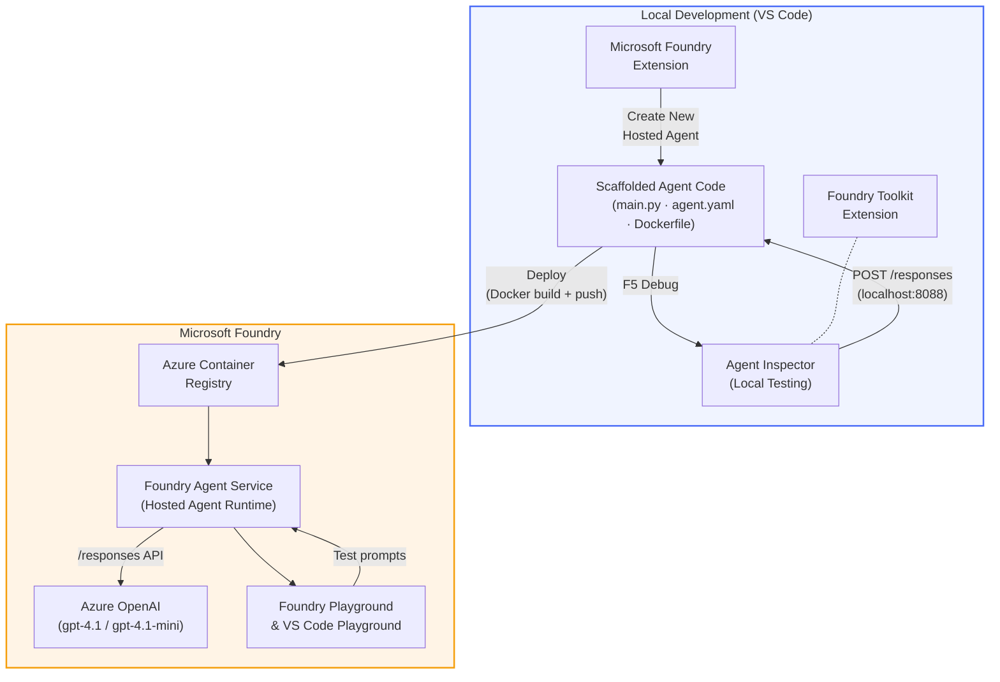

# Foundry Toolkit + Foundry Hosted Agents ওয়ার্কশপ

[](https://www.python.org/)
[](https://learn.microsoft.com/agent-framework/)
[](https://learn.microsoft.com/azure/foundry/agents/concepts/hosted-agents)
[](https://ai.azure.com/)
[](https://learn.microsoft.com/azure/ai-services/openai/)
[](https://learn.microsoft.com/cli/azure/install-azure-cli)
[](https://learn.microsoft.com/azure/developer/azure-developer-cli/install-azd)
[](https://www.docker.com/)
[](https://marketplace.visualstudio.com/items?itemName=ms-windows-ai-studio.windows-ai-studio)
[](LICENSE)

**Microsoft Foundry Agent Service** এ **Hosted Agents** হিসাবে AI এজেন্ট তৈরি, পরীক্ষা এবং স্থাপন করুন - সম্পূর্ণরূপে VS Code থেকে **Microsoft Foundry extension** এবং **Foundry Toolkit** ব্যবহার করে।

> **Hosted Agents বর্তমানে প্রিভিউ পর্যায়ে রয়েছে।** সমর্থিত অঞ্চলগুলি সীমিত - দেখুন [region availability](https://learn.microsoft.com/azure/foundry/agents/concepts/hosted-agents#region-availability)।

> প্রতিটি ল্যাবে `agent/` ফোল্ডারটি **Foundry extension দ্বারা স্বয়ংক্রিয়ভাবে স্ক্যাফোল্ডেড** - তারপরে আপনি কোডটি কাস্টমাইজ করেন, স্থানীয়ভাবে পরীক্ষা করেন এবং স্থাপন করেন।

### 🌐 বহুভাষিক সমর্থন

#### GitHub Action এর মাধ্যমে সমর্থিত (স্বয়ংক্রিয় ও সর্বদা আপ-টু-ডেট)

<!-- CO-OP TRANSLATOR LANGUAGES TABLE START -->
[Arabic](../ar/README.md) | [Bengali](./README.md) | [Bulgarian](../bg/README.md) | [Burmese (Myanmar)](../my/README.md) | [Chinese (Simplified)](../zh-CN/README.md) | [Chinese (Traditional, Hong Kong)](../zh-HK/README.md) | [Chinese (Traditional, Macau)](../zh-MO/README.md) | [Chinese (Traditional, Taiwan)](../zh-TW/README.md) | [Croatian](../hr/README.md) | [Czech](../cs/README.md) | [Danish](../da/README.md) | [Dutch](../nl/README.md) | [Estonian](../et/README.md) | [Finnish](../fi/README.md) | [French](../fr/README.md) | [German](../de/README.md) | [Greek](../el/README.md) | [Hebrew](../he/README.md) | [Hindi](../hi/README.md) | [Hungarian](../hu/README.md) | [Indonesian](../id/README.md) | [Italian](../it/README.md) | [Japanese](../ja/README.md) | [Kannada](../kn/README.md) | [Khmer](../km/README.md) | [Korean](../ko/README.md) | [Lithuanian](../lt/README.md) | [Malay](../ms/README.md) | [Malayalam](../ml/README.md) | [Marathi](../mr/README.md) | [Nepali](../ne/README.md) | [Nigerian Pidgin](../pcm/README.md) | [Norwegian](../no/README.md) | [Persian (Farsi)](../fa/README.md) | [Polish](../pl/README.md) | [Portuguese (Brazil)](../pt-BR/README.md) | [Portuguese (Portugal)](../pt-PT/README.md) | [Punjabi (Gurmukhi)](../pa/README.md) | [Romanian](../ro/README.md) | [Russian](../ru/README.md) | [Serbian (Cyrillic)](../sr/README.md) | [Slovak](../sk/README.md) | [Slovenian](../sl/README.md) | [Spanish](../es/README.md) | [Swahili](../sw/README.md) | [Swedish](../sv/README.md) | [Tagalog (Filipino)](../tl/README.md) | [Tamil](../ta/README.md) | [Telugu](../te/README.md) | [Thai](../th/README.md) | [Turkish](../tr/README.md) | [Ukrainian](../uk/README.md) | [Urdu](../ur/README.md) | [Vietnamese](../vi/README.md)

> **স্থানীয়ভাবে ক্লোন করতে পছন্দ করবেন?**
>
> এই রিপোজিটরিতে ৫০+ ভাষার অনুবাদ রয়েছে যা ডাউনলোডের আকার অনেকটাই বাড়িয়ে দেয়। অনুবাদ ছাড়া ক্লোন করতে sparse checkout ব্যবহার করুন:
>
> **Bash / macOS / Linux:**
> ```bash
> git clone --filter=blob:none --sparse https://github.com/microsoft-foundry/Foundry_Toolkit_for_VSCode_Lab.git
> cd Foundry_Toolkit_for_VSCode_Lab
> git sparse-checkout set --no-cone '/*' '!translations' '!translated_images'
> ```
>
> **CMD (Windows):**
> ```cmd
> git clone --filter=blob:none --sparse https://github.com/microsoft-foundry/Foundry_Toolkit_for_VSCode_Lab.git
> cd Foundry_Toolkit_for_VSCode_Lab
> git sparse-checkout set --no-cone "/*" "!translations" "!translated_images"
> ```
>
> এর মাধ্যমে আপনি কোর্স সম্পূর্ণ করতে প্রয়োজনীয় সবকিছু পাবেন, খুব দ্রুত ডাউনলোডের সাথে।
<!-- CO-OP TRANSLATOR LANGUAGES TABLE END -->

---

## আর্কিটেকচার



**প্রবাহ:** Foundry extension এজেন্টের স্ক্যাফোল্ড তৈরি করে → আপনি কোড এবং নির্দেশনা কাস্টমাইজ করেন → Agent Inspector দিয়ে স্থানীয়ভাবে পরীক্ষণ করেন → Foundry তে স্থাপন করেন (Docker ইমেজ ACR তে পুশ হয়) → Playground এ যাচাই করেন।

---

## আপনি যা তৈরি করবেন

| ল্যাব | বর্ণনা | অবস্থা |
|-----|-------------|--------|
| **Lab 01 - Single Agent** | **"Explain Like I'm an Executive" Agent** তৈরি করুন, স্থানীয়ভাবে পরীক্ষা করুন এবং Foundry তে স্থাপন করুন | ✅ উপলব্ধ |
| **Lab 02 - Multi-Agent Workflow** | **"Resume → Job Fit Evaluator"** তৈরি করুন - ৪ জন এজেন্ট রিজিউমির উপযোগিতা স্কোর করে এবং শেখার রোডম্যাপ তৈরি করে | ✅ উপলব্ধ |

---

## Executive Agent পরিচিতি

এই ওয়ার্কশপে আপনি **"Explain Like I'm an Executive" Agent** তৈরি করবেন - একটি AI এজেন্ট যা জটিল প্রযুক্তিগত শব্দগুলোকে সরল, বোর্ডরুম-প্রস্তুত সারসংক্ষেপে অনুবাদ করে। কারণ বাস্তবতা হলো, C-suite এ কেউ "v3.2 এ পরিচিত সিঙ্ক্রোনাস কল দ্বারা উত্পন্ন থ্রেড পুল এক্সহস্টশন" শুনতে চায় না।

আমি এই এজেন্ট তৈরি করেছিলাম অনেক অঘটনের পরে যখন আমার নিখুঁত পোস্ট-মর্টেমের জবাব ছিল: *"তাহলে... ওয়েবসাইট ডাউন কি না?"*

### এটা কিভাবে কাজ করে

আপনি একটি প্রযুক্তিগত আপডেট দেন। এটি একটি নির্বাহী সারসংক্ষেপ ফিরিয়ে দেয় - তিনটি বুলেট পয়েন্ট, কোনো জারগন নেই, কোনো স্ট্যাক ট্রেস নেই, কোনো অস্তিত্বগত ভয় নেই। শুধু **কি ঘটেছে**, **ব্যবসায়িক প্রভাব**, এবং **পরবর্তী ধাপ**।

### এটি কর্মে দেখুন

**আপনি বলেন:**
> "API এর বিলম্বতা বৃদ্ধি পেয়েছে কারণ v3.2 তে যুক্ত সিঙ্ক্রোনাস কল দ্বারা থ্রেড পুল এক্সহস্টশন হয়েছে।"

**এজেন্ট উত্তর দেয়:**

> **নির্বাহী সারাংশ:**
> - **কি ঘটেছে:** সর্বশেষ রিলিজের পর সিস্টেম ধীরগতি হয়েছে।
> - **ব্যবসায়িক প্রভাব:** কিছু ব্যবহারকারী সেবা ব্যবহারে দেরি অনুভব করেছেন।
> - **পরবর্তী ধাপ:** পরিবর্তনটি প্রত্যাহার করা হয়েছে এবং পুনরায় স্থাপনের আগে একটি সমাধান প্রস্তুত করা হচ্ছে।

### কেন এই এজেন্ট?

এটি একটি সরল, নির্দিষ্ট উদ্দেশ্যের এজেন্ট - হোস্টেড এজেন্ট ওয়ার্কফ্লো সম্পূর্ণরূপে শেখার জন্য আদর্শ, জটিল টুল চেইনে আটকে না গিয়ে। এবং সত্যি বলতে? প্রতিটি ইঞ্জিনিয়ারিং দল একটির প্রয়োজন আসলেই।

---

## ওয়ার্কশপের কাঠামো

```
📂 Foundry_Toolkit_for_VSCode_Lab/
├── 📄 README.md                      ← You are here
└── 📂 workshop/
    ├── 📂 lab01-single-agent/        ← Full lab: docs + agent code
    │   ├── README.md                 ← Hands-on lab instructions
    │   ├── 📂 docs/                  ← Step-by-step tutorial modules
    │   │   ├── 00-prerequisites.md
    │   │   ├── 01-setup.md
    │   │   ├── 02-create-hosted-agent.md
    │   │   ├── 03-configure-and-code.md
    │   │   ├── 04-test-locally.md
    │   │   ├── 05-deploy-to-foundry.md
    │   │   ├── 06-verify-in-playground.md
    │   │   ├── 07-summary.md
    │   │   └── 08-troubleshooting.md
    │   └── 📂 agent/                 ← Reference solution (auto-scaffolded by Foundry extension)
    │       ├── agent.yaml
    │       ├── Dockerfile
    │       ├── main.py
    │       └── requirements.txt
    └── 📂 lab02-multi-agent/         ← Resume → Job Fit Evaluator
        ├── README.md                 ← Hands-on lab instructions (end-to-end)
        ├── 📂 docs/                  ← Step-by-step tutorial modules
        │   ├── 00-prerequisites.md
        │   ├── 01-understand-multi-agent.md
        │   ├── 02-scaffold-multi-agent.md
        │   ├── 03-configure-agents.md
        │   ├── 04-orchestration-patterns.md
        │   ├── 05-test-locally.md
        │   ├── 06-deploy-to-foundry.md
        │   ├── 07-verify-in-playground.md
        │   ├── 08-troubleshooting.md
        │   └── 09-summary.md
        └── 📂 PersonalCareerCopilot/ ← Reference solution (multi-agent workflow)
            ├── agent.yaml
            ├── Dockerfile
            ├── main.py
            └── requirements.txt
```

> **নোট:** প্রতিটি ল্যাবে `agent/` ফোল্ডারটি হল যা **Microsoft Foundry extension** তৈরি করে যখন আপনি Command Palette থেকে `Microsoft Foundry: Create a New Hosted Agent` চালান। এরপর ফাইলগুলো এজেন্টের নির্দেশনা, সরঞ্জাম, এবং কনফিগারেশন দিয়ে কাস্টমাইজ করা হয়। Lab 01 আপনাকে শুরু থেকে এটি পুনরায় তৈরি করা শেখাবে।

---

## শুরু করা হচ্ছে

### 1. রিপোজিটরি ক্লোন করুন

```bash
git clone https://github.com/microsoft-foundry/Foundry_Toolkit_for_VSCode_Lab.git
cd Foundry_Toolkit_for_VSCode_Lab
```

### 2. একটি Python ভার্চুয়াল এনভায়রনমেন্ট সেট আপ করুন

```bash
python -m venv venv
```

সক্রিয় করুন:

- **Windows (PowerShell):**
  ```powershell
  .\venv\Scripts\Activate.ps1
  ```
- **macOS / Linux:**
  ```bash
  source venv/bin/activate
  ```

### 3. নির্ভরযোগ্যতা ইনস্টল করুন

```bash
pip install -r workshop/lab01-single-agent/agent/requirements.txt
```

### 4. পরিবেশ ভেরিয়েবল কনফিগার করুন

এজেন্ট ফোল্ডারের ভিতরে উদাহরণস্বরূপ `.env` ফাইল কপি করে আপনার মানগুলো পূরণ করুন:

```bash
cp workshop/lab01-single-agent/agent/.env.example workshop/lab01-single-agent/agent/.env
```

`workshop/lab01-single-agent/agent/.env` সম্পাদনা করুন:

```env
FOUNDRY_PROJECT_ENDPOINT=https://<your-account>.services.ai.azure.com/api/projects/<your-project>
AZURE_AI_MODEL_DEPLOYMENT_NAME=<your-model-deployment-name>
```

### 5. ওয়ার্কশপ ল্যাবগুলি অনুসরণ করুন

প্রতিটি ল্যাব নিজস্ব মডিউল নিয়ে স্ব-সম্পূর্ণ। **Lab 01** থেকে শুরু করে মৌলিক বিষয় শিখুন, তারপর **Lab 02** তে যান মাল্টি-এজেন্ট ওয়ার্কফ্লো জন্য।

#### Lab 01 - Single Agent ([সম্পূর্ণ নির্দেশিকা](workshop/lab01-single-agent/README.md))

| # | মডিউল | লিঙ্ক |
|---|--------|------|
| 1 | প্রয়োজনীয় শর্তাবলী পড়ুন | [00-prerequisites.md](workshop/lab01-single-agent/docs/00-prerequisites.md) |
| 2 | Foundry Toolkit এবং Foundry extension ইনস্টল করুন | [01-setup.md](workshop/lab01-single-agent/docs/01-setup.md) |
| 3 | একটি Foundry প্রজেক্ট তৈরি করুন | [01-setup.md](workshop/lab01-single-agent/docs/01-setup.md) |
| 4 | একটি হোস্টেড এজেন্ট তৈরি করুন | [02-create-hosted-agent.md](workshop/lab01-single-agent/docs/02-create-hosted-agent.md) |
| 5 | নির্দেশনা ও পরিবেশ কনফিগার করুন | [03-configure-and-code.md](workshop/lab01-single-agent/docs/03-configure-and-code.md) |
| 6 | স্থানীয়ভাবে পরীক্ষা করুন | [04-test-locally.md](workshop/lab01-single-agent/docs/04-test-locally.md) |
| 7 | Foundry তে স্থাপন করুন | [05-deploy-to-foundry.md](workshop/lab01-single-agent/docs/05-deploy-to-foundry.md) |
| 8 | প্লেগ্রাউন্ডে যাচাই করুন | [06-verify-in-playground.md](workshop/lab01-single-agent/docs/06-verify-in-playground.md) |
| 9 | সারাংশ ও পরবর্তী ধাপ | [07-summary.md](workshop/lab01-single-agent/docs/07-summary.md) |
| 10 | সমস্যার সমাধান | [08-troubleshooting.md](workshop/lab01-single-agent/docs/08-troubleshooting.md) |

#### Lab 02 - Multi-Agent Workflow ([সম্পূর্ণ নির্দেশিকা](workshop/lab02-multi-agent/README.md))

| # | মডিউল | লিঙ্ক |
|---|--------|------|
| 1 | শর্তাবলী (Lab 02) | [00-prerequisites.md](workshop/lab02-multi-agent/docs/00-prerequisites.md) |
| 2 | মাল্টি-এজেন্ট আর্কিটেকচার বুঝুন | [01-understand-multi-agent.md](workshop/lab02-multi-agent/docs/01-understand-multi-agent.md) |
| 3 | মাল্টি-এজেন্ট প্রজেক্ট স্ক্যাফোল্ড করুন | [02-scaffold-multi-agent.md](workshop/lab02-multi-agent/docs/02-scaffold-multi-agent.md) |
| 4 | এজেন্ট ও পরিবেশ কনফিগার করুন | [03-configure-agents.md](workshop/lab02-multi-agent/docs/03-configure-agents.md) |
| 5 | অর্কেস্ট্রেশন প্যাটার্ন | [04-orchestration-patterns.md](workshop/lab02-multi-agent/docs/04-orchestration-patterns.md) |
| 6 | স্থানীয়ভাবে পরীক্ষা করুন (মাল্টি-এজেন্ট) | [05-test-locally.md](workshop/lab02-multi-agent/docs/05-test-locally.md) |
| 7 | Foundry তে স্থাপন করুন | [06-deploy-to-foundry.md](workshop/lab02-multi-agent/docs/06-deploy-to-foundry.md) |
| 8 | প্লেগ্রাউন্ডে যাচাই করুন | [07-verify-in-playground.md](workshop/lab02-multi-agent/docs/07-verify-in-playground.md) |
| 9 | সমস্যার সমাধান (মাল্টি-এজেন্ট) | [08-troubleshooting.md](workshop/lab02-multi-agent/docs/08-troubleshooting.md) |
| 10 | সারাংশ ও পরবর্তী ধাপ | [09-summary.md](workshop/lab02-multi-agent/docs/09-summary.md) |

---

## রক্ষণাবেক্ষণকারী

<table>
<tr>
    <td align="center"><a href="https://github.com/ShivamGoyal03">
        <br />
        <sub><b>Shivam Goyal</b></sub>
    </a><br />
    </td>
</tr>
</table>

---

## প্রয়োজনীয় অনুমতিসমূহ (দ্রুত রেফারেন্স)

| পরিস্থিতি | প্রয়োজনীয় ভূমিকা |
|----------|---------------|
| নতুন Foundry প্রজেক্ট তৈরি করা | Foundry রিসোর্সে **Azure AI Owner** |
| বিদ্যমান প্রজেক্টে স্থাপন (নতুন রিসোর্স) | **Azure AI Owner** + সাবস্ক্রিপশনে **Contributor** |
| পুরোপুরি কনফিগার করা প্রজেক্টে স্থাপন | অ্যাকাউন্টে **Reader** + প্রজেক্টে **Azure AI User** |

> **গুরুত্বপূর্ণ:** Azure `Owner` এবং `Contributor` ভূমিকা শুধুমাত্র *ম্যানেজমেন্ট* অনুমতি অন্তর্ভুক্ত করে, *ডেভেলপমেন্ট* (ডাটা অ্যাকশন) অনুমতি নয়। এজেন্ট তৈরি এবং ডিপ্লয় করতে আপনাকে **Azure AI User** বা **Azure AI Owner** হতে হবে।

---

## রেফারেন্সসমূহ

- [কুইকস্টার্ট: আপনার প্রথম হোস্টেড এজেন্ট ডিপ্লয় করুন (VS Code)](https://learn.microsoft.com/azure/foundry/agents/quickstarts/quickstart-hosted-agent)
- [হোস্টেড এজেন্ট কি কি?](https://learn.microsoft.com/azure/foundry/agents/concepts/hosted-agents)
- [VS Code এ হোস্টেড এজেন্ট ওয়ার্কফ্লো তৈরি করুন](https://learn.microsoft.com/azure/foundry/agents/how-to/vs-code-agents-workflow-pro-code)
- [একটি হোস্টেড এজেন্ট ডিপ্লয় করুন](https://learn.microsoft.com/azure/foundry/agents/how-to/deploy-hosted-agent)
- [Microsoft Foundry এর জন্য RBAC](https://learn.microsoft.com/azure/foundry/concepts/rbac-foundry)
- [আর্কিটেকচার রিভিউ এজেন্ট স্যাম্পল](https://github.com/Azure-Samples/agent-architecture-review-sample) - MCP টুলস, Excalidraw চিত্র, এবং দ্বৈত ডিপ্লয়মেন্টসহ বাস্তব হোস্টেড এজেন্ট

---


## লাইসেন্স

[MIT](../../LICENSE)

---

<!-- CO-OP TRANSLATOR DISCLAIMER START -->
**অস্বীকৃতি**:
এই নথিটি AI অনুবাদ পরিষেবা [Co-op Translator](https://github.com/Azure/co-op-translator) ব্যবহার করে অনূদিত হয়েছে। যদিও আমরা শুদ্ধতার জন্য চেষ্টা করি, অনুগ্রহ করে মনে রাখবেন যে স্বয়ংক্রিয় অনুবাদে ত্রুটি বা অসঙ্গতি থাকতে পারে। মূল নথিটি তার স্বভাষায় কর্তৃত্বপূর্ণ উৎস হিসেবে বিবেচিত হওয়া উচিত। গুরুত্বপূর্ণ তথ্যের জন্য পেশাদার মানব অনুবাদ সুপারিশ করা হয়। এই অনুবাদের ব্যবহারে প্রয়োজনীয় ভুল বোঝাবুঝি বা ভুল ব্যাখ্যার জন্য আমরা দায়বদ্ধ নই।
<!-- CO-OP TRANSLATOR DISCLAIMER END -->