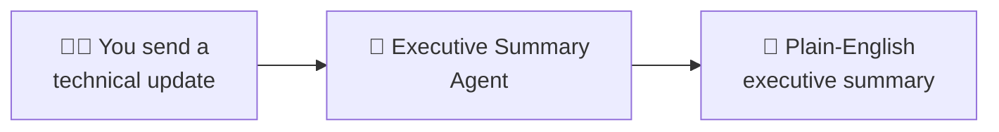

# মডিউল 0 - পরিচিতি

⏱️ ~১০ মিনিট

> [!WARNING]
> **প্রিভিউ ও সীমাবদ্ধতা:** [হোস্টেড এজেন্ট](https://learn.microsoft.com/azure/foundry/agents/concepts/hosted-agents) বর্তমানে **পাবলিক প্রিভিউতে** আছে - প্রোডাকশনের কাজে সুপারিশ করা হয় না। নিম্নলিখিত বিষয়গুলো অবগত থাকুন:
> - **সমর্থিত অঞ্চল সীমিত** - রিসোর্স তৈরি করার আগে [অঞ্চল উপলব্ধতা](https://learn.microsoft.com/azure/foundry/agents/concepts/hosted-agents#region-availability) চেক করুন। যদি আপনি সমর্থিত না এমন কোনো অঞ্চল বেছে নেন, ডিপ্লয়মেন্ট ব্যর্থ হবে।
> - `agent-framework-foundry-hosting` প্যাকেজটি প্রি-রিলিজ - সংস্করণের মধ্যে API পরিবর্তন হতে পারে।
> - স্কেল সীমা: হোস্টেড এজেন্ট ০–৫ রেপ্লিকা (স্কেল-টু-জিরো সহ) সমর্থন করে।
> - এই কর্মশালায় দেখানো কিছু বৈশিষ্ট্য GA দিকে যাওয়ার সময় পরিবর্তিত হতে পারে।

## আপনি যা তৈরি করবেন

এই কর্মশালায়, আপনি একটি **"Explain Like I'm an Executive"** এজেন্ট তৈরি করবেন - একটি হোস্টেড AI এজেন্ট যা জটিল প্রযুক্তিগত আপডেটগুলো নিয়ে তাদের সহজ ইংরেজিতে নির্বাহী সারসংক্ষেপে পুনঃলিখন করে।

**এজেন্টটি ব্যবহার করে:**
- **Microsoft Agent Framework** - এজেন্ট লজিক ও গঠন জন্য
- **Foundry Toolkit for VS Code** - স্ক্যাফোল্ড, স্থানীয়ভাবে পরীক্ষা ও ডিপ্লয়মেন্টের জন্য
- **একটি AI মডেল** (যেমন, `gpt-4.1-mini/gpt-5-mini`) - সারসংক্ষেপ তৈরি করার জন্য

এই ল্যাবের শেষে, আপনার কাছে একটি কার্যকরী এজেন্ট থাকবে যা আপনি লোকালি Agent Inspector দিয়ে পরীক্ষা করতে পারবেন, এবং ইচ্ছা করলে ক্লাউডে ডিপ্লয় করতে পারবেন।

---

## হোস্টেড এজেন্ট কি?

একটি **হোস্টেড এজেন্ট** হলো একটি AI এজেন্ট যা Microsoft Foundry তে একটি ব্যবস্থাপিত সেবার মতো চলে। নিজে অবকাঠামো পরিচালনা করার পরিবর্তে, আপনি আপনার এজেন্ট কোড একটি কনটেইনারে প্যাকেজ করেন এবং Foundry এটি স্কেলিং, হোস্টিং এবং একটি স্ট্যান্ডার্ড HTTP এন্ডপয়েন্টের মাধ্যমে প্রকাশ করে।

| ধারণা | তা কি বুঝায় |
|---------|--------------|
| **এজেন্ট** | আপনার পাইথন কোড যা ব্যবহারকারীর মেসেজ গ্রহণ করে, একটি AI মডেল কল করে, এবং একটি সংরচিত উত্তর দেয় |
| **হোস্টেড** | Foundry আপনার জন্য কনটেইনার চালায় - কোন VM, কোন Kubernetes, কোন অবকাঠামো পরিচালনা করতে হচ্ছে না |
| **উত্তরের প্রোটোকল** | একটি স্ট্যান্ডার্ড HTTP API (`POST /responses`) যা যেকোন ক্লায়েন্ট আপনার এজেন্টের সাথে যোগাযোগ করার জন্য কল করতে পারে |
| **Agent Inspector** | একটি স্থানীয় পরীক্ষার UI (Foundry Toolkit-এ অন্তর্ভুক্ত) যা ডিপ্লয়মেন্টের আগে আপনার এজেন্টের সাথে চ্যাট করার সুযোগ দেয় |

এই কর্মশালায়, আপনি শূন্য থেকে শুরু করে সম্পূর্ণ হোস্টেড এজেন্ট তৈরি করবেন - অথবা ইচ্ছা করলে শুধুমাত্র লোকাল পরীক্ষায় থামতে পারেন।

---

## আপনার পথ নির্বাচন করুন

> ⚠️ **চালিয়ে যাওয়ার আগে একটি পথ নির্বাচন করুন।** আপনার পছন্দ নির্ধারণ করবে কোন টুলগুলো ইন্সটল করবেন এবং কোন মডিউলগুলি প্রযোজ্য। আপনি পরে Path B → Path A-তে পরিবর্তন করতে পারেন যদি সাবস্ক্রিপশন পেয়ে যান।

<strong>🅰️ Path A - Azure ক্লাউড (Azure সাবস্ক্রিপশন প্রয়োজন)</strong>

| | বিবরণ |
|---|---|
| **এই পথ কার জন্য?** | আপনার একটি সক্রিয় Azure সাবস্ক্রিপশন আছে এবং আপনি Foundry রিসোর্স তৈরি করতে পারেন |
| **মডেল** | Foundry মাধ্যমে Azure OpenAI (যেমন `gpt-4.1-mini/gpt-5-mini`) |
| **মডিউল কাভারেজ** | সব মডিউল (00–07) |
| **ক্লাউডে ডিপ্লয়?** | ✅ হাঁ - সম্পূর্ণ শেষ পর্যন্ত ডিপ্লয়মেন্ট |

<strong>🅱️ Path B - স্থানীয় / ফ্রি-টিয়ার (কোন Azure সাবস্ক্রিপশন দরকার নেই)</strong>

| | বিবরণ |
|---|---|
| **এই পথ কার জন্য?** | MVP, ছাত্র বা Azure অ্যাক্সেস ছাড়া যেকারো জন্য |
| **মডেল** | **Foundry Local** (ফ্রি, আপনার যন্ত্রে চলে) |
| **মডিউল কাভারেজ** | মডিউল 00–04 (ডিপ্লয় ও ক্লাউড যাচাই বাদ দিন) |
| **ক্লাউডে ডিপ্লয়?** | ❌ না - শুধুমাত্র Agent Inspector দিয়ে স্থানীয় পরীক্ষা |

---

## সব পথ: প্রয়োজনীয় টুলসমূহ

নিচের প্রতিটি টুল ইনস্টল করুন। ইনস্টল করার পর, চেক কমান্ডটি চালিয়ে নিশ্চিত করুন এটি কাজ করছে।

| # | টুল | ভার্সন | ইনস্টল | যাচাই (প্রত্যাশিত আউটপুট) |
|---|------|---------|---------|---------------------------|
| 1 | **Visual Studio Code** | সর্বশেষ | [code.visualstudio.com](https://code.visualstudio.com/) | কোনো ত্রুটি ছাড়াই খোলে |
| 2 | **Python** | 3.12 বা উচ্চতর | [python.org/downloads](https://www.python.org/downloads/) | `python --version` $\rightarrow$ `Python 3.12.x` |
| 3 | **Foundry Toolkit for VS Code** | সর্বশেষ | Extension ID: `ms-windows-ai-studio.windows-ai-studio` | Activity Bar-এ Foundry আইকন |
| 4 | **Python extension for VS Code** | সর্বশেষ | Extension ID: `ms-python.python` | Extensions প্যানেলে ইনস্টল হয়েছে |

> [!TIP]
> **ইনস্টলেশনের জন্য পেশাদার টিপস:**
> - **Python PATH (Windows):** Python ইন্সটলার-এর প্রথম স্ক্রীনে সর্বদা **"Add Python to PATH"** নির্বাচন করুন। এট ছাড়া, `python` আপনার টার্মিনালে চিনবে না।
> - **একাধিক Python সংস্করণ:** যদি Python 3.10 ও 3.12 উভয়ই ইনস্টল করা থাকে, তাহলে আপনার ভার্চুয়াল পরিবেশে সঠিক সংস্করণ ব্যবহারের জন্য `python3.12 -m venv .venv` ব্যবহার করুন।
> - **Docker WSL 2 (Windows):** Docker Desktop ইনস্টলেশনের সময় নিশ্চিত করুন **WSL 2 backend** নির্বাচন করা হয়েছে। Hyper-V সহ Docker ধীর গতি এবং Foundry কনটেইনার বিল্ডে সমস্যা করতে পারে।
> - **Docker শুরু হচ্ছে না?** Docker Desktop চালু করার ৩০–৬০ সেকেন্ড অপেক্ষা করুন। `docker info` চালান - যদি "Cannot connect to the Docker daemon" দেখেন, Docker এখনো ইনিশিয়ালাইজ হচ্ছে।
> - **VS Code এক্সটেনশন লোড হচ্ছে না?** এক্সটেনশন ইনস্টল করার পর, উইন্ডো রিলোড করুন: `Ctrl+Shift+P` → `Developer: Reload Window`।

> **Windows ব্যবহারকারীরা:** Python ইনস্টলেশনের সময় **"Add Python to PATH"** নির্বাচন করুন।

**পরবর্তী:** [01 - সেটআপ →](01-setup.md)

---

<!-- CO-OP TRANSLATOR DISCLAIMER START -->
**অস্বীকৃতি**:
এই নথিটি AI অনুবাদ পরিষেবা [Co-op Translator](https://github.com/Azure/co-op-translator) ব্যবহার করে অনূদিত হয়েছে। যদিও আমরা শুদ্ধতার জন্য চেষ্টা করি, অনুগ্রহ করে মনে রাখবেন যে স্বয়ংক্রিয় অনুবাদে ত্রুটি বা অসঙ্গতি থাকতে পারে। মূল নথিটি তার স্বভাষায় কর্তৃত্বপূর্ণ উৎস হিসেবে বিবেচিত হওয়া উচিত। গুরুত্বপূর্ণ তথ্যের জন্য পেশাদার মানব অনুবাদ সুপারিশ করা হয়। এই অনুবাদের ব্যবহারে প্রয়োজনীয় ভুল বোঝাবুঝি বা ভুল ব্যাখ্যার জন্য আমরা দায়বদ্ধ নই।
<!-- CO-OP TRANSLATOR DISCLAIMER END -->