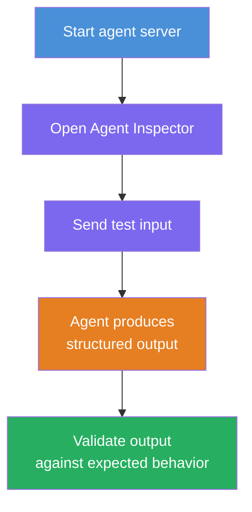
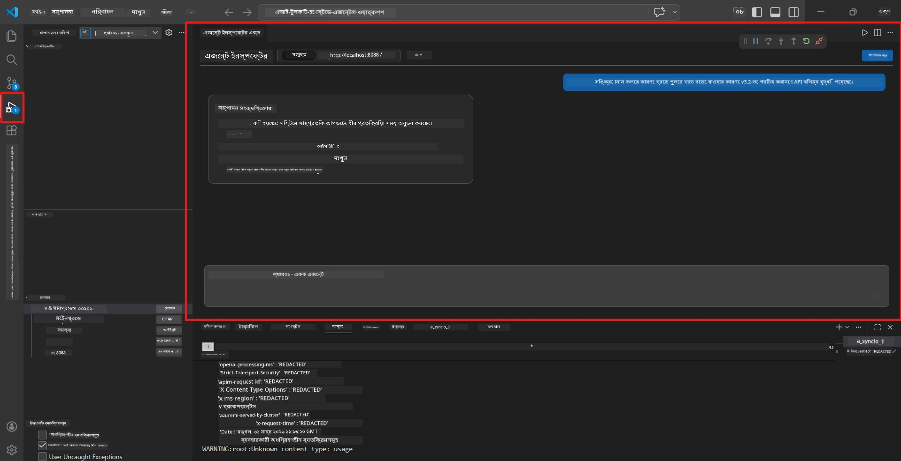
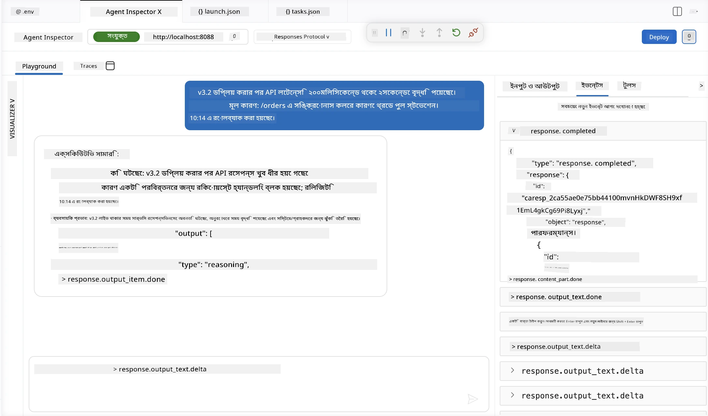

# মডিউল ৪ - লোকালি পরীক্ষা করুন

⏱️ ~১০ মিনিট

এই মডিউলে, আপনি আপনার এজেন্ট স্থানীয়ভাবে চালাবেন এবং এটি সঠিকভাবে কাজ করে কিনা যাচাই করবেন **সুখী-পথ কার্যকরী পরীক্ষাগুলি** ব্যবহার করে। আপনি এজেন্ট ইন্সপেক্টর (ভিজ্যুয়াল UI) অথবা সরাসরি HTTP কল ব্যবহার করে নিশ্চিত করবেন যে এজেন্ট সংগঠিত, সঠিক প্রতিক্রিয়া তৈরি করছে।

### স্থানীয় পরীক্ষার প্রবাহ



---

## অপশন ১: F5 চাপুন - এজেন্ট ইন্সপেক্টর দিয়ে ডিবাগ করুন (সুপারিশকৃত)

### ডিবাগার শুরু করুন

১. VS Code-এ সরাসরি **executive-summary-agent/** ফোল্ডারটি খুলুন (`File → Open Folder`)।
২. **Run and Debug** প্যানেলটি খুলুন (`Ctrl+Shift+D`)।
৩. ড্রপডাউন থেকে **Debug Local Agent HTTP Server** নির্বাচন করুন।
৪. **F5** চাপুন (বা ▶ Start Debugging এ ক্লিক করুন)।

> ⚠️ **গুরত্বপূর্ণ: আপনার পাইথন ইন্টারপ্রেটার নির্বাচন করুন**
> যদি "ModuleNotFoundError" পাওয়া যায় বা ডিবাগার শুরু না হয়, তাহলে আপনাকে VS Code-কে আপনার ভার্চুয়াল পরিবেশ ব্যবহার করতে বলতে হবে:
  > ১. `Ctrl+Shift+P` চাপুন $\rightarrow$ টাইপ করুন **Python: Select Interpreter**।
  > ২. আপনার প্রকল্পের `.venv` ফোল্ডারে রাখা ইন্টারপ্রেটার সিলেক্ট করুন (উদাহরণস্বরূপ, উইন্ডোজে `.\.venv\Scripts\python.exe`)।
  > ৩. ডিবাগ সেশন পুনরায় শুরু করুন।
> যদি তবুও ত্রুটি আসে, আপনার `tasks.json` ফাইলটি ম্যানুয়ালি নিম্নরূপ আপডেট করুন:
  > ১. `.vscode/tasks.json` ফাইলটি খুলুন
  > ২. `Run Agent HTTP Server` নামে টাস্কটি অবস্থান করুন
  > ৩. কমান্ড মান নিম্নরূপ আপডেট করুন:
  >    - **উইন্ডোজ:** `"value": "${workspaceFolder}/.venv/Scripts/python.exe",`
  >    - **ম্যাকওএস/লিনাক্স:** `"value": "${workspaceFolder}/.venv/bin/python",`

### কী হয়

১. HTTP সার্ভার `http://localhost:8088/responses` এ শুরু হয়।
২. **Agent Inspector** প্যানেল স্বয়ংক্রিয়ভাবে খোলে - এটি পরীক্ষার জন্য একটি ভিজ্যুয়াল চ্যাট ইন্টারফেস।
৩. `main.py` এ ব্রেকপয়েন্ট চালু থাকে।

টার্মিনালে নজর রাখুন:
```
Starting executive summary hosted agent
Executive agent server running on http://localhost:8088
```

> **যদি Agent Inspector না খোলে:** `Ctrl+Shift+P` চাপুন → **Foundry Toolkit: Open Agent Inspector**।



> *স্ক্রিনশটটি পুরাতন 'AI TOOLKIT' ব্র্যান্ডিং দেখাতে পারে একটি আগের এক্সটেনশনের সংস্করণ থেকে।*

---

## অপশন ২: টার্মিনাল থেকে পরীক্ষা করুন (বিকল্প)

এক টার্মিনালে এজেন্ট শুরু করুন, অন্যটিতে রিকোয়েস্ট পাঠান:

```bash
# Terminal 1: Start agent
cd executive-summary-agent/
source .venv/bin/activate
python main.py
```

```bash
# Terminal 2: Send test (curl)
curl -sS -X POST http://localhost:8088/responses \
  -H "Content-Type: application/json" \
  -d '{"input": "The API latency increased due to thread pool exhaustion caused by sync calls in v3.2.", "stream": false}'
```

---

## সিনারিও পরীক্ষা: সুখী-পথ কার্যকরী যাচাই

নিচের **সব তিনটি** সিনারিও চালান। এগুলি যাচাই করে যে আপনার এজেন্ট বাস্তবিক ইনপুটের জন্য সঠিক, গঠিত আউটপুট তৈরি করে।



### সিনারিও ১: IT ঘটনা - API বিলম্ব বৃদ্ধি

**ইনপুট:**
```
The API latency increased from 200ms to 2s after deploying v3.2.
Root cause: thread pool starvation from synchronous calls in /orders.
Rolled back at 10:14.
```

**প্রত্যাশিত আচরণ:**
- ✅ "Executive Summary" কাঠামো অনুসরণ করে (কি ঘটেছে / ব্যবসায়িক প্রভাব / পরবর্তী ধাপ)
- ✅ কোনো টেকনিক্যাল জারগন নেই (যেমন "thread pool", "/orders", বা "v3.2" নেই)
- ✅ স্পষ্টভাবে ব্যবসায়িক প্রভাব উল্লেখ করে (যেমন, ব্যবহারকারীরা দেরি অনুভব করেছে)
- ✅ একটি পরবর্তী ধাপ অন্তর্ভুক্ত (যেমন, সমাধান স্থাপন করা হয়েছে, পর্যবেক্ষণ চলছে)

---

### সিনারিও ২: ডেটা পাইপলাইন - ETL ব্যর্থতা

**ইনপুট:**
```
The nightly ETL job failed because the upstream schema changed. APAC dashboards show missing data.
```

**প্রত্যাশিত আচরণ:**
- ✅ ডেটা রিফ্রেশ ব্যর্থতাটি সাধারণ ভাষায় সারাংশ করে
- ✅ APAC ড্যাশবোর্ড প্রভাব উল্লেখ করে
- ✅ একটি সমাধানমূলক পরবর্তী ধাপ অন্তর্ভুক্ত করে
- ✅ "ETL", "schema", বা অন্যান্য টেকনিক্যাল শব্দ উল্লেখ করে না

---

### সিনারিও ৩: নিরাপত্তা - প্রকাশিত ক্রেডেনশিয়াল

**ইনপুট:**
```
Static analysis flagged a hardcoded secret in the repository.
The secret may have been exposed in commit history.
```

**প্রত্যাশিত আচরণ:**
- ✅ একটি ক্রেডেনশিয়াল/নিরাপত্তা সমস্যা নির্বাহী-সামঞ্জস্যপূর্ণ ভাষায় বর্ণনা করে
- ✅ সম্ভাব্য ঝুঁকি নির্দেশ করে (অজ্ঞাতনামা প্রবেশ)
- ✅ সমাধানমূলক কাজ উল্লেখ করে (ক্রেডেনশিয়াল রোটেশন, অডিট)
- ✅ "static analysis", "commit history", বা "hardcoded" মত শব্দ অন্তর্ভুক্ত করে না

---

## যাচাই মানদণ্ড

প্রতিটি সিনারিওর জন্য যাচাই করুন:

| # | মানদণ্ড | পাশের শর্ত |
|---|----------|---------------|
| ১ | **কাঠামো** | প্রতিক্রিয়া "Executive Summary" বিন্যাস ব্যবহার করে সব তিনটি বুলেট সহ |
| ২ | **সরল ভাষা** | এমন কোনো টেকনিক্যাল জারগন নেই যা নির্বাহী বুঝবেন না |
| ৩ | **সঠিকতা** | সারাংশ ইনপুটের সাথে মেলে - কোনো গড়মিল তথ্য নয় |
| ৪ | **সংক্ষিপ্ততা** | প্রতিক্রিয়া ১০০ শব্দের কম |
| ৫ | **পরবর্তী ধাপ** | একটি স্পষ্ট কর্ম বা শমনীকরন উল্লেখ আছে |

---

## ডিবাগিং টিপস

| সমস্যা | সমাধান |
|-------|-----|
| এজেন্ট শুরু হয় না | `.env` মান যাচাই করুন, venv সক্রিয় আছে কি দেখুন, `pip install -r requirements.txt` রান করুন |
| খালি বা সাধারণ প্রতিক্রিয়া | `main.py` নির্দেশনা পর্যালোচনা করুন - আউটপুট ফর্ম্যাট নির্দিষ্ট আছে কিনা নিশ্চিত করুন |
| প্রতিক্রিয়ায় জারগন রয়েছে | নির্দেশনায় "টেকনিক্যাল শব্দ অপসারণ" নিয়ম শক্তিশালী করুন |
| Agent Inspector খুলছে না | `Ctrl+Shift+P` → **Foundry Toolkit: Open Agent Inspector** |
| টার্মিনালে মডেল ত্রুটি | `AZURE_AI_MODEL_DEPLOYMENT_NAME` ঠিকমতো মিলিয়ে দেখুন (কেস-সেনসিটিভ) |

---

### ✅ চেকপয়েন্ট

- [ ] এজেন্ট স্থানীয়ভাবে ত্রুটি ছাড়া শুরু হয়
- [ ] এজেন্ট ইন্সপেক্টর খোলে এবং একটি চ্যাট ইন্টারফেস দেখায় (যদি F5 ব্যবহার করেন)
- [ ] **সিনারিও ১** (IT ঘটনা) - গঠিত Executive Summary, কোনো জারগন নেই
- [ ] **সিনারিও ২** (ডেটা পাইপলাইন) - প্রাসঙ্গিক সারাংশ সহ ব্যবসায়িক প্রভাব
- [ ] **সিনারিও ৩** (নিরাপত্তা সতর্কতা) - উপযুক্ত ঝুঁকি যোগাযোগ
- [ ] সব প্রতিক্রিয়া নেয়া কাঠামো অনুসরণ করে

> **আপনার প্রতিক্রিয়াগুলি সংরক্ষণ করুন** (কপি বা স্ক্রিনশট নিন) - আপনি এগুলি মডিউল ০৬ এর ক্লাউড ফলাফলের সাথে তুলনা করবেন।

---

**পূর্বের:** [০৩ - কনফিগার & কোড](03-configure-and-code.md) · **পরবর্তী:** [০৫ - Foundry তে ডেপ্লয় →](05-deploy-to-foundry.md)

---

<!-- CO-OP TRANSLATOR DISCLAIMER START -->
**অস্বীকৃতি**:
এই নথিটি AI অনুবাদ পরিষেবা [Co-op Translator](https://github.com/Azure/co-op-translator) ব্যবহার করে অনূদিত হয়েছে। যদিও আমরা শুদ্ধতার জন্য চেষ্টা করি, অনুগ্রহ করে মনে রাখবেন যে স্বয়ংক্রিয় অনুবাদে ত্রুটি বা অসঙ্গতি থাকতে পারে। মূল নথিটি তার স্বভাষায় কর্তৃত্বপূর্ণ উৎস হিসেবে বিবেচিত হওয়া উচিত। গুরুত্বপূর্ণ তথ্যের জন্য পেশাদার মানব অনুবাদ সুপারিশ করা হয়। এই অনুবাদের ব্যবহারে প্রয়োজনীয় ভুল বোঝাবুঝি বা ভুল ব্যাখ্যার জন্য আমরা দায়বদ্ধ নই।
<!-- CO-OP TRANSLATOR DISCLAIMER END -->