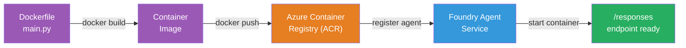
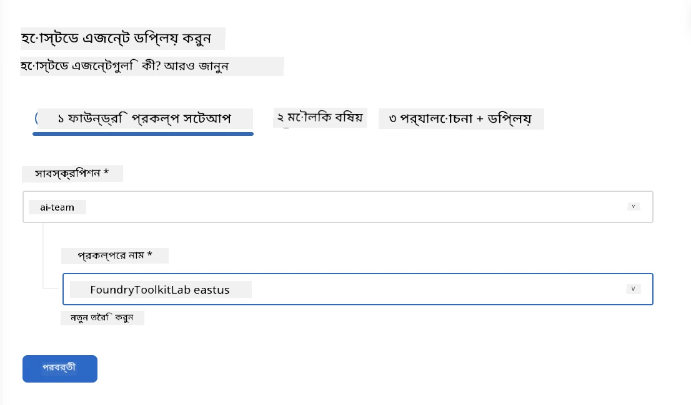
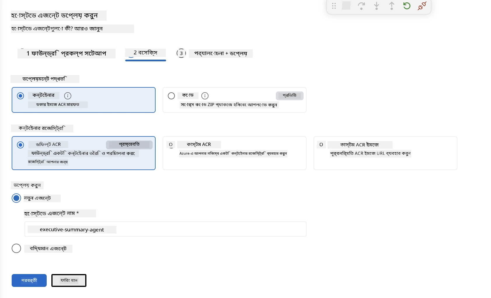
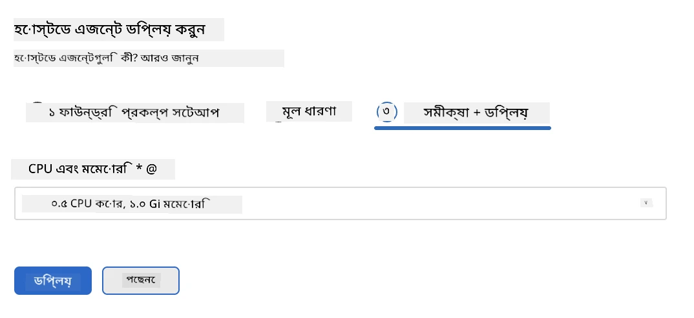
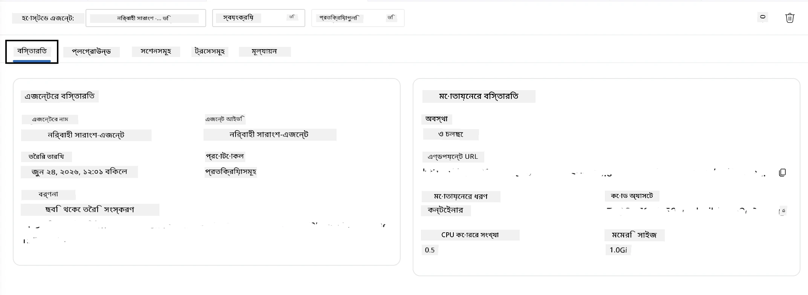

# মডিউল ৫ - Foundry Agent সেবায় ডিপ্লয় করুন

⏱️ ~১০ মিনিট

> ⚠️ **পাথ বি ব্যবহারকারীগণ:** এই মডিউলটি একটি Foundry সাবস্ক্রিপশন প্রয়োজন। আপনি যদি Foundry Local ব্যবহার করছেন, তাহলে [মডিউল ০৭ - সারসংক্ষেপ](07-summary.md) এ চলে যান। আপনি সফলভাবে লোকাল ডেভেলপমেন্ট ওয়ার্কফ্লো সম্পন্ন করেছেন!

এই মডিউলে, আপনি আপনার লোকালি পরীক্ষিত এজেন্টকে Microsoft Foundry তে **হোস্টেড এজেন্ট** হিসেবে ডিপ্লয় করবেন। ডিপ্লয়মেন্ট একটি কন্টেইনার ইমেজ তৈরি করে, সেটি Azure Container Registry তে পুশ করে, এবং Foundry এর ম্যানেজড অবকাঠামোতে এজেন্ট শুরু করে।

### ডিপ্লয়মেন্ট পাইপলাইন

---

## পূর্বপ্রয়োজনীয়তা পরীক্ষা

ডিপ্লয়মেন্টের আগে যাচাই করুন:

- [ ] এজেন্ট সমস্ত ৩টি লোকাল সিনারিও থেকে উত্তীর্ন হয়েছে [মডিউল ০৪](04-test-locally.md)
- [ ] আপনার কাছে প্রোজেক্ট স্তরে **Azure AI User** ভূমিকা আছে ([মডিউল ০১, RBAC নির্ধারণ](01-setup.md#deploy-a-model--assign-rbac))
- [ ] আপনি VS Code এ Azure এ সাইন ইন করেছেন (অ্যাকাউন্ট আইকনে আপনার নাম প্রদর্শিত)

---

## ধাপ ১: ডিপ্লয়মেন্ট শুরু করুন

### অপশন এ: Agent Inspector থেকে ডিপ্লয়মেন্ট (প্রস্তাবিত)

যদি Agent Inspector খোলা থাকে (পরীক্ষার জন্য):
১. উপরের ডানদিকে **Deploy** বোতামে ক্লিক করুন (মেঘ আইকন ↑)।

### অপশন বি: কমান্ড প্যালেট থেকে ডিপ্লয়মেন্ট

১. `Ctrl+Shift+P` চাপুন → **Foundry Toolkit: Deploy Hosted Agent** নির্বাচন করুন।

---

## ধাপ ২: ডিপ্লয়মেন্ট কনফিগার করুন

উইজার্ড আপনাকে নিম্নলিখিত তথ্যের জন্য জিজ্ঞাসা করবে:

| প্রশ্ন | নির্বাচন |
|--------|-----------|
| **সাবস্ক্রিপশন** | আপনার Azure সাবস্ক্রিপশন |
| **টার্গেট প্রোজেক্ট** | আপনার Foundry প্রোজেক্ট (যেমন, `workshop-agents`) |

এজেন্ট কনফিগার করতে **next** ক্লিক করুন।

| প্রশ্ন | নির্বাচন |
|--------|-----------|
| **ডিপ্লয়মেন্ট পদ্ধতি** | কন্টেইনার |
| **কন্টেইনার রেজিস্ট্রি** | **ডিফল্ট ACR** (Microsoft Foundry আপনার জন্য একটি তৈরি করে এবং ব্যবস্থাপনা করে) |
| **এতে ডিপ্লয় করুন** | নতুন এজেন্ট (নাম, `executive-summary-agent`) |

আপনার এজেন্ট পর্যালোচনা ও ডিপ্লয় করতে **next** ক্লিক করুন।

| প্রশ্ন | নির্বাচন |
|--------|-----------|
| **CPU এবং মেমরি** | **০.৫ CPU কোর, ১.০ Gi মেমরি** (ডিফল্ট - ওয়ার্কশপের জন্য যথেষ্ট) |

---

## ধাপ ৩: ডিপ্লয় ও মনিটর করুন

১. **Deploy** ক্লিক করুন।
২. **Output** প্যানেল মনিটর করুন (ড্রপডাউন থেকে **Microsoft Foundry** নির্বাচন করুন)।
৩. ডিপ্লয়মেন্ট নিচের পর্যায়গুলি অনুসরণ করে:
   - **Docker build** - আপনার Dockerfile থেকে কন্টেইনার তৈরি করে
   - **Docker push** - ইমেজ ACR এ পুশ করে (প্রথম ডিপ্লয়মেন্টে ১–৩ মিনিট)
   - **Agent registration** - Foundry তে হোস্টেড এজেন্ট তৈরি করে
   - **Container start** - সিস্টেম-ম্যানেজড পরিচিতি দিয়ে শুরু হয়

৪. সমাপ্ত হলে একটি নোটিফিকেশন প্রদর্শিত হবে:
   > **executive-summary-agent সফলভাবে ডিপ্লয় হয়েছে।** `View logs` `Run agent`

৫. Agent Playground খুলতে **Run agent** ক্লিক করুন।

### ডিপ্লয়মেন্ট অবস্থা মান

| অবস্থা | অর্থ |
|--------|---------|
| **চলমান** | কন্টেইনার প্রস্তুত, এজেন্ট সাড়া দিচ্ছে |
| **অপেক্ষমান** | কন্টেইনার শুরু হচ্ছে - ৩০–৬০ সেকেন্ড অপেক্ষা করুন |
| **ব্যর্থ** | লগ চেক করুন (নিচের সমস্যা সমাধান দেখুন) |

---

## সাধারণ ডিপ্লয়মেন্ট এরর

| এরর | কারণ | সমাধান |
|-------|-----------|-----|
| `agents/write` permission denied | প্রোজেক্ট স্তরে **Azure AI User** ভূমিকা নেই | [মডিউল ০১, RBAC নির্ধারণ](01-setup.md#deploy-a-model--assign-rbac) |
| Docker চলছে না | Docker Desktop চালু হয়নি | Docker Desktop চালু করুন → যাচাই করুন `docker info` |
| ACR অনুমোদন | Managed identity ইমেজ পুল করতে পারে না | দেখুন [মডিউল ০৮ - সমস্যা সমাধান](08-troubleshooting.md) |

---

### ✅ চেকপয়েন্ট

- [ ] ডিপ্লয়মেন্ট ত্রুটিমুক্ত সম্পন্ন হয়েছে
- [ ] এজেন্ট Foundry Toolkit সাইডবারে আপনার প্রোজেক্টের অধীনে **Agents** এ ক্লিক করলে **Hosted Agent** ট্যাবে প্রদর্শিত হয়
- [ ] কন্টেইনার অবস্থা **চলমান** দেখায়
- [ ] Agent Playground ট্যাব খুলে এজেন্টের বিস্তারিত এবং endpoint URL দেখায়

---

**আগের:** [০৪ - লোকালি পরীক্ষা](04-test-locally.md) · **পরবর্তী:** [০৬ - Playground এ যাচাই →](06-verify-in-playground.md)

---

<!-- CO-OP TRANSLATOR DISCLAIMER START -->
**অস্বীকৃতি**:
এই নথিটি AI অনুবাদ পরিষেবা [Co-op Translator](https://github.com/Azure/co-op-translator) ব্যবহার করে অনূদিত হয়েছে। যদিও আমরা শুদ্ধতার জন্য চেষ্টা করি, অনুগ্রহ করে মনে রাখবেন যে স্বয়ংক্রিয় অনুবাদে ত্রুটি বা অসঙ্গতি থাকতে পারে। মূল নথিটি তার স্বভাষায় কর্তৃত্বপূর্ণ উৎস হিসেবে বিবেচিত হওয়া উচিত। গুরুত্বপূর্ণ তথ্যের জন্য পেশাদার মানব অনুবাদ সুপারিশ করা হয়। এই অনুবাদের ব্যবহারে প্রয়োজনীয় ভুল বোঝাবুঝি বা ভুল ব্যাখ্যার জন্য আমরা দায়বদ্ধ নই।
<!-- CO-OP TRANSLATOR DISCLAIMER END -->