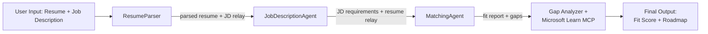

# PersonalCareerCopilot - রিজিউমে → চাকরির উপযোগিতা মূল্যায়নকারী

একটি ওয়ার্কফ্লো-প্রথম মাল্টি-এজেন্ট অ্যাপ যা মূল্যায়ন করে একটি রিজিউমে চাকরির বিবরণের সাথে কতটা ভাল মেলে, তারপর ফাঁকগুলি বন্ধ করার জন্য একটি ব্যক্তিগতকৃত শেখার রোডম্যাপ তৈরি করে।

---

## এজেন্টস্

| এজেন্ট | ভূমিকা | টুলস্ |
|-------|------|-------|
| **ResumeParser** | রিজিউমে টেক্সট থেকে কাঠামোবদ্ধ দক্ষতা, অভিজ্ঞতা, সার্টিফিকেশন এক্সট্র্যাক্ট করে | - |
| **JobDescriptionAgent** | একটি JD থেকে প্রয়োজনীয়/পছন্দের দক্ষতা, অভিজ্ঞতা, সার্টিফিকেশন এক্সট্র্যাক্ট করে | - |
| **MatchingAgent** | প্রোফাইল বনাম প্রয়োজনীয়তা তুলনা করে → ফিট স্কোর (0-100) + মিল/অনুপস্থিত দক্ষতা | - |
| **GapAnalyzer** | Microsoft Learn রিসোর্সেসসহ একটি ব্যক্তিগতকৃত শেখার রোডম্যাপ তৈরি করে | `search_microsoft_learn_for_plan` (MCP) |

## ওয়ার্কফ্লো



---

## দ্রুত শুরু

### ১। পরিবেশ সেটআপ করুন

এই ফোল্ডারটি ওয়ার্কফ্লো-ভিত্তিক Lab 02 এর রেফারেন্স ইমপ্লিমেন্টেশন। এর `main.py` বিদ্যমান প্রম্পট ব্লকগুলি ব্যবহার করে প্লাস `WorkflowBuilder` চারটি এজেন্টকে সংযুক্ত করে।

```powershell
cd workshop\lab02-multi-agent\PersonalCareerCopilot
python -m venv .venv
.\.venv\Scripts\Activate.ps1          # Windows PowerShell
# source .venv/bin/activate            # macOS / Linux
pip install -r requirements.txt
```

### ২। ক্রেডেনশিয়াল কনফিগার করুন

এই ফোল্ডারে একটি `.env` ফাইল তৈরি করুন:

```powershell
copy .env .env.bak 2>$null; echo $null > .env
```

`.env` এডিট করুন:

```env
FOUNDRY_PROJECT_ENDPOINT=https://<your-account>.services.ai.azure.com/api/projects/<your-project>
AZURE_AI_MODEL_DEPLOYMENT_NAME=gpt-4.1-mini
```

| মান | কোথায় পাবেন |
|-------|------------------|
| `FOUNDRY_PROJECT_ENDPOINT` | Foundry Toolkit সাইডবার → আপনার প্রোজেক্টে রাইট-ক্লিক করুন → **Copy Project Endpoint** |
| `AZURE_AI_MODEL_DEPLOYMENT_NAME` | Foundry সাইডবার → প্রোজেক্ট এক্সপ্যান্ড করুন → **Models + endpoints** → ডিপ্লয়মেন্ট নাম |

### ৩। লোকালি রান করুন

```powershell
python -m debugpy --listen 127.0.0.1:5679 main.py --port 8088
```

অথবা VS Code টাস্ক ব্যবহার করুন: `Ctrl+Shift+P` → **Tasks: Run Task** → **Run Agent HTTP Server**।

F5 ডিবাগিং এর জন্য, ব্যবহার করুন **Debug Local Agent HTTP Server**।

### ৪। এজেন্ট ইনস্পেক্টর দিয়ে পরীক্ষা করুন

এজেন্ট ইনস্পেক্টর খুলুন: `Ctrl+Shift+P` → **Foundry Toolkit: Open Agent Inspector**।

নিচের টেস্ট প্রম্পট পেস্ট করুন:

```
Resume:
Jane Doe
Senior Software Engineer with 5 years of experience in Python, Django, and AWS.
Built microservices handling 10K+ requests/second. Led a team of 4 developers.
Certifications: AWS Solutions Architect Associate.
Education: B.S. Computer Science, State University.

Job Description:
Senior Cloud Engineer at Contoso Ltd.
Required: Python, Azure, Kubernetes, Terraform, CI/CD pipelines.
Preferred: Go, monitoring (Prometheus/Grafana), cost optimization.
Experience: 5+ years in cloud infrastructure.
Certifications: Azure Solutions Architect Expert preferred.
```

**অপ্রত্যাশিত:** একটি ফিট স্কোর (0-100), মিল/অপূর্ণ দক্ষতা, এবং মাইক্রোসফট লার্ন URL সহ একটি ব্যক্তিগত শেখার রোডম্যাপ।

### ৫। ফাউন্ডরিতে ডিপ্লয় করুন

`Ctrl+Shift+P` → **Foundry Toolkit: Deploy Hosted Agent** → আপনার প্রোজেক্ট নির্বাচন করুন → নিশ্চিত করুন।

---

## প্রোজেক্ট স্ট্রাকচার

```
PersonalCareerCopilot/
├── .env                ← Your credentials (git-ignored)
├── agent.yaml          ← Hosted agent definition (name, resources, env vars)
├── Dockerfile          ← Container image for Foundry deployment
├── main.py             ← 4-agent workflow (instructions, MCP tool, WorkflowBuilder)
└── requirements.txt    ← Python dependencies
```

## মূল ফাইলসমূহ

### `agent.yaml`

Foundry Agent Service এর জন্য হোস্টেড এজেন্ট নির্ধারণ করে:
- `kind: hosted` - ম্যানেজড কন্টেইনার হিসেবে রান করে
- `protocols` - `responses` প্রোটোকল সহ `version: 2.0.0`, `/responses` HTTP এন্ডপয়েন্ট উন্মুক্ত করে
- `environment_variables` - `AZURE_AI_MODEL_DEPLOYMENT_NAME` এখানে ঘোষণা করা হয়; `FOUNDRY_PROJECT_ENDPOINT` স্বয়ংক্রিয়ভাবে ডিপ্লয়মেন্টে ইনজেক্ট হয়

### `main.py`

অন্তর্ভুক্ত:
- **এজেন্ট নির্দেশনা** - চারটি `*_INSTRUCTIONS` কনস্ট্যান্ট, প্রতি এজেন্টে একটি করে
- **MCP টুল** - `search_microsoft_learn_for_plan()` Streamable HTTP মারফত `https://learn.microsoft.com/api/mcp` কল করে
- **এজেন্ট সৃষ্টি** - চারটি `Agent()` + `AgentExecutor()` ইনস্ট্যান্স একক `FoundryChatClient` শেয়ার করছে
- **ওয়ার্কফ্লো গ্রাফ** - `WorkflowBuilder` ক্রমাগত পাইপলাইনে এজেন্টগুলোকে সংযুক্ত করে: ResumeParser → JD Agent → MatchingAgent → GapAnalyzer
- **সার্ভার স্টার্টআপ** - `ResponsesHostServer` পোর্ট ৮০৮৮ এ রান করে

### `requirements.txt`

| প্যাকেজ | উদ্দেশ্য |
|---------|----------|
| `agent-framework-foundry` | কোর রানটাইম: `Agent`, `AgentExecutor`, `WorkflowBuilder`, `@tool`, `FoundryChatClient` |
| `agent-framework-foundry-hosting` | `ResponsesHostServer` + Foundry হোস্টিং ইন্টিগ্রেশন |
| `mcp<2,>=1.24.0` | GapAnalyzer এর জন্য MCP ক্লায়েন্ট (`streamable_http_client`) |
| `debugpy` | পাইথন ডিবাগিং (VS Code এ F5) |

---

## সমস্যাযুক্ত সমাধান

| সমস্যা | সমাধান |
|-------|-----|
| `KeyError: 'FOUNDRY_PROJECT_ENDPOINT'` অথবা `KeyError: 'AZURE_AI_MODEL_DEPLOYMENT_NAME'` | একটি `.env` তৈরি করুন যেটিতে উভয় `FOUNDRY_PROJECT_ENDPOINT` এবং `AZURE_AI_MODEL_DEPLOYMENT_NAME` সেট করা আছে |
| `ModuleNotFoundError: No module named 'agent_framework'` | ভার্চুয়াল এনভায়রনমেন্ট অ্যাক্টিভেট করুন এবং `pip install -r requirements.txt` রান করুন |
| আউটপুটে কোনো Microsoft Learn URL নেই | ইন্টারনেট সংযোগ পরীক্ষা করুন `https://learn.microsoft.com/api/mcp` এর সাথে |
| শুধু ১টি গ্যাপ কার্ড (ছেঁটে ফেলা হয়েছে) | নিশ্চিত করুন `GAP_ANALYZER_INSTRUCTIONS` তে `CRITICAL:` ব্লক অন্তর্ভুক্ত আছে |
| ৮০৮৮ পোর্ট ব্যবহৃত হচ্ছে | অন্যান্য সার্ভার বন্ধ করুন: `netstat -ano \| findstr :8088` |

বিস্তারিত সমস্যাযুক্ত সমাধানের জন্য দেখুন [Module 8 - Troubleshooting](../docs/08-troubleshooting.md)।

---

**সম্পূর্ণ ওয়াকথ্রু:** [Lab 02 Docs](../docs/README.md) · **ফিরে যান:** [Lab 02 README](../README.md) · [Workshop Home](../../../README.md)

---

<!-- CO-OP TRANSLATOR DISCLAIMER START -->
**অস্বীকৃতি**:
এই নথিটি AI অনুবাদ পরিষেবা [Co-op Translator](https://github.com/Azure/co-op-translator) ব্যবহার করে অনূদিত হয়েছে। যদিও আমরা শুদ্ধতার জন্য চেষ্টা করি, অনুগ্রহ করে মনে রাখবেন যে স্বয়ংক্রিয় অনুবাদে ত্রুটি বা অসঙ্গতি থাকতে পারে। মূল নথিটি তার স্বভাষায় কর্তৃত্বপূর্ণ উৎস হিসেবে বিবেচিত হওয়া উচিত। গুরুত্বপূর্ণ তথ্যের জন্য পেশাদার মানব অনুবাদ সুপারিশ করা হয়। এই অনুবাদের ব্যবহারে প্রয়োজনীয় ভুল বোঝাবুঝি বা ভুল ব্যাখ্যার জন্য আমরা দায়বদ্ধ নই।
<!-- CO-OP TRANSLATOR DISCLAIMER END -->