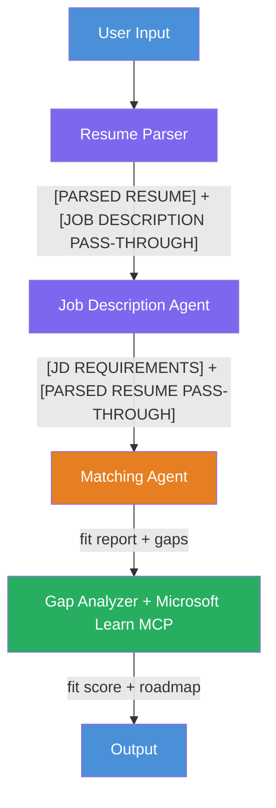

# ল্যাব ০২ - মাল্টি-এজেন্ট ওয়ার্কফ্লো: রিজিউমে → চাকরির উপযোগী মূল্যায়ন

## ওভারভিউ

এই হ্যান্ডস-অন ল্যাবে, আপনি VS Code-এ Foundry Toolkit ব্যবহার করে একটি **ওয়ার্কফ্লো-প্রথম মাল্টি-এজেন্ট অ্যাপ্লিকেশন** তৈরি করবেন এবং Microsoft Foundry Agent Service-এ তা ডিপ্লয় করবেন।

**আপনি যা তৈরি করবেন:** একটি রিজিউমে → চাকরির উপযোগী মূল্যায়নকারী যা রিজিউমে ও চাকরির বর্ণনা বিশ্লেষণ করে, মিলের স্কোর দেয়, এবং Microsoft Learn রিসোর্স ব্যবহার করে একটি ব্যক্তিগতকৃত শেখার রোডম্যাপ তৈরি করে।

---

## আর্কিটেকচার

**কিভাবে কাজ করে:**
১. ইউজার একটি রিজিউমে এবং চাকরির বর্ণনা পেস্ট করে।
২. **ResumeParser** রিজিউমে বিশ্লেষণ করে এবং JD-টিকে সঠিকভাবে `[JOB DESCRIPTION PASS-THROUGH]` ধাপে অনুলিপি করে।
৩. **JD Agent** পাস-থ্রু থেকে কাঠামোগত প্রয়োজনীয়তাগুলো বের করে, তারপর `[PARSED RESUME]` কে `[PARSED RESUME PASS-THROUGH]` হিসেবে ফরোয়ার্ড করে।
৪. **MatchingAgent** `[PARSED RESUME PASS-THROUGH]` ও `[JD REQUIREMENTS]` তুলনা করে এবং একটি ফিট স্কোর তৈরি করে।
৫. **GapAnalyzer** ফাঁকগুলোকে একটি ব্যবহারিক রোডম্যাপে রূপান্তর করে এবং MCP-এর মাধ্যমে সত্যিকারের Microsoft Learn লিংকগুলো নিয়ে আসে।

---

## পূর্বশর্তসমূহ

প্রথমে ল্যাব ০১ সম্পন্ন করুন:

- [Lab 01 - Single Agent](../lab01-single-agent/README.md)

---

## অংশ ১: মডিউলগুলো ধারাবাহিকভাবে পড়ুন

পুরো শেখার পথ দেখুন:

- [Lab 2 Docs - Prerequisites](docs/00-prerequisites.md)
- [Lab 2 Docs - Full Learning Path](docs/README.md)
- [PersonalCareerCopilot run guide](PersonalCareerCopilot/README.md)

---

## অংশ ২: ওয়ার্কফ্লো নির্মাণ ও পরীক্ষা করুন

১. Foundry Toolkit উইজার্ড ব্যবহার করে ওয়ার্কফ্লো-ভিত্তিক প্রকল্পের কাঠামো তৈরি করুন।
২. আপনার ওয়ার্কস্পেসে `PersonalCareerCopilot/main.py` থেকে প্রম্পট ব্লক এবং ওয়ার্কফ্লো গ্রাফ অনুলিপি করুন।
৩. লোকালি Agent Inspector দিয়ে চালিয়ে চারটি এজেন্ট এবং MCP টুল সঠিকভাবে কাজ করছে কিনা যাচাই করুন।
৪. লোকাল টেস্টিং সফল হলে হোস্টেড এজেন্টকে Foundry-তে ডিপ্লয় করুন।

---

## অর্কেস্ট্রেশন প্যাটার্নসমূহ

ল্যাব ০২ একটি **ক্রমাগত পাইপলাইন** ব্যবহার করে: প্রতিটি এজেন্টের আউটপুট পরবর্তী এজেন্টকে দেয়, এবং ওয়ার্কফ্লো শেষ এজেন্টের প্রতিক্রিয়া দেয়। দুটি প্যাটার্ন এই কাজ সুষ্ঠুভাবে করে:

- **ক্রমিক চেইন** - `WorkflowBuilder` ResumeParser → JD Agent → MatchingAgent → GapAnalyzer কে একেক ধাপে একটি `add_edge()` কল দিয়ে সংযুক্ত করে
- **কন্টেন্ট রিলে** - কারণ প্রতিটি এজেন্ট শুধু তার পূর্ববর্তী এজেন্টের আউটপুট দেখেন, ResumeParser এবং JD Agent তাদের ডেটা উপরের এজেন্টদের প্রয়োজনীয় ডেটা লেবেলকৃত পাস-থ্রু সেকশনে অনুলিপি করে দেয়

ডকুমেন্টগুলো আরও বর্ণনা করে ল্যাবটি কেন fan-out/fan-in ব্যবহার করে না, এবং কিভাবে আরেকটি এজেন্ট দিয়ে গ্রাফ সম্প্রসারণ করা যায়।

দেখুন [docs/04-orchestration-patterns.md](docs/04-orchestration-patterns.md)।

---

**পূর্ববর্তী:** [Lab 01 - Single Agent](../lab01-single-agent/README.md) · **ফিরে যান:** [Workshop Home](../../README.md)

---

<!-- CO-OP TRANSLATOR DISCLAIMER START -->
**অস্বীকৃতি**:
এই নথিটি AI অনুবাদ পরিষেবা [Co-op Translator](https://github.com/Azure/co-op-translator) ব্যবহার করে অনূদিত হয়েছে। যদিও আমরা শুদ্ধতার জন্য চেষ্টা করি, অনুগ্রহ করে মনে রাখবেন যে স্বয়ংক্রিয় অনুবাদে ত্রুটি বা অসঙ্গতি থাকতে পারে। মূল নথিটি তার স্বভাষায় কর্তৃত্বপূর্ণ উৎস হিসেবে বিবেচিত হওয়া উচিত। গুরুত্বপূর্ণ তথ্যের জন্য পেশাদার মানব অনুবাদ সুপারিশ করা হয়। এই অনুবাদের ব্যবহারে প্রয়োজনীয় ভুল বোঝাবুঝি বা ভুল ব্যাখ্যার জন্য আমরা দায়বদ্ধ নই।
<!-- CO-OP TRANSLATOR DISCLAIMER END -->