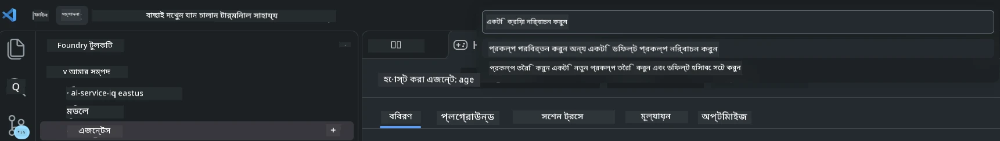

# মডিউল 0 - পরিচিতি

⏱️ ~১০ মিনিট

> [!WARNING]
> **প্রিভিউ এবং সীমাবদ্ধতা:** [Hosted Agents](https://learn.microsoft.com/azure/foundry/agents/concepts/hosted-agents) বর্তমানে **পাবলিক প্রিভিউ** অবস্থায় রয়েছে - প্রোডাকশন কাজের জন্য সুপারিশ করা হয় না। এই কর্মশালায় প্রদর্শিত কিছু ফিচার পরিষেবার GA-তে যাবার পথে পরিবর্তিত হতে পারে।

## আপনি কি তৈরি করবেন

এই ল্যাবে, আপনি Lab 01 থেকে একক এজেন্ট দক্ষতা সম্প্রসারণ করে একটি **মাল্টি-এজেন্ট ওয়ার্কফ্লো** তৈরি করবেন - রিজিউম → চাকরির ফিট মূল্যায়ক।

আপনি একটি **রিজিউমে** এবং একটি **চাকরির বর্ণনা** পেস্ট করবেন। চারটি বিশেষায়িত এজেন্ট ক্রমানুসারে ইনপুট প্রক্রিয়া করবে, তারপর ফলাফল দিবে:
- একটি ফিট স্কোর (0–100 স্কোরিং ব্রেকডাউনসহ)
- একটি দক্ষতা এবং সনদপত্র ঘাটতির তালিকা
- প্রতিটি ঘাটতির জন্য বাস্তব Microsoft Learn লিঙ্ক সহ একটি ব্যক্তিগতকৃত শেখার রোডম্যাপ

**ওয়ার্কফ্লোটি ব্যবহার করে:**
- **Microsoft Agent Framework** - `WorkflowBuilder` ক্রমাগত পাইপলাইন অর্কেস্ট্রেশনের জন্য
- **Foundry Toolkit for VS Code** - স্ক্যাফোল্ড, লোকালি টেস্ট, ডিপ্লয়
- **একটি এআই মডেল** (যেমন, `gpt-4.1-mini`) - চারটি এজেন্টের দ্বারা ব্যবহৃত
- **Microsoft Learn MCP সার্ভার** - প্রতিটি দক্ষতা ঘাটতির জন্য বাস্তব শেখার রিসোর্স লিঙ্ক প্রদান করে

---

## আপনার পথ নির্বাচন করুন

> ⚠️ **আপনি যে পথটি Lab 01 এ ব্যবহার করেছেন সেটি অব্যাহত রাখুন।**

<details open>
<summary><strong>🅰️ পথ A - Azure ক্লাউড (Azure সাবস্ক্রিপশন প্রয়োজন)</strong></summary>

| | বিবরণ |
|---|---|
| **কার জন্য?** | আপনি Azure সাবস্ক্রিপশন ব্যবহার করে Lab 01 সম্পন্ন করেছেন |
| **মডেল** | Foundry মাধ্যমে Azure OpenAI (যেমন, `gpt-4.1-mini`) |
| **কভার করা মডিউল** | সমস্ত মডিউল (00–09) |
| **ক্লাউডে ডিপ্লয় করবেন?** | ✅ হ্যা - পূর্ণ এন্ড-টু-এন্ড ডিপ্লয়মেন্ট |

</details>

<details open>
<summary><strong>🅱️ পথ B - Foundry লোকাল (Azure সাবস্ক্রিপশন দরকার নেই)</strong></summary>

| | বিবরণ |
|---|---|
| **কার জন্য?** | আপনি Foundry লোকাল ব্যবহার করে Lab 01 সম্পন্ন করেছেন |
| **মডেল** | Foundry লোকাল (ফ্রি, আপনার মেশিনে চলে) |
| **কভার করা মডিউল** | মডিউল ০০–০৫ (০৬–০৭ বাদ দিন - ডিপ্লয় এবং ক্লাউড ভেরিফাই) |
| **ক্লাউডে ডিপ্লয় করবেন?** | ❌ না - Agent Inspector এর মাধ্যমে শুধুমাত্র লোকাল টেস্টিং |

</details>

---

## Lab 01 যাচাইকরণ

Lab 02 সরাসরি Lab 01 এর উপর নির্মিত। এখানে শুরু করার আগে Lab 01 সম্পন্ন করুন।

এখনও Lab 01 করেননি? এখানে শুরু করুন: [Lab 01 - পরিচিতি](../../lab01-single-agent/docs/00-prerequisites.md)

<details open>
<summary><strong>🅰️ পথ A - Azure ক্লাউড</strong></summary>

```powershell
az account show --query "{name:name, id:id}" --output table
```

যদি এটি ব্যর্থ হয়, তাহলে `az login` চালান। এরপর VS Code এ যাচাই করুন:

1. `Ctrl+Shift+P` → টাইপ করুন **Foundry Toolkit** → নিশ্চিত করুন কমান্ড আসে।
2. **Foundry Toolkit** আইকনে ক্লিক করুন → আপনার প্রকল্প এবং ডিপ্লয়কৃত মডেল দেখায় **সফল**।



> **RBAC:** আপনি Lab 01 এ **Foundry User** অ্যাসাইন করেছেন। আবার অ্যাসাইন করতে হলে দেখুন [Lab 01, মডিউল 1](../../lab01-single-agent/docs/01-setup.md#deploy-a-model--assign-rbac)। পূর্বে এই ভূমিকা ছিল **Azure AI User** নামে - একই অনুমতিসমূহ।

</details>

<details open>
<summary><strong>🅱️ পথ B - Foundry লোকাল</strong></summary>

```powershell
Invoke-WebRequest -Uri "http://localhost:5273/v1/health" -UseBasicParsing | Select-Object StatusCode
```

প্রত্যাশিত: `StatusCode: 200`। না হলে, Foundry Toolkit সাইডবার থেকে Foundry লোকাল রিস্টার্ট করুন।

> সমস্ত ইনফারেন্স আপনার মেশিনে চলে। একমাত্র আউটবাউন্ড কল MCP টুল থেকে `https://learn.microsoft.com/api/mcp`।

</details>

---

## Lab 02 তে নতুন কি

| | Lab 01 | Lab 02 |
|--|--------|--------|
| এজেন্ট | ১ | ৪ (WorkflowBuilder দিয়ে চেইন করা) |
| স্ক্যাফোল্ড টেমপ্লেট | বেসিক - Agent Framework | ওয়ার্কফ্লো - Agent Framework |
| নতুন প্যাকেজ | - | `mcp` |
| অর্কেস্ট্রেশন | একক কথোপকথন এজেন্ট | ক্রমানুসারে পাইপলাইন (WorkflowBuilder) |
| নতুন টুল | - | `search_microsoft_learn_for_plan` (MCP) |

---

**পরবর্তী:** [01 - আর্কিটেকচার বুঝুন →](01-understand-multi-agent.md)

---

<!-- CO-OP TRANSLATOR DISCLAIMER START -->
**অস্বীকৃতি**:
এই নথিটি AI অনুবাদ পরিষেবা [Co-op Translator](https://github.com/Azure/co-op-translator) ব্যবহার করে অনূদিত হয়েছে। যদিও আমরা শুদ্ধতার জন্য চেষ্টা করি, অনুগ্রহ করে মনে রাখবেন যে স্বয়ংক্রিয় অনুবাদে ত্রুটি বা অসঙ্গতি থাকতে পারে। মূল নথিটি তার স্বভাষায় কর্তৃত্বপূর্ণ উৎস হিসেবে বিবেচিত হওয়া উচিত। গুরুত্বপূর্ণ তথ্যের জন্য পেশাদার মানব অনুবাদ সুপারিশ করা হয়। এই অনুবাদের ব্যবহারে প্রয়োজনীয় ভুল বোঝাবুঝি বা ভুল ব্যাখ্যার জন্য আমরা দায়বদ্ধ নই।
<!-- CO-OP TRANSLATOR DISCLAIMER END -->