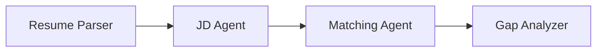
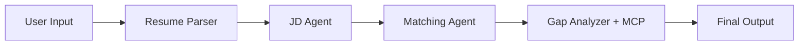

# মডিউল ৪ - অর্কেস্ট্রেশন প্যাটার্নস

⏱️ ~১০ মিনিট

এই মডিউলে, আপনি রিজুমে জব ফিট ইভ্যালুয়েটরে ব্যবহৃত অর্কেস্ট্রেশন প্যাটার্নগুলি অন্বেষণ করবেন এবং শিখবেন কীভাবে ওয়ার্কফ্লো গ্রাফ পড়তে, পরিবর্তন করতে এবং সম্প্রসারিত করতে হয়। এই প্যাটার্নগুলি বোঝা ডেটা ফ্লো সমস্যাগুলি ডিবাগ করার এবং আপনার নিজস্ব [মাল্টি-এজেন্ট ওয়ার্কফ্লো](https://learn.microsoft.com/agent-framework/workflows/) তৈরি করার জন্য অত্যাবশ্যক।

---

## প্যাটার্ন ১: সিকোয়েন্সিয়াল চেইন

ওয়ার্কফ্লোতে মৌলিক প্যাটার্ন হল **সিকোয়েন্সিয়াল চেইন** - প্রতিটি এজেন্টের আউটপুট সরাসরি পরবর্তী এজেন্টে যোগ হয়।



কোডে, প্রতিটি `add_edge()` কল চেইনে একটি ধাপ তৈরি করে:

```python
.add_edge(resume_executor, jd_executor)       # ResumeParser output → JD Agent
.add_edge(jd_executor, matching_executor)     # JD Agent output → MatchingAgent
.add_edge(matching_executor, gap_executor)    # MatchingAgent output → GapAnalyzer
```

> **কেন ধারাবাহিক, ফ্যান-আউট/ফ্যান-ইন নয়?** `WorkflowBuilder` আসা এজগুলোর জন্য **OR-সেমান্টিকস** ব্যবহার করে: একটি ডাউনস্ট্রিম এক্সিকিউটর তখনই কাজ শুরু করে যখন **যেকোনো** পূর্বসূরি শেষ করে। যদি `matching_executor` এর দুটি আসা এজ (উভয় `resume_executor` এবং `jd_executor` থেকে) থাকে, তাহলে এটি দুইবার ট্রিগার করবে - একবার ResumeParser শেষ হলে এবং একবার JD Agent শেষ হলে - যার ফলে GapAnalyzer ও দুইবার চলবে এবং আউটপুট দুইবার প্রদর্শিত হবে। ধারাবাহিক পাইপলাইন এটি পুরোপুরি এড়ায়।

## প্যাটার্ন ২: কন্টেন্ট রিলে

কারণ `context_mode="last_agent"` মানে প্রতিটি এক্সিকিউটর শুধুমাত্র তার **সোজাসুজি পূর্বসূরির আউটপুট** দেখে, ধারাবাহিক চেইনের এজেন্টদের স্পষ্টভাবে যে কোন ডাউনস্ট্রিম এজেন্টের প্রয়োজনীয় ডাটা সামনের দিকে পাস করতে হয়।

এই ওয়ার্কফ্লো-তে:
- **ResumeParser** JD শব্দশঃ `[JOB DESCRIPTION PASS-THROUGH]`-এ অনুলিপি করে (যাতে JD Agent এটি পেতে পারে)।
- **JD Agent** `[PARSED RESUME]` শব্দশঃ `[PARSED RESUME PASS-THROUGH]`-এ অনুলিপি করে (যাতে MatchingAgent উভয় প্রোফাইল তুলনা করতে পারে)।

```
ResumeParser output
└─ [PARSED RESUME]               ← extracted by JD Agent
└─ [JOB DESCRIPTION PASS-THROUGH] ← extracted by JD Agent

JD Agent output
└─ [JD REQUIREMENTS]             ← extracted by MatchingAgent
└─ [PARSED RESUME PASS-THROUGH]  ← extracted by MatchingAgent
```

প্রতিটি রিলে অংশ **শব্দশঃ** অনুলিপি করতে হবে - এটি সারাংশ বা পুনরুল্লেখ করলে ডাউনস্ট্রিম এজেন্ট যা তার উপর নির্ভর করে সেটি ভেঙে যাবে।

---

## সম্পূর্ণ গ্রাফ

ধারাবাহিক চেইন এবং কনটেন্ট রিলে প্যাটার্নগুলি মিলিয়ে পূর্ণ কাজের প্রবাহ গঠন করে:



এজেন্ট ইন্সপেক্টর এই একই গ্রাফ কাঠামো দেখায় যখন এজেন্টটি লোকালভাবে চলছে। স্ক্রিনশটের জন্য [মডিউল ৫ - টেস্ট লোকালি](05-test-locally.md) দেখুন।

---

## WorkflowBuilder কোড পড়া

কাজের প্রবাহ গ্রাফ `main()` ফাংশনে তৈরি করা হয় [`PersonalCareerCopilot/main.py`](../../../../../workshop/lab02-multi-agent/PersonalCareerCopilot/main.py) এ। তিনটি `add_edge()` কল ধারাবাহিক পাইপলাইন তৈরি করে:

| # | এজ | প্রভাব |
|---|------|--------|
| 1 | `resume_executor → jd_executor` | JD এজেন্ট `[PARSED RESUME]` + `[JOB DESCRIPTION PASS-THROUGH]` গ্রহণ করে |
| 2 | `jd_executor → matching_executor` | MatchingAgent `[JD REQUIREMENTS]` + `[PARSED RESUME PASS-THROUGH]` গ্রহণ করে |
| 3 | `matching_executor → gap_executor` | GapAnalyzer ফিট রিপোর্ট + গ্যাপ তালিকা গ্রহণ করে |

---

## গ্রাফ পরিবর্তন করা

### নতুন এজেন্ট যোগ করা

পঞ্চম এজেন্ট যোগ করতে (যেমন, GapAnalyzer এর পরে একটি **InterviewPrepAgent**):

1. একটি `INTERVIEW_PREP_INSTRUCTIONS` ধ্রুবক সংজ্ঞায়িত করুন।
2. `Agent` + `AgentExecutor` অবজেক্ট তৈরি করুন (বিদ্যমান চারটির মতো একই প্যাটার্ন)।
3. `.add_edge(gap_executor, interview_exec)` `WorkflowBuilder` এ যোগ করুন।
4. `output_executors=[interview_exec]` আপডেট করুন।

> **গুরুত্বপূর্ণ:** `start_executor` হল একমাত্র এজেন্ট যা কাঁচা ব্যবহারকারীর ইনপুট গ্রহণ করে। সকল অন্যান্য এজেন্ট তাদের ওপরের এজ থেকে আউটপুট গ্রহণ করে।

---

## সাধারণ গ্রাফ ভুল

| ভুল | লক্ষণ | সংশোধন |
|---------|---------|-----|
| `output_executors` এজ মিসিং | এজেন্ট চললেও আউটপুট শূন্য | নিশ্চিত করুন `start_executor` থেকে `output_executors` এর প্রতিটি এজেন্টের জন্য একটি পথ আছে |
| বৃত্তাকার নির্ভরতা | অসীম লুপ বা টাইমআউট | পরীক্ষা করুন কোনো এজেন্ট তার ওপরের এজেন্টকে পুনরায় ফিড দিচ্ছে না |
| `output_executors` এ এজেন্ট যার কোন ইনকামিং এজ নেই | খালি আউটপুট | অন্তত একটি `add_edge(source, that_agent)` যোগ করুন |
| একাধিক `output_executors` ফ্যান-ইন ছাড়া | আউটপুটে শুধুমাত্র এক এজেন্টের প্রতিক্রিয়া থাকে | একটি একক আউটপুট এজেন্ট ব্যবহার করুন যা যােগান্বিত করে, অথবা বহু আউটপুট গ্রহণ করুন |
| `start_executor` মিসিং | `ValueError` বক্স তৈরি সময় | সবসময় `start_executor` নির্দিষ্ট করুন `WorkflowBuilder()` এ |

---

## গ্রাফ ডিবাগিং

### এজেন্ট ইনস্পেক্টর ব্যবহার

1. এজেন্টটি লোকালিতে F5 দিয়ে শুরু করুন।
2. এজেন্ট ইনস্পেক্টর খুলুন (`Ctrl+Shift+P` → **Foundry Toolkit: Open Agent Inspector**)।
3. একটি টেস্ট মেসেজ পাঠান।
4. ইনস্পেক্টরের রেসপন্স প্যানেলে **স্ট্রীমিং আউটপুট** দেখুন - এটি ধারাবাহিকভাবে প্রতিটি এজেন্টের অবদানকে দেখায়।


### লগিং ব্যবহার

ডেটা ফ্লো ট্রেস করতে `main.py` এ লগিং যোগ করুন:

```python
import logging
logger = logging.getLogger("resume-job-fit")

# In main(), after building the workflow:
logger.info("Workflow graph built with edges: RP→JD, JD→MA, MA→GA")
```

সার্ভার লগ এজেন্ট এক্সিকিউশনের ক্রম এবং MCP টুল কল দেখায়:

```
INFO:agent_framework:Executing agent: ResumeParser
INFO:agent_framework:Executing agent: JobDescriptionAgent
INFO:agent_framework:Executing agent: MatchingAgent
INFO:agent_framework:Executing agent: GapAnalyzer
INFO:agent_framework:Tool call: search_microsoft_learn_for_plan(skill="Kubernetes")
POST https://learn.microsoft.com/api/mcp → 200
INFO:agent_framework:Tool call: search_microsoft_learn_for_plan(skill="Terraform")
POST https://learn.microsoft.com/api/mcp → 200
```

---

### চেকপয়েন্ট

- [ ] আপনি কাজের প্রবাহের দুটি অর্কেসট্রেশন প্যাটার্ন চিনতে পারেন: ধারাবাহিক চেইন এবং কন্টেন্ট রিলে
- [ ] আপনি বুঝতে পারেন কেন `context_mode="last_agent"` এজেন্টদের মধ্যে স্পষ্ট ডেটা রিলে প্রয়োজন
- [ ] আপনি `WorkflowBuilder` কোড পড়তে পারেন এবং প্রতিটি `add_edge()` কলকে ভিজ্যুয়াল গ্রাফের সাথে ম্যাপ করতে পারেন
- [ ] আপনি পাইপলাইনের শেষে একটি নতুন এজেন্ট কিভাবে যোগ করতে হয় জানেন
- [ ] আপনি সাধারণ গ্রাফ ভুল এবং তাদের লক্ষণ চিনতে পারেন

---

**আগে:** [03 - Configure Agents & Environment](03-configure-agents.md) · **পরবর্তী:** [05 - Test Locally →](05-test-locally.md)

---

<!-- CO-OP TRANSLATOR DISCLAIMER START -->
**অস্বীকৃতি**:
এই নথিটি AI অনুবাদ পরিষেবা [Co-op Translator](https://github.com/Azure/co-op-translator) ব্যবহার করে অনূদিত হয়েছে। যদিও আমরা শুদ্ধতার জন্য চেষ্টা করি, অনুগ্রহ করে মনে রাখবেন যে স্বয়ংক্রিয় অনুবাদে ত্রুটি বা অসঙ্গতি থাকতে পারে। মূল নথিটি তার স্বভাষায় কর্তৃত্বপূর্ণ উৎস হিসেবে বিবেচিত হওয়া উচিত। গুরুত্বপূর্ণ তথ্যের জন্য পেশাদার মানব অনুবাদ সুপারিশ করা হয়। এই অনুবাদের ব্যবহারে প্রয়োজনীয় ভুল বোঝাবুঝি বা ভুল ব্যাখ্যার জন্য আমরা দায়বদ্ধ নই।
<!-- CO-OP TRANSLATOR DISCLAIMER END -->