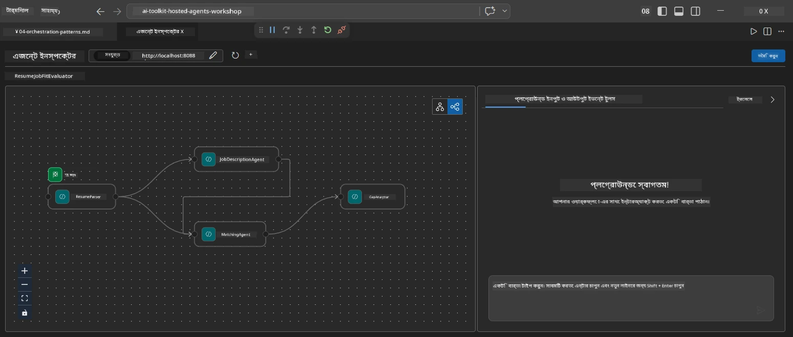
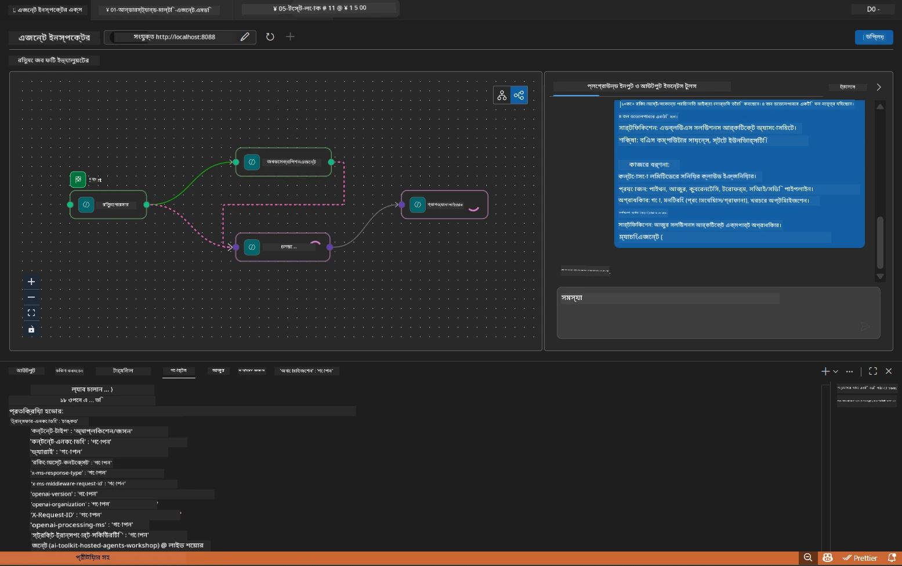
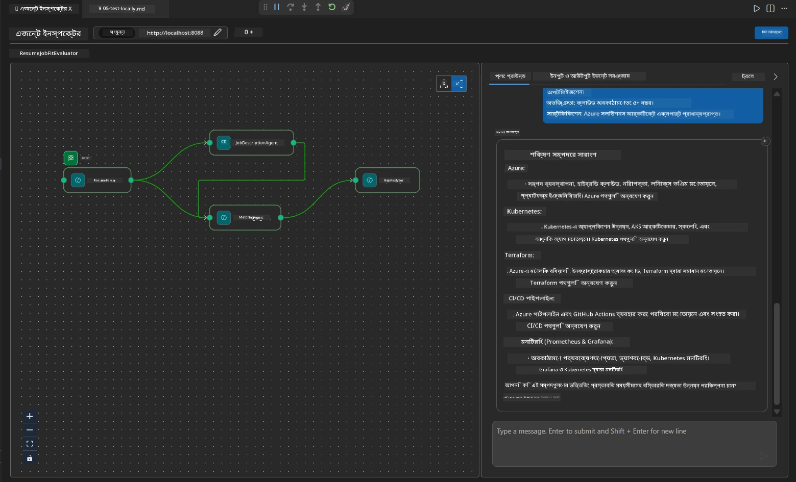

# মডিউল ৫ - লোকালি পরীক্ষা করুন

⏱️ ~১৫ মিনিট

এই মডিউলটিতে, আপনি মাল্টি-এজেন্ট ওয়ার্কফ্লো লোকালি চালাবেন, Agent Inspector দিয়ে এটি পরীক্ষা করবেন, এবং সকল চারটি এজেন্ট এবং MCP টুল সঠিকভাবে কাজ করছে কিনা তা যাচাই করবেন ডিপ্লয় করার আগে।

---

## ধাপ ১: এজেন্ট সার্ভার চালু করুন

### বিকল্প এ: VS Code টাস্ক ব্যবহার করা (প্রস্তাবিত)

১. `workshop/lab02-multi-agent/PersonalCareerCopilot/` আপনার VS Code ফোল্ডার হিসাবে খুলুন।
২. `Ctrl+Shift+P` চাপুন → টাইপ করুন **Tasks: Run Task** → নির্বাচন করুন **Run Agent HTTP Server**।
৩. টাস্কটি সার্ভার শুরু করবে debugpy সংযুক্ত সহ পোর্ট `5679` তে এবং এজেন্ট পোর্ট `8088` তে।
৪. আউটপুটে স্টার্টআপ বার্তা এবং সার্ভারের নিজস্ব রেডি মেসেজ (অন্যান্য লগ লাইন এর মাঝে প্রদর্শিত হবে) দেখার জন্য অপেক্ষা করুন:

```
INFO:resume-job-fit:Starting Resume -> Job Fit Evaluator HTTP server...
...
INFO:hypercorn.error:Running on http://0.0.0.0:8088 (CTRL + C to quit)
```

### বিকল্প বি: F5 ব্যবহার করা (ডিবাগ মোড)

১. `F5` চাপুন → নির্বাচন করুন **Debug Local Agent HTTP Server**।
২. সার্ভার সম্পূর্ণ ব্রেকপয়েন্ট সাপোর্ট সহ শুরু হবে - যা MCP রেসপন্স বা এজেন্ট আউটপুট পরিদর্শনের জন্য উপকারী।

---

## ধাপ ২: Agent Inspector খুলুন

১. `Ctrl+Shift+P` চাপুন → টাইপ করুন **Foundry Toolkit: Open Agent Inspector**।
২. Agent Inspector একটি VS Code প্যানেল হিসেবে খুলবে যা `http://localhost:8088` এ সংযুক্ত থাকবে।
৩. আপনি দেখতে পাবেন এজেন্ট ইন্টারফেস মেসেজ গ্রহণের জন্য প্রস্তুত।



> **যদি Agent Inspector না খুলে:** নিশ্চিত করুন সার্ভার সম্পূর্ণ শুরু হয়েছে (আপনি `Running on http://0.0.0.0:8088` লগ দেখবেন)। যদি পোর্ট ৫৬৭৯ ব্যস্ত থাকে, দেখুন [Module 8 - Troubleshooting](08-troubleshooting.md)।

---

## ধাপ ২b: (ঐচ্ছিক) Workflow Visualizer খুলুন

Foundry Toolkit-এ রয়েছে একটি রিয়েল-টাইম **Workflow Visualizer** যা দেখায় কীভাবে এজেন্টরা গ্রাফ চালানোর সময় আন্তঃক্রিয়া করে। এটি বিশেষত মাল্টি-এজেন্ট ডিবাগিংয়ের জন্য অত্যন্ত উপকারী।

১. `Ctrl+Shift+P` চাপুন → টাইপ করুন **Foundry Toolkit: Open Visualizer for Hosted Agents**।
২. একটি নতুন VS Code ট্যাব খুলবে যেখানে লাইভ এক্সিকিউশন গ্রাফ দেখানো হবে।
৩. Agent Inspector-এ আপনি যখন মেসেজ পাঠাবেন, ভিজ্যুয়ালাইজার স্বয়ংক্রিয়ভাবে আপডেট হবে - সবুজ নোডগুলি সম্পন্ন এজেন্ট নির্দেশ করে, এবং এনিমেটেড এজগুলি তাদের মধ্যে ডেটা প্রবাহিত দেখায়।

> **পোর্ট বিরোধ:** যদি ভিজ্যুয়ালাইজার পোর্ট ইতিমধ্যেই ব্যবহৃত হয়, সেটি ভিজ্যুয়াল কোড সেটিংসে পরিবর্তন করুন → **Extensions** → **Microsoft Foundry Configuration** → **Hosted Agents: Visualizer Port**।

---

## ধাপ ৩: Smoke tests চালান

এই দুটি টেস্ট ক্রমান্বয়ে চালান। প্রতিটি ধাপে ধাপে ওয়ার্কফ্লোর আরও অংশ পরীক্ষা করে।

### টেস্ট ১: বেসিক রেসুমে + জব ডেসক্রিপশন

নিচের কোড Agent Inspector-এ পেস্ট করুন:

```
Resume:
Jane Doe
Senior Software Engineer with 5 years of experience in Python, Django, and AWS.
Built microservices handling 10K+ requests/second. Led a team of 4 developers.
Certifications: AWS Solutions Architect Associate.
Education: B.S. Computer Science, State University.

Job Description:
Senior Cloud Engineer at Contoso Ltd.
Required: Python, Azure, Kubernetes, Terraform, CI/CD pipelines.
Preferred: Go, monitoring (Prometheus/Grafana), cost optimization.
Experience: 5+ years in cloud infrastructure.
Certifications: Azure Solutions Architect Expert preferred.
```

**প্রত্যাশিত আউটপুটের গঠন:**

রেসপন্সে ক্রমান্বয়ে সকল চারটি এজেন্টের আউটপুট থাকা উচিত:

১. **Resume Parser আউটপুট** - দুইটি লেবেলযুক্ত সেকশন: `[PARSED RESUME]` (প্রার্থী প্রোফাইল গ্রুপভূক্ত দক্ষতা সহ) এবং `[JOB DESCRIPTION PASS-THROUGH]` (মূলে JD Agent-কে উৎসাহিত করার জন্য JD টেক্সট)
২. **JD Agent আউটপুট** - কাঠামোবদ্ধ চাহিদা, প্রয়োজনীয় বনাম পছন্দসই দক্ষতা আলাদা করে
৩. **Matching Agent আউটপুট** - ফিট স্কোর (০-১০০) সহ বিশ্লেষণ, মিলানো দক্ষতা, অনুপস্থিত দক্ষতা, ফাঁক
৪. **Gap Analyzer আউটপুট** - প্রতিটি অনুপস্থিত দক্ষতার জন্য আলাদা গ্যাপ কার্ড, প্রতিটির সাথে Microsoft Learn URL





### টেস্ট ১-এ যাচাই করার বিষয়

| যাচাই করুন | প্রত্যাশিত | পাশ? |
|-------|----------|-------|
| রেসপন্সে ফিট স্কোর আছে | ০-১০০ এর মধ্যে সংখ্যা এবং বিশ্লেষণ | |
| মিলানো দক্ষতাগুলি তালিকাভুক্ত | Python, CI/CD (আংশিক), ইত্যাদি | |
| অনুপস্থিত দক্ষতাগুলি তালিকাভুক্ত | Azure, Kubernetes, Terraform, ইত্যাদি | |
| প্রতিটি অনুপস্থিত দক্ষতার জন্য গ্যাপ কার্ড আছে | প্রতিটি দক্ষতার জন্য একটি কার্ড | |
| Microsoft Learn URL বিদ্যমান | প্রকৃত `learn.microsoft.com` লিঙ্ক | |
| রেসপন্সে কোন ত্রুটি বার্তা নেই | পরিষ্কার কাঠামোবদ্ধ আউটপুট | |

### টেস্ট ২: এজ কেস - হাই-ফিট প্রার্থী

একটি রেসুমে পেস্ট করুন যা JD-র সাথে ঘনিষ্ঠভাবে মিলে যায়, যাচাই করতে যে GapAnalyzer উচ্চ ফিট পরিস্থিতি পরিচালনা করে:

```
Resume:
Alex Chen
Senior Cloud Engineer with 7 years of experience.
Skills: Python, Azure (AKS, Functions, DevOps), Kubernetes, Terraform, CI/CD (GitHub Actions, Azure Pipelines), Go, Prometheus, Grafana, cost optimization.
Certifications: Azure Solutions Architect Expert, Azure DevOps Engineer Expert.
Led infrastructure migration to Azure for 3 enterprise clients.
Education: M.S. Computer Science, Tech University.

Job Description:
Senior Cloud Engineer at Contoso Ltd.
Required: Python, Azure, Kubernetes, Terraform, CI/CD pipelines.
Preferred: Go, monitoring (Prometheus/Grafana), cost optimization.
Experience: 5+ years in cloud infrastructure.
Certifications: Azure Solutions Architect Expert preferred.
```

**প্রত্যাশিত আচরণ:**
- ফিট স্কোর হওয়া উচিত **৮০+** (অধিকাংশ দক্ষতা মেলে)
- গ্যাপ কার্ডগুলি মৌলিক শিক্ষার চাইতে পালিশ/ইন্টারভিউ প্রস্তুতির উপর কেন্দ্রীভূত হওয়া উচিত
- GapAnalyzer এর নির্দেশনা বলে: "যদি ফিট >= ৮০, তবে পালিশ/ইন্টারভিউ প্রস্তুতির উপর ফোকাস করুন"

---

## ধাপ ৪: নিজের ডেটা দিয়ে পরীক্ষা করুন (ঐচ্ছিক)

নিজস্ব রেসুমে এবং একটি বাস্তব জব ডেসক্রিপশন পেস্ট করে চেষ্টা করুন। এটি যাচাই করতে সাহায্য করে:

- এজেন্টরা বিভিন্ন রেসুমে ফরম্যাট (কালানুক্রমিক, ফাংশনাল, হাইব্রিড) পরিচালনা করে
- JD Agent বিভিন্ন JD স্টাইল (বুলেট পয়েন্ট, প্যারাগ্রাফ, কাঠামোবদ্ধ) পরিচালনা করে
- MCP টুল বাস্তব দক্ষতার জন্য প্রাসঙ্গিক রিসোর্স রিটার্ন করে
- গ্যাপ কার্ডগুলি আপনার নির্দিষ্ট পটভূমি অনুযায়ী ব্যক্তিগতকৃত

> **গোপনীয়তা - পাথ এ (Foundry ক্লাউড):** রেসুমে এবং JD টেক্সট আপনার Azure OpenAI ডিপ্লয়মেন্টে ইনফারেন্সের জন্য পাঠানো হয়। এটি ওয়ার্কশপ ইন্ফ্রাস্ট্রাকচার দ্বারা লগ বা স্টোর করা হয় না। আপনি ইচ্ছা করলে প্লেসহোল্ডার নাম (যেমন, "Jane Doe") ব্যবহার করতে পারেন।
>
> **গোপনীয়তা - পাথ বি (Foundry লোকাল):** সকল চারটি এজেন্ট ইনফারেন্স সম্পূর্ণভাবে আপনার ডিভাইসেই চলে। আপনার রেসুমে এবং জব ডেসক্রিপশন টেক্সট **কখনও আপনার মেশিন ছাড়ে না**। একমাত্র আউটবাউন্ড কল MCP টুলের মাধ্যমে `https://learn.microsoft.com/api/mcp` হতে রিসোর্স ফেচিং; সেই ক্যোয়ারীতে শুধুমাত্র দক্ষতার নাম থাকে, আপনার ব্যক্তিগত ডেটা নয়।

---

### চেকপয়েন্ট

- [ ] সার্ভার সফলভাবে পোর্ট `8088` এ চালু হয়েছে (লগে `Running on http://0.0.0.0:8088` দেখায়)
- [ ] Agent Inspector খুলে এজেন্টের সাথে সংযুক্ত হয়েছে
- [ ] টেস্ট ১: সম্পূর্ণ রেসপন্স ফিট স্কোর, মিলানো/অনুপস্থিত দক্ষতা, গ্যাপ কার্ড, এবং Microsoft Learn URL সহ
- [ ] টেস্ট ২: উচ্চ ফিট প্রার্থী ৮০+ স্কোর পায় পালিশ-কেন্দ্রিক সুপারিশসহ
- [ ] সমস্ত গ্যাপ কার্ড উপস্থিত রয়েছে (প্রতিটি অনুপস্থিত দক্ষতার জন্য একক, কোন কাটা নয়)
- [ ] সার্ভার টার্মিনালে কোন ত্রুটি বা স্ট্যাক ট্রেস নেই

---

**পূর্ববর্তী:** [০৪ - অর্কেসট্রেশন প্যাটার্নস](04-orchestration-patterns.md) · **পরবর্তী:** [০৬ - Foundry-তে ডিপ্লয় করুন →](06-deploy-to-foundry.md)

---

<!-- CO-OP TRANSLATOR DISCLAIMER START -->
**অস্বীকৃতি**:
এই নথিটি AI অনুবাদ পরিষেবা [Co-op Translator](https://github.com/Azure/co-op-translator) ব্যবহার করে অনূদিত হয়েছে। যদিও আমরা শুদ্ধতার জন্য চেষ্টা করি, অনুগ্রহ করে মনে রাখবেন যে স্বয়ংক্রিয় অনুবাদে ত্রুটি বা অসঙ্গতি থাকতে পারে। মূল নথিটি তার স্বভাষায় কর্তৃত্বপূর্ণ উৎস হিসেবে বিবেচিত হওয়া উচিত। গুরুত্বপূর্ণ তথ্যের জন্য পেশাদার মানব অনুবাদ সুপারিশ করা হয়। এই অনুবাদের ব্যবহারে প্রয়োজনীয় ভুল বোঝাবুঝি বা ভুল ব্যাখ্যার জন্য আমরা দায়বদ্ধ নই।
<!-- CO-OP TRANSLATOR DISCLAIMER END -->