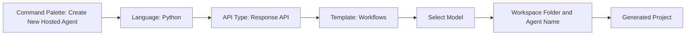

# Modul 2 - Vytvoření kostry projektu pro více agentů

⏱️ cca 5 min

V tomto modulu použijete [Foundry Toolkit for VS Code](https://aka.ms/foundrytk) k **vytvoření kostry projektu pro více agentů**. Průvodce vygeneruje `agent.yaml`, `main.py`, `Dockerfile`, `requirements.txt`, `.env`, a konfiguraci ladění VS Code - takže se můžete soustředit na propojení pracovního postupu se 4 agenty v Modulu 3.

> **Klíčový koncept:** Kostra je funkční zkušební verze s jedním agentem. Nahradíte zástupnou logiku grafem `WorkflowBuilder` v Modulu 3. Nepíšete základní šablonu od začátku.

> **Referenční implementace:** [`PersonalCareerCopilot/`](../../../../../workshop/lab02-multi-agent/PersonalCareerCopilot) je kompletní funkční příklad. Používejte ho k porovnání své práce průběžně.

### Průvodce vytvořením kostry



---

## Krok 1: Otevřete průvodce Create Hosted Agent

1. Stiskněte `Ctrl+Shift+P` pro otevření **Příkazové palety**.
2. Zadejte: **Foundry Toolkit: Create a New Hosted Agent** a vyberte jej.
3. Průvodce se otevře na kartě **Detaily agenta**.

> **Alternativa:** Klikněte na ikonu **Foundry Toolkit** v Activity Bar → klikněte na ikonu **+** vedle **Hosted Agents** → **Create New Hosted Agent**.

---

## Krok 2: Vyberte nastavení


1. V levé navigační/sekci možností vyberte následující:

| Menu | Výběr | Poznámky |
|--------|-----------|-------|
| **Jazyk** | Python | C# (.NET) je také podporován |
| **Framework** | Agent Framework | Poskytuje `Agent`, `AgentExecutor`, `WorkflowBuilder` |
| **Typ API** | Response API | `POST /responses` - historie spravovaná platformou, podpora streamingu |
| **Šablona** | **Workflows** | Zpracovává požadavky přes více agentů postupně |

2. Po výběru klikněte na **Next**


3. V dalším okně vyberte následující:

| Menu | Výběr | Poznámky |
|--------|-----------|-------|
| **Workspace folder** | Procházejte do cílové složky | např. `workshop/lab02-multi-agent/` v tomto repozitáři |
| **Název agenta** | `PersonalCareerCopilot` | Toto bude název adresáře projektu |
| **Nasazení modelu** | Vyberte svůj nasazený model | např. `gpt-4.1-mini` z Lab 01 |

4. Klikněte na **Create** pro vytvoření kostry projektu. VS Code vygeneruje soubory a otevře složku.

> **Tip:** [`gpt-4.1-mini`](https://learn.microsoft.com/azure/foundry/foundry-models/concepts/models-sold-directly-by-azure#gpt-41-series) dobře vyvažuje rychlost a kvalitu pro vývoj více agentů.

---

## Krok 3: Prohlédněte si vygenerovaný projekt

Po dokončení vytvoření kostry ověřte, že v Průzkumníku vidíte tyto soubory (`Ctrl+Shift+E`):

```
📂 <your-agent-name>/
├── .azdignore          ← Files excluded from Azure Developer CLI deployments
├── .dockerignore       ← Files excluded from Docker builds
├── .env                ← Environment variables (placeholders - fill in Module 3)
├── .vscode/
│   ├── launch.json     ← Debug config (F5 → run + Agent Inspector)
│   └── tasks.json      ← VS Code task definitions
├── agent.yaml          ← Agent definition (kind: hosted, protocol: responses)
├── Dockerfile          ← Container config for deployment
├── main.py             ← Stub agent entry point (replace with WorkflowBuilder in Module 3)
└── requirements.txt    ← Python dependencies
```

> **Důležité:** Otevřete tuto vytvořenou složku přímo ve VS Code, aby se `.vscode/launch.json` a `tasks.json` správně použily pro ladění pomocí F5.

### Vysvětlení klíčových souborů

| Soubor | Účel |
|------|---------|
| `agent.yaml` | Deklaruje `kind: hosted`, mapuje proměnné prostředí, definuje protokol `/responses` |
| `main.py` | Stub: jeden `FoundryChatClient` → `Agent` → `ResponsesHostServer`. Toto nahradíte ve Modulu 3 čtyřmi agenty + `WorkflowBuilder` |
| `Dockerfile` | `python:3.12-slim`, instaluje `requirements.txt`, zpřístupňuje port 8088, spouští `python main.py` |
| `requirements.txt` | `agent-framework-foundry`, `agent-framework-foundry-hosting`, `mcp<2,>=1.24.0`, `debugpy` |

> **Reference:** Viz [`PersonalCareerCopilot/agent.yaml`](../../../../../workshop/lab02-multi-agent/PersonalCareerCopilot/agent.yaml) a [`PersonalCareerCopilot/requirements.txt`](../../../../../workshop/lab02-multi-agent/PersonalCareerCopilot/requirements.txt) pro kompletní vygenerovaný obsah.

---

### ✅ Kontrolní bod

- [ ] Průvodce vytvořením kostry dokončen - nová složka projektu je viditelná v Průzkumníku
- [ ] Všechny očekávané soubory přítomny: `agent.yaml`, `main.py`, `Dockerfile`, `requirements.txt`, `.env`
- [ ] `agent.yaml` zobrazuje `kind: hosted` a `protocol: responses`
- [ ] `main.py` importuje `Agent`, `FoundryChatClient`, `ResponsesHostServer`
- [ ] Vytvořená složka je otevřena jako kořen pracovního prostoru VS Code
- [ ] Chápete, že `main.py` je stub - `WorkflowBuilder` bude přidán v Modulu 3

---

**Předchozí:** [01 - Pochopte architekturu více agentů](01-understand-multi-agent.md) · **Další:** [03 - Nakonfigurujte agenty a prostředí →](03-configure-agents.md)

---

<!-- CO-OP TRANSLATOR DISCLAIMER START -->
**Prohlášení o omezení odpovědnosti**:
Tento dokument byl přeložen pomocí AI překladatelské služby [Co-op Translator](https://github.com/Azure/co-op-translator). Přestože usilujeme o co největší přesnost, mějte prosím na paměti, že automatizované překlady mohou obsahovat chyby nebo nepřesnosti. Originální dokument v jeho mateřském jazyce by měl být považován za autoritativní zdroj. Pro kritické informace se doporučuje profesionální lidský překlad. Nejsme odpovědní za jakékoli nedorozumění nebo nesprávné interpretace vzniklé použitím tohoto překladu.
<!-- CO-OP TRANSLATOR DISCLAIMER END -->