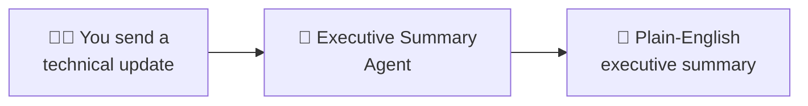

# Modul 0 - Introduktion

⏱️ ~10 min

> [!WARNING]
> **Preview & Begrænsninger:** [Hosted Agents](https://learn.microsoft.com/azure/foundry/agents/concepts/hosted-agents) er i øjeblikket i **offentlig preview** - anbefales ikke til produktionsarbejdsmængder. Vær opmærksom på følgende:
> - **Understøttede regioner er begrænsede** - tjek [regiontilgængelighed](https://learn.microsoft.com/azure/foundry/agents/concepts/hosted-agents#region-availability) inden oprettelse af ressourcer. Hvis du vælger en ikke-understøttet region, vil implementering mislykkes.
> - Pakken `agent-framework-foundry-hosting` er pre-release - API'er kan ændre sig mellem versioner.
> - Skaleringsgrænser: hosted agents understøtter 0–5 replikationer (inklusive skalering til nul).
> - Nogle funktioner, der vises i denne workshop, kan ændre sig, efterhånden som tjenesten nærmer sig GA.

## Hvad du vil bygge

I denne workshop bygger du en **"Forklar som om jeg er en leder"** agent - en hosted AI-agent, der tager komplekse tekniske opdateringer og omskriver dem som enkle ledelsesresuméer på almindeligt engelsk.

**Agenten bruger:**
- **Microsoft Agent Framework** - til agentlogik og struktur
- **Foundry Toolkit for VS Code** - til at scaffolde, teste lokalt og implementere
- **En AI-model** (f.eks. `gpt-4.1-mini/gpt-5-mini`) - til at generere resuméerne

Ved slutningen af dette laboratorium har du en fungerende agent, som du kan teste lokalt via Agent Inspector, og valgfrit implementere i skyen.

---

## Hvad er hosted agents?

En **hosted agent** er en AI-agent, der kører som en administreret service i Microsoft Foundry. I stedet for at administrere din egen infrastruktur, pakker du din agentkode i en container, og Foundry håndterer skalering, hosting og eksponering via en standard HTTP-endpoint.

| Begreb | Hvad det betyder |
|---------|--------------|
| **Agent** | Din Python-kode, som modtager en brugermeddelelse, kalder en AI-model og returnerer et struktureret svar |
| **Hosted** | Foundry kører din container for dig - ingen VM'er, ingen Kubernetes, ingen infrastruktur at administrere |
| **Svarprotokol** | En standard HTTP API (`POST /responses`), som enhver klient kan kalde for at interagere med din agent |
| **Agent Inspector** | En lokal test-UI (bygget ind i Foundry Toolkit), som lader dig chatte med din agent, inden du implementerer |

I denne workshop går du fra nul til en fuldt hosted agent - eller stopper ved lokal test, hvis du foretrækker det.

---

## Vælg din vej

> ⚠️ **Vælg én vej før du fortsætter.** Dit valg bestemmer hvilke værktøjer, der skal installeres, og hvilke moduler der gælder. Du kan skifte fra Sti B → Sti A senere, hvis du får et abonnement.

<strong>🅰️ Sti A - Azure-skyen (kræver Azure-abonnement)</strong>

| | Detaljer |
|---|---|
| **Hvem er det til?** | Du har et aktivt Azure-abonnement og kan oprette Foundry-ressourcer |
| **Model** | Azure OpenAI via Foundry (f.eks. `gpt-4.1-mini/gpt-5-mini`) |
| **Dækning af moduler** | Alle moduler (00–07) |
| **Implementere i skyen?** | ✅ Ja - fuld end-to-end implementering |

<strong>🅱️ Sti B - Lokalt / gratis niveau (kræver ikke Azure-abonnement)</strong>

| | Detaljer |
|---|---|
| **Hvem er det til?** | MVP'er, studerende eller alle uden Azure-adgang |
| **Model** | **Foundry Local** (gratis, kører på din maskine) |
| **Dækning af moduler** | Moduler 00–04 (spring implementering & cloud verificering over) |
| **Implementere i skyen?** | ❌ Nej - kun lokal test via Agent Inspector |

---

## Alle veje: Nødvendige værktøjer

Installer hvert værktøj nedenfor. Efter installation, bekræft at det virker ved at køre tjek-kommandoen.

| # | Værktøj | Version | Installér | Bekræft (Forventet output) |
|---|------|---------|---------|---------------------------|
| 1 | **Visual Studio Code** | Seneste | [code.visualstudio.com](https://code.visualstudio.com/) | Åbner uden fejl |
| 2 | **Python** | 3.12 eller nyere| [python.org/downloads](https://www.python.org/downloads/) | `python --version` $\rightarrow$ `Python 3.12.x` |
| 3 | **Foundry Toolkit for VS Code** | Seneste | Udvidelses ID: `ms-windows-ai-studio.windows-ai-studio` | Foundry-ikon i Aktivitetslinjen |
| 4 | **Python-extension for VS Code** | Seneste | Udvidelses ID: `ms-python.python` | Installeret i Udvidelses-panel |

> [!TIP]
> **Pro-tips til installationen:**
> - **Python PATH (Windows):** Sørg altid for at markere **"Add Python to PATH"** på den første skærm i Python-installationsprogrammet. Uden dette vil `python` ikke blive genkendt i dit terminalvindue.
> - **Flere Python-versioner:** Hvis du har installeret både Python 3.10 og 3.12, brug `python3.12 -m venv .venv` for at sikre, at den rigtige version bruges til dit virtuelle miljø.
> - **Docker WSL 2 (Windows):** Under installationen af Docker Desktop skal du sikre, at **WSL 2-backend** er valgt. Docker med Hyper-V er langsommere og kan give problemer med Foundry container builds.
> - **Docker starter ikke?** Vent 30–60 sekunder efter lanceringen af Docker Desktop. Kør `docker info` - hvis du ser "Cannot connect to the Docker daemon," så initialiserer Docker stadig.
> - **VS Code-extensions indlæses ikke?** Efter installation af extensions, genindlæs vinduet: `Ctrl+Shift+P` → `Developer: Reload Window`.

> **Windows-brugere:** Sørg for at markere **"Add Python to PATH"** under Python-installationen.

**Næste:** [01 - Setup →](01-setup.md)

---

<!-- CO-OP TRANSLATOR DISCLAIMER START -->
**Ansvarsfraskrivelse**:
Dette dokument er blevet oversat ved hjælp af AI-oversættelsestjenesten [Co-op Translator](https://github.com/Azure/co-op-translator). Selvom vi bestræber os på nøjagtighed, skal du være opmærksom på, at automatiserede oversættelser kan indeholde fejl eller unøjagtigheder. Det originale dokument på dets oprindelige sprog bør betragtes som den autoritative kilde. For kritisk information anbefales professionel menneskelig oversættelse. Vi påtager os intet ansvar for misforståelser eller fejltolkninger, der opstår som følge af brugen af denne oversættelse.
<!-- CO-OP TRANSLATOR DISCLAIMER END -->