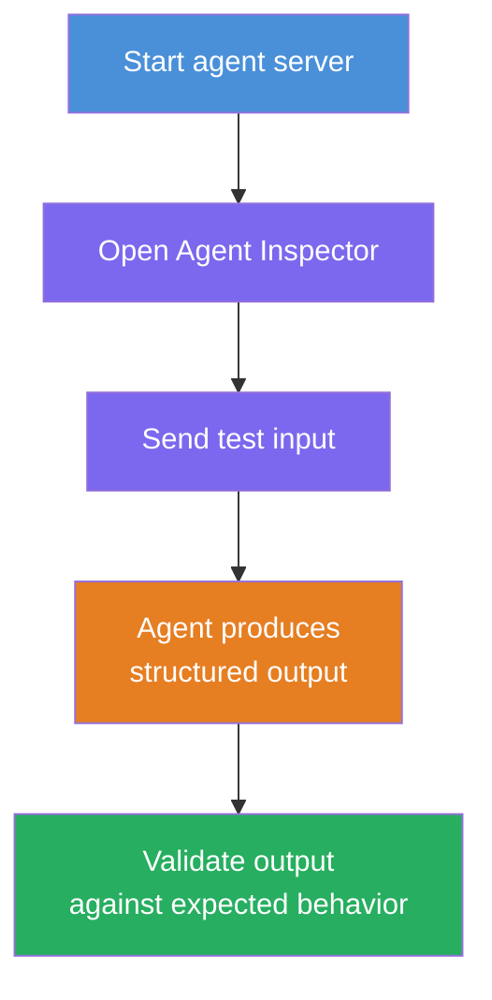
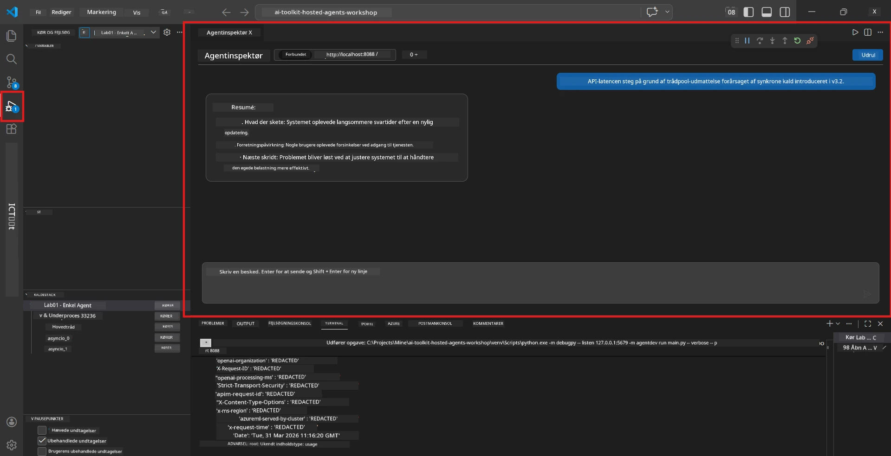
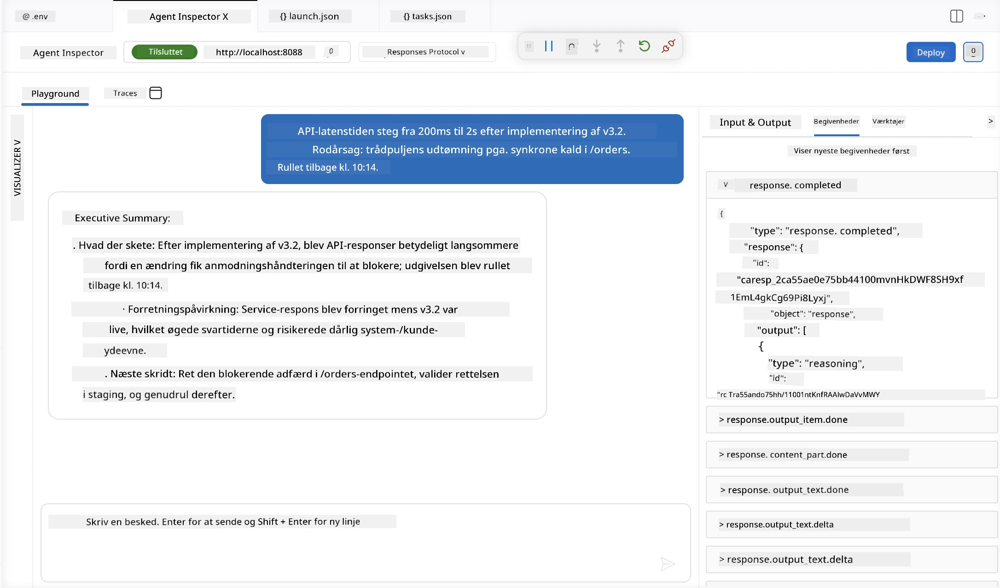

# Modul 4 - Test lokalt

⏱️ ~10 min

I dette modul kører du din agent lokalt og validerer, at den fungerer korrekt ved hjælp af **happy-path funktionelle tests**. Du bruger Agent Inspector (visuelt UI) eller direkte HTTP-kald for at bekræfte, at agenten producerer strukturerede, nøjagtige svar.

### Lokalt testningsflow



---

## Valgmulighed 1: Tryk på F5 - Debug med Agent Inspector (anbefalet)

### Start debuggeren

1. Åbn mappen **executive-summary-agent/** direkte i VS Code (`File → Open Folder`).
2. Åbn **Kør og Debug** panelet (`Ctrl+Shift+D`).
3. Vælg **Debug Local Agent HTTP Server** fra dropdown-menuen.
4. Tryk på **F5** (eller klik på ▶ Start Debugging).

> ⚠️ **Kritisk: Vælg din Python-fortolker**
> Hvis du får "ModuleNotFoundError" eller debuggeren ikke starter, skal du fortælle VS Code at bruge dit virtuelle miljø:
  > 1. Tryk på `Ctrl+Shift+P` $\rightarrow$ skriv **Python: Select Interpreter**.
  > 2. Vælg fortolkeren, der ligger i din projekts `.venv` mappe (f.eks. `.\.venv\Scripts\python.exe` på Windows).
  > 3. Genstart debug-sessionen.
> Hvis du stadig får fejl, opdater manuelt din fil `tasks.json` som følger:
  > 1. Naviger til `.vscode/tasks.json` filen
  > 2. Gå til opgaven mærket: `Run Agent HTTP Server`
  > 3. Opdater kommandoen som følger:
  >    - **Windows:** `"value": "${workspaceFolder}/.venv/Scripts/python.exe",`
  >    - **macOS/Linux:** `"value": "${workspaceFolder}/.venv/bin/python",`

### Hvad sker der

1. HTTP-serveren starter på `http://localhost:8088/responses`.
2. **Agent Inspector** panelet åbnes automatisk - en visuel chat-grænseflade til test.
3. Breakpoints er aktiveret i `main.py`.

Hold øje med Terminalen for:
```
Starting executive summary hosted agent
Executive agent server running on http://localhost:8088
```

> **Hvis Agent Inspector ikke åbner:** Tryk på `Ctrl+Shift+P` → **Foundry Toolkit: Open Agent Inspector**.



> *Skærmbilledet kan vise ældre 'AI TOOLKIT' branding fra en tidligere udvidelsesversion.*

---

## Mulighed 2: Test via Terminal (alternativ)

Start agenten i et terminalvindue, send forespørgsler fra et andet:

```bash
# Terminal 1: Start agent
cd executive-summary-agent/
source .venv/bin/activate
python main.py
```

```bash
# Terminal 2: Send test (curl)
curl -sS -X POST http://localhost:8088/responses \
  -H "Content-Type: application/json" \
  -d '{"input": "The API latency increased due to thread pool exhaustion caused by sync calls in v3.2.", "stream": false}'
```

---

## Scenarie tests: Happy-path funktionel validering

Kør **alle tre** scenarier nedenfor. Disse validerer, at din agent producerer korrekt, struktureret output for realistiske input.



### Scenarie 1: IT incident - API latenstop

**Input:**
```
The API latency increased from 200ms to 2s after deploying v3.2.
Root cause: thread pool starvation from synchronous calls in /orders.
Rolled back at 10:14.
```

**Forventet adfærd:**
- ✅ Følger "Executive Summary" strukturen (Hvad skete der / Forretningspåvirkning / Næste skridt)
- ✅ Ingen teknisk jargon (ingen "thread pool", ingen "/orders", ingen "v3.2")
- ✅ Angiver tydeligt forretningspåvirkningen (f.eks. brugere oplevede forsinkelser)
- ✅ Indeholder et næste skridt (f.eks. fix implementeret, overvågning på plads)

---

### Scenarie 2: Data Pipeline - ETL fejl

**Input:**
```
The nightly ETL job failed because the upstream schema changed. APAC dashboards show missing data.
```

**Forventet adfærd:**
- ✅ Opsummerer dataopdateringsfejlen i letforståeligt sprog
- ✅ Nævner APAC dashboard påvirkningen
- ✅ Indeholder et afhjælpende næste skridt
- ✅ Nævner IKKE "ETL", "schema" eller andre tekniske termer

---

### Scenarie 3: Sikkerhed - Udsat legitimationsoplysninger

**Input:**
```
Static analysis flagged a hardcoded secret in the repository.
The secret may have been exposed in commit history.
```

**Forventet adfærd:**
- ✅ Beskriver en legitimations-/sikkerhedsproblematik på et ledelsesvenligt niveau
- ✅ Fremhæver potentiel risiko (uautoriseret adgang)
- ✅ Angiver afhjælpende handling (credential rotation, audit)
- ✅ Indeholder IKKE termer som "static analysis", "commit history" eller "hardcoded"

---

## Valideringskriterier

For hvert scenarie, tjek:

| # | Kriterium | Godkendelsesbetingelse |
|---|----------|-----------------------|
| 1 | **Struktur** | Responsen bruger "Executive Summary"-formatet med alle tre punkter |
| 2 | **Letforståeligt sprog** | Ingen teknisk jargon som en leder ikke ville forstå |
| 3 | **Nøjagtighed** | Opsummeringen afspejler inputtet - ingen fabrikerede detaljer |
| 4 | **Kortfattethed** | Responsen er under 100 ord |
| 5 | **Næste skridt** | En klar handling eller afbødning er angivet |

---

## Tips til fejlfinding

| Problem | Løsning |
|---------|---------|
| Agenten starter ikke | Tjek `.env` værdier, verificer at venv er aktiveret, kør `pip install -r requirements.txt` |
| Tom eller generisk respons | Gennemgå instruktioner i `main.py` - sørg for at output format er specificeret |
| Respons indeholder jargon | Forstærk "fjern tekniske termer" regler i instruktionerne |
| Agent Inspector åbner ikke | `Ctrl+Shift+P` → **Foundry Toolkit: Open Agent Inspector** |
| Model fejl i Terminal | Verificer at `AZURE_AI_MODEL_DEPLOYMENT_NAME` matcher præcist (case-sensitive) |

---

### ✅ Tjekpunkt

- [ ] Agenten starter lokalt uden fejl
- [ ] Agent Inspector åbner og viser en chat-grænseflade (hvis du bruger F5)
- [ ] **Scenarie 1** (IT hændelse) - struktureret Executive Summary, ingen jargon
- [ ] **Scenarie 2** (data pipeline) - relevant opsummering med forretningspåvirkning
- [ ] **Scenarie 3** (sikkerhedsadvarsel) - passende risikokommunikation
- [ ] Alle svar følger den definerede outputstruktur

> **Gem dine svar** (kopier eller tag screenshot) - du vil sammenligne dem med cloud-resultater i Modul 06.

---

**Forrige:** [03 - Konfigurer & Kode](03-configure-and-code.md) · **Næste:** [05 - Deploy til Foundry →](05-deploy-to-foundry.md)

---

<!-- CO-OP TRANSLATOR DISCLAIMER START -->
**Ansvarsfraskrivelse**:
Dette dokument er blevet oversat ved hjælp af AI-oversættelsestjenesten [Co-op Translator](https://github.com/Azure/co-op-translator). Selvom vi bestræber os på nøjagtighed, skal du være opmærksom på, at automatiserede oversættelser kan indeholde fejl eller unøjagtigheder. Det originale dokument på dets oprindelige sprog bør betragtes som den autoritative kilde. For kritisk information anbefales professionel menneskelig oversættelse. Vi påtager os intet ansvar for misforståelser eller fejltolkninger, der opstår som følge af brugen af denne oversættelse.
<!-- CO-OP TRANSLATOR DISCLAIMER END -->