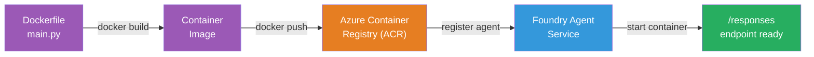

# Modul 5 - Udrul til Foundry Agent Service

⏱️ ~10 min

> ⚠️ **Path B-brugere:** Dette modul kræver et Foundry-abonnement. Hvis du bruger Foundry Local, spring til [Modul 07 - Resumé](07-summary.md). Du har med succes gennemført den lokale udviklingsarbejdsgang!

I dette modul udruller du din lokalt-testede agent til Microsoft Foundry som en **Hostet Agent**. Udrulningen bygger et containerbillede, skubber det til Azure Container Registry og starter agenten i Foundrys administrerede infrastruktur.

### Udrulningspipeline

---

## Forudsætningskontrol

Før du udruller, bekræft:

- [ ] Agent passerer alle 3 lokale scenarier fra [Modul 04](04-test-locally.md)
- [ ] Du har rollen **Azure AI User** på projektniveau ([Modul 01, Tildel RBAC](01-setup.md#implementer-en-model-tildel-rbac))
- [ ] Du er logget ind på Azure i VS Code (Konti-ikonet viser dit navn)

---

## Trin 1: Start udrulningen

### Mulighed A: Udrul fra Agent Inspector (anbefalet)

Hvis Agent Inspector er åben (fra test):
1. Klik på **Deploy**-knappen i øverste højre hjørne (sky-ikon ↑).

### Mulighed B: Udrul fra Command Palette

1. Tryk `Ctrl+Shift+P` → **Foundry Toolkit: Deploy Hosted Agent**.

---

## Trin 2: Konfigurer udrulningen

Guiden beder dig om:

| Prompt | Valg |
|--------|-----------|
| **Abonnement** | Dit Azure-abonnement |
| **Målprojekt** | Dit Foundry-projekt (f.eks. `workshop-agents`) |

Klik **næste** for at konfigurere din agent.

| Prompt | Valg |
|--------|-----------|
| **Udrulningsmetode** | Container |
| **Containerregister** | **Default ACR** (Microsoft Foundry opretter og administrerer ét for dig) |
| **Udrul til** | Ny agent (navn, `executive-summary-agent`) |

Klik **næste** for at gennemgå og udrulle din agent.

| Prompt | Valg |
|--------|-----------|
| **CPU og hukommelse** | **0.25 CPU-kerner, 0.5 Gi hukommelse** (tilstrækkeligt til workshoppen) |

---

## Trin 3: Udrul og overvåg

1. Klik på **Deploy**.
2. Hold øje med **Output**-panelet (vælg **Microsoft Foundry** i dropdown-menuen).
3. Udrulningen gennemløber disse trin:
   - **Docker build** - bygger container fra din Dockerfile
   - **Docker push** - skubber image til ACR (1–3 min ved første udrulning)
   - **Agent registration** - opretter hostet agent i Foundry
   - **Container start** - starter med systemadministreret identitet

4. Når det er fuldført, vises en notifikation:
   > **my-agent er udrullet med succes.** `View logs` `Run agent`

5. Klik **Run agent** for at åbne Agent Playground.

### Udrulningsstatusværdier

| Status | Betydning |
|--------|---------|
| **Kører** | Container klar, agent svarer |
| **Afventer** | Container starter - vent 30–60 sekunder |
| **Mislykket** | Tjek logfiler (se fejlfinding nedenfor) |

---

## Almindelige udrulningsfejl

| Fejl | Rodårsag | Løsning |
|-------|-----------|-----|
| `agents/write` permission denied | Manglende **Azure AI User**-rolle på projektniveau | [Modul 01, Tildel RBAC](01-setup.md#implementer-en-model-tildel-rbac) |
| Docker kører ikke | Docker Desktop er ikke startet | Start Docker Desktop → bekræft `docker info` |
| ACR-autorisering | Administreret identitet kan ikke hente containerbilledet | Se [Modul 08 - Fejlfinding](08-troubleshooting.md) |

---

### ✅ Kontrolpunkt

- [ ] Udrulning gennemført uden fejl
- [ ] Agenten vises under **Hosted Agents (Preview)** i Foundry-sidebjælken
- [ ] Containerstatus viser **Kører**
- [ ] Agent Playground-fanen er åbnet og viser agentdetaljer og slutpunkts-URL

---

**Forrige:** [04 - Test lokalt](04-test-locally.md) · **Næste:** [06 - Bekræft i Playground →](06-verify-in-playground.md)

---

<!-- CO-OP TRANSLATOR DISCLAIMER START -->
**Ansvarsfraskrivelse**:
Dette dokument er blevet oversat ved hjælp af AI-oversættelsestjenesten [Co-op Translator](https://github.com/Azure/co-op-translator). Selvom vi bestræber os på nøjagtighed, skal du være opmærksom på, at automatiserede oversættelser kan indeholde fejl eller unøjagtigheder. Det originale dokument på dets oprindelige sprog bør betragtes som den autoritative kilde. For kritisk information anbefales professionel menneskelig oversættelse. Vi påtager os intet ansvar for misforståelser eller fejltolkninger, der opstår som følge af brugen af denne oversættelse.
<!-- CO-OP TRANSLATOR DISCLAIMER END -->
