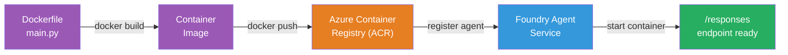
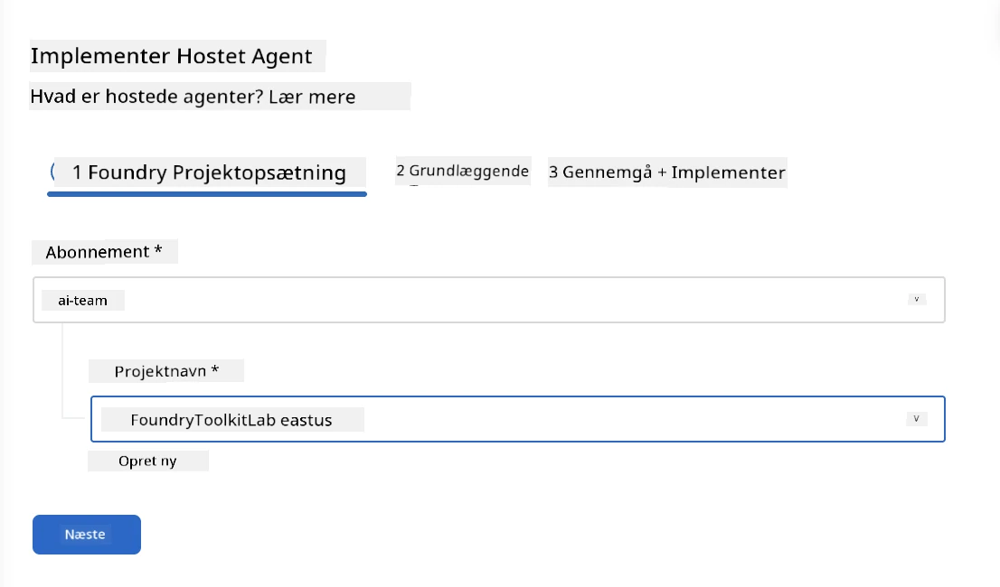
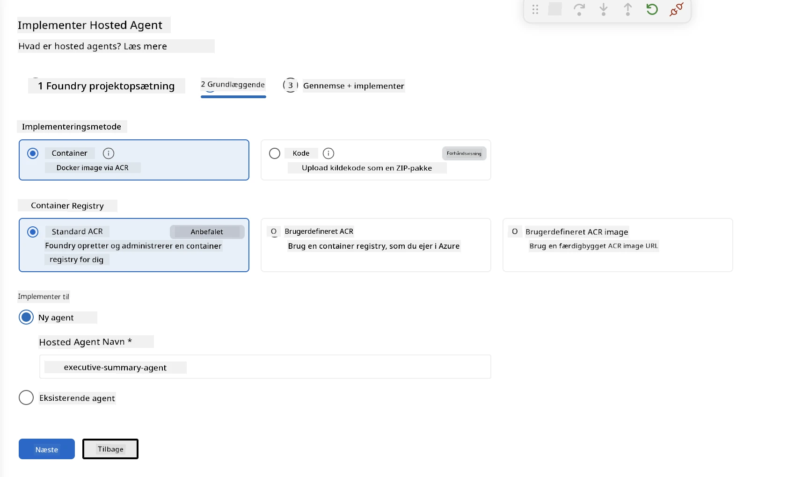
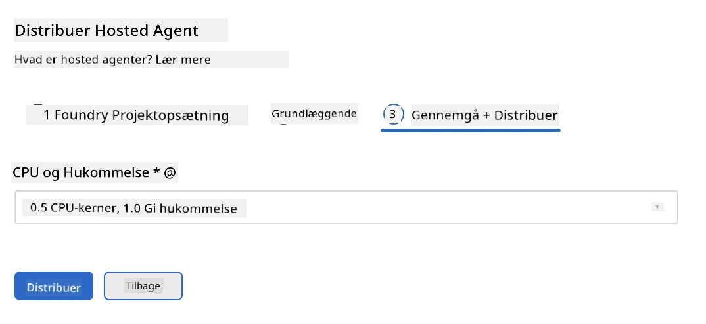
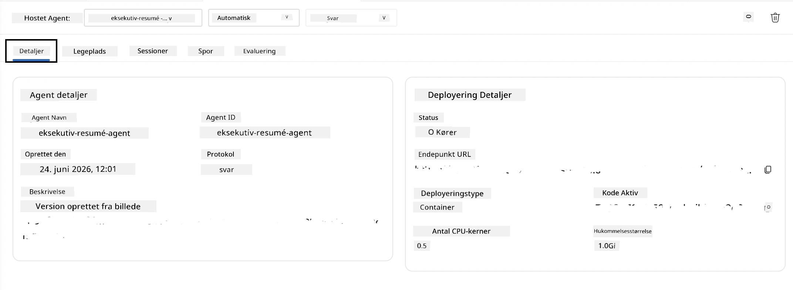

# Modul 5 - Udrul til Foundry Agent Service

⏱️ ~10 min

> ⚠️ **Brugere af Path B:** Dette modul kræver et Foundry-abonnement. Hvis du bruger Foundry Local, spring videre til [Modul 07 - Resume](07-summary.md). Du har med succes gennemført den lokale udviklingsworkflow!

I dette modul udruller du din lokalt testede agent til Microsoft Foundry som en **Hosted Agent**. Udrulningen bygger et containerbillede, skubber det til Azure Container Registry og starter agenten i Foundrys styrede infrastruktur.

### Udrulningspipeline

---

## Forudsætninger kontrol

Før udrulning, verificer:

- [ ] Agenten består alle 3 lokale scenarier fra [Modul 04](04-test-locally.md)
- [ ] Du har **Azure AI User**-rollen på projekt niveau ([Modul 01, Tildel RBAC](01-setup.md#deploy-a-model--assign-rbac))
- [ ] Du er logget ind i Azure i VS Code (kontoikon viser dit navn)

---

## Trin 1: Start udrulningen

### Mulighed A: Udrul fra Agent Inspector (anbefalet)

Hvis Agent Inspector er åben (fra test):
1. Klik på **Deploy** knappen øverst til højre (sky-ikon ↑).

### Mulighed B: Udrul fra Command Palette

1. Tryk `Ctrl+Shift+P` → **Foundry Toolkit: Deploy Hosted Agent**.

---

## Trin 2: Konfigurer udrulningen

Guiden beder om:

| Forespørgsel | Valg |
|--------|-----------|
| **Abonnement** | Dit Azure-abonnement |
| **Målprojekt** | Dit Foundry-projekt (f.eks. `workshop-agents`) |

Klik på **næste** for at konfigurere din agent.

| Forespørgsel | Valg |
|--------|-----------|
| **Udrulningsmetode** | Container |
| **Container register** | **Standard ACR** (Microsoft Foundry opretter og administrerer en for dig) |
| **Udrul til** | Ny agent (navn, `executive-summary-agent`) |

Klik på **næste** for at gennemgå og udrulle din agent.

| Forespørgsel | Valg |
|--------|-----------|
| **CPU og hukommelse** | **0.5 CPU-kerner, 1.0 Gi hukommelse** (standard - tilstrækkeligt til workshop) |

---

## Trin 3: Udrul og overvåg

1. Klik på **Deploy**.
2. Følg med i **Output** panelet (vælg **Microsoft Foundry** fra dropdown-menuen).
3. Udrulningen gennemgår disse stadier:
   - **Docker build** - bygger container fra din Dockerfile
   - **Docker push** - skubber billede til ACR (1–3 min ved første udrulning)
   - **Agent registrering** - opretter hosted agent i Foundry
   - **Container start** - starter med system-administreret identitet

4. Når færdig, vises en notifikation:
   > **executive-summary-agent er udrullet succesfuldt.** `View logs` `Run agent`

5. Klik **Run agent** for at åbne Agent Playground.

### Udrulningsstatus værdier

| Status | Betydning |
|--------|---------|
| **Running** | Container klar, agent svarer |
| **Pending** | Container starter - vent 30–60 sekunder |
| **Failed** | Tjek logs (se fejlfinding nedenfor) |

---

## Almindelige udrulningsfejl

| Fejl | Rodårsag | Løsning |
|-------|-----------|-----|
| `agents/write` tilladelse nægtet | Manglende **Azure AI User** rolle på projektniveau | [Modul 01, Tildel RBAC](01-setup.md#deploy-a-model--assign-rbac) |
| Docker kører ikke | Docker Desktop er ikke startet | Start Docker Desktop → verificer `docker info` |
| ACR autorisation | Administreret identitet kan ikke trække billede | Se [Modul 08 - Fejlfinding](08-troubleshooting.md) |

---

### ✅ Tjekpunkt

- [ ] Udrulning gennemført uden fejl
- [ ] Agent vises på fanen **Hosted Agent** når du klikker **Agents** under dit projekt i Foundry Toolkit sidepanelet
- [ ] Container status viser **Running**
- [ ] Agent Playground fanen er åbnet og viser agentdetaljer og endpoint URL

---

**Forrige:** [04 - Test lokalt](04-test-locally.md) · **Næste:** [06 - Bekræft i Playground →](06-verify-in-playground.md)

---

<!-- CO-OP TRANSLATOR DISCLAIMER START -->
**Ansvarsfraskrivelse**:
Dette dokument er blevet oversat ved hjælp af AI-oversættelsestjenesten [Co-op Translator](https://github.com/Azure/co-op-translator). Selvom vi bestræber os på nøjagtighed, skal du være opmærksom på, at automatiserede oversættelser kan indeholde fejl eller unøjagtigheder. Det originale dokument på dets oprindelige sprog bør betragtes som den autoritative kilde. For kritisk information anbefales professionel menneskelig oversættelse. Vi påtager os intet ansvar for misforståelser eller fejltolkninger, der opstår som følge af brugen af denne oversættelse.
<!-- CO-OP TRANSLATOR DISCLAIMER END -->