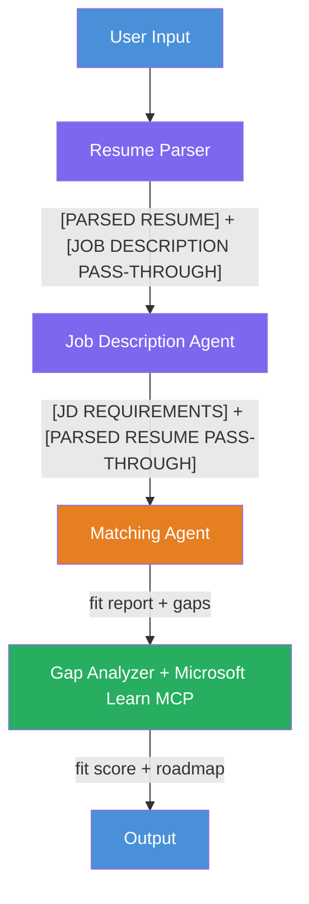

# Lab 02 - Multi-Agent Workflow: CV → Job Fit Evaluator

## Oversigt

I denne praktiske lab bygger du en **workflow-først multi-agent app** ved hjælp af Foundry Toolkit i VS Code og implementerer den til Microsoft Foundry Agent Service.

**Hvad du bygger:** en CV → Job Fit Evaluator, der analyserer et CV og en jobbeskrivelse, vurderer matchen og producerer en personlig læringsplan ved hjælp af Microsoft Learn ressourcer.

---

## Arkitektur

**Sådan fungerer det:**
1. Brugeren indsætter et CV og en jobbeskrivelse.
2. **ResumeParser** analyserer CV'et og kopierer jobbeskrivelsen ordret ind i en `[JOB DESCRIPTION PASS-THROUGH]` sektion.
3. **JD Agent** udtrækker strukturerede krav fra gennemgangen og sender derefter `[PARSED RESUME]` videre som `[PARSED RESUME PASS-THROUGH]`.
4. **MatchingAgent** sammenligner `[PARSED RESUME PASS-THROUGH]` mod `[JD REQUIREMENTS]` og producerer en fit-score.
5. **GapAnalyzer** konverterer hullerne til en praktisk køreplan og henter rigtige Microsoft Learn-links via MCP.

---

## Forudsætninger

Gennemfør først Lab 01:

- [Lab 01 - Single Agent](../lab01-single-agent/README.md)

---

## Del 1: Læs modulerne i rækkefølge

Se hele læringsforløbet i:

- [Lab 2 Docs - Forudsætninger](docs/00-prerequisites.md)
- [Lab 2 Docs - Fuldt læringsforløb](docs/README.md)
- [PersonalCareerCopilot kørselsvejledning](PersonalCareerCopilot/README.md)

---

## Del 2: Byg og test workflowet

1. Brug Foundry Toolkit-guiden til at skabe workflow-baseret projekt.
2. Kopiér prompt-blokkene og workflow-grafen fra `PersonalCareerCopilot/main.py` ind i dit arbejdsområde.
3. Kør lokalt med Agent Inspector og verificér alle fire agenter plus MCP-værktøjet.
4. Implementér den hostede agent til Foundry når lokal test er bestået.

---

## Orkestreringsmønstre

Lab 02 bruger en **sekventiel pipeline**: hver agents output fødes videre til den næste, og workflowet returnerer den endelige agents svar. To mønstre får dette til at fungere:

- **Sekventiel kæde** - `WorkflowBuilder` forbinder ResumeParser → JD Agent → MatchingAgent → GapAnalyzer med ét `add_edge()` kald pr. trin
- **Indholdsvidereformidling** - fordi hver agent kun ser output fra sin direkte forgænger, kopierer ResumeParser og JD Agent de data, downstream-agenternes har brug for, til markerede gennemgangssektioner

Dokumentationen forklarer også, hvorfor labben ikke bruger fan-out/fan-in, og hvordan grafen kan udvides med en anden agent.

Se [docs/04-orchestration-patterns.md](docs/04-orchestration-patterns.md).

---

**Forrige:** [Lab 01 - Single Agent](../lab01-single-agent/README.md) · **Tilbage til:** [Workshop Hjem](../../README.md)

---

<!-- CO-OP TRANSLATOR DISCLAIMER START -->
**Ansvarsfraskrivelse**:
Dette dokument er blevet oversat ved hjælp af AI-oversættelsestjenesten [Co-op Translator](https://github.com/Azure/co-op-translator). Selvom vi bestræber os på nøjagtighed, skal du være opmærksom på, at automatiserede oversættelser kan indeholde fejl eller unøjagtigheder. Det originale dokument på dets oprindelige sprog bør betragtes som den autoritative kilde. For kritisk information anbefales professionel menneskelig oversættelse. Vi påtager os intet ansvar for misforståelser eller fejltolkninger, der opstår som følge af brugen af denne oversættelse.
<!-- CO-OP TRANSLATOR DISCLAIMER END -->