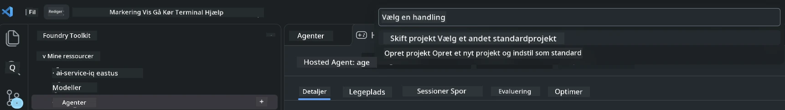

# Modul 0 - Introduktion

⏱️ ~10 min

> [!WARNING]
> **Preview & Begrænsninger:** [Hosted Agents](https://learn.microsoft.com/azure/foundry/agents/concepts/hosted-agents) er i øjeblikket i **offentlig preview** - ikke anbefalet til produktionsarbejdsbelastninger. Nogle funktioner vist i denne workshop kan ændre sig, efterhånden som tjenesten bevæger sig mod GA.

## Hvad du vil bygge

I dette laboratorie udvider du enkelt-agent færdighederne fra Lab 01 til at bygge en **multi-agent arbejdsgang** - Resume → Job Fit Evaluator.

Du indsætter et **cv** og en **jobbeskrivelse**. Fire specialiserede agenter behandler inputtene sekventielt og returnerer derefter:
- En fit-score (0–100 med en score-opdeling)
- En liste over mangler i færdigheder og certificeringer
- En personlig læringsplan med rigtige Microsoft Learn-links for hver mangel

**Arbejdsgangen bruger:**
- **Microsoft Agent Framework** - `WorkflowBuilder` til sekventiel pipeline orkestrering
- **Foundry Toolkit for VS Code** - scaffolding, lokal test, deployment
- **En AI-model** (fx `gpt-4.1-mini`) - brugt af alle fire agenter
- **Microsoft Learn MCP-server** - leverer rigtige læringsressourcelinks for hver færdighedsmangel

---

## Vælg din vej

> ⚠️ **Fortsæt med samme vej, som du brugte i Lab 01.**

<details open>
<summary><strong>🅰️ Vej A - Azure cloud (kræver Azure abonnement)</strong></summary>

| | Detaljer |
|---|---|
| **Hvem er denne til?** | Du har gennemført Lab 01 med et Azure-abonnement |
| **Model** | Azure OpenAI via Foundry (fx `gpt-4.1-mini`) |
| **Dækkede moduler** | Alle moduler (00–09) |
| **Deploy til cloud?** | ✅ Ja - fuld end-to-end deployment |

</details>

<details open>
<summary><strong>🅱️ Vej B - Foundry Local (kræver ikke Azure abonnement)</strong></summary>

| | Detaljer |
|---|---|
| **Hvem er denne til?** | Du har gennemført Lab 01 med Foundry Local |
| **Model** | Foundry Local (gratis, kører på din maskine) |
| **Dækkede moduler** | Moduler 00–05 (spring 06–07 over - deployment & cloud verifikation) |
| **Deploy til cloud?** | ❌ Nej - kun lokal test via Agent Inspector |

</details>

---

## Lab 01 tjek

Lab 02 bygger direkte videre på Lab 01. Fuldfør Lab 01 først, inden du starter her.

Har du ikke lavet Lab 01 endnu? Start her: [Lab 01 - Introduktion](../../lab01-single-agent/docs/00-prerequisites.md)

<details open>
<summary><strong>🅰️ Vej A - Azure cloud</strong></summary>

```powershell
az account show --query "{name:name, id:id}" --output table
```

Hvis dette fejler, kør `az login`. Bekræft derefter i VS Code:

1. `Ctrl+Shift+P` → skriv **Foundry Toolkit** → bekræft at kommandoer vises.
2. Klik på **Foundry Toolkit** ikonet → dit projekt og deployede model viser **Succeeded**.



> **RBAC:** Du tildelte **Foundry User** i Lab 01. Hvis du skal tildele det igen, se [Lab 01, Modul 1](../../lab01-single-agent/docs/01-setup.md#deploy-a-model--assign-rbac). Rollen hed tidligere **Azure AI User** - samme tilladelser.

</details>

<details open>
<summary><strong>🅱️ Vej B - Foundry Local</strong></summary>

```powershell
Invoke-WebRequest -Uri "http://localhost:5273/v1/health" -UseBasicParsing | Select-Object StatusCode
```

Forventet: `StatusCode: 200`. Hvis ikke, genstart Foundry Local fra Foundry Toolkit sidebjælken.

> Al inferens kører på din maskine. Det eneste udgående kald er MCP-værktøjet til `https://learn.microsoft.com/api/mcp`.

</details>

---

## Hvad er nyt i Lab 02

| | Lab 01 | Lab 02 |
|--|--------|--------|
| Agenter | 1 | 4 (kædet sammen med WorkflowBuilder) |
| Scaffold skabelon | Grundlæggende - Agent Framework | Arbejdsgange - Agent Framework |
| Ny pakke | - | `mcp` |
| Orkestrering | Enkel samtaleagent | Sekventiel pipeline (WorkflowBuilder) |
| Nyt værktøj | - | `search_microsoft_learn_for_plan` (MCP) |

---

**Næste:** [01 - Forstå arkitekturen →](01-understand-multi-agent.md)

---

<!-- CO-OP TRANSLATOR DISCLAIMER START -->
**Ansvarsfraskrivelse**:
Dette dokument er blevet oversat ved hjælp af AI-oversættelsestjenesten [Co-op Translator](https://github.com/Azure/co-op-translator). Selvom vi bestræber os på nøjagtighed, skal du være opmærksom på, at automatiserede oversættelser kan indeholde fejl eller unøjagtigheder. Det originale dokument på dets oprindelige sprog bør betragtes som den autoritative kilde. For kritisk information anbefales professionel menneskelig oversættelse. Vi påtager os intet ansvar for misforståelser eller fejltolkninger, der opstår som følge af brugen af denne oversættelse.
<!-- CO-OP TRANSLATOR DISCLAIMER END -->