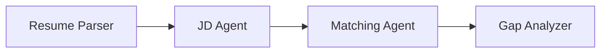
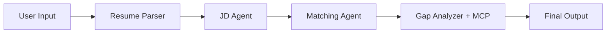

# Modul 4 - Orkestreringsmønstre

⏱️ ~10 min

I dette modul udforsker du de orkestreringsmønstre, der anvendes i Resume Job Fit Evaluator, og lærer hvordan man læser, ændrer og udvider workflow-grafen. Forståelse af disse mønstre er essentielt for fejlfinding af dataflowproblemer og opbygning af dine egne [multi-agent workflows](https://learn.microsoft.com/agent-framework/workflows/).

---

## Mønster 1: Sekventiel kæde

Det grundlæggende mønster i workflow er en **sekventiel kæde** - hver agents output føres direkte videre til den næste.



I koden opretter hvert `add_edge()` kald et trin i kæden:

```python
.add_edge(resume_executor, jd_executor)       # ResumeParser output → JD Agent
.add_edge(jd_executor, matching_executor)     # JD Agent output → MatchingAgent
.add_edge(matching_executor, gap_executor)    # MatchingAgent output → GapAnalyzer
```

> **Hvorfor sekventiel og ikke fan-out/fan-in?** `WorkflowBuilder` bruger **OR-semantik** for indkommende kanter: en efterfølgende executor aktiveres, så snart **en hvilken som helst** forgænger er færdig. Hvis `matching_executor` havde to indkommende kanter (fra både `resume_executor` og `jd_executor`), ville den aktivere to gange - én gang når ResumeParser er færdig og igen når JD Agent er færdig - hvilket ville få GapAnalyzer til også at køre to gange og outputtet til at optræde dobbelt. Den sekventielle pipeline undgår dette helt.

## Mønster 2: Indholdsvideresendelse

Fordi `context_mode="last_agent"` betyder, at hver executor kun ser output fra sin **direkte forgænger**, skal agenter i en sekventiel kæde eksplicit vidersende alle data, som efterfølgende agenter har brug for.

I dette workflow:
- **ResumeParser** kopierer JD ordret over i `[JOB DESCRIPTION PASS-THROUGH]` (så JD Agent kan finde det).
- **JD Agent** kopierer `[PARSED RESUME]` ordret over i `[PARSED RESUME PASS-THROUGH]` (så MatchingAgent kan sammenligne begge profiler).

```
ResumeParser output
└─ [PARSED RESUME]               ← extracted by JD Agent
└─ [JOB DESCRIPTION PASS-THROUGH] ← extracted by JD Agent

JD Agent output
└─ [JD REQUIREMENTS]             ← extracted by MatchingAgent
└─ [PARSED RESUME PASS-THROUGH]  ← extracted by MatchingAgent
```

Hver videresendelsessektion skal kopieres **ordret** - at opsummere eller omskrive den vil ødelægge den efterfølgende agent, som er afhængig af det.

---

## Det komplette diagram

Kombinationen af det sekventielle kæde- og indholdsvideresendelsesmønster producerer den fulde workflow:



Agent Inspector viser samme diagramstruktur, når agenten kører lokalt. Se [Modul 5 - Test Lokalt](05-test-locally.md) for skærmbilleder.

---

## Læsning af WorkflowBuilder-koden

Workflow-grafen bygges i funktionen `main()` i [`PersonalCareerCopilot/main.py`](../../../../../workshop/lab02-multi-agent/PersonalCareerCopilot/main.py). De tre `add_edge()` kald bygger den sekventielle pipeline:

| # | Kilde | Effekt |
|---|------|--------|
| 1 | `resume_executor → jd_executor` | JD Agent modtager `[PARSED RESUME]` + `[JOB DESCRIPTION PASS-THROUGH]` |
| 2 | `jd_executor → matching_executor` | MatchingAgent modtager `[JD REQUIREMENTS]` + `[PARSED RESUME PASS-THROUGH]` |
| 3 | `matching_executor → gap_executor` | GapAnalyzer modtager fit-rapport + hul-liste |

---

## Ændring af grafen

### Tilføjelse af en ny agent

For at tilføje en femte agent (f.eks. en **InterviewPrepAgent** efter GapAnalyzer):

1. Definer en `INTERVIEW_PREP_INSTRUCTIONS` konstant.
2. Opret `Agent` + `AgentExecutor` objekter (samme mønster som de eksisterende fire).
3. Tilføj `.add_edge(gap_executor, interview_exec)` i `WorkflowBuilder`.
4. Opdater `output_executors=[interview_exec]`.

> **Vigtigt:** `start_executor` er den eneste agent, der modtager rå brugerinput. Alle andre agenter modtager output fra deres upstream-kant.

---

## Almindelige graf-fejl

| Fejl | Symptomer | Løsning |
|---------|---------|-----|
| Manglende kant til `output_executors` | Agenten kører, men output er tomt | Sørg for, at der er en sti fra `start_executor` til hver agent i `output_executors` |
| Cirkulært afhængighedsforhold | Uendelig løkke eller timeout | Kontroller, at ingen agent fodrer tilbage til en upstream agent |
| Agent i `output_executors` uden indkommende kant | Tomt output | Tilføj mindst én `add_edge(source, that_agent)` |
| Flere `output_executors` uden fan-in | Output indeholder kun én agents svar | Brug en enkelt output-agent, der aggregerer, eller accepter flere outputs |
| Manglende `start_executor` | `ValueError` ved byggertid | Angiv altid `start_executor` i `WorkflowBuilder()` |

---

## Fejlfinding af grafen

### Brug af Agent Inspector

1. Start agenten lokalt med F5.
2. Åbn Agent Inspector (`Ctrl+Shift+P` → **Foundry Toolkit: Open Agent Inspector**).
3. Send en testbesked.
4. I Inspectors svarpanel, kig efter **streaming output** - det viser hvert agents bidrag i rækkefølge.


### Brug af logging

Tilføj logging til `main.py` for at spore dataflow:

```python
import logging
logger = logging.getLogger("resume-job-fit")

# In main(), after building the workflow:
logger.info("Workflow graph built with edges: RP→JD, JD→MA, MA→GA")
```

Serverens logs viser agentkørselsrækkefølge og MCP-værktøjskald:

```
INFO:agent_framework:Executing agent: ResumeParser
INFO:agent_framework:Executing agent: JobDescriptionAgent
INFO:agent_framework:Executing agent: MatchingAgent
INFO:agent_framework:Executing agent: GapAnalyzer
INFO:agent_framework:Tool call: search_microsoft_learn_for_plan(skill="Kubernetes")
POST https://learn.microsoft.com/api/mcp → 200
INFO:agent_framework:Tool call: search_microsoft_learn_for_plan(skill="Terraform")
POST https://learn.microsoft.com/api/mcp → 200
```

---

### Checkpoint

- [ ] Du kan identificere de to orkestreringsmønstre i workflowet: sekventiel kæde og indholdsvideresendelse
- [ ] Du forstår, hvorfor `context_mode="last_agent"` kræver eksplicit videresendelse af data mellem agenter
- [ ] Du kan læse `WorkflowBuilder`-koden og koble hvert `add_edge()`-kald til det visuelle diagram
- [ ] Du ved, hvordan man tilføjer en ny agent til slutningen af pipelinen
- [ ] Du kan identificere almindelige graf-fejl og deres symptomer

---

**Forrige:** [03 - Konfigurer Agenter & Miljø](03-configure-agents.md) · **Næste:** [05 - Test Lokalt →](05-test-locally.md)

---

<!-- CO-OP TRANSLATOR DISCLAIMER START -->
**Ansvarsfraskrivelse**:
Dette dokument er blevet oversat ved hjælp af AI-oversættelsestjenesten [Co-op Translator](https://github.com/Azure/co-op-translator). Selvom vi bestræber os på nøjagtighed, skal du være opmærksom på, at automatiserede oversættelser kan indeholde fejl eller unøjagtigheder. Det originale dokument på dets oprindelige sprog bør betragtes som den autoritative kilde. For kritisk information anbefales professionel menneskelig oversættelse. Vi påtager os intet ansvar for misforståelser eller fejltolkninger, der opstår som følge af brugen af denne oversættelse.
<!-- CO-OP TRANSLATOR DISCLAIMER END -->