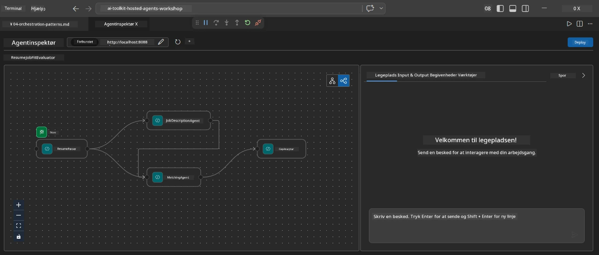
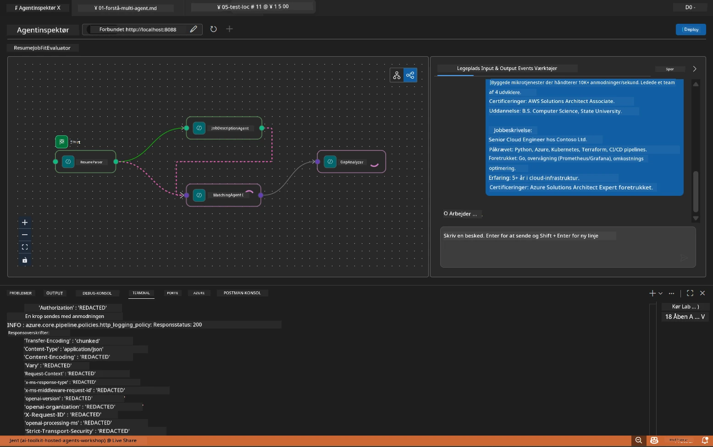
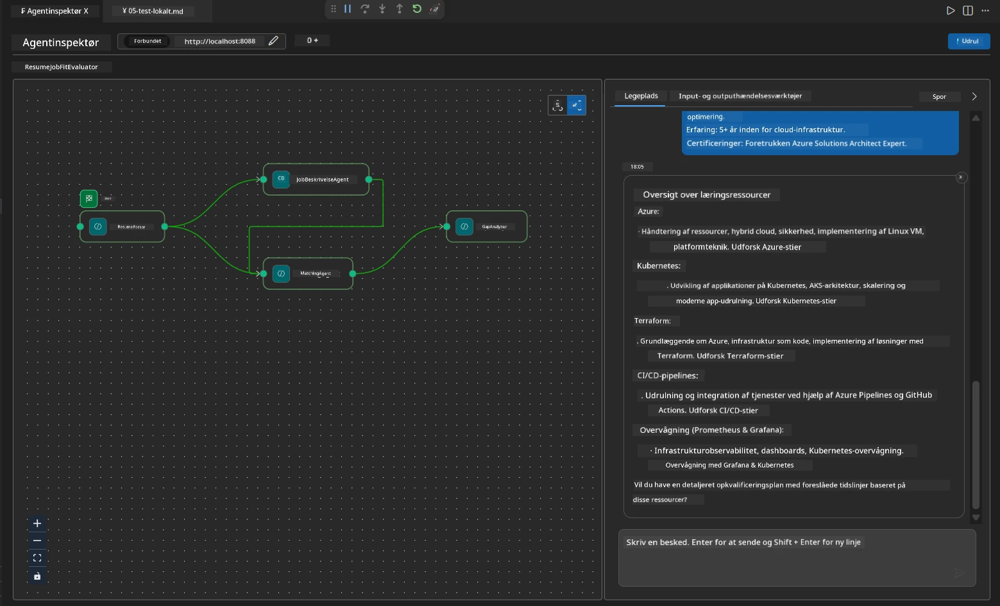

# Modul 5 - Test Lokalt

⏱️ ~15 min

I dette modul kører du multi-agent workflowet lokalt, tester det med Agent Inspector, og bekræfter at alle fire agenter og MCP-værktøjet fungerer korrekt før implementering.

---

## Trin 1: Start agentserveren

### Mulighed A: Brug af VS Code task (anbefalet)

1. Åbn `workshop/lab02-multi-agent/PersonalCareerCopilot/` som din VS Code-mappe.
2. Tryk `Ctrl+Shift+P` → skriv **Tasks: Run Task** → vælg **Run Agent HTTP Server**.
3. Tasken starter serveren med debugpy tilknyttet på port `5679` og agenten på port `8088`.
4. Vent på outputtet viser opstartsbeskeden, efterfulgt af serverens egen klare besked (andre loglinjer kan komme imellem):

```
INFO:resume-job-fit:Starting Resume -> Job Fit Evaluator HTTP server...
...
INFO:hypercorn.error:Running on http://0.0.0.0:8088 (CTRL + C to quit)
```

### Mulighed B: Brug af F5 (debug-tilstand)

1. Tryk `F5` → vælg **Debug Local Agent HTTP Server**.
2. Serveren starter med fuld breakpoint-understøttelse - nyttigt til inspektion af MCP-svar eller agentoutput.

---

## Trin 2: Åbn Agent Inspector

1. Tryk `Ctrl+Shift+P` → skriv **Foundry Toolkit: Open Agent Inspector**.
2. Agent Inspector åbnes som en VS Code-panel forbundet til `http://localhost:8088`.
3. Du skulle kunne se agentgrænsefladen klar til at modtage beskeder.



> **Hvis Agent Inspector ikke åbner:** Sørg for at serveren er fuldt startet (du kan se `Running on http://0.0.0.0:8088` loggen). Hvis port 5679 er optaget, se [Modul 8 - Fejlfinding](08-troubleshooting.md).

---

## Trin 2b: (Valgfrit) Åbn Workflow Visualizer

Foundry Toolkit inkluderer en real-time **Workflow Visualizer**, der viser hvordan agenter interagerer mens grafen kører. Dette er særligt nyttigt til fler-agent fejlfinding.

1. Tryk `Ctrl+Shift+P` → skriv **Foundry Toolkit: Open Visualizer for Hosted Agents**.
2. En ny VS Code-fane åbner og viser live eksekveringsgrafen.
3. Når du sender beskeder i Agent Inspector, opdaterer visualizeren automatisk - grønne noder angiver fuldførte agenter, og animerede kanter viser dataflow mellem dem.

> **Portkonflikt:** Hvis visualizer-porten allerede er i brug, ændr den i VS Code Indstillinger → **Extensions** → **Microsoft Foundry Configuration** → **Hosted Agents: Visualizer Port**.

---

## Trin 3: Kør smoke tests

Kør disse to tests i rækkefølge. Hver tester gradvist mere af workflowet.

### Test 1: Grundlæggende CV + jobbeskrivelse

Indsæt følgende i Agent Inspector:

```
Resume:
Jane Doe
Senior Software Engineer with 5 years of experience in Python, Django, and AWS.
Built microservices handling 10K+ requests/second. Led a team of 4 developers.
Certifications: AWS Solutions Architect Associate.
Education: B.S. Computer Science, State University.

Job Description:
Senior Cloud Engineer at Contoso Ltd.
Required: Python, Azure, Kubernetes, Terraform, CI/CD pipelines.
Preferred: Go, monitoring (Prometheus/Grafana), cost optimization.
Experience: 5+ years in cloud infrastructure.
Certifications: Azure Solutions Architect Expert preferred.
```

**Forventet outputstruktur:**

Svaret bør indeholde output fra alle fire agenter i rækkefølge:

1. **Resume Parser output** - To mærkede sektioner: `[PARSED RESUME]` (kandidatprofil med grupperede færdigheder) og `[JOB DESCRIPTION PASS-THROUGH]` (ordret JD-tekst der fodrer JD Agent)
2. **JD Agent output** - Strukturerede krav med adskilte nødvendige vs. foretrukne færdigheder
3. **Matching Agent output** - Fit-score (0-100) med opdeling, matchede færdigheder, manglende færdigheder, huller
4. **Gap Analyzer output** - Individuelle hul-kort for hver manglende færdighed, hver med Microsoft Learn URL'er





### Hvad der skal verificeres i Test 1

| Tjek | Forventet | Bestået? |
|-------|----------|----------|
| Svaret indeholder en fit-score | Tal mellem 0-100 med opdeling | |
| Matchede færdigheder er angivet | Python, CI/CD (delvis), osv. | |
| Manglende færdigheder er angivet | Azure, Kubernetes, Terraform, osv. | |
| Hul-kort findes for hver manglende færdighed | Et kort per færdighed | |
| Microsoft Learn URL'er er til stede | Rigtige `learn.microsoft.com` links | |
| Ingen fejlmeddelelser i svaret | Rent struktureret output | |

### Test 2: Edge case - høj-fit kandidat

Indsæt et CV, der tæt matcher JD for at sikre at GapAnalyzer håndterer høj-fit scenarier:

```
Resume:
Alex Chen
Senior Cloud Engineer with 7 years of experience.
Skills: Python, Azure (AKS, Functions, DevOps), Kubernetes, Terraform, CI/CD (GitHub Actions, Azure Pipelines), Go, Prometheus, Grafana, cost optimization.
Certifications: Azure Solutions Architect Expert, Azure DevOps Engineer Expert.
Led infrastructure migration to Azure for 3 enterprise clients.
Education: M.S. Computer Science, Tech University.

Job Description:
Senior Cloud Engineer at Contoso Ltd.
Required: Python, Azure, Kubernetes, Terraform, CI/CD pipelines.
Preferred: Go, monitoring (Prometheus/Grafana), cost optimization.
Experience: 5+ years in cloud infrastructure.
Certifications: Azure Solutions Architect Expert preferred.
```

**Forventet adfærd:**
- Fit-score bør være **80+** (de fleste færdigheder matcher)
- Hul-kort bør fokusere på finpudsning/interview-beredskab snarere end grundlæggende læring
- GapAnalyzer instruktionerne siger: "Hvis fit >= 80, fokusér på finpudsning/interview-beredskab"

---

## Trin 4: Test med dine egne data (valgfrit)

Prøv at indsætte dit eget CV og en ægte jobbeskrivelse. Det hjælper med at bekræfte:

- At agenterne håndterer forskellige CV-formater (kronologisk, funktionelt, hybrid)
- At JD Agent håndterer forskellige JD-stilarter (punktopstilling, afsnit, struktureret)
- At MCP-værktøjet returnerer relevante ressourcer for rigtige færdigheder
- At hul-kortene er personaliserede til din specifikke baggrund

> **Privatliv - Sti A (Foundry cloud):** CV og JD-tekst sendes til din Azure OpenAI-implementering til inferens. Det logges eller gemmes ikke af workshop-infrastrukturen. Brug placeholder-navne (f.eks. "Jane Doe"), hvis du foretrækker det.
>
> **Privatliv - Sti B (Foundry Local):** Alle fire agentinferencer kører fuldstændigt på din enhed. Dit CV og jobbeskrivelsestekst **forlader aldrig din maskine**. Det eneste udgående kald er MCP-værktøjets hentning af ressourcer fra `https://learn.microsoft.com/api/mcp`; denne forespørgsel indeholder kun færdighedsnavnet, ikke dine personlige data.

---

### Tjekpunkt

- [ ] Server startede succesfuldt på port `8088` (log viser `Running on http://0.0.0.0:8088`)
- [ ] Agent Inspector åbnede og forbundet til agenten
- [ ] Test 1: Komplett svar med fit-score, matchede/manglende færdigheder, hul-kort, og Microsoft Learn URL'er
- [ ] Test 2: Høj-fit kandidat får score 80+ med anbefalinger fokuseret på finpudsning
- [ ] Alle hul-kort til stede (et per manglende færdighed, ingen afkortning)
- [ ] Ingen fejl eller stack traces i serverterminalen

---

**Forrige:** [04 - Orkestreringsmønstre](04-orchestration-patterns.md) · **Næste:** [06 - Implementer til Foundry →](06-deploy-to-foundry.md)

---

<!-- CO-OP TRANSLATOR DISCLAIMER START -->
**Ansvarsfraskrivelse**:
Dette dokument er blevet oversat ved hjælp af AI-oversættelsestjenesten [Co-op Translator](https://github.com/Azure/co-op-translator). Selvom vi bestræber os på nøjagtighed, skal du være opmærksom på, at automatiserede oversættelser kan indeholde fejl eller unøjagtigheder. Det originale dokument på dets oprindelige sprog bør betragtes som den autoritative kilde. For kritisk information anbefales professionel menneskelig oversættelse. Vi påtager os intet ansvar for misforståelser eller fejltolkninger, der opstår som følge af brugen af denne oversættelse.
<!-- CO-OP TRANSLATOR DISCLAIMER END -->