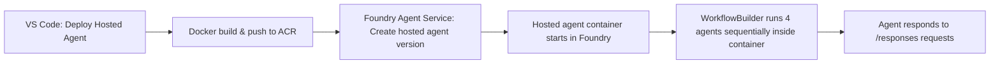
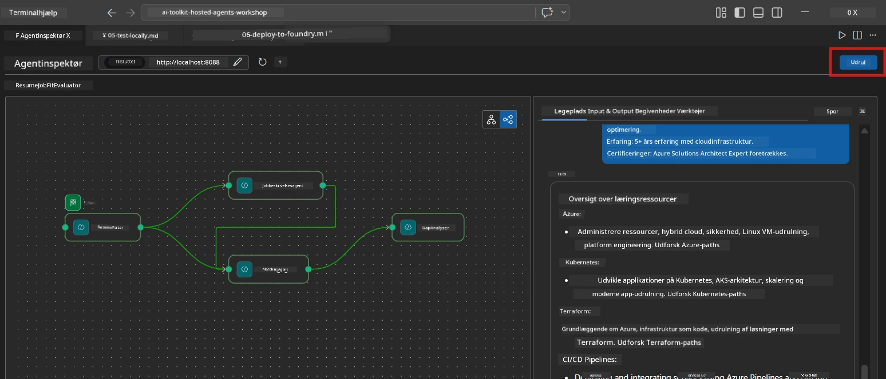
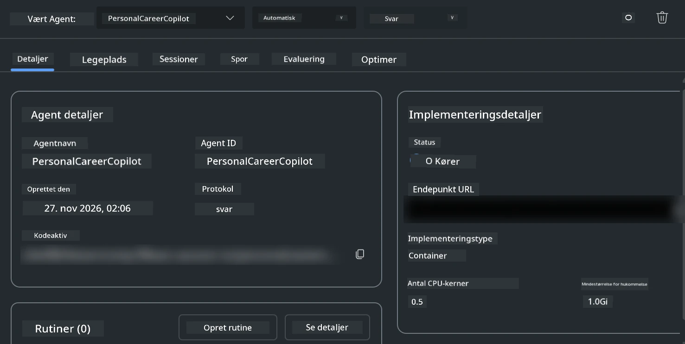

# Modul 6 - Deploy til Foundry Agent Service

⏱️ ~10 min

I dette modul deployer du dit lokalt-testede multi-agent workflow til [Microsoft Foundry](https://learn.microsoft.com/azure/foundry/agents/concepts/hosted-agents) som en **Hosted Agent**. Deploy-processen bygger et Docker container image, skubber det til [Azure Container Registry (ACR)](https://learn.microsoft.com/azure/container-registry/container-registry-intro), og opretter en hosted agent version i [Foundry Agent Service](https://learn.microsoft.com/azure/foundry/agents/how-to/publish-agent).

> **Vigtig forskel fra Lab 01:** Deploy-processen er identisk. Foundry behandler dit multi-agent workflow som en enkelt hosted agent – kompleksiteten er inde i containeren, men deploy-fladen er den samme `/responses` endpoint.

### Deploy pipeline



---

## Forudsætninger kontrol

Før du deployer, skal du verificere hvert punkt nedenfor:

1. **Agenten klarer lokale smoke tests:**
   - Du har gennemført begge smoke tests i [Modul 5](05-test-locally.md) og workflowet producerede komplet output med gap cards og Microsoft Learn URLs.

2. **Du har [Foundry User](https://learn.microsoft.com/azure/foundry/concepts/rbac-foundry) rollen** (for at implementere skal du mindst have **Foundry Project Manager** på projektomfang):

   > **Bemærk:** Foundry RBAC-rollerne blev for nylig omdøbt - **Foundry User**, **Foundry Owner** og **Foundry Project Manager** hed tidligere Azure AI User, Azure AI Owner og Azure AI Project Manager. Rolle-ID'er og tilladelser er uændrede.

   - Bekræft i [Azure Portal](https://portal.azure.com) → din Foundry **projekt** ressource → **Adgangskontrol (IAM)** → **Rolle tildelinger** → bekræft at **Foundry User** (eller højere) er på listen for din konto.

3. **Du er logget ind i Azure i VS Code:**
   - Tjek ikonet Konti i nederste venstre hjørne af VS Code. Dit kontonavn skal være synligt.

4. **`agent.yaml` har korrekte værdier:**
   - Åbn `PersonalCareerCopilot/agent.yaml` og bekræft:
     ```yaml
     environment_variables:
       - name: AZURE_AI_MODEL_DEPLOYMENT_NAME
         value: ${AZURE_AI_MODEL_DEPLOYMENT_NAME}
     ```
   - `FOUNDRY_PROJECT_ENDPOINT` er **ikke** listet her - Foundry indsætter den ved kørslen. Kun `AZURE_AI_MODEL_DEPLOYMENT_NAME` skal deklareres.

5. **`requirements.txt` har korrekte versioner:**
   ```
   agent-framework-foundry
   agent-framework-foundry-hosting
   mcp<2,>=1.24.0
   debugpy
   ```

---

## Trin 1: Start implementeringen

### Mulighed A: Implementér fra Agent Inspector (anbefalet)

Hvis agenten kører via F5 med Agent Inspector åben:

1. Se på **øverste højre hjørne** af Agent Inspector-panelet.
2. Klik på **Deploy** knappen (sky ikon med en opadgående pil ↑).
3. Implementeringsguiden åbnes.



### Mulighed B: Implementér fra Kommando Paletten

1. Tryk på `Ctrl+Shift+P` for at åbne **Kommando Paletten**.
2. Skriv: **Foundry Toolkit: Deploy Hosted Agent** og vælg den.
3. Implementeringsguiden åbnes.

---

## Trin 2: Konfigurer implementeringen

### 2.1 Vælg målprojektet

1. En dropdown viser dine Foundry projekter.
2. Vælg det projekt, du brugte gennem hele workshoppen (fx `workshop-agents`).

### 2.2 Vælg container agent filen

1. Du bliver bedt om at vælge agentens indgangspunkt.
2. Naviger til `workshop/lab02-multi-agent/PersonalCareerCopilot/` og vælg **`main.py`**.

### 2.3 Konfigurer ressourcer

| Indstilling | Anbefalet værdi | Noter |
|---------|------------------|-------|
| **Implementeringsmetode** | **Container** (anbefalet) eller **Kode** | Container bygger et Docker billede; Kode uploader kildekode som ZIP (preview) |
| **Container Registry** | **Standard ACR** | Foundry opretter og administrerer en til dig |
| **CPU** | `0.5` | Standard. Multi-agent workflows behøver ikke mere CPU fordi modelkald er I/O begrænsede |
| **Hukommelse** | `1.0Gi` | Standard. Forøg hvis du tilføjer store databehandlingsværktøjer |

---

## Trin 3: Bekræft og implementer

1. Guiden viser et implementeringsresumé.
2. Gennemgå og klik **Bekræft og implementer**.
3. Følg fremskridtet i VS Code.

### Hvad sker der under implementeringen

Se VS Code **Output**-panelet (vælg "Microsoft Foundry" i dropdown):

1. **Docker build** – Bygger containeren ud fra din `Dockerfile`
   ```
   Step 1/6 : FROM python:3.12-slim
   Step 2/6 : WORKDIR /app
   ...
   Successfully built abc123def456
   ```

2. **Docker push** – Pusher billedet til ACR (1-3 minutter ved første udrulning).

3. **Agent-registrering** – Foundry opretter en hosted agent ved hjælp af `agent.yaml` metadata. Agentens navn er `PersonalCareerCopilot`.

4. **Containerstart** – Containeren starter i Foundrys styrede infrastruktur med en systemadministreret identitet.

> **Første udrulning er langsommere** (Docker pusher alle lag). Efterfølgende udrulninger genbruger cachede lag og er hurtigere.

### Specifikke noter om multi-agent

- **Alle fire agenter er i én container.** Foundry ser en enkelt hosted agent. WorkflowBuilder-grafen kører internt.
- **MCP-kald er udgående.** Containeren har brug for internetadgang for at nå `https://learn.microsoft.com/api/mcp`. Foundrys styrede infrastruktur leverer dette som standard.
- **[Managed Identity](https://learn.microsoft.com/azure/foundry/agents/concepts/agent-identity).** Foundry opretter automatisk en **dedikeret Entra-identitet pr. agent** for hver Hosted agent ved udrulning. I det hosted miljø løser `DefaultAzureCredential` automatisk til denne agentidentitet - der kræves ingen manuel konfiguration af managed identity.

---

## Trin 4: Bekræft udrulningsstatus

1. Åbn **Foundry Toolkit** sidebjælken (klik på Foundry Toolkit-ikonet i Activity Bar).
2. Under dit projekt i **My Resources**, klik på **Agents**, og vælg derefter fanen **Hosted Agent**.
3. Klik på **PersonalCareerCopilot** (eller dit agentnavn).
4. **Hosted agent playground** åbner på fanen **Details**. Tjek **Deployment Details** → **Status**:



| Status | Betydning |
|--------|---------|
| **active** | Agent kører og er klar til at modtage anmodninger |
| **creating** | Container starter (vent 30–60 sekunder) |
| **failed** | Container kunne ikke starte (tjek logs - se nedenfor) |

> **Bemærk:** Fanen **Details** kan vise mærkater som "Running" eller "Started", mens den underliggende API-status bruger `active`/`creating`. Begge visninger angiver samme tilstand.

> **Multi-agent opstart tager længere tid** end enkeltagent, fordi containeren opretter 4 agentinstanser ved opstart. `creating` op til 2 minutter er normalt.

---

## Almindelige udrulningsfejl og rettelser

### Fejl 1: Tilladelse nægtet - `agents/write`

```
Error: lacks the required data action 
Microsoft.CognitiveServices/accounts/AIServices/agents/write
```

**Løsning:** Tildel **[Foundry-bruger](https://learn.microsoft.com/azure/foundry/concepts/rbac-foundry)** rollen (tidligere **Azure AI-bruger**) på **projekt**-niveau. Se [Modul 8 - Fejlfinding](08-troubleshooting.md) for trin-for-trin instruktioner.

### Fejl 2: Docker kører ikke

```
Error: Docker build failed / Cannot connect to Docker daemon
```

**Løsning:**
1. Start Docker Desktop.
2. Vent på "Docker Desktop kører".
3. Verificer: `docker info`
4. **Windows:** Sørg for, at WSL 2-backend er aktiveret i Docker Desktop-indstillingerne.
5. Prøv igen.

### Fejl 3: pip install fejler under Docker build

```
Error: Could not find a version that satisfies the requirement agent-framework-foundry
```

**Løsning:** Bekræft at `requirements.txt` stemmer overens med:
```
agent-framework-foundry
agent-framework-foundry-hosting
mcp<2,>=1.24.0
debugpy
```

Hvis build stadig fejler, kan dit Docker-netværk blokere PyPI. Tjek `docker info` for proxy-indstillinger.

### Fejl 4: MCP værktøj fejler i hosted agent

Hvis Gap Analyzer stopper med at generere Microsoft Learn URLs efter deployment:

**Årsag:** Netværkspolitik kan blokere udgående HTTPS fra containeren.

**Løsning:**
1. Dette er normalt ikke et problem med Foundrys standardkonfiguration.
2. Hvis det opstår, så tjek om Foundry-projektets virtuelle netværk har en NSG, der blokerer udgående HTTPS.
3. MCP værktøjet har indbyggede fallback URLs, så agenten vil stadig generere output (dog uden live URLs).

---

### Tjekpunkt

- [ ] Deploy-kommandoen blev gennemført uden fejl i VS Code
- [ ] Agent vises på fanen **Hosted Agent**, når du klikker på **Agents** under dit projekt i Foundry Toolkit sidepanelet
- [ ] Agent-navnet er `PersonalCareerCopilot` (eller dit valgte navn)
- [ ] Container status viser **Started** eller **Running**
- [ ] (Hvis fejl) Du identificerede fejlen, anvendte løsningen og deployede igen med succes

---

**Forrige:** [05 - Test Lokalt](05-test-locally.md) · **Næste:** [07 - Verificer i Playground →](07-verify-in-playground.md)

---

<!-- CO-OP TRANSLATOR DISCLAIMER START -->
**Ansvarsfraskrivelse**:
Dette dokument er blevet oversat ved hjælp af AI-oversættelsestjenesten [Co-op Translator](https://github.com/Azure/co-op-translator). Selvom vi bestræber os på nøjagtighed, skal du være opmærksom på, at automatiserede oversættelser kan indeholde fejl eller unøjagtigheder. Det originale dokument på dets oprindelige sprog bør betragtes som den autoritative kilde. For kritisk information anbefales professionel menneskelig oversættelse. Vi påtager os intet ansvar for misforståelser eller fejltolkninger, der opstår som følge af brugen af denne oversættelse.
<!-- CO-OP TRANSLATOR DISCLAIMER END -->