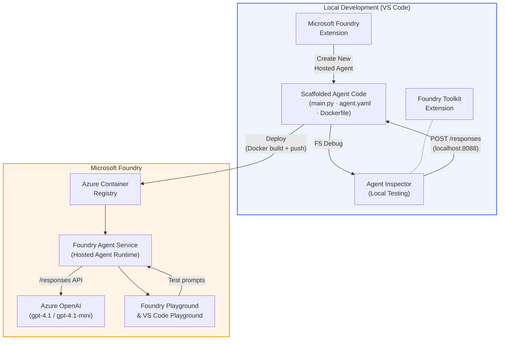

# Foundry Toolkit + Foundry Hosted Agents Workshop

[](https://www.python.org/)
[](https://github.com/microsoft/agents)
[](https://learn.microsoft.com/azure/foundry/agents/concepts/hosted-agents)
[](https://ai.azure.com/)
[](https://learn.microsoft.com/azure/ai-services/openai/)
[](https://learn.microsoft.com/cli/azure/install-azure-cli)
[](https://learn.microsoft.com/azure/developer/azure-developer-cli/install-azd)
[](https://www.docker.com/)
[](https://marketplace.visualstudio.com/items?itemName=ms-windows-ai-studio.windows-ai-studio)
[](../../LICENSE)

Erstellen, testen und bereitstellen von KI-Agenten auf dem **Microsoft Foundry Agent Service** als **Gehostete Agenten** - vollständig aus VS Code mithilfe der **Microsoft Foundry-Erweiterung** und des **Foundry Toolkits**.

> **Gehostete Agenten befinden sich derzeit in der Vorschau.** Unterstützte Regionen sind begrenzt - siehe [Verfügbarkeit nach Region](https://learn.microsoft.com/azure/foundry/agents/concepts/hosted-agents#region-availability).

> Der `agent/` Ordner in jedem Lab wird von der Foundry-Erweiterung **automatisch erstellt** - anschließend passen Sie den Code an, testen lokal, und stellen bereit.

### 🌐 Mehrsprachige Unterstützung

#### Unterstützt über GitHub Action (Automatisiert & stets aktuell)

<!-- CO-OP TRANSLATOR LANGUAGES TABLE START -->
[Arabic](../ar/README.md) | [Bengali](../bn/README.md) | [Bulgarian](../bg/README.md) | [Burmese (Myanmar)](../my/README.md) | [Chinese (Simplified)](../zh-CN/README.md) | [Chinese (Traditional, Hong Kong)](../zh-HK/README.md) | [Chinese (Traditional, Macau)](../zh-MO/README.md) | [Chinese (Traditional, Taiwan)](../zh-TW/README.md) | [Croatian](../hr/README.md) | [Czech](../cs/README.md) | [Danish](../da/README.md) | [Dutch](../nl/README.md) | [Estonian](../et/README.md) | [Finnish](../fi/README.md) | [French](../fr/README.md) | [German](./README.md) | [Greek](../el/README.md) | [Hebrew](../he/README.md) | [Hindi](../hi/README.md) | [Hungarian](../hu/README.md) | [Indonesian](../id/README.md) | [Italian](../it/README.md) | [Japanese](../ja/README.md) | [Kannada](../kn/README.md) | [Khmer](../km/README.md) | [Korean](../ko/README.md) | [Lithuanian](../lt/README.md) | [Malay](../ms/README.md) | [Malayalam](../ml/README.md) | [Marathi](../mr/README.md) | [Nepali](../ne/README.md) | [Nigerian Pidgin](../pcm/README.md) | [Norwegian](../no/README.md) | [Persian (Farsi)](../fa/README.md) | [Polish](../pl/README.md) | [Portuguese (Brazil)](../pt-BR/README.md) | [Portuguese (Portugal)](../pt-PT/README.md) | [Punjabi (Gurmukhi)](../pa/README.md) | [Romanian](../ro/README.md) | [Russian](../ru/README.md) | [Serbian (Cyrillic)](../sr/README.md) | [Slovak](../sk/README.md) | [Slovenian](../sl/README.md) | [Spanish](../es/README.md) | [Swahili](../sw/README.md) | [Swedish](../sv/README.md) | [Tagalog (Filipino)](../tl/README.md) | [Tamil](../ta/README.md) | [Telugu](../te/README.md) | [Thai](../th/README.md) | [Turkish](../tr/README.md) | [Ukrainian](../uk/README.md) | [Urdu](../ur/README.md) | [Vietnamese](../vi/README.md)

> **Möchten Sie lokal klonen?**
>
> Dieses Repository enthält Übersetzungen in über 50 Sprachen, was die Download-Größe deutlich erhöht. Um ohne Übersetzungen zu klonen, verwenden Sie Sparse Checkout:
>
> **Bash / macOS / Linux:**
> ```bash
> git clone --filter=blob:none --sparse https://github.com/microsoft-foundry/Foundry_Toolkit_for_VSCode_Lab.git
> cd Foundry_Toolkit_for_VSCode_Lab
> git sparse-checkout set --no-cone '/*' '!translations' '!translated_images'
> ```
>
> **CMD (Windows):**
> ```cmd
> git clone --filter=blob:none --sparse https://github.com/microsoft-foundry/Foundry_Toolkit_for_VSCode_Lab.git
> cd Foundry_Toolkit_for_VSCode_Lab
> git sparse-checkout set --no-cone "/*" "!translations" "!translated_images"
> ```
>
> Damit erhalten Sie alles, was Sie benötigen, um den Kurs abzuschließen – bei einem deutlich schnelleren Download.
<!-- CO-OP TRANSLATOR LANGUAGES TABLE END -->

---

## Architektur



**Ablauf:** Die Foundry-Erweiterung erstellt das Agentengerüst → Sie passen Code & Anweisungen an → lokal mit Agent Inspector testen → in Foundry bereitstellen (Docker-Image wird in ACR gepusht) → im Playground verifizieren.

---

## Was Sie bauen werden

| Lab | Beschreibung | Status |
|-----|-------------|--------|
| **Lab 01 - Einzelner Agent** | Bauen Sie den **„Explain Like I'm an Executive“-Agenten**, testen Sie ihn lokal, und stellen Sie ihn in Foundry bereit | ✅ Verfügbar |
| **Lab 02 - Multi-Agent-Workflow** | Erstellen Sie den **„Resume → Job Fit Evaluator“** - 4 Agenten arbeiten zusammen, um die Eignung eines Lebenslaufs zu bewerten und einen Lernfahrplan zu erstellen | ✅ Verfügbar |

---

## Lernen Sie den Executive-Agenten kennen

In diesem Workshop bauen Sie den **„Explain Like I'm an Executive“-Agenten** - einen KI-Agenten, der kompliziertes technisches Fachchinesisch in ruhige, vorstandsreife Zusammenfassungen übersetzt. Denn seien wir ehrlich, niemand in der C‑Suite möchte etwas über "thread pool exhaustion caused by synchronous calls introduced in v3.2." hören.

Ich habe diesen Agenten nach einem Vorfall zu viel entwickelt, bei dem mein perfekt formulierter Post‑Mortem-Bericht die Antwort erhielt: *"Also... ist die Website jetzt down oder nicht?"*

### Wie es funktioniert

Sie geben ihm ein technisches Update. Es spuckt eine Executive-Zusammenfassung aus - drei Stichpunkte, kein Jargon, keine Stacktraces, keine existenzielle Panik. Nur **was passiert ist**, **geschäftliche Auswirkungen**, und **nächster Schritt**.

### Sehen Sie es in Aktion

**Sie sagen:**
> „Die API-Latenz hat sich erhöht aufgrund von Thread-Pool-Erschöpfung, verursacht durch synchrone Aufrufe, die in v3.2 eingeführt wurden.“

**Der Agent antwortet:**

> **Executive-Zusammenfassung:**
> - **Was passiert ist:** Nach dem letzten Release hat sich das System verlangsamt.
> - **Geschäftliche Auswirkungen:** Einige Nutzer hatten Verzögerungen bei der Nutzung des Dienstes.
> - **Nächster Schritt:** Die Änderung wurde zurückgenommen und ein Fix wird vorbereitet, bevor das System erneut bereitgestellt wird.

### Warum dieser Agent?

Er ist ein denkbar einfacher, zweckgebundener Agent - perfekt, um den Workflow für gehostete Agenten von Anfang bis Ende zu erlernen, ohne sich in komplexen Toolchains zu verzetteln. Und ganz ehrlich? Jedes Engineering-Team könnte so einen gebrauchen.

---

## Aufbau des Workshops

```
📂 Foundry_Toolkit_for_VSCode_Lab/
├── 📄 README.md                      ← You are here
└── 📂 workshop/
    ├── 📂 lab01-single-agent/        ← Full lab: docs + agent code
    │   ├── README.md                 ← Hands-on lab instructions
    │   ├── 📂 docs/                  ← Step-by-step tutorial modules
    │   │   ├── 00-prerequisites.md
    │   │   ├── 01-setup.md
    │   │   ├── 02-create-hosted-agent.md
    │   │   ├── 03-configure-and-code.md
    │   │   ├── 04-test-locally.md
    │   │   ├── 05-deploy-to-foundry.md
    │   │   ├── 06-verify-in-playground.md
    │   │   ├── 07-summary.md
    │   │   └── 08-troubleshooting.md
    │   └── 📂 agent/                 ← Reference solution (auto-scaffolded by Foundry extension)
    │       ├── agent.yaml
    │       ├── Dockerfile
    │       ├── main.py
    │       └── requirements.txt
    └── 📂 lab02-multi-agent/         ← Resume → Job Fit Evaluator
        ├── README.md                 ← Hands-on lab instructions (end-to-end)
        ├── 📂 docs/                  ← Step-by-step tutorial modules
        │   ├── 00-prerequisites.md
        │   ├── 01-understand-multi-agent.md
        │   ├── 02-scaffold-multi-agent.md
        │   ├── 03-configure-agents.md
        │   ├── 04-orchestration-patterns.md
        │   ├── 05-test-locally.md
        │   ├── 06-deploy-to-foundry.md
        │   ├── 07-verify-in-playground.md
        │   └── 08-troubleshooting.md
        └── 📂 PersonalCareerCopilot/ ← Reference solution (multi-agent workflow)
            ├── agent.yaml
            ├── Dockerfile
            ├── main.py
            └── requirements.txt
```

> **Hinweis:** Der `agent/` Ordner in jedem Lab ist das, was die **Microsoft Foundry-Erweiterung** erzeugt, wenn Sie `Microsoft Foundry: Create a New Hosted Agent` aus der Befehlspalette ausführen. Die Dateien werden dann mit den Anweisungen, Tools und der Konfiguration Ihres Agenten angepasst. Lab 01 führt Sie durch die vollständige Neuanlage davon.

---

## Erste Schritte

### 1. Repository klonen

```bash
git clone https://github.com/microsoft-foundry/Foundry_Toolkit_for_VSCode_Lab.git
cd Foundry_Toolkit_for_VSCode_Lab
```

### 2. Eine Python‑virtuelle Umgebung einrichten

```bash
python -m venv venv
```

Aktivieren:

- **Windows (PowerShell):**
  ```powershell
  .\venv\Scripts\Activate.ps1
  ```
- **macOS / Linux:**
  ```bash
  source venv/bin/activate
  ```

### 3. Abhängigkeiten installieren

```bash
pip install -r workshop/lab01-single-agent/agent/requirements.txt
```

### 4. Umgebungsvariablen konfigurieren

Kopieren Sie die Beispieldatei `.env` in den Agentenordner und füllen Sie Ihre Werte aus:

```bash
cp workshop/lab01-single-agent/agent/.env.example workshop/lab01-single-agent/agent/.env
```

Bearbeiten Sie `workshop/lab01-single-agent/agent/.env`:

```env
AZURE_AI_PROJECT_ENDPOINT=https://<your-account>.services.ai.azure.com/api/projects/<your-project>
AZURE_AI_MODEL_DEPLOYMENT_NAME=<your-model-deployment-name>
```

### 5. Folgen Sie den Workshop-Labs

Jedes Lab ist in sich geschlossen und hat eigene Module. Beginnen Sie mit **Lab 01**, um die Grundlagen zu lernen, und fahren Sie dann mit **Lab 02** für Multi-Agent-Workflows fort.

#### Lab 01 - Einzelner Agent ([vollständige Anleitung](workshop/lab01-single-agent/README.md))

| # | Modul | Link |
|---|--------|------|
| 1 | Lesen Sie die Voraussetzungen | [00-prerequisites.md](workshop/lab01-single-agent/docs/00-prerequisites.md) |
| 2 | Installieren Sie das Foundry Toolkit & die Foundry-Erweiterung | [01-setup.md](workshop/lab01-single-agent/docs/01-setup.md) |
| 3 | Erstellen Sie ein Foundry-Projekt | [01-setup.md](workshop/lab01-single-agent/docs/01-setup.md) |
| 4 | Erstellen Sie einen gehosteten Agenten | [02-create-hosted-agent.md](workshop/lab01-single-agent/docs/02-create-hosted-agent.md) |
| 5 | Anweisungen & Umgebung konfigurieren | [03-configure-and-code.md](workshop/lab01-single-agent/docs/03-configure-and-code.md) |
| 6 | Lokal testen | [04-test-locally.md](workshop/lab01-single-agent/docs/04-test-locally.md) |
| 7 | In Foundry bereitstellen | [05-deploy-to-foundry.md](workshop/lab01-single-agent/docs/05-deploy-to-foundry.md) |
| 8 | Im Playground verifizieren | [06-verify-in-playground.md](workshop/lab01-single-agent/docs/06-verify-in-playground.md) |
| 9 | Fehlerbehebung | [08-troubleshooting.md](workshop/lab01-single-agent/docs/08-troubleshooting.md) |

#### Lab 02 - Multi-Agent-Workflow ([vollständige Anleitung](workshop/lab02-multi-agent/README.md))

| # | Modul | Link |
|---|--------|------|
| 1 | Voraussetzungen (Lab 02) | [00-prerequisites.md](workshop/lab02-multi-agent/docs/00-prerequisites.md) |
| 2 | Multi-Agent-Architektur verstehen | [01-understand-multi-agent.md](workshop/lab02-multi-agent/docs/01-understand-multi-agent.md) |
| 3 | Multi-Agent-Projekt scaffolden | [02-scaffold-multi-agent.md](workshop/lab02-multi-agent/docs/02-scaffold-multi-agent.md) |
| 4 | Agenten & Umgebung konfigurieren | [03-configure-agents.md](workshop/lab02-multi-agent/docs/03-configure-agents.md) |
| 5 | Orchestrierungsmuster | [04-orchestration-patterns.md](workshop/lab02-multi-agent/docs/04-orchestration-patterns.md) |
| 6 | Lokal testen (Multi-Agent) | [05-test-locally.md](workshop/lab02-multi-agent/docs/05-test-locally.md) |
| 7 | In Foundry bereitstellen | [06-deploy-to-foundry.md](workshop/lab02-multi-agent/docs/06-deploy-to-foundry.md) |
| 8 | Im Playground verifizieren | [07-verify-in-playground.md](workshop/lab02-multi-agent/docs/07-verify-in-playground.md) |
| 9 | Fehlerbehebung (Multi-Agent) | [08-troubleshooting.md](workshop/lab02-multi-agent/docs/08-troubleshooting.md) |

---

## Maintainer

<table>
<tr>
    <td align="center"><a href="https://github.com/ShivamGoyal03">
        <br />
        <sub><b>Shivam Goyal</b></sub>
    </a><br />
    </td>
</tr>
</table>

---

## Erforderliche Berechtigungen (Kurzreferenz)

| Szenario | Erforderliche Rollen |
|----------|---------------|
| Neues Foundry-Projekt erstellen | **Azure AI Owner** auf der Foundry-Ressource |
| In vorhandenes Projekt bereitstellen (neue Ressourcen) | **Azure AI Owner** + **Contributor** auf Abonnement |
| In vollständig konfiguriertes Projekt bereitstellen | **Reader** auf Konto + **Azure AI User** im Projekt |

> **Wichtig:** Azure `Owner` und `Contributor` Rollen beinhalten nur *Verwaltungs*-Berechtigungen, nicht *Entwicklungs* (Data-Action)-Berechtigungen. Sie benötigen **Azure AI User** oder **Azure AI Owner**, um Agenten zu erstellen und bereitzustellen.

---

## Referenzen

- [Schnellstart: Stellen Sie Ihren ersten gehosteten Agenten bereit (VS Code)](https://learn.microsoft.com/azure/foundry/agents/quickstarts/quickstart-hosted-agent)
- [Was sind gehostete Agenten?](https://learn.microsoft.com/azure/foundry/agents/concepts/hosted-agents)
- [Gehostete-Agent-Workflows in VS Code erstellen](https://learn.microsoft.com/azure/foundry/agents/how-to/vs-code-agents-workflow-pro-code)
- [Einen gehosteten Agenten bereitstellen](https://learn.microsoft.com/azure/foundry/agents/how-to/deploy-hosted-agent)
- [RBAC für Microsoft Foundry](https://learn.microsoft.com/azure/foundry/concepts/rbac-foundry)
- [Architecture Review Agent Sample](https://github.com/Azure-Samples/agent-architecture-review-sample) - Praxisnaher gehosteter Agent mit MCP-Tools, Excalidraw-Diagrammen und doppelter Bereitstellung

---


## Lizenz

[MIT](../../LICENSE)

---

<!-- CO-OP TRANSLATOR DISCLAIMER START -->
**Haftungsausschluss**:
Dieses Dokument wurde mit dem KI-Übersetzungsdienst [Co-op Translator](https://github.com/Azure/co-op-translator) übersetzt. Obwohl wir uns um Genauigkeit bemühen, beachten Sie bitte, dass automatisierte Übersetzungen Fehler oder Ungenauigkeiten enthalten können. Das Originaldokument in seiner Ursprungssprache gilt als maßgebliche Quelle. Bei kritischen Informationen wird eine professionelle menschliche Übersetzung empfohlen. Wir übernehmen keine Haftung für Missverständnisse oder Fehlinterpretationen, die aus der Verwendung dieser Übersetzung entstehen.
<!-- CO-OP TRANSLATOR DISCLAIMER END -->
