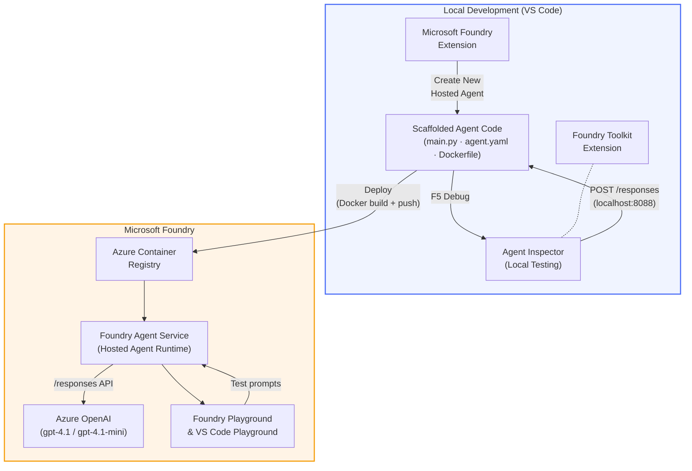

# Foundry Toolkit + Foundry Hosted Agents Workshop

[](https://www.python.org/)
[](https://learn.microsoft.com/agent-framework/)
[](https://learn.microsoft.com/azure/foundry/agents/concepts/hosted-agents)
[](https://ai.azure.com/)
[](https://learn.microsoft.com/azure/ai-services/openai/)
[](https://learn.microsoft.com/cli/azure/install-azure-cli)
[](https://learn.microsoft.com/azure/developer/azure-developer-cli/install-azd)
[](https://www.docker.com/)
[](https://marketplace.visualstudio.com/items?itemName=ms-windows-ai-studio.windows-ai-studio)
[](LICENSE)

Erstellen, testen und bereitstellen von KI-Agenten im **Microsoft Foundry Agent Service** als **Hosted Agents** – komplett aus VS Code heraus mit der **Microsoft Foundry-Erweiterung** und dem **Foundry Toolkit**.

> **Hosted Agents befinden sich aktuell in der Vorschau.** Unterstützte Regionen sind begrenzt - siehe [Regionenverfügbarkeit](https://learn.microsoft.com/azure/foundry/agents/concepts/hosted-agents#region-availability).

> Der `agent/`-Ordner in jedem Labor wird **automatisch von der Foundry-Erweiterung generiert** – Sie passen dann den Code an, testen lokal und stellen bereit.

### 🌐 Mehrsprachige Unterstützung

#### Unterstützt über GitHub Action (Automatisiert & stets aktuell)

<!-- CO-OP TRANSLATOR LANGUAGES TABLE START -->
[Arabisch](../ar/README.md) | [Bengalisch](../bn/README.md) | [Bulgarisch](../bg/README.md) | [Birmanisch (Myanmar)](../my/README.md) | [Chinesisch (vereinfacht)](../zh-CN/README.md) | [Chinesisch (traditionell, Hongkong)](../zh-HK/README.md) | [Chinesisch (traditionell, Macau)](../zh-MO/README.md) | [Chinesisch (traditionell, Taiwan)](../zh-TW/README.md) | [Kroatisch](../hr/README.md) | [Tschechisch](../cs/README.md) | [Dänisch](../da/README.md) | [Niederländisch](../nl/README.md) | [Estnisch](../et/README.md) | [Finnisch](../fi/README.md) | [Französisch](../fr/README.md) | [Deutsch](./README.md) | [Griechisch](../el/README.md) | [Hebräisch](../he/README.md) | [Hindi](../hi/README.md) | [Ungarisch](../hu/README.md) | [Indonesisch](../id/README.md) | [Italienisch](../it/README.md) | [Japanisch](../ja/README.md) | [Kannada](../kn/README.md) | [Khmer](../km/README.md) | [Koreanisch](../ko/README.md) | [Litauisch](../lt/README.md) | [Malaiisch](../ms/README.md) | [Malayalam](../ml/README.md) | [Marathi](../mr/README.md) | [Nepalesisch](../ne/README.md) | [Nigerianisches Pidgin](../pcm/README.md) | [Norwegisch](../no/README.md) | [Persisch (Farsi)](../fa/README.md) | [Polnisch](../pl/README.md) | [Portugiesisch (Brasilien)](../pt-BR/README.md) | [Portugiesisch (Portugal)](../pt-PT/README.md) | [Punjabi (Gurmukhi)](../pa/README.md) | [Rumänisch](../ro/README.md) | [Russisch](../ru/README.md) | [Serbisch (Kyrillisch)](../sr/README.md) | [Slowakisch](../sk/README.md) | [Slowenisch](../sl/README.md) | [Spanisch](../es/README.md) | [Swahili](../sw/README.md) | [Schwedisch](../sv/README.md) | [Tagalog (Filipino)](../tl/README.md) | [Tamil](../ta/README.md) | [Telugu](../te/README.md) | [Thailändisch](../th/README.md) | [Türkisch](../tr/README.md) | [Ukrainisch](../uk/README.md) | [Urdu](../ur/README.md) | [Vietnamesisch](../vi/README.md)

> **Möchten Sie lieber lokal klonen?**
>
> Dieses Repository enthält über 50 Sprachübersetzungen, was die Downloadgröße erheblich erhöht. Um ohne Übersetzungen zu klonen, verwenden Sie Sparse Checkout:
>
> **Bash / macOS / Linux:**
> ```bash
> git clone --filter=blob:none --sparse https://github.com/microsoft-foundry/Foundry_Toolkit_for_VSCode_Lab.git
> cd Foundry_Toolkit_for_VSCode_Lab
> git sparse-checkout set --no-cone '/*' '!translations' '!translated_images'
> ```
>
> **CMD (Windows):**
> ```cmd
> git clone --filter=blob:none --sparse https://github.com/microsoft-foundry/Foundry_Toolkit_for_VSCode_Lab.git
> cd Foundry_Toolkit_for_VSCode_Lab
> git sparse-checkout set --no-cone "/*" "!translations" "!translated_images"
> ```
>
> So erhalten Sie alles, was Sie benötigen, um den Kurs abzuschließen, bei deutlich schnellerem Download.
<!-- CO-OP TRANSLATOR LANGUAGES TABLE END -->

---

## Architektur



**Ablauf:** Die Foundry-Erweiterung erzeugt das Grundgerüst für den Agenten → Sie passen Code & Anweisungen an → testen lokal mit dem Agent Inspector → stellen in Foundry bereit (Docker-Image wird zu ACR geschoben) → prüfen im Playground.

---

## Was Sie bauen werden

| Labor | Beschreibung | Status |
|-----|-------------|--------|
| **Labor 01 - Einzelagent** | Erstellen Sie den **"Explain Like I'm an Executive"-Agenten**, testen Sie ihn lokal und stellen Sie ihn in Foundry bereit | ✅ Verfügbar |
| **Labor 02 - Multi-Agenten-Workflow** | Erstellen Sie den **"Lebenslauf → Job-Fit-Bewerter"** - 4 Agenten arbeiten zusammen, um die Passgenauigkeit des Lebenslaufs zu bewerten und einen Lernplan zu erstellen | ✅ Verfügbar |

---

## Lernen Sie den Executive Agent kennen

In diesem Workshop bauen Sie den **"Explain Like I'm an Executive"-Agenten** – einen KI-Agenten, der kompliziertes technisches Fachchinesisch nimmt und in ruhige, vorstandstaugliche Zusammenfassungen übersetzt. Denn seien wir ehrlich: Niemand in der Führungsetage will etwas hören wie „Thread-Pool-Ermüdung verursacht durch synchrone Aufrufe, eingeführt in v3.2.“

Ich habe diesen Agenten entwickelt, nachdem ich zu oft erlebt hatte, dass mein perfekt ausgearbeiteter Post-Mortem-Bericht mit der Antwort endete: *„Also... ist die Webseite nun down oder nicht?“*

### Wie es funktioniert

Sie geben eine technische Aktualisierung ein. Der Agent liefert eine Executive Summary – drei Stichpunkte, kein Fachchinesisch, keine Stack-Traces, keine existenzielle Panik. Einfach **was passiert ist**, **Auswirkung auf das Geschäft** und **nächster Schritt**.

### Sehen Sie es in Aktion

**Sie sagen:**
> „Die API-Latenz hat sich erhöht aufgrund von Thread-Pool-Ermüdung, verursacht durch synchrone Aufrufe, die in v3.2 eingeführt wurden.“

**Der Agent antwortet:**

> **Executive Summary:**
> - **Was passiert ist:** Nach dem neuesten Release hat sich das System verlangsamt.
> - **Auswirkung auf das Geschäft:** Einige Nutzer erlebten Verzögerungen bei der Nutzung des Dienstes.
> - **Nächster Schritt:** Die Änderung wurde zurückgenommen und ein Fix wird vor der erneuten Bereitstellung vorbereitet.

### Warum dieser Agent?

Er ist ein extrem einfacher Agent mit einer einzigen Aufgabe – ideal, um den Workflow für gehostete Agenten von Anfang bis Ende zu lernen, ohne sich in komplexen Toolchains zu verlieren. Und ganz ehrlich? Jedes Entwicklerteam könnte so einen gebrauchen.

---

## Workshop-Struktur

```
📂 Foundry_Toolkit_for_VSCode_Lab/
├── 📄 README.md                      ← You are here
└── 📂 workshop/
    ├── 📂 lab01-single-agent/        ← Full lab: docs + agent code
    │   ├── README.md                 ← Hands-on lab instructions
    │   ├── 📂 docs/                  ← Step-by-step tutorial modules
    │   │   ├── 00-prerequisites.md
    │   │   ├── 01-setup.md
    │   │   ├── 02-create-hosted-agent.md
    │   │   ├── 03-configure-and-code.md
    │   │   ├── 04-test-locally.md
    │   │   ├── 05-deploy-to-foundry.md
    │   │   ├── 06-verify-in-playground.md
    │   │   ├── 07-summary.md
    │   │   └── 08-troubleshooting.md
    │   └── 📂 agent/                 ← Reference solution (auto-scaffolded by Foundry extension)
    │       ├── agent.yaml
    │       ├── Dockerfile
    │       ├── main.py
    │       └── requirements.txt
    └── 📂 lab02-multi-agent/         ← Resume → Job Fit Evaluator
        ├── README.md                 ← Hands-on lab instructions (end-to-end)
        ├── 📂 docs/                  ← Step-by-step tutorial modules
        │   ├── 00-prerequisites.md
        │   ├── 01-understand-multi-agent.md
        │   ├── 02-scaffold-multi-agent.md
        │   ├── 03-configure-agents.md
        │   ├── 04-orchestration-patterns.md
        │   ├── 05-test-locally.md
        │   ├── 06-deploy-to-foundry.md
        │   ├── 07-verify-in-playground.md
        │   ├── 08-troubleshooting.md
        │   └── 09-summary.md
        └── 📂 PersonalCareerCopilot/ ← Reference solution (multi-agent workflow)
            ├── agent.yaml
            ├── Dockerfile
            ├── main.py
            └── requirements.txt
```

> **Hinweis:** Der `agent/`-Ordner in jedem Labor ist das, was die **Microsoft Foundry-Erweiterung** generiert, wenn Sie `Microsoft Foundry: Create a New Hosted Agent` über die Befehlspalette ausführen. Die Dateien werden dann mit den Anweisungen, Tools und der Konfiguration Ihres Agenten angepasst. Labor 01 führt Sie durch die Neuerstellung von Grund auf.

---

## Erste Schritte

### 1. Repository klonen

```bash
git clone https://github.com/microsoft-foundry/Foundry_Toolkit_for_VSCode_Lab.git
cd Foundry_Toolkit_for_VSCode_Lab
```

### 2. Python-Virtual-Environment einrichten

```bash
python -m venv venv
```

Aktivieren Sie es:

- **Windows (PowerShell):**
  ```powershell
  .\venv\Scripts\Activate.ps1
  ```
- **macOS / Linux:**
  ```bash
  source venv/bin/activate
  ```

### 3. Abhängigkeiten installieren

```bash
pip install -r workshop/lab01-single-agent/agent/requirements.txt
```

### 4. Umgebungsvariablen konfigurieren

Kopieren Sie die Beispiel-`.env`-Datei in den Agentenordner und füllen Sie Ihre Werte aus:

```bash
cp workshop/lab01-single-agent/agent/.env.example workshop/lab01-single-agent/agent/.env
```

Bearbeiten Sie `workshop/lab01-single-agent/agent/.env`:

```env
FOUNDRY_PROJECT_ENDPOINT=https://<your-account>.services.ai.azure.com/api/projects/<your-project>
AZURE_AI_MODEL_DEPLOYMENT_NAME=<your-model-deployment-name>
```

### 5. Workshop-Labs folgen

Jedes Labor ist eigenständig mit eigenen Modulen. Beginnen Sie mit **Labor 01**, um die Grundlagen zu lernen, dann wechseln Sie zu **Labor 02** für Multi-Agenten-Workflows.

#### Labor 01 - Einzelagent ([vollständige Anweisungen](workshop/lab01-single-agent/README.md))

| # | Modul | Link |
|---|--------|------|
| 1 | Voraussetzungen lesen | [00-prerequisites.md](workshop/lab01-single-agent/docs/00-prerequisites.md) |
| 2 | Foundry Toolkit & Foundry-Erweiterung installieren | [01-setup.md](workshop/lab01-single-agent/docs/01-setup.md) |
| 3 | Ein Foundry-Projekt erstellen | [01-setup.md](workshop/lab01-single-agent/docs/01-setup.md) |
| 4 | Einen gehosteten Agenten erstellen | [02-create-hosted-agent.md](workshop/lab01-single-agent/docs/02-create-hosted-agent.md) |
| 5 | Anweisungen & Umgebung konfigurieren | [03-configure-and-code.md](workshop/lab01-single-agent/docs/03-configure-and-code.md) |
| 6 | Lokal testen | [04-test-locally.md](workshop/lab01-single-agent/docs/04-test-locally.md) |
| 7 | Bereitstellen in Foundry | [05-deploy-to-foundry.md](workshop/lab01-single-agent/docs/05-deploy-to-foundry.md) |
| 8 | Prüfung im Playground | [06-verify-in-playground.md](workshop/lab01-single-agent/docs/06-verify-in-playground.md) |
| 9 | Zusammenfassung & nächste Schritte | [07-summary.md](workshop/lab01-single-agent/docs/07-summary.md) |
| 10 | Fehlerbehebung | [08-troubleshooting.md](workshop/lab01-single-agent/docs/08-troubleshooting.md) |

#### Labor 02 - Multi-Agenten-Workflow ([vollständige Anweisungen](workshop/lab02-multi-agent/README.md))

| # | Modul | Link |
|---|--------|------|
| 1 | Voraussetzungen (Labor 02) | [00-prerequisites.md](workshop/lab02-multi-agent/docs/00-prerequisites.md) |
| 2 | Multi-Agenten-Architektur verstehen | [01-understand-multi-agent.md](workshop/lab02-multi-agent/docs/01-understand-multi-agent.md) |
| 3 | Multi-Agenten-Projekt erstellen | [02-scaffold-multi-agent.md](workshop/lab02-multi-agent/docs/02-scaffold-multi-agent.md) |
| 4 | Agenten & Umgebung konfigurieren | [03-configure-agents.md](workshop/lab02-multi-agent/docs/03-configure-agents.md) |
| 5 | Orchestrierungsmuster | [04-orchestration-patterns.md](workshop/lab02-multi-agent/docs/04-orchestration-patterns.md) |
| 6 | Lokal testen (Multi-Agent) | [05-test-locally.md](workshop/lab02-multi-agent/docs/05-test-locally.md) |
| 7 | Bereitstellen in Foundry | [06-deploy-to-foundry.md](workshop/lab02-multi-agent/docs/06-deploy-to-foundry.md) |
| 8 | Prüfung im Playground | [07-verify-in-playground.md](workshop/lab02-multi-agent/docs/07-verify-in-playground.md) |
| 9 | Fehlerbehebung (Multi-Agent) | [08-troubleshooting.md](workshop/lab02-multi-agent/docs/08-troubleshooting.md) |
| 10 | Zusammenfassung & nächste Schritte | [09-summary.md](workshop/lab02-multi-agent/docs/09-summary.md) |

---

## Betreuer

<table>
<tr>
    <td align="center"><a href="https://github.com/ShivamGoyal03">
        <br />
        <sub><b>Shivam Goyal</b></sub>
    </a><br />
    </td>
</tr>
</table>

---

## Erforderliche Berechtigungen (schnelle Referenz)

| Szenario | Erforderliche Rollen |
|----------|---------------|
| Neues Foundry-Projekt erstellen | **Azure AI Owner** auf Foundry-Ressource |
| Bereitstellen in bestehendes Projekt (neue Ressourcen) | **Azure AI Owner** + **Contributor** auf Abonnement |
| Bereitstellen in vollständig konfiguriertes Projekt | **Reader** auf Konto + **Azure AI User** auf Projekt |

> **Wichtig:** Azure `Owner` und `Contributor` Rollen beinhalten nur *Management*-Berechtigungen, keine *Entwicklungs* (Datenaktionen)-Berechtigungen. Sie benötigen **Azure AI User** oder **Azure AI Owner**, um Agenten zu erstellen und bereitzustellen.

---

## Verweise

- [Schnellstart: Stellen Sie Ihren ersten gehosteten Agenten bereit (VS Code)](https://learn.microsoft.com/azure/foundry/agents/quickstarts/quickstart-hosted-agent)
- [Was sind gehostete Agenten?](https://learn.microsoft.com/azure/foundry/agents/concepts/hosted-agents)
- [Erstellen von gehosteten Agenten-Workflows in VS Code](https://learn.microsoft.com/azure/foundry/agents/how-to/vs-code-agents-workflow-pro-code)
- [Bereitstellen eines gehosteten Agenten](https://learn.microsoft.com/azure/foundry/agents/how-to/deploy-hosted-agent)
- [RBAC für Microsoft Foundry](https://learn.microsoft.com/azure/foundry/concepts/rbac-foundry)
- [Architecture Review Agent Beispiel](https://github.com/Azure-Samples/agent-architecture-review-sample) - Realer gehosteter Agent mit MCP-Tools, Excalidraw-Diagrammen und Dual-Deployment

---


## Lizenz

[MIT](../../LICENSE)

---

<!-- CO-OP TRANSLATOR DISCLAIMER START -->
**Haftungsausschluss**:
Dieses Dokument wurde mit dem KI-Übersetzungsdienst [Co-op Translator](https://github.com/Azure/co-op-translator) übersetzt. Obwohl wir uns um Genauigkeit bemühen, beachten Sie bitte, dass automatisierte Übersetzungen Fehler oder Ungenauigkeiten enthalten können. Das Originaldokument in seiner Ursprungssprache gilt als maßgebliche Quelle. Bei kritischen Informationen wird eine professionelle menschliche Übersetzung empfohlen. Wir übernehmen keine Haftung für Missverständnisse oder Fehlinterpretationen, die aus der Verwendung dieser Übersetzung entstehen.
<!-- CO-OP TRANSLATOR DISCLAIMER END -->