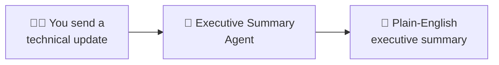

# Modul 0 - Einführung

⏱️ ~10 Minuten

> [!WARNING]
> **Vorschau & Einschränkungen:** [Hosted Agents](https://learn.microsoft.com/azure/foundry/agents/concepts/hosted-agents) befinden sich derzeit in der **öffentlichen Vorschau** – nicht empfohlen für Produktions-Workloads. Beachten Sie Folgendes:
> - **Unterstützte Regionen sind begrenzt** – prüfen Sie vor der Ressourcenerstellung die [Regionsverfügbarkeit](https://learn.microsoft.com/azure/foundry/agents/concepts/hosted-agents#region-availability). Wenn Sie eine nicht unterstützte Region wählen, schlägt die Bereitstellung fehl.
> - Das `agent-framework-foundry-hosting` Paket ist eine Vorabversion – APIs können sich zwischen den Versionen ändern.
> - Skalierungsgrenzen: Hosted Agents unterstützen 0–5 Replikate (einschließlich Scale-to-Zero).
> - Einige in diesem Workshop gezeigte Funktionen können sich ändern, wenn der Dienst auf GA (allgemeine Verfügbarkeit) zusteuert.

## Was Sie bauen werden

In diesem Workshop bauen Sie einen **"Explain Like I'm an Executive"** Agenten – einen gehosteten KI-Agenten, der komplexe technische Updates nimmt und sie als leicht verständliche Zusammenfassungen für Führungskräfte umschreibt.

**Der Agent verwendet:**
- **Microsoft Agent Framework** – für Agentenlogik und -struktur
- **Foundry Toolkit für VS Code** – zum Gerüsterstellen, lokalen Testen und Bereitstellen
- **Ein KI-Modell** (z. B. `gpt-4.1-mini/gpt-5-mini`) – zur Generierung der Zusammenfassungen

Am Ende dieses Labs haben Sie einen funktionierenden Agenten, den Sie lokal über den Agent Inspector testen und optional in die Cloud bereitstellen können.

---

## Was sind Hosted Agents?

Ein **Hosted Agent** ist ein KI-Agent, der als verwalteter Dienst in Microsoft Foundry läuft. Anstatt Ihre eigene Infrastruktur zu verwalten, verpacken Sie Ihren Agenten-Code in einem Container, und Foundry übernimmt Skalierung, Hosting und die Bereitstellung über einen standardmäßigen HTTP-Endpunkt.

| Konzept | Was es bedeutet |
|---------|------------------|
| **Agent** | Ihr Python-Code, der eine Benutzeranfrage entgegennimmt, ein KI-Modell aufruft und eine strukturierte Antwort zurückgibt |
| **Hosted** | Foundry führt Ihren Container aus – keine VMs, kein Kubernetes, keine Infrastrukturverwaltung |
| **Antwortprotokoll** | Eine standardisierte HTTP-API (`POST /responses`), die jeder Client aufrufen kann, um mit Ihrem Agenten zu interagieren |
| **Agent Inspector** | Ein lokales Test-UI (integriert ins Foundry Toolkit), mit dem Sie vor der Bereitstellung mit Ihrem Agenten chatten können |

In diesem Workshop gehen Sie von „null“ zu einem vollständig gehosteten Agenten – oder stoppen bei lokalem Testen, wenn Sie bevorzugen.

---

## Wähle deinen Weg

> ⚠️ **Wählen Sie einen Pfad, bevor Sie fortfahren.** Ihre Wahl bestimmt, welche Tools installiert werden und welche Module gelten. Sie können später von Pfad B → Pfad A wechseln, wenn Sie ein Abonnement erhalten.

<strong>🅰️ Pfad A – Azure Cloud (erfordert Azure-Abonnement)</strong>

| | Details |
|---|--------|
| **Für wen?** | Sie haben ein aktives Azure-Abonnement und können Foundry-Ressourcen erstellen |
| **Modell** | Azure OpenAI via Foundry (z. B. `gpt-4.1-mini/gpt-5-mini`) |
| **Abgedeckte Module** | Alle Module (00–07) |
| **Bereitstellung in der Cloud?** | ✅ Ja – vollständige Ende-zu-Ende-Bereitstellung |

<strong>🅱️ Pfad B – Lokal / Free-Tier (kein Azure-Abonnement nötig)</strong>

| | Details |
|---|--------|
| **Für wen?** | MVPs, Studierende oder alle ohne Azure-Zugang |
| **Modell** | **Foundry Local** (kostenlos, läuft auf Ihrem Rechner) |
| **Abgedeckte Module** | Module 00–04 (kein Bereitstellen & keine Cloud-Überprüfung) |
| **Bereitstellung in der Cloud?** | ❌ Nein – nur lokales Testen via Agent Inspector |

---

## Alle Pfade: Erforderliche Werkzeuge

Installieren Sie jedes der folgenden Werkzeuge. Nach der Installation verifizieren Sie die Funktionstüchtigkeit mit dem Überprüfungsbefehl.

| # | Werkzeug | Version | Installation | Verifikation (Erwartete Ausgabe) |
|---|---------|---------|--------------|----------------------------------|
| 1 | **Visual Studio Code** | Aktuellste Version | [code.visualstudio.com](https://code.visualstudio.com/) | Öffnet ohne Fehler |
| 2 | **Python** | 3.12 oder höher | [python.org/downloads](https://www.python.org/downloads/) | `python --version` $\rightarrow$ `Python 3.12.x` |
| 3 | **Foundry Toolkit für VS Code** | Aktuellste Version | Erweiterungs-ID: `ms-windows-ai-studio.windows-ai-studio` | Foundry-Symbol in der Aktivitätsleiste |
| 4 | **Python-Erweiterung für VS Code** | Aktuellste Version | Erweiterungs-ID: `ms-python.python` | In der Erweiterungsübersicht installiert |

> [!TIP]
> **Pro-Tipps für die Installation:**
> - **Python PATH (Windows):** Aktivieren Sie immer **„Python zum PATH hinzufügen“** im ersten Bildschirm des Python-Installers. Ohne dies wird `python` im Terminal nicht erkannt.
> - **Mehrere Python-Versionen:** Wenn Sie sowohl Python 3.10 als auch 3.12 installiert haben, verwenden Sie `python3.12 -m venv .venv`, um sicherzustellen, dass für Ihre virtuelle Umgebung die richtige Version verwendet wird.
> - **Docker WSL 2 (Windows):** Stellen Sie während der Docker Desktop-Installation sicher, dass das **WSL 2 Backend** ausgewählt ist. Docker mit Hyper-V ist langsamer und kann Probleme beim Bauen von Foundry-Containern verursachen.
> - **Docker startet nicht?** Warten Sie 30–60 Sekunden nach dem Start von Docker Desktop. Führen Sie `docker info` aus – wenn Sie „Cannot connect to the Docker daemon“ sehen, initialisiert Docker noch.
> - **VS Code-Erweiterungen werden nicht geladen?** Nach der Installation der Erweiterungen Fenster neu laden: `Ctrl+Shift+P` → `Developer: Reload Window`.

> **Windows-Nutzer:** Aktivieren Sie im Python-Installer **„Python zum PATH hinzufügen“**.

**Weiter:** [01 - Einrichtung →](01-setup.md)

---

<!-- CO-OP TRANSLATOR DISCLAIMER START -->
**Haftungsausschluss**:
Dieses Dokument wurde mit dem KI-Übersetzungsdienst [Co-op Translator](https://github.com/Azure/co-op-translator) übersetzt. Obwohl wir uns um Genauigkeit bemühen, beachten Sie bitte, dass automatisierte Übersetzungen Fehler oder Ungenauigkeiten enthalten können. Das Originaldokument in seiner Ursprungssprache gilt als maßgebliche Quelle. Bei kritischen Informationen wird eine professionelle menschliche Übersetzung empfohlen. Wir übernehmen keine Haftung für Missverständnisse oder Fehlinterpretationen, die aus der Verwendung dieser Übersetzung entstehen.
<!-- CO-OP TRANSLATOR DISCLAIMER END -->