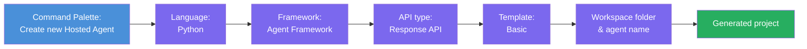
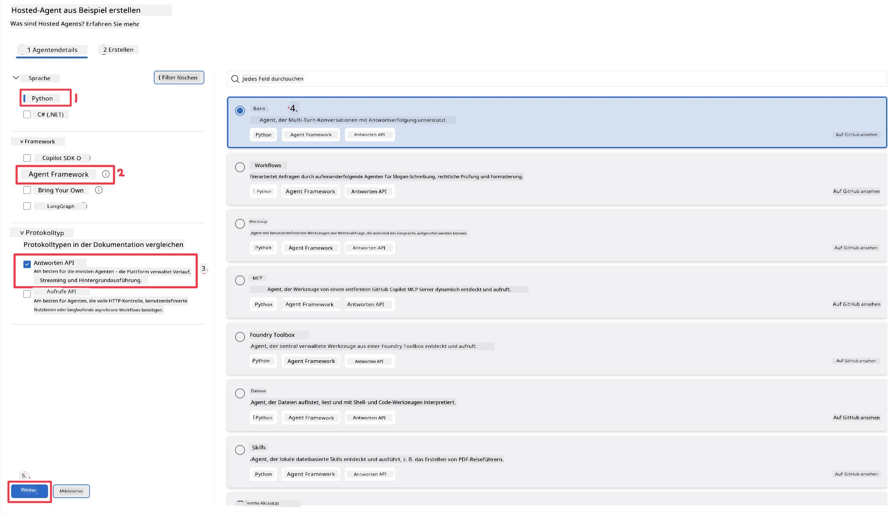
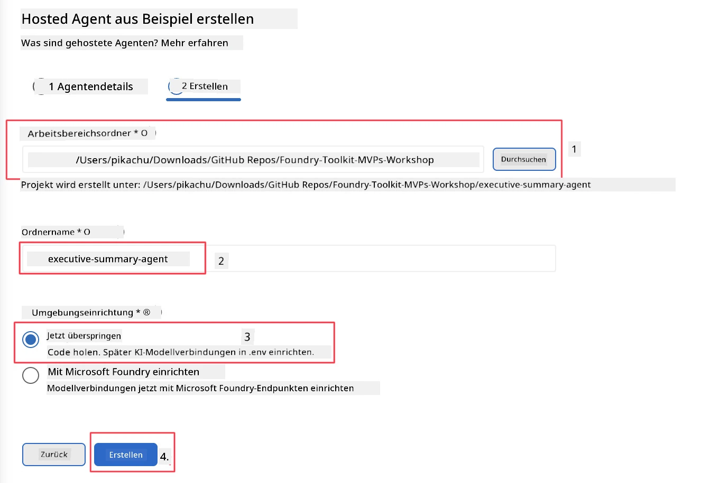

# Modul 2 - Einen neuen Hosted Agent erstellen

⏱️ ~5 min

In diesem Modul verwendest du das Foundry Toolkit, um **ein Hosted Agent-Projekt zu scaffolden**. Das Scaffold erzeugt die vollständige Projektstruktur - `agent.yaml`, `main.py`, `Dockerfile`, `requirements.txt` und die VS Code-Debug-Konfiguration - damit du dich auf die Anpassung des Agentenverhaltens konzentrieren kannst.

> **Schlüsselkonzept:** Der Ordner `agent/` in diesem Labor ist ein Beispiel dessen, was das Foundry Toolkit generiert. Du schreibst diese Dateien nicht von Grund auf neu.

### Ablauf des Scaffold-Assistenten



---

## Schritt 1: Öffne den Create Hosted Agent-Assistenten

1. Drücke `Ctrl+Shift+P`, um die **Befehls-Palette** zu öffnen.
2. Tippe: **Foundry Toolkit: Create new Hosted Agent** und wähle es aus.

> **Alternative: Erstellung über das Foundry-Portal**
> Wenn du lieber den Browser verwendest, kannst du dein Projekt unter [https://ai.azure.com](https://ai.azure.com) erstellen. Sobald das Projekt bereitgestellt ist, kehre zu VS Code zurück und verbinde dich über die **Foundry Toolkit**-Seitenleiste damit.

> **Alternative:** Bewege in der Foundry Toolkit-Seitenleiste die Maus über **Agents** unter deinem Projekt, klicke auf das **+**-Symbol und wähle dann **Create in Code With Template**.

## Schritt 2: Einstellungen auswählen



1. Wähle im linken Navigations-/Optionsbereich Folgendes aus:

| Menü | Auswahl | Anmerkungen |
|--------|-----------|----------|
| **Sprache** | Python | C# ebenfalls unterstützt |
| **Framework** | Agent Framework | Einfacher Einstiegspunkt mit Agent Framework SDK |
| **API-Typ** | Response API | `POST /responses` - konversationell, mit plattformverwaltetem Verlauf |
| **Vorlage** | Basic | Einfacher Einstiegspunkt mit Agent Framework SDK |

2. Nachdem du ausgewählt hast, klicke auf **Next**



3. Wähle im nächsten Fenster Folgendes aus:

| Menü | Auswahl | Anmerkungen |
|--------|-----------|----------|
| **Arbeitsbereich-Ordner** | Zielordner wählen | z.B. `/workspace/Foundry_Toolkit_for_VSCode_Lab/` oder ein Unterordner in diesem Repo |
| **Agentenname** | Name eingeben | z.B. `executive-summary-agent` |
| **Umgebungs-Setup** | Setup vorerst überspringen |  |

Klicke auf **create**, um unseren Agenten zu erstellen. Ein neuer Ordner mit dem Namen des Hosted Agents wird angelegt.

## Schritt 3: Das generierte Projekt überprüfen

Nach Abschluss des Scaffoldings überprüfe, ob du diese Dateien im Explorer (`Ctrl+Shift+E`) siehst:

```
📂 executive-summary-agent/
├── .env                ← Environment variables (placeholders)
├── .vscode/
│   ├── launch.json     ← Debug config (F5 → run + Agent Inspector)
│   └── tasks.json      ← VS Code task definitions
├── agent.yaml          ← Agent definition (kind: hosted)
├── Dockerfile          ← Container config for deployment
├── main.py             ← Agent entry point (your main code)
└── requirements.txt    ← Python dependencies
```

### Wichtige Dateien erklärt

| Datei | Zweck |
|------|---------|
| `agent.yaml` | Deklariert den Agenten als `kind: hosted`, bildet Umgebungsvariablen ab, definiert das `/responses`-Protokoll |
| `main.py` | Erstellt ein `FoundryChatClient` → umschließt es in einem `Agent` mit Anweisungen → bedient über `ResponsesHostServer` auf Port 8088 |
| `Dockerfile` | Nutzt `python:3.12-slim`, installiert Abhängigkeiten, öffnet Port 8088, führt `main.py` aus |
| `requirements.txt` | `agent-framework-foundry`, `agent-framework-foundry-hosting`, `mcp`, `debugpy` |

> **Wichtig:** Öffne den scaffoldeten Agentenordner direkt in VS Code (den `agent/`-Ordner selbst), damit `.vscode/launch.json` und `tasks.json` für das F5-Debugging korrekt funktionieren.

---

### ✅ Kontrollpunkt

- [ ] Scaffold-Projekt mit allen erwarteten Dateien erstellt
- [ ] `agent.yaml` zeigt `kind: hosted` und `protocol: responses`
- [ ] `main.py` importiert `Agent`, `FoundryChatClient`, `ResponsesHostServer`
- [ ] Der Agentenordner ist als Arbeitsbereichs-Root in VS Code geöffnet

---

**Vorherige:** [01 - Einrichtung](01-setup.md) · **Nächste:** [03 - Konfigurieren & Programmieren →](03-configure-and-code.md)

---

<!-- CO-OP TRANSLATOR DISCLAIMER START -->
**Haftungsausschluss**:
Dieses Dokument wurde mit dem KI-Übersetzungsdienst [Co-op Translator](https://github.com/Azure/co-op-translator) übersetzt. Obwohl wir uns um Genauigkeit bemühen, beachten Sie bitte, dass automatisierte Übersetzungen Fehler oder Ungenauigkeiten enthalten können. Das Originaldokument in seiner Ursprungssprache gilt als maßgebliche Quelle. Bei kritischen Informationen wird eine professionelle menschliche Übersetzung empfohlen. Wir übernehmen keine Haftung für Missverständnisse oder Fehlinterpretationen, die aus der Verwendung dieser Übersetzung entstehen.
<!-- CO-OP TRANSLATOR DISCLAIMER END -->