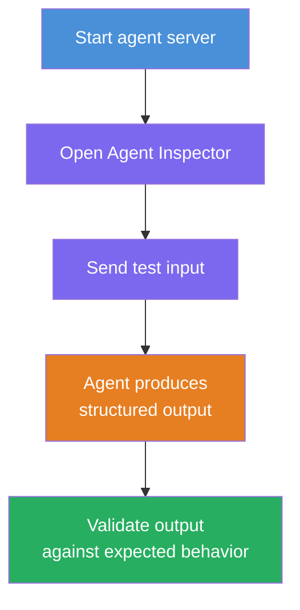
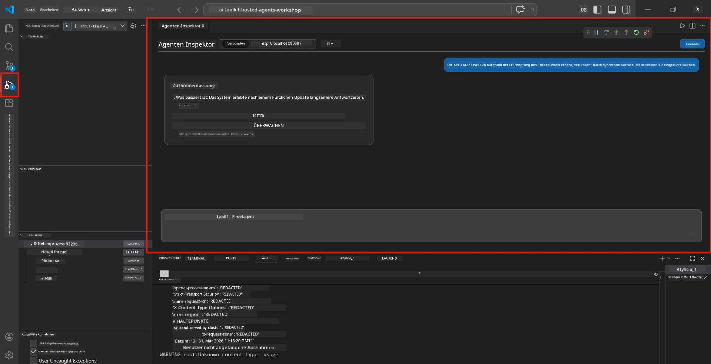
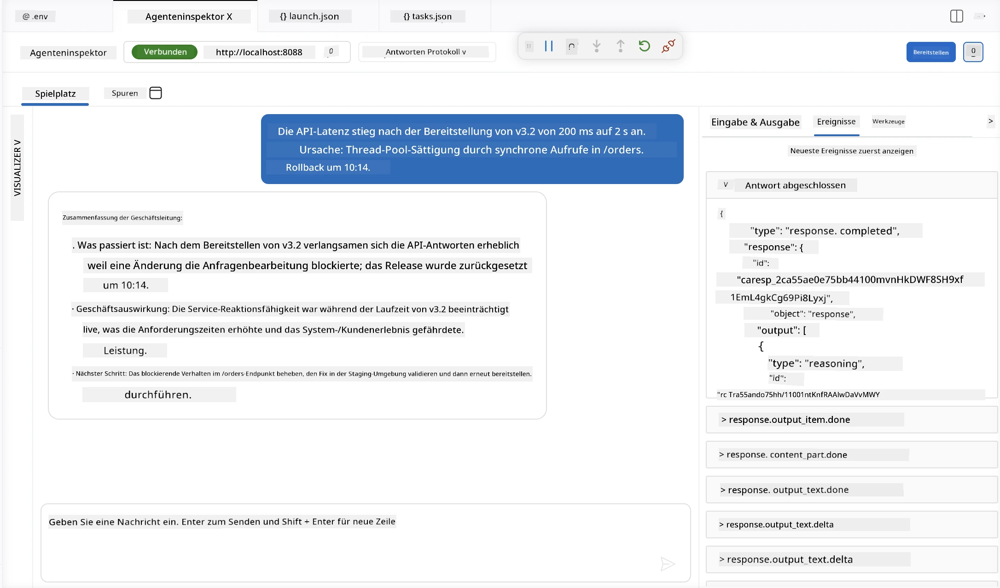

# Modul 4 - Lokal testen

⏱️ ~10 min

In diesem Modul führst du deinen Agenten lokal aus und überprüfst, ob er korrekt funktioniert, indem du **Happy-Path-Funktionstests** verwendest. Du nutzt den Agent Inspector (visuelle Benutzeroberfläche) oder direkte HTTP-Aufrufe, um zu bestätigen, dass der Agent strukturierte, präzise Antworten liefert.

### Ablauf des lokalen Testens



---

## Option 1: Drücke F5 - Debugging mit Agent Inspector (empfohlen)

### Starte den Debugger

1. Öffne direkt den Ordner **executive-summary-agent/** in VS Code (`File → Open Folder`).
2. Öffne das **Run and Debug**-Panel (`Ctrl+Shift+D`).
3. Wähle **Debug Local Agent HTTP Server** aus dem Dropdown aus.
4. Drücke **F5** (oder klicke auf ▶ Debugging starten).

> ⚠️ **Wichtig: Wähle deinen Python-Interpreter aus**
> Wenn du "ModuleNotFoundError" erhältst oder der Debugger nicht startet, musst du VS Code anweisen, dein virtuelles Umfeld zu verwenden:
  > 1. Drücke `Ctrl+Shift+P` $\rightarrow$ gib **Python: Select Interpreter** ein.
  > 2. Wähle den Interpreter aus dem `.venv` Ordner deines Projekts (z.B. `.\.venv\Scripts\python.exe` unter Windows).
  > 3. Starte die Debug-Sitzung neu.
> Wenn weiterhin Fehler auftreten, aktualisiere deine Datei `tasks.json` manuell wie folgt:
  > 1. Navigiere zur Datei `.vscode/tasks.json`
  > 2. Gehe zur Aufgabe mit der Bezeichnung: `Run Agent HTTP Server`
  > 3. Aktualisiere den Wert für den Befehl wie folgt:
  >    - **Windows:** `"value": "${workspaceFolder}/.venv/Scripts/python.exe",`
  >    - **macOS/Linux:** `"value": "${workspaceFolder}/.venv/bin/python",`

### Was passiert

1. Der HTTP-Server startet auf `http://localhost:8088/responses`.
2. Das **Agent Inspector**-Panel öffnet sich automatisch - eine visuelle Chat-Oberfläche zum Testen.
3. Breakpoints sind in `main.py` aktiviert.

Beobachte das Terminal für:
```
Starting executive summary hosted agent
Executive agent server running on http://localhost:8088
```

> **Wenn sich der Agent Inspector nicht öffnet:** Drücke `Ctrl+Shift+P` → **Foundry Toolkit: Open Agent Inspector**.



> *Der Screenshot zeigt möglicherweise ältere "AI TOOLKIT"-Markenzeichen einer früheren Extension-Version.*

---

## Option 2: Test über Terminal (Alternative)

Starte den Agenten in einem Terminal, sende Anfragen vom anderen:

```bash
# Terminal 1: Start agent
cd executive-summary-agent/
source .venv/bin/activate
python main.py
```

```bash
# Terminal 2: Send test (curl)
curl -sS -X POST http://localhost:8088/responses \
  -H "Content-Type: application/json" \
  -d '{"input": "The API latency increased due to thread pool exhaustion caused by sync calls in v3.2.", "stream": false}'
```

---

## Szenariotests: Happy-Path-Funktionale Validierung

Führe **alle drei** der folgenden Szenarien aus. Damit wird geprüft, ob dein Agent für realistische Eingaben korrekte, strukturierte Ausgaben erzeugt.



### Szenario 1: IT-Vorfall - API-Latenzspitze

**Eingabe:**
```
The API latency increased from 200ms to 2s after deploying v3.2.
Root cause: thread pool starvation from synchronous calls in /orders.
Rolled back at 10:14.
```

**Erwartetes Verhalten:**
- ✅ Folgt der Struktur der "Executive Summary" (Was ist passiert / Geschäftsauswirkung / Nächster Schritt)
- ✅ Keine technische Fachbegriffe (kein "thread pool", kein "/orders", keine "v3.2")
- ✅ Beschreibt klar die Geschäftsauswirkung (z.B. es kam bei Nutzern zu Verzögerungen)
- ✅ Beinhaltet einen nächsten Schritt (z.B. Fehlerbehebung deployed, Monitoring eingerichtet)

---

### Szenario 2: Datenpipeline - ETL-Ausfall

**Eingabe:**
```
The nightly ETL job failed because the upstream schema changed. APAC dashboards show missing data.
```

**Erwartetes Verhalten:**
- ✅ Fasst den Fehler beim Daten-Refresh in einfacher Sprache zusammen
- ✅ Erwähnt den Einfluss auf das APAC-Dashboard
- ✅ Enthält einen nächsten Schritt zur Behebung
- ✅ Erwähnt NICHT "ETL", "Schema" oder andere technische Begriffe

---

### Szenario 3: Sicherheit - Offenbarte Anmeldeinformationen

**Eingabe:**
```
Static analysis flagged a hardcoded secret in the repository.
The secret may have been exposed in commit history.
```

**Erwartetes Verhalten:**
- ✅ Beschreibt eine Anmeldeinformations- / Sicherheitsproblematik in für Führungskräfte verständlicher Sprache
- ✅ Hebt ein potenzielles Risiko (unbefugter Zugriff) hervor
- ✅ Nimmt eine Maßnahme zur Behebung vor (Anmeldeinfo-Rotation, Audit)
- ✅ Enthält KEINE Begriffe wie "statische Analyse", "Commit-Verlauf" oder "hardcoded"

---

## Validierungskriterien

Für jedes Szenario prüfe:

| # | Kriterium | Bestehensbedingung |
|---|----------|---------------|
| 1 | **Struktur** | Antwort verwendet das Format der "Executive Summary" mit allen drei Aufzählungen |
| 2 | **Einfache Sprache** | Keine Fachbegriffe, die ein Geschäftsführer nicht verstehen würde |
| 3 | **Genauigkeit** | Zusammenfassung entspricht der Eingabe - keine erfundenen Details |
| 4 | **Kürze** | Antwort umfasst weniger als 100 Wörter |
| 5 | **Nächster Schritt** | Eine klare Maßnahme oder Milderung wird genannt |

---

## Debugging-Tipps

| Problem | Lösung |
|-------|-----|
| Agent startet nicht | Prüfe die `.env` Werte, überprüfe ob das venv aktiviert ist, führe `pip install -r requirements.txt` aus |
| Leere oder generische Antwort | Überprüfe die Anweisungen in `main.py` - stelle sicher, dass das Ausgabeformat spezifiziert ist |
| Antwort enthält Fachbegriffe | Verschärfe die Regeln zum "Entfernen technischer Begriffe" in den Anweisungen |
| Agent Inspector öffnet sich nicht | `Ctrl+Shift+P` → **Foundry Toolkit: Open Agent Inspector** |
| Modellfehler im Terminal | Überprüfe, ob `AZURE_AI_MODEL_DEPLOYMENT_NAME` exakt übereinstimmt (Groß-/Kleinschreibung beachten) |

---

### ✅ Checkpoint

- [ ] Agent startet lokal ohne Fehler
- [ ] Agent Inspector öffnet sich und zeigt eine Chat-Schnittstelle (wenn F5 verwendet wird)
- [ ] **Szenario 1** (IT-Vorfall) - strukturierte Executive Summary, keine Fachbegriffe
- [ ] **Szenario 2** (Datenpipeline) - relevante Zusammenfassung mit Geschäftsauswirkung
- [ ] **Szenario 3** (Sicherheitswarnung) - angemessene Risiko-Kommunikation
- [ ] Alle Antworten folgen der definierten Ausgabe-Struktur

> **Speichere deine Antworten** (kopiere oder mache Screenshots) - du wirst sie in Modul 06 mit Cloud-Ergebnissen vergleichen.

---

**Vorheriges:** [03 - Konfigurieren & Codieren](03-configure-and-code.md) · **Nächstes:** [05 - Deployment in Foundry →](05-deploy-to-foundry.md)

---

<!-- CO-OP TRANSLATOR DISCLAIMER START -->
**Haftungsausschluss**:
Dieses Dokument wurde mit dem KI-Übersetzungsdienst [Co-op Translator](https://github.com/Azure/co-op-translator) übersetzt. Obwohl wir uns um Genauigkeit bemühen, beachten Sie bitte, dass automatisierte Übersetzungen Fehler oder Ungenauigkeiten enthalten können. Das Originaldokument in seiner Ursprungssprache gilt als maßgebliche Quelle. Bei kritischen Informationen wird eine professionelle menschliche Übersetzung empfohlen. Wir übernehmen keine Haftung für Missverständnisse oder Fehlinterpretationen, die aus der Verwendung dieser Übersetzung entstehen.
<!-- CO-OP TRANSLATOR DISCLAIMER END -->