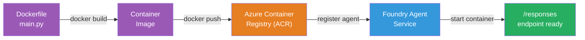
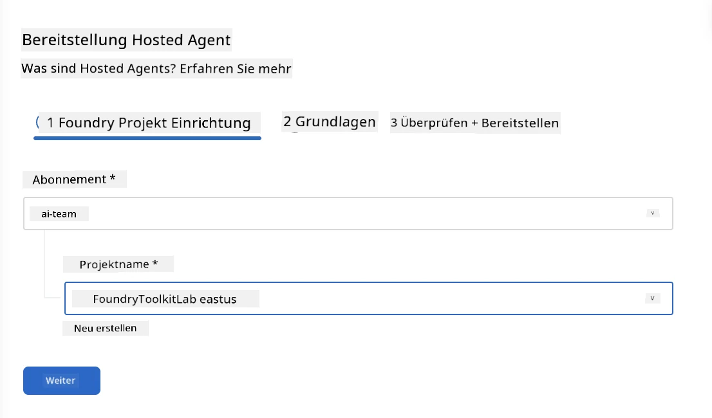
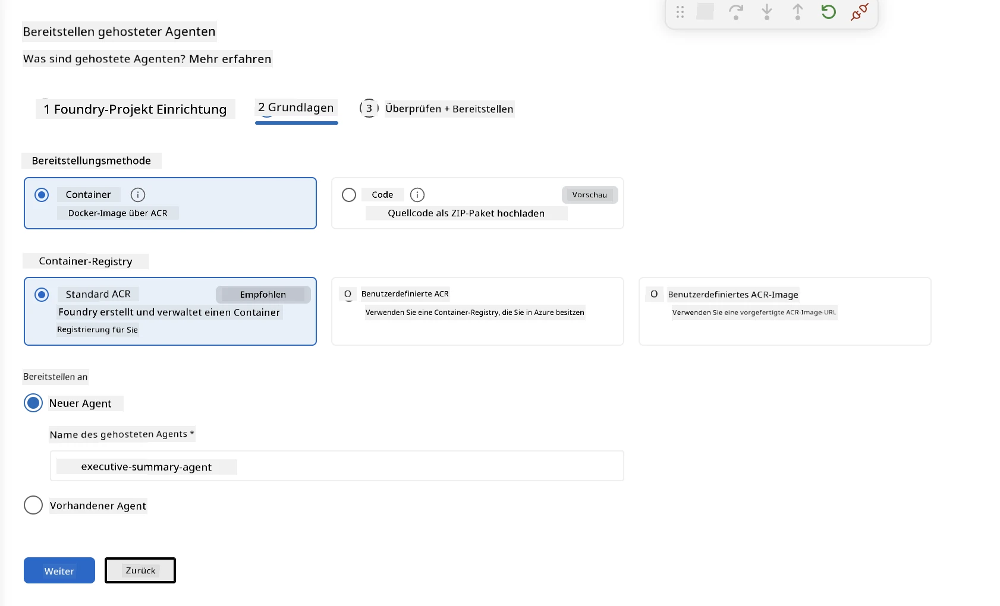
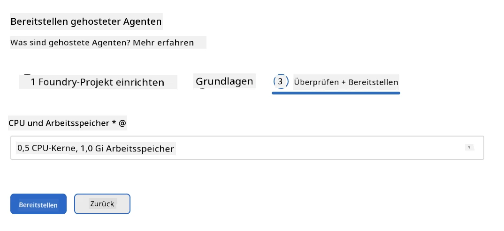
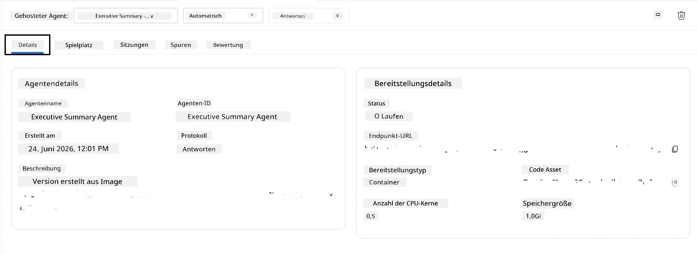

# Modul 5 - Bereitstellung im Foundry Agent Service

⏱️ ~10 Min.

> ⚠️ **Pfad B Benutzer:** Dieses Modul erfordert ein Foundry-Abonnement. Wenn Sie Foundry Local verwenden, springen Sie zu [Modul 07 - Zusammenfassung](07-summary.md). Sie haben den lokalen Entwicklungsworkflow erfolgreich abgeschlossen!

In diesem Modul stellen Sie Ihren lokal getesteten Agent als **Gehosteten Agent** in Microsoft Foundry bereit. Die Bereitstellung erstellt ein Container-Image, schiebt es in das Azure Container Registry und startet den Agenten in der verwalteten Infrastruktur von Foundry.

### Bereitstellungspipeline

---

## Voraussetzungen prüfen

Vor der Bereitstellung überprüfen Sie:

- [ ] Agent besteht alle 3 lokalen Szenarien aus [Modul 04](04-test-locally.md)
- [ ] Sie haben die **Azure AI User**-Rolle auf Projektebene ([Modul 01, RBAC zuweisen](01-setup.md#deploy-a-model--assign-rbac))
- [ ] Sie sind in VS Code bei Azure angemeldet (Kontosymbol zeigt Ihren Namen)

---

## Schritt 1: Starten Sie die Bereitstellung

### Option A: Bereitstellung aus dem Agent Inspector (empfohlen)

Wenn der Agent Inspector geöffnet ist (vom Testen):
1. Klicken Sie oben rechts auf die **Bereitstellen**-Schaltfläche (Cloud-Symbol ↑).

### Option B: Bereitstellung über die Befehls-Palette

1. Drücken Sie `Ctrl+Shift+P` → **Foundry Toolkit: Gehosteten Agent bereitstellen**.

---

## Schritt 2: Konfigurieren Sie die Bereitstellung

Die Eingabeaufforderung fragt Sie nach:

| Eingabeaufforderung | Auswahl |
|--------|-----------|
| **Abonnement** | Ihr Azure-Abonnement |
| **Zielprojekt** | Ihr Foundry-Projekt (z. B. `workshop-agents`) |

Klicken Sie auf **Weiter**, um Ihren Agent zu konfigurieren.

| Eingabeaufforderung | Auswahl |
|--------|-----------|
| **Bereitstellungsmethode** | Container |
| **Container-Registry** | **Standard-ACR** (Microsoft Foundry erstellt und verwaltet eine für Sie) |
| **Bereitstellen auf** | Neuer Agent (Name, `executive-summary-agent`) |

Klicken Sie auf **Weiter**, um Ihren Agent zu überprüfen und bereitzustellen.

| Eingabeaufforderung | Auswahl |
|--------|-----------|
| **CPU und Arbeitsspeicher** | **0,5 CPU-Kerne, 1,0 Gi Arbeitsspeicher** (Standard - ausreichend für den Workshop) |

---

## Schritt 3: Bereitstellen und überwachen

1. Klicken Sie auf **Bereitstellen**.
2. Beobachten Sie das **Ausgabe**-Fenster (wählen Sie **Microsoft Foundry** aus dem Dropdown-Menü).
3. Die Bereitstellung durchläuft diese Phasen:
   - **Docker Build** - erstellt Container aus Ihrer Dockerdatei
   - **Docker Push** - schiebt Image in ACR (1–3 Min. bei erster Bereitstellung)
   - **Agent Registrierung** - erstellt gehosteten Agent in Foundry
   - **Container Start** - startet mit systemverwalteter Identität

4. Nach Abschluss erscheint eine Benachrichtigung:
   > **executive-summary-agent wurde erfolgreich bereitgestellt.** `View logs` `Run agent`

5. Klicken Sie auf **Agent ausführen**, um den Agent Playground zu öffnen.

### Werte für den Bereitstellungsstatus

| Status | Bedeutung |
|--------|---------|
| **Running** | Container bereit, Agent reagiert |
| **Pending** | Container startet - warten Sie 30–60 Sekunden |
| **Failed** | Überprüfen Sie die Protokolle (siehe Fehlerbehebung weiter unten) |

---

## Häufige Bereitstellungsfehler

| Fehler | Ursache | Lösung |
|-------|--------|--------|
| `agents/write` Berechtigung verweigert | Fehlende **Azure AI User**-Rolle auf Projektebene | [Modul 01, RBAC zuweisen](01-setup.md#deploy-a-model--assign-rbac) |
| Docker läuft nicht | Docker Desktop nicht gestartet | Starten Sie Docker Desktop → prüfen Sie `docker info` |
| ACR-Autorisierung | Verwaltete Identität kann Image nicht ziehen | Siehe [Modul 08 - Fehlerbehebung](08-troubleshooting.md) |

---

### ✅ Checkpoint

- [ ] Bereitstellung abgeschlossen ohne Fehler
- [ ] Agent erscheint auf der Registerkarte **Hosted Agent**, wenn Sie unter Ihrem Projekt im Foundry Toolkit-Sidebar auf **Agents** klicken
- [ ] Containerstatus zeigt **Running**
- [ ] Registerkarte Agent Playground geöffnet zeigt Agent-Details und Endpunkt-URL

---

**Vorheriges:** [04 - Lokal testen](04-test-locally.md) · **Nächstes:** [06 - Im Playground prüfen →](06-verify-in-playground.md)

---

<!-- CO-OP TRANSLATOR DISCLAIMER START -->
**Haftungsausschluss**:
Dieses Dokument wurde mit dem KI-Übersetzungsdienst [Co-op Translator](https://github.com/Azure/co-op-translator) übersetzt. Obwohl wir uns um Genauigkeit bemühen, beachten Sie bitte, dass automatisierte Übersetzungen Fehler oder Ungenauigkeiten enthalten können. Das Originaldokument in seiner Ursprungssprache gilt als maßgebliche Quelle. Bei kritischen Informationen wird eine professionelle menschliche Übersetzung empfohlen. Wir übernehmen keine Haftung für Missverständnisse oder Fehlinterpretationen, die aus der Verwendung dieser Übersetzung entstehen.
<!-- CO-OP TRANSLATOR DISCLAIMER END -->