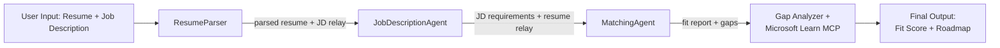

# PersonalCareerCopilot – Lebenslauf → Job-Passung Evaluator

Eine Workflow-zentrierte Multi-Agenten-App, die bewertet, wie gut ein Lebenslauf zur Stellenbeschreibung passt, und dann eine personalisierte Lern-Roadmap zur Schließung der Lücken erstellt.

---

## Agenten

| Agent | Rolle | Werkzeuge |
|-------|------|-----------|
| **ResumeParser** | Extrahiert strukturierte Fähigkeiten, Erfahrungen, Zertifizierungen aus dem Lebenslauft text | - |
| **JobDescriptionAgent** | Extrahiert erforderliche/bevorzugte Fähigkeiten, Erfahrungen, Zertifizierungen aus einer Stellenbeschreibung | - |
| **MatchingAgent** | Vergleicht Profil vs Anforderungen → Passungsbewertung (0-100) + übereinstimmende/fehlende Fähigkeiten | - |
| **GapAnalyzer** | Erstellt eine personalisierte Lern-Roadmap mit Microsoft Learn Ressourcen | `search_microsoft_learn_for_plan` (MCP) |

## Workflow



---

## Schnellstart

### 1. Umgebung einrichten

Dieser Ordner ist die Referenzimplementierung für das workflow-basierte Lab 02 Gerüst. Seine `main.py` nutzt die bestehenden Prompt-Blöcke plus `WorkflowBuilder`, um die vier Agenten zu verbinden.

```powershell
cd workshop\lab02-multi-agent\PersonalCareerCopilot
python -m venv .venv
.\.venv\Scripts\Activate.ps1          # Windows PowerShell
# source .venv/bin/activate            # macOS / Linux
pip install -r requirements.txt
```

### 2. Zugangsdaten konfigurieren

Erstellen Sie eine `.env` Datei in diesem Ordner:

```powershell
copy .env .env.bak 2>$null; echo $null > .env
```

Bearbeiten Sie `.env`:

```env
FOUNDRY_PROJECT_ENDPOINT=https://<your-account>.services.ai.azure.com/api/projects/<your-project>
AZURE_AI_MODEL_DEPLOYMENT_NAME=gpt-4.1-mini
```

| Wert | Wo zu finden |
|-------|--------------|
| `FOUNDRY_PROJECT_ENDPOINT` | Foundry Toolkit Seitenleiste → Rechtsklick auf Ihr Projekt → **Projekt-Endpunkt kopieren** |
| `AZURE_AI_MODEL_DEPLOYMENT_NAME` | Foundry Seitenleiste → Projekt ausklappen → **Modelle + Endpunkte** → Bereitstellungsname |

### 3. Lokal ausführen

```powershell
python -m debugpy --listen 127.0.0.1:5679 main.py --port 8088
```

Oder verwenden Sie die VS Code Aufgabe: `Ctrl+Shift+P` → **Aufgaben: Aufgabe ausführen** → **Agent HTTP Server ausführen**.

Für F5-Debugging: **Lokalen Agent HTTP Server debuggen** verwenden.

### 4. Testen mit Agent Inspector

Öffnen Sie Agent Inspector: `Ctrl+Shift+P` → **Foundry Toolkit: Agent Inspector öffnen**.

Fügen Sie diese Testaufforderung ein:

```
Resume:
Jane Doe
Senior Software Engineer with 5 years of experience in Python, Django, and AWS.
Built microservices handling 10K+ requests/second. Led a team of 4 developers.
Certifications: AWS Solutions Architect Associate.
Education: B.S. Computer Science, State University.

Job Description:
Senior Cloud Engineer at Contoso Ltd.
Required: Python, Azure, Kubernetes, Terraform, CI/CD pipelines.
Preferred: Go, monitoring (Prometheus/Grafana), cost optimization.
Experience: 5+ years in cloud infrastructure.
Certifications: Azure Solutions Architect Expert preferred.
```

**Erwartet:** Eine Passungsbewertung (0-100), übereinstimmende/fehlende Fähigkeiten und eine personalisierte Lern-Roadmap mit Microsoft Learn URLs.

### 5. Bereitstellen in Foundry

`Ctrl+Shift+P` → **Foundry Toolkit: Gehosteten Agent bereitstellen** → wählen Sie Ihr Projekt → bestätigen.

---

## Projektstruktur

```
PersonalCareerCopilot/
├── .env                ← Your credentials (git-ignored)
├── agent.yaml          ← Hosted agent definition (name, resources, env vars)
├── Dockerfile          ← Container image for Foundry deployment
├── main.py             ← 4-agent workflow (instructions, MCP tool, WorkflowBuilder)
└── requirements.txt    ← Python dependencies
```

## Wichtige Dateien

### `agent.yaml`

Definiert den gehosteten Agent für Foundry Agent Service:
- `kind: hosted` - läuft als verwalteter Container
- `protocols` - `responses` Protokoll mit `version: 2.0.0`, stellt den `/responses` HTTP-Endpunkt bereit
- `environment_variables` - `AZURE_AI_MODEL_DEPLOYMENT_NAME` wird hier deklariert; `FOUNDRY_PROJECT_ENDPOINT` wird bei Bereitstellung automatisch injiziert

### `main.py`

Enthält:
- **Agentenanweisungen** - vier `*_INSTRUCTIONS` Konstanten, eine pro Agent
- **MCP Tool** - `search_microsoft_learn_for_plan()` ruft `https://learn.microsoft.com/api/mcp` via Streamable HTTP auf
- **Agentenerstellung** - vier `Agent()` + `AgentExecutor()` Exemplare teilen sich eine `FoundryChatClient`
- **Workflow-Graph** - `WorkflowBuilder` verbindet Agenten als sequenzielle Pipeline: ResumeParser → JD Agent → MatchingAgent → GapAnalyzer
- **Serverstart** - `ResponsesHostServer` läuft auf Port 8088

### `requirements.txt`

| Paket | Zweck |
|---------|--------|
| `agent-framework-foundry` | Kernlaufzeit: `Agent`, `AgentExecutor`, `WorkflowBuilder`, `@tool`, `FoundryChatClient` |
| `agent-framework-foundry-hosting` | `ResponsesHostServer` + Foundry Hosting Integration |
| `mcp<2,>=1.24.0` | MCP-Client für GapAnalyzer (`streamable_http_client`) |
| `debugpy` | Python-Debugging (F5 in VS Code) |

---

## Fehlerbehebung

| Problem | Lösung |
|---------|--------|
| `KeyError: 'FOUNDRY_PROJECT_ENDPOINT'` oder `KeyError: 'AZURE_AI_MODEL_DEPLOYMENT_NAME'` | Erstellen Sie `.env` mit sowohl `FOUNDRY_PROJECT_ENDPOINT` als auch `AZURE_AI_MODEL_DEPLOYMENT_NAME` gesetzt |
| `ModuleNotFoundError: No module named 'agent_framework'` | Aktivieren Sie venv und führen Sie `pip install -r requirements.txt` aus |
| Keine Microsoft Learn URLs in der Ausgabe | Prüfen Sie die Internetverbindung zu `https://learn.microsoft.com/api/mcp` |
| Nur 1 Gap-Karte (abgeschnitten) | Überprüfen Sie, ob `GAP_ANALYZER_INSTRUCTIONS` den `CRITICAL:` Block enthält |
| Port 8088 bereits in Verwendung | Stoppen Sie andere Server: `netstat -ano \| findstr :8088` |

Für detaillierte Fehlerbehebung siehe [Modul 8 - Fehlerbehebung](../docs/08-troubleshooting.md).

---

**Vollständige Anleitung:** [Lab 02 Docs](../docs/README.md) · **Zurück zu:** [Lab 02 README](../README.md) · [Workshop Startseite](../../../README.md)

---

<!-- CO-OP TRANSLATOR DISCLAIMER START -->
**Haftungsausschluss**:
Dieses Dokument wurde mit dem KI-Übersetzungsdienst [Co-op Translator](https://github.com/Azure/co-op-translator) übersetzt. Obwohl wir uns um Genauigkeit bemühen, beachten Sie bitte, dass automatisierte Übersetzungen Fehler oder Ungenauigkeiten enthalten können. Das Originaldokument in seiner Ursprungssprache gilt als maßgebliche Quelle. Bei kritischen Informationen wird eine professionelle menschliche Übersetzung empfohlen. Wir übernehmen keine Haftung für Missverständnisse oder Fehlinterpretationen, die aus der Verwendung dieser Übersetzung entstehen.
<!-- CO-OP TRANSLATOR DISCLAIMER END -->