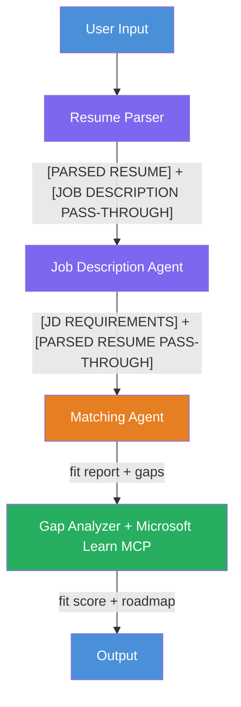

# Labor 02 - Multi-Agent Workflow: Lebenslauf → Stellen-Passung Evaluator

## Überblick

In diesem praktischen Labor baust du eine **workflow-zentrierte Multi-Agenten-App** mit dem Foundry Toolkit in VS Code und stellst sie im Microsoft Foundry Agent Service bereit.

**Was du bauen wirst:** ein Lebenslauf → Stellen-Passung Evaluator, der einen Lebenslauf und eine Stellenbeschreibung analysiert, die Übereinstimmung bewertet und einen personalisierten Lernplan mit Microsoft Learn Ressourcen erstellt.

---

## Architektur

**So funktioniert es:**
1. Der Benutzer fügt einen Lebenslauf und eine Stellenbeschreibung ein.
2. **ResumeParser** analysiert den Lebenslauf und kopiert die Stellenbeschreibung wortwörtlich in einen `[JOB DESCRIPTION PASS-THROUGH]` Abschnitt.
3. **JD Agent** extrahiert strukturierte Anforderungen aus dem Durchlauf, dann leitet er den `[PARSED RESUME]` als `[PARSED RESUME PASS-THROUGH]` weiter.
4. **MatchingAgent** vergleicht `[PARSED RESUME PASS-THROUGH]` mit `[JD REQUIREMENTS]` und erzeugt eine Passungsbewertung.
5. **GapAnalyzer** wandelt die Lücken in einen praktischen Lernplan um und holt echte Microsoft Learn Links über MCP.

---

## Voraussetzungen

Schließe zuerst Labor 01 ab:

- [Labor 01 - Ein Agent](../lab01-single-agent/README.md)

---

## Teil 1: Lies die Module in Reihenfolge

Siehe den vollständigen Lernpfad unter:

- [Labor 2 Dokumentation - Voraussetzungen](docs/00-prerequisites.md)
- [Labor 2 Dokumentation - Vollständiger Lernpfad](docs/README.md)
- [PersonalCareerCopilot Anleitung](PersonalCareerCopilot/README.md)

---

## Teil 2: Erstelle und teste den Workflow

1. Nutze den Foundry Toolkit Assistenten, um das workflow-basierte Projekt zu erstellen.
2. Kopiere die Prompt-Blöcke und den Workflow-Graphen von `PersonalCareerCopilot/main.py` in deinen Arbeitsbereich.
3. Führe lokal mit dem Agent Inspector aus und überprüfe alle vier Agenten sowie das MCP Tool.
4. Stelle den gehosteten Agent nach bestandenem lokalen Test in Foundry bereit.

---

## Orchestrierungs-Muster

Labor 02 verwendet eine **sequentielle Pipeline**: die Ausgabe jedes Agenten wird an den nächsten weitergeleitet und der Workflow gibt die Antwort des letzten Agenten zurück. Zwei Muster ermöglichen dies:

- **Sequentielle Kette** - `WorkflowBuilder` verbindet ResumeParser → JD Agent → MatchingAgent → GapAnalyzer mit einem `add_edge()` Aufruf pro Schritt
- **Datenweiterleitung** - da jeder Agent nur die Ausgabe seines direkten Vorgängers sieht, kopieren ResumeParser und JD Agent die für weitere Agenten benötigten Daten in beschriftete Durchlauf-Abschnitte

Die Dokumentation erklärt auch, warum das Labor kein Fan-out/Fan-in verwendet und wie man den Graphen mit einem weiteren Agenten erweitert.

Siehe [docs/04-orchestration-patterns.md](docs/04-orchestration-patterns.md).

---

**Vorheriges:** [Labor 01 - Ein Agent](../lab01-single-agent/README.md) · **Zurück zu:** [Workshop Startseite](../../README.md)

---

<!-- CO-OP TRANSLATOR DISCLAIMER START -->
**Haftungsausschluss**:
Dieses Dokument wurde mit dem KI-Übersetzungsdienst [Co-op Translator](https://github.com/Azure/co-op-translator) übersetzt. Obwohl wir uns um Genauigkeit bemühen, beachten Sie bitte, dass automatisierte Übersetzungen Fehler oder Ungenauigkeiten enthalten können. Das Originaldokument in seiner Ursprungssprache gilt als maßgebliche Quelle. Bei kritischen Informationen wird eine professionelle menschliche Übersetzung empfohlen. Wir übernehmen keine Haftung für Missverständnisse oder Fehlinterpretationen, die aus der Verwendung dieser Übersetzung entstehen.
<!-- CO-OP TRANSLATOR DISCLAIMER END -->