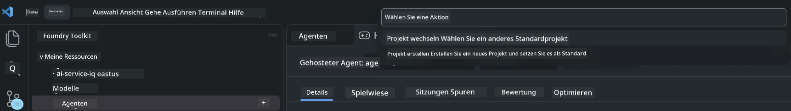

# Modul 0 - Einführung

⏱️ ~10 Min.

> [!WARNING]
> **Vorschau & Einschränkungen:** [Gehostete Agenten](https://learn.microsoft.com/azure/foundry/agents/concepts/hosted-agents) befinden sich derzeit in der **öffentlichen Vorschau** - nicht für Produktionsumgebungen empfohlen. Einige in diesem Workshop gezeigte Funktionen können sich ändern, wenn der Dienst in Richtung GA geht.

## Was Sie bauen werden

In diesem Labor erweitern Sie die Einzelagenten-Fähigkeiten aus Labor 01, um einen **Multi-Agenten-Workflow** zu erstellen – den Resume → Job Fit Evaluator.

Sie fügen einen **Lebenslauf** und eine **Stellenbeschreibung** ein. Vier spezialisierte Agenten verarbeiten die Eingaben nacheinander und liefern dann:
- Eine Passgenauigkeitsbewertung (0–100 mit Details zur Bewertung)
- Eine Liste von Fähigkeits- und Zertifizierungslücken
- Einen personalisierten Lernfahrplan mit echten Microsoft Learn-Links für jede Lücke

**Der Workflow verwendet:**
- **Microsoft Agent Framework** - `WorkflowBuilder` für sequentielle Pipeline-Orchestrierung
- **Foundry Toolkit für VS Code** - Grundgerüst, lokale Tests, Bereitstellung
- **Ein KI-Modell** (z. B. `gpt-4.1-mini`) - genutzt von allen vier Agenten
- **Microsoft Learn MCP-Server** - stellt echte Lernressourcen-Links für jede Fähigkeitslücke bereit

---

## Wählen Sie Ihren Pfad

> ⚠️ **Fahren Sie mit demselben Pfad fort, den Sie in Labor 01 verwendet haben.**

<details open>
<summary><strong>🅰️ Pfad A – Azure Cloud (erfordert Azure-Abonnement)</strong></summary>

| | Details |
|---|---|
| **Für wen ist das?** | Sie haben Labor 01 mit einem Azure-Abonnement abgeschlossen |
| **Modell** | Azure OpenAI über Foundry (z. B. `gpt-4.1-mini`) |
| **Abgedeckte Module** | Alle Module (00–09) |
| **In die Cloud bereitstellen?** | ✅ Ja – vollständige End-to-End-Bereitstellung |

</details>

<details open>
<summary><strong>🅱️ Pfad B – Foundry Local (kein Azure-Abonnement erforderlich)</strong></summary>

| | Details |
|---|---|
| **Für wen ist das?** | Sie haben Labor 01 mit Foundry Local abgeschlossen |
| **Modell** | Foundry Local (kostenlos, läuft auf Ihrem Computer) |
| **Abgedeckte Module** | Module 00–05 (Überspringen 06–07 – Bereitstellung & Cloud-Überprüfung) |
| **In die Cloud bereitstellen?** | ❌ Nein – nur lokale Tests via Agent Inspector |

</details>

---

## Überprüfung von Labor 01

Labor 02 baut direkt auf Labor 01 auf. Abschließen Sie zuerst Labor 01, bevor Sie hier starten.

Haben Sie Labor 01 noch nicht gemacht? Starten Sie hier: [Labor 01 – Einführung](../../lab01-single-agent/docs/00-prerequisites.md)

<details open>
<summary><strong>🅰️ Pfad A – Azure Cloud</strong></summary>

```powershell
az account show --query "{name:name, id:id}" --output table
```

Falls das fehlschlägt, führen Sie `az login` aus. Überprüfen Sie dann in VS Code:

1. `Ctrl+Shift+P` → geben Sie **Foundry Toolkit** ein → bestätigen Sie, dass Befehle angezeigt werden.
2. Klicken Sie auf das **Foundry Toolkit**-Symbol → Ihr Projekt und das bereitgestellte Modell zeigen **Erfolgreich** an.



> **RBAC:** Sie haben in Labor 01 die Rolle **Foundry User** zugewiesen. Falls Sie sie erneut zuweisen müssen, siehe [Labor 01, Modul 1](../../lab01-single-agent/docs/01-setup.md#deploy-a-model--assign-rbac). Die Rolle hieß zuvor **Azure AI User** – gleiche Berechtigungen.

</details>

<details open>
<summary><strong>🅱️ Pfad B – Foundry Local</strong></summary>

```powershell
Invoke-WebRequest -Uri "http://localhost:5273/v1/health" -UseBasicParsing | Select-Object StatusCode
```

Erwartet: `StatusCode: 200`. Falls nicht, starten Sie Foundry Local über die Foundry Toolkit-Sidebar neu.

> Alle Inferenz läuft auf Ihrem Computer. Der einzige ausgehende Aufruf erfolgt durch das MCP-Tool zu `https://learn.microsoft.com/api/mcp`.

</details>

---

## Was ist neu in Labor 02

| | Labor 01 | Labor 02 |
|--|--------|--------|
| Agenten | 1 | 4 (verkettet mit WorkflowBuilder) |
| Gerüstvorlage | Grundlegend – Agent Framework | Workflows – Agent Framework |
| Neues Paket | - | `mcp` |
| Orchestrierung | Einzelner Konversationsagent | Sequentielle Pipeline (WorkflowBuilder) |
| Neues Tool | - | `search_microsoft_learn_for_plan` (MCP) |

---

**Weiter:** [01 – Architektur verstehen →](01-understand-multi-agent.md)

---

<!-- CO-OP TRANSLATOR DISCLAIMER START -->
**Haftungsausschluss**:
Dieses Dokument wurde mit dem KI-Übersetzungsdienst [Co-op Translator](https://github.com/Azure/co-op-translator) übersetzt. Obwohl wir uns um Genauigkeit bemühen, beachten Sie bitte, dass automatisierte Übersetzungen Fehler oder Ungenauigkeiten enthalten können. Das Originaldokument in seiner Ursprungssprache gilt als maßgebliche Quelle. Bei kritischen Informationen wird eine professionelle menschliche Übersetzung empfohlen. Wir übernehmen keine Haftung für Missverständnisse oder Fehlinterpretationen, die aus der Verwendung dieser Übersetzung entstehen.
<!-- CO-OP TRANSLATOR DISCLAIMER END -->