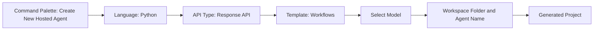
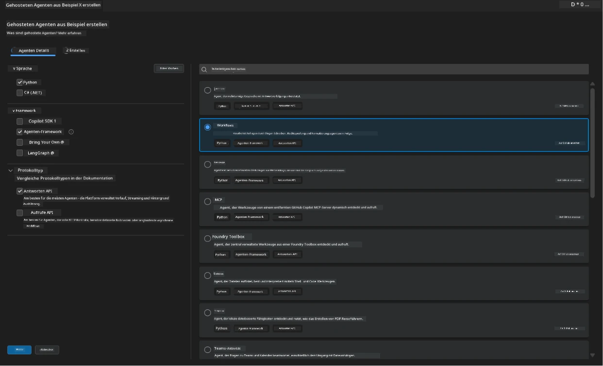
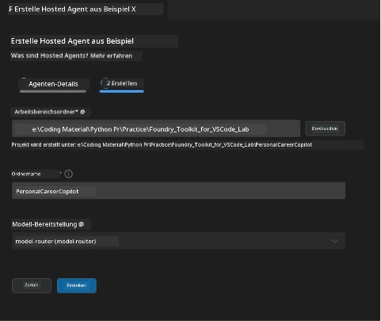

# Modul 2 - Das Multi-Agenten-Projekt Grundgerüst erstellen

⏱️ ~5 min

In diesem Modul verwendest du [Foundry Toolkit for VS Code](https://aka.ms/foundrytk), um **ein Multi-Agenten-Projekt zu erstellen**. Der Assistent generiert `agent.yaml`, `main.py`, `Dockerfile`, `requirements.txt`, `.env` und die VS Code Debug-Konfiguration - sodass du dich in Modul 3 auf die Verkettung des 4-Agenten-Workflows konzentrieren kannst.

> **Schlüsselkonzept:** Das Grundgerüst ist ein funktionierender Platzhalter mit einem Agenten. Du ersetzt die Platzhalterlogik in Modul 3 durch den `WorkflowBuilder` Graph. Du schreibst die Boilerplate nicht von Grund auf neu.

> **Referenzimplementierung:** [`PersonalCareerCopilot/`](../../../../../workshop/lab02-multi-agent/PersonalCareerCopilot) ist ein vollständiges funktionierendes Beispiel. Nutze es zum Vergleich deiner Arbeit.

### Ablauf des Scaffold-Assistenten



---

## Schritt 1: Öffne den Create Hosted Agent Assistenten

1. Drücke `Ctrl+Shift+P`, um die **Befehls-Palette** zu öffnen.
2. Tippe: **Foundry Toolkit: Create new Hosted Agent** und wähle es aus.
3. Der Assistent öffnet sich im Reiter **Agent Details**.

> **Alternative:** Klicke auf das **Foundry Toolkit** Symbol in der Aktivitätsleiste → klicke auf das **+** Symbol neben **Hosted Agents** → **Create New Hosted Agent**.

---

## Schritt 2: Wähle die Einstellungen aus



1. Wähle im linken Navigations-/Optionsbereich Folgendes aus:

| Menü | Auswahl | Hinweise |
|--------|-----------|-------|
| **Sprache** | Python | C# (.NET) wird auch unterstützt |
| **Framework** | Agent Framework | Bietet `Agent`, `AgentExecutor`, `WorkflowBuilder` |
| **API-Typ** | Response API | `POST /responses` - Plattformverwaltete Historie, Streaming-Unterstützung |
| **Vorlage** | **Workflows** | Verarbeitet Anfragen nacheinander durch mehrere Agenten |

2. Nach Auswahl klicke auf **Next**



3. Im nächsten Fenster wähle Folgendes:

| Menü | Auswahl | Hinweise |
|--------|-----------|-------|
| **Arbeitsbereichsordner** | Navigiere zum Zielordner | z.B. `workshop/lab02-multi-agent/` in diesem Repo |
| **Agentenname** | `PersonalCareerCopilot` | Dieser wird zum Projektordnernamen |
| **Modellbereitstellung** | Wähle dein bereitgestelltes Modell aus | z.B. `gpt-4.1-mini` aus Labor 01 |

4. Klicke auf **Create**, um das Projekt zu erstellen. VS Code generiert die Dateien und öffnet den Ordner.

> **Tipp:** [`gpt-4.1-mini`](https://learn.microsoft.com/azure/foundry/foundry-models/concepts/models-sold-directly-by-azure#gpt-41-series) bietet eine gute Balance zwischen Geschwindigkeit und Qualität für die Multi-Agenten-Entwicklung.

---

## Schritt 3: Untersuche das generierte Projekt

Nach Abschluss der Gerüsterstellung überprüfe, dass du diese Dateien im Explorer (`Ctrl+Shift+E`) siehst:

```
📂 <your-agent-name>/
├── .azdignore          ← Files excluded from Azure Developer CLI deployments
├── .dockerignore       ← Files excluded from Docker builds
├── .env                ← Environment variables (placeholders - fill in Module 3)
├── .vscode/
│   ├── launch.json     ← Debug config (F5 → run + Agent Inspector)
│   └── tasks.json      ← VS Code task definitions
├── agent.yaml          ← Agent definition (kind: hosted, protocol: responses)
├── Dockerfile          ← Container config for deployment
├── main.py             ← Stub agent entry point (replace with WorkflowBuilder in Module 3)
└── requirements.txt    ← Python dependencies
```

> **Wichtig:** Öffne diesen gestalteten Ordner direkt in VS Code, damit `.vscode/launch.json` und `tasks.json` korrekt für das F5-Debugging angewendet werden.

### Wichtige Dateien erklärt

| Datei | Zweck |
|------|---------|
| `agent.yaml` | Deklariert `kind: hosted`, ordnet Umgebungsvariablen zu, definiert das `/responses` Protokoll |
| `main.py` | Platzhalter: ein `FoundryChatClient` → `Agent` → `ResponsesHostServer`. Du ersetzt dies durch 4 Agenten + `WorkflowBuilder` in Modul 3 |
| `Dockerfile` | `python:3.12-slim`, installiert `requirements.txt`, öffnet Port 8088, führt `python main.py` aus |
| `requirements.txt` | `agent-framework-foundry`, `agent-framework-foundry-hosting`, `mcp<2,>=1.24.0`, `debugpy` |

> **Referenz:** Siehe [`PersonalCareerCopilot/agent.yaml`](../../../../../workshop/lab02-multi-agent/PersonalCareerCopilot/agent.yaml) und [`PersonalCareerCopilot/requirements.txt`](../../../../../workshop/lab02-multi-agent/PersonalCareerCopilot/requirements.txt) für den vollständigen generierten Inhalt.

---

### ✅ Kontrollpunkt

- [ ] Scaffold-Assistent abgeschlossen - neuer Projektordner ist im Explorer sichtbar
- [ ] Alle erwarteten Dateien vorhanden: `agent.yaml`, `main.py`, `Dockerfile`, `requirements.txt`, `.env`
- [ ] `agent.yaml` zeigt `kind: hosted` und `protocol: responses`
- [ ] `main.py` importiert `Agent`, `FoundryChatClient`, `ResponsesHostServer`
- [ ] Der gestaltete Ordner ist als VS Code Arbeitsbereichs-Root geöffnet
- [ ] Du verstehst, dass `main.py` ein Platzhalter ist - `WorkflowBuilder` wird in Modul 3 hinzugefügt

---

**Zurück:** [01 - Multi-Agenten-Architektur verstehen](01-understand-multi-agent.md) · **Weiter:** [03 - Agenten & Umgebung konfigurieren →](03-configure-agents.md)

---

<!-- CO-OP TRANSLATOR DISCLAIMER START -->
**Haftungsausschluss**:
Dieses Dokument wurde mit dem KI-Übersetzungsdienst [Co-op Translator](https://github.com/Azure/co-op-translator) übersetzt. Obwohl wir uns um Genauigkeit bemühen, beachten Sie bitte, dass automatisierte Übersetzungen Fehler oder Ungenauigkeiten enthalten können. Das Originaldokument in seiner Ursprungssprache gilt als maßgebliche Quelle. Bei kritischen Informationen wird eine professionelle menschliche Übersetzung empfohlen. Wir übernehmen keine Haftung für Missverständnisse oder Fehlinterpretationen, die aus der Verwendung dieser Übersetzung entstehen.
<!-- CO-OP TRANSLATOR DISCLAIMER END -->