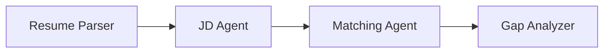
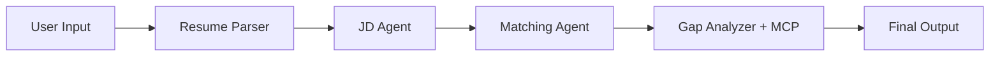

# Modul 4 - Orchestrierungsmuster

⏱️ ~10 Min

In diesem Modul erkunden Sie die in Resume Job Fit Evaluator verwendeten Orchestrierungsmuster und lernen, wie Sie den Workflow-Graph lesen, modifizieren und erweitern können. Das Verständnis dieser Muster ist entscheidend, um Probleme im Datenfluss zu debuggen und Ihre eigenen [Multi-Agenten-Workflows](https://learn.microsoft.com/agent-framework/workflows/) zu erstellen.

---

## Muster 1: Sequenzielle Kette

Das grundlegende Muster im Workflow ist eine **sequenzielle Kette** – die Ausgabe eines Agenten fließt direkt in den nächsten.



Im Code erzeugt jeder `add_edge()`-Aufruf einen Schritt in der Kette:

```python
.add_edge(resume_executor, jd_executor)       # ResumeParser output → JD Agent
.add_edge(jd_executor, matching_executor)     # JD Agent output → MatchingAgent
.add_edge(matching_executor, gap_executor)    # MatchingAgent output → GapAnalyzer
```

> **Warum sequenziell und nicht Fan-out/Fan-in?** `WorkflowBuilder` verwendet **ODER-Semantik** für eingehende Kanten: Ein nachgeschalteter Executor wird ausgelöst, sobald **irgendein** Vorgänger fertig ist. Wenn `matching_executor` zwei eingehende Kanten hätte (von `resume_executor` und `jd_executor`), würde es zweimal ausgelöst – einmal wenn ResumeParser fertig ist und nochmal, wenn JD Agent fertig ist – was dazu führen würde, dass GapAnalyzer auch zweimal läuft und die Ausgabe doppelt erscheint. Die sequenzielle Pipeline vermeidet dies vollständig.

## Muster 2: Inhaltsweiterleitung

Da `context_mode="last_agent"` bedeutet, dass jeder Executor nur die Ausgabe seines **direkten Vorgängers** sieht, müssen Agenten in der sequenziellen Kette explizit alle Daten weiterreichen, die nachgeschaltete Agenten benötigen.

In diesem Workflow:
- **ResumeParser** kopiert die Stellenbeschreibung wortwörtlich in `[JOB DESCRIPTION PASS-THROUGH]` (damit JD Agent sie finden kann).
- **JD Agent** kopiert die `[PARSED RESUME]` wortwörtlich in `[PARSED RESUME PASS-THROUGH]` (damit MatchingAgent beide Profile vergleichen kann).

```
ResumeParser output
└─ [PARSED RESUME]               ← extracted by JD Agent
└─ [JOB DESCRIPTION PASS-THROUGH] ← extracted by JD Agent

JD Agent output
└─ [JD REQUIREMENTS]             ← extracted by MatchingAgent
└─ [PARSED RESUME PASS-THROUGH]  ← extracted by MatchingAgent
```

Jeder Weiterleitungsabschnitt muss **wortwörtlich** kopiert werden – eine Zusammenfassung oder Paraphrase bricht den nachgelagerten Agenten, der darauf angewiesen ist.

---

## Der komplette Graph

Die Kombination der Muster der sequenziellen Kette und Inhaltsweiterleitung ergibt den vollständigen Workflow:



Der Agent Inspector zeigt diese gleiche Graphstruktur, wenn der Agent lokal läuft. Siehe [Modul 5 - Lokal testen](05-test-locally.md) für Bildschirmfotos.

---

## Den WorkflowBuilder-Code lesen

Der Workflow-Graph wird in der Funktion `main()` in [`PersonalCareerCopilot/main.py`](../../../../../workshop/lab02-multi-agent/PersonalCareerCopilot/main.py) erstellt. Die drei `add_edge()`-Aufrufe bauen die sequenzielle Pipeline auf:

| # | Kante | Effekt |
|---|-------|--------|
| 1 | `resume_executor → jd_executor` | JD Agent erhält `[PARSED RESUME]` + `[JOB DESCRIPTION PASS-THROUGH]` |
| 2 | `jd_executor → matching_executor` | MatchingAgent erhält `[JD REQUIREMENTS]` + `[PARSED RESUME PASS-THROUGH]` |
| 3 | `matching_executor → gap_executor` | GapAnalyzer erhält Fit-Bericht + Lückentabelle |

---

## Den Graph modifizieren

### Einen neuen Agent hinzufügen

Um einen fünften Agenten hinzuzufügen (z.B. einen **InterviewPrepAgent** nach GapAnalyzer):

1. Definieren Sie eine `INTERVIEW_PREP_INSTRUCTIONS`-Konstante.
2. Erstellen Sie `Agent` + `AgentExecutor` Objekte (gleiches Muster wie bei den vorhandenen vier).
3. Fügen Sie `.add_edge(gap_executor, interview_exec)` in `WorkflowBuilder` hinzu.
4. Aktualisieren Sie `output_executors=[interview_exec]`.

> **Wichtig:** `start_executor` ist der einzige Agent, der rohe Benutzereingaben erhält. Alle anderen Agenten erhalten Ausgabe von ihrer vorgelagerten Kante.

---

## Häufige Fehler im Graph

| Fehler | Symptom | Lösung |
|--------|---------|--------|
| Fehlende Kante zu `output_executors` | Agent läuft, aber Ausgabe ist leer | Sicherstellen, dass ein Pfad von `start_executor` zu jedem Agent in `output_executors` besteht |
| Zyklische Abhängigkeit | Endlosschleife oder Timeout | Prüfen, dass kein Agent einem vorgelagerten Agenten zurückspeist |
| Agent in `output_executors` ohne eingehende Kante | Leere Ausgabe | Mindestens eine `add_edge(source, that_agent)` hinzufügen |
| Mehrere `output_executors` ohne Fan-in | Ausgabe enthält nur Antwort eines Agenten | Einen einzelnen Ausgabeagenten verwenden, der aggregiert, oder mehrere Ausgaben akzeptieren |
| Fehlende `start_executor` | `ValueError` zur Erstellungszeit | Immer `start_executor` in `WorkflowBuilder()` angeben |

---

## Den Graph debuggen

### Agent Inspector verwenden

1. Starten Sie den Agent lokal mit F5.
2. Öffnen Sie Agent Inspector (`Ctrl+Shift+P` → **Foundry Toolkit: Open Agent Inspector**).
3. Senden Sie eine Testnachricht.
4. Im Antwortbereich des Inspectors suchen Sie nach der **Streaming-Ausgabe** – sie zeigt die Beiträge jedes Agenten nacheinander.


### Logging verwenden

Fügen Sie Logging zu `main.py` hinzu, um den Datenfluss nachzuvollziehen:

```python
import logging
logger = logging.getLogger("resume-job-fit")

# In main(), after building the workflow:
logger.info("Workflow graph built with edges: RP→JD, JD→MA, MA→GA")
```

Die Server-Logs zeigen die Ausführungsreihenfolge der Agenten und MCP-Tool-Aufrufe:

```
INFO:agent_framework:Executing agent: ResumeParser
INFO:agent_framework:Executing agent: JobDescriptionAgent
INFO:agent_framework:Executing agent: MatchingAgent
INFO:agent_framework:Executing agent: GapAnalyzer
INFO:agent_framework:Tool call: search_microsoft_learn_for_plan(skill="Kubernetes")
POST https://learn.microsoft.com/api/mcp → 200
INFO:agent_framework:Tool call: search_microsoft_learn_for_plan(skill="Terraform")
POST https://learn.microsoft.com/api/mcp → 200
```

---

### Checkpoint

- [ ] Sie können die zwei Orchestrierungsmuster im Workflow identifizieren: sequenzielle Kette und Inhaltsweiterleitung
- [ ] Sie verstehen, warum `context_mode="last_agent"` eine explizite Datenweiterleitung zwischen Agenten erfordert
- [ ] Sie können den `WorkflowBuilder`-Code lesen und jeden `add_edge()`-Aufruf der visuellen Graphik zuordnen
- [ ] Sie wissen, wie man einen neuen Agent am Ende der Pipeline hinzufügt
- [ ] Sie können häufige Fehler im Graph und deren Symptome erkennen

---

**Vorheriges:** [03 - Agenten & Umgebung konfigurieren](03-configure-agents.md) · **Nächstes:** [05 - Lokal testen →](05-test-locally.md)

---

<!-- CO-OP TRANSLATOR DISCLAIMER START -->
**Haftungsausschluss**:
Dieses Dokument wurde mit dem KI-Übersetzungsdienst [Co-op Translator](https://github.com/Azure/co-op-translator) übersetzt. Obwohl wir uns um Genauigkeit bemühen, beachten Sie bitte, dass automatisierte Übersetzungen Fehler oder Ungenauigkeiten enthalten können. Das Originaldokument in seiner Ursprungssprache gilt als maßgebliche Quelle. Bei kritischen Informationen wird eine professionelle menschliche Übersetzung empfohlen. Wir übernehmen keine Haftung für Missverständnisse oder Fehlinterpretationen, die aus der Verwendung dieser Übersetzung entstehen.
<!-- CO-OP TRANSLATOR DISCLAIMER END -->