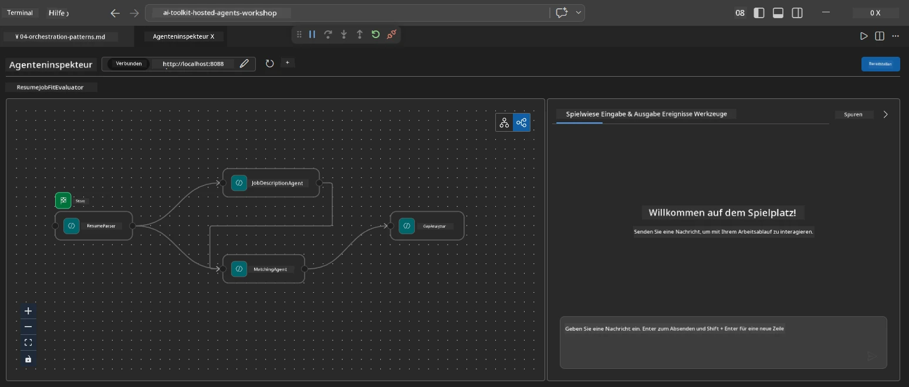
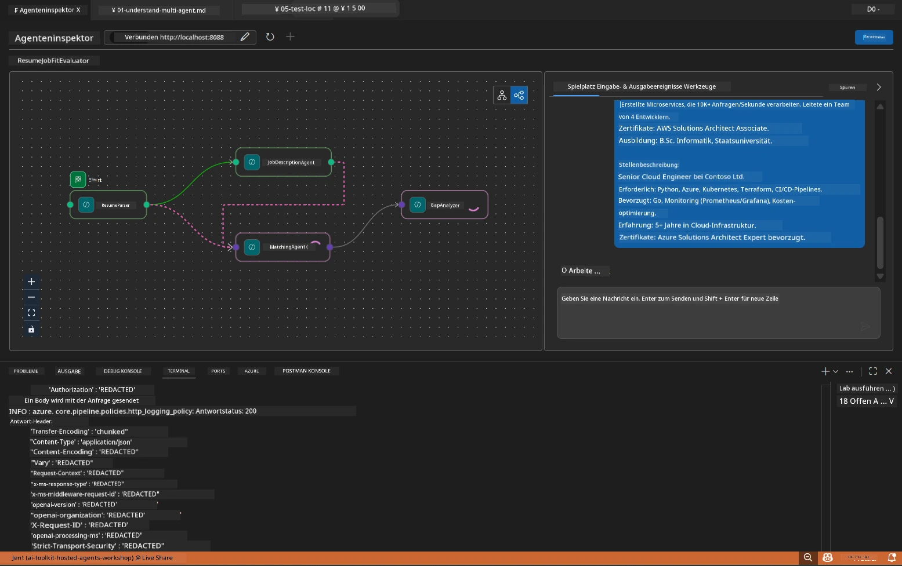
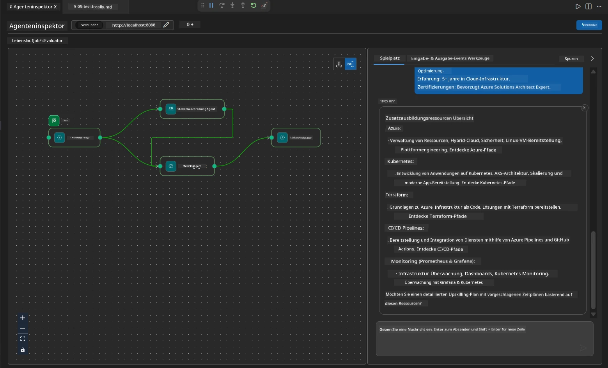

# Modul 5 - Lokal testen

⏱️ ~15 min

In diesem Modul führst du den Multi-Agenten-Workflow lokal aus, testest ihn mit dem Agent Inspector und überprüfst, ob alle vier Agenten und das MCP-Tool korrekt funktionieren, bevor du es bereitstellst.

---

## Schritt 1: Starte den Agenten-Server

### Option A: Verwendung der VS Code-Aufgabe (empfohlen)

1. Öffne `workshop/lab02-multi-agent/PersonalCareerCopilot/` als deinen VS Code-Ordner.
2. Drücke `Ctrl+Shift+P` → tippe **Tasks: Run Task** → wähle **Run Agent HTTP Server**.
3. Die Aufgabe startet den Server mit debugpy angehängt auf Port `5679` und den Agenten auf Port `8088`.
4. Warte, bis die Ausgabe die Startnachricht anzeigt, gefolgt von der Bereitschaftsmeldung des Servers (dazwischen erscheinen andere Logzeilen):

```
INFO:resume-job-fit:Starting Resume -> Job Fit Evaluator HTTP server...
...
INFO:hypercorn.error:Running on http://0.0.0.0:8088 (CTRL + C to quit)
```

### Option B: Verwendung von F5 (Debug-Modus)

1. Drücke `F5` → wähle **Debug Local Agent HTTP Server**.
2. Der Server startet mit vollständiger Breakpoint-Unterstützung – hilfreich zum Untersuchen von MCP-Antworten oder Agentenausgaben.

---

## Schritt 2: Öffne den Agent Inspector

1. Drücke `Ctrl+Shift+P` → tippe **Foundry Toolkit: Open Agent Inspector**.
2. Der Agent Inspector öffnet sich als VS Code-Panel, das mit `http://localhost:8088` verbunden ist.
3. Du solltest das Agenteninterface sehen, das bereit ist, Nachrichten zu empfangen.



> **Falls der Agent Inspector nicht öffnet:** Stelle sicher, dass der Server vollständig gestartet ist (du siehst das `Running on http://0.0.0.0:8088`-Log). Wenn Port 5679 belegt ist, siehe [Modul 8 - Fehlerbehebung](08-troubleshooting.md).

---

## Schritt 2b: (Optional) Öffne den Workflow Visualizer

Das Foundry Toolkit beinhaltet einen Echtzeit-**Workflow Visualizer**, der zeigt, wie Agenten interagieren, während der Graph ausgeführt wird. Das ist besonders nützlich zur Multi-Agenten-Debugging.

1. Drücke `Ctrl+Shift+P` → tippe **Foundry Toolkit: Open Visualizer for Hosted Agents**.
2. Ein neuer VS Code-Tab öffnet sich und zeigt den Live-Ausführungsgraphen.
3. Während du Nachrichten im Agent Inspector sendest, aktualisiert sich der Visualizer automatisch – grüne Knoten zeigen abgeschlossene Agenten an, und animierte Kanten zeigen den Datenfluss zwischen ihnen.

> **Portkonflikt:** Wenn der Visualizer-Port bereits verwendet wird, ändere ihn in den VS Code-Einstellungen → **Erweiterungen** → **Microsoft Foundry Configuration** → **Hosted Agents: Visualizer Port**.

---

## Schritt 3: Führe Smoke-Tests aus

Führe diese zwei Tests der Reihe nach aus. Jeder testet zunehmend mehr des Workflows.

### Test 1: Grundlegender Lebenslauf + Stellenbeschreibung

Füge Folgendes im Agent Inspector ein:

```
Resume:
Jane Doe
Senior Software Engineer with 5 years of experience in Python, Django, and AWS.
Built microservices handling 10K+ requests/second. Led a team of 4 developers.
Certifications: AWS Solutions Architect Associate.
Education: B.S. Computer Science, State University.

Job Description:
Senior Cloud Engineer at Contoso Ltd.
Required: Python, Azure, Kubernetes, Terraform, CI/CD pipelines.
Preferred: Go, monitoring (Prometheus/Grafana), cost optimization.
Experience: 5+ years in cloud infrastructure.
Certifications: Azure Solutions Architect Expert preferred.
```

**Erwartete Ausgabe-Struktur:**

Die Antwort sollte die Ausgaben aller vier Agenten in Folge enthalten:

1. **Lebenslauf-Parser-Ausgabe** - Zwei bezeichnete Abschnitte: `[PARSED RESUME]` (Kandidatenprofil mit gruppierten Fähigkeiten) und `[JOB DESCRIPTION PASS-THROUGH]` (wörtlicher JD-Text, der den JD-Agenten versorgt)
2. **JD-Agent-Ausgabe** - Strukturierte Anforderungen mit getrennten Pflicht- und Wunschfähigkeiten
3. **Matching-Agent-Ausgabe** - Passgenauigkeitswert (0-100) mit Aufschlüsselung, gematchten Fähigkeiten, fehlenden Fähigkeiten, Lücken
4. **Gap-Analyzer-Ausgabe** - Einzelne Lücken-Karten für jede fehlende Fähigkeit, jeweils mit Microsoft Learn URLs





### Was im Test 1 zu prüfen ist

| Überprüfung | Erwartet | Bestanden? |
|-------|----------|-------|
| Antwort enthält einen Fit-Score | Zahl zwischen 0-100 mit Aufschlüsselung | |
| Gematchte Fähigkeiten sind aufgeführt | Python, CI/CD (teilweise), etc. | |
| Fehlende Fähigkeiten sind aufgeführt | Azure, Kubernetes, Terraform, etc. | |
| Lücken-Karten existieren für jede fehlende Fähigkeit | Eine Karte pro Fähigkeit | |
| Microsoft Learn URLs sind vorhanden | Echte `learn.microsoft.com`-Links | |
| Keine Fehlermeldungen in der Antwort | Saubere strukturierte Ausgabe | |

### Test 2: Grenzfall – Kandidat mit hoher Passung

Füge einen Lebenslauf ein, der der Stellenbeschreibung sehr ähnlich ist, um zu überprüfen, dass der GapAnalyzer hohe Passungs-Szenarien handhabt:

```
Resume:
Alex Chen
Senior Cloud Engineer with 7 years of experience.
Skills: Python, Azure (AKS, Functions, DevOps), Kubernetes, Terraform, CI/CD (GitHub Actions, Azure Pipelines), Go, Prometheus, Grafana, cost optimization.
Certifications: Azure Solutions Architect Expert, Azure DevOps Engineer Expert.
Led infrastructure migration to Azure for 3 enterprise clients.
Education: M.S. Computer Science, Tech University.

Job Description:
Senior Cloud Engineer at Contoso Ltd.
Required: Python, Azure, Kubernetes, Terraform, CI/CD pipelines.
Preferred: Go, monitoring (Prometheus/Grafana), cost optimization.
Experience: 5+ years in cloud infrastructure.
Certifications: Azure Solutions Architect Expert preferred.
```

**Erwartetes Verhalten:**
- Der Fit-Score sollte **80+** sein (die meisten Fähigkeiten passen)
- Lücken-Karten sollten sich auf Feinschliff/Vorbereitung auf das Vorstellungsgespräch konzentrieren statt auf Grundlagenlernen
- Die Anweisungen des GapAnalyzers lauten: "Wenn Fit >= 80, Fokus auf Feinschliff/Vorbereitung auf das Vorstellungsgespräch"

---

## Schritt 4: Teste mit eigenen Daten (optional)

Versuche, deinen eigenen Lebenslauf und eine echte Stellenbeschreibung einzufügen. Das hilft zu überprüfen:

- Die Agenten unterschiedliche Lebenslauf-Formate verarbeiten (chronologisch, funktional, hybrid)
- Der JD-Agent unterschiedliche JD-Stile verarbeitet (Aufzählungen, Absätze, strukturiert)
- Das MCP-Tool relevante Ressourcen für echte Fähigkeiten zurückgibt
- Die Lücken-Karten auf deinen spezifischen Hintergrund personalisiert sind

> **Datenschutz - Pfad A (Foundry Cloud):** Lebenslauf- und JD-Text werden zur Inferenz an deine Azure OpenAI-Bereitstellung gesendet. Sie werden nicht vom Workshop-Infrastruktur protokolliert oder gespeichert. Verwende Platzhalternamen (z.B. „Jane Doe“), wenn gewünscht.
>
> **Datenschutz - Pfad B (Foundry Lokal):** Alle vier Agenteninferenz laufen vollständig auf deinem Gerät. Dein Lebenslauf und die Stellenbeschreibung **verlassen niemals dein Gerät**. Der einzige ausgehende Aufruf ist der MCP-Tool-Aufruf, der Ressourcen von `https://learn.microsoft.com/api/mcp` abruft; diese Anfrage enthält nur den Fähigkeitsnamen, keine persönlichen Daten.

---

### Kontrollpunkt

- [ ] Server erfolgreich auf Port `8088` gestartet (Log zeigt `Running on http://0.0.0.0:8088`)
- [ ] Agent Inspector geöffnet und mit dem Agenten verbunden
- [ ] Test 1: Vollständige Antwort mit Fit-Score, gematchten/fehlenden Fähigkeiten, Lücken-Karten und Microsoft Learn URLs
- [ ] Test 2: Kandidat mit hoher Passung erhält Score 80+ mit Empfehlungen zum Feinschliff
- [ ] Alle Lücken-Karten vorhanden (eine pro fehlender Fähigkeit, keine Kürzung)
- [ ] Keine Fehler oder Stack-Traces im Server-Terminal

---

**Vorher:** [04 - Orchestrierungsmuster](04-orchestration-patterns.md) · **Nächster:** [06 - Deployment zu Foundry →](06-deploy-to-foundry.md)

---

<!-- CO-OP TRANSLATOR DISCLAIMER START -->
**Haftungsausschluss**:
Dieses Dokument wurde mit dem KI-Übersetzungsdienst [Co-op Translator](https://github.com/Azure/co-op-translator) übersetzt. Obwohl wir uns um Genauigkeit bemühen, beachten Sie bitte, dass automatisierte Übersetzungen Fehler oder Ungenauigkeiten enthalten können. Das Originaldokument in seiner Ursprungssprache gilt als maßgebliche Quelle. Bei kritischen Informationen wird eine professionelle menschliche Übersetzung empfohlen. Wir übernehmen keine Haftung für Missverständnisse oder Fehlinterpretationen, die aus der Verwendung dieser Übersetzung entstehen.
<!-- CO-OP TRANSLATOR DISCLAIMER END -->