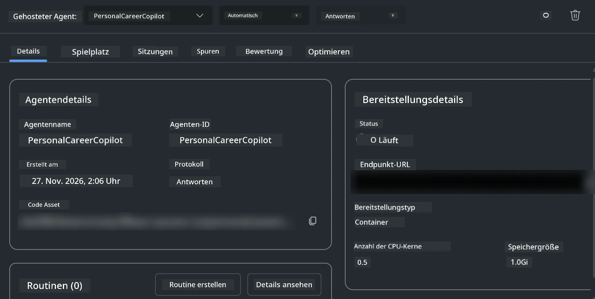

# Modul 7 - Überprüfung im Playground

⏱️ ~10 Min.

In diesem Modul testen Sie Ihren bereitgestellten Multi-Agent Workflow in VS Code und im Foundry Portal, um zu bestätigen, dass sich der Agent genauso verhält wie bei lokalen Tests.

---

## Warum nach der Bereitstellung erneut testen?

Die gehostete Umgebung unterscheidet sich in einigen wichtigen Punkten von der lokalen:

| | Lokal | Gehostet |
|--|-------|--------|
| **Identität** | Ihre persönliche Anmeldung (`DefaultAzureCredential`) | Dedizierte Entra-Identität pro Agent (automatisch bei der Bereitstellung bereitgestellt) |
| **Endpunkt** | `http://localhost:8088/responses` | Vom Foundry Agent Service verwaltete URL |
| **Netzwerk** | Ihr Gerät → Azure OpenAI + MCP | Azure Backbone (geringer Latenz) |

Eine fehlkonfigurierte Umgebungsvariable, RBAC-Probleme oder blockierte MCP-Ausgänge würden hier zuerst auffallen.

---

## Option A: Testen im VS Code Playground (empfohlen als Erstes)

### Schritt 1: Navigieren Sie zu Ihrem gehosteten Agent

1. Klicken Sie auf das **Foundry Toolkit**-Symbol in der Aktivitätsleiste.
2. Unter **Meine Ressourcen** klicken Sie auf **Agents** unter Ihrem Projekt, wählen die Registerkarte **Hosted Agent** und klicken dann auf Ihren Agenten.



### Schritt 2: Status überprüfen

1. Der **Gehostete Agent Playground** öffnet sich auf der Registerkarte **Details**.
2. Überprüfen Sie, ob **Bereitstellungsdetails** → **Status** auf **aktiv** steht (VS Code zeigt möglicherweise „Running“ oder „Started“ an – beides bedeutet denselben Bereitschaftszustand).

### Schritt 3: Playground öffnen

1. Klicken Sie auf die Registerkarte **Playground**.
2. Ein Chatfenster öffnet sich in einem VS Code-Tab.

### Schritt 4: Führen Sie Ihre Smoke-Tests aus

Führen Sie die drei untenstehenden Smoke-Tests durch – Test 1 verwendet das Prompt aus [Modul 5](05-test-locally.md). Geben Sie jede Nachricht im Eingabefeld des Playgrounds ein und drücken Sie **Senden** (oder **Enter**).

#### Test 1 - Vollständiger Lebenslauf + JD (Standardablauf)

Fügen Sie das vollständige Lebenslauf + JD-Prompt aus Modul 5, Test 1 ein (Jane Doe + Senior Cloud Engineer bei Contoso Ltd).

**Erwartet:**
- Passgenauigkeitswert mit Aufschlüsselung (100-Punkte-Skala)
- Abschnitt Übereinstimmende Fähigkeiten
- Abschnitt Fehlende Fähigkeiten
- **Eine Gap-Karte pro fehlender Fähigkeit** mit Microsoft Learn URLs
- Lernpfad mit Zeitplan

#### Test 2 - Schneller Kurztest (minimale Eingabe)

```
RESUME: 3 years Python developer, knows Django and PostgreSQL, no cloud experience.

JOB: Cloud DevOps Engineer requiring AWS, Kubernetes, Terraform, CI/CD. 5 years needed.
```

**Erwartet:**
- Geringerer Passgenauigkeitswert (< 40)
- Ehrliche Bewertung mit gestuftem Lernpfad
- Mehrere Gap-Karten (AWS, Kubernetes, Terraform, CI/CD, Erfahrungslücke)

#### Test 3 - Kandidat mit hoher Passung

```
RESUME:
10 years Azure Cloud Architect. AZ-305 certified. Expert in AKS, Terraform, Azure DevOps, 
Azure Functions, Helm, Prometheus, Grafana, Python, Go. Led platform team of 8.

JOB:
Senior Cloud Engineer. Required: AKS, Terraform, Azure DevOps, Python. Preferred: Helm, Go.
5+ years experience. AZ-305 preferred.
```

**Erwartet:**
- Hoher Passgenauigkeitswert (≥ 80)
- Fokus auf Interviewvorbereitung und Feinschliff
- Wenige oder keine Gap-Karten
- Kurzer Zeitplan mit Fokus auf Vorbereitung

### Schritt 5: Vergleich mit lokalen Ergebnissen

Öffnen Sie Ihre Notizen oder Browser-Tab aus Modul 5, in dem Sie lokale Antworten gespeichert haben. Für jeden Test:

- Hat die Antwort die **gleiche Struktur** (Passgenauigkeit, Gap-Karten, Roadmap)?
- Entspricht sie der **gleichen Bewertungslogik** (100-Punkte-Aufschlüsselung)?
- Sind **Microsoft Learn URLs** noch in den Gap-Karten vorhanden?
- Gibt es **eine Gap-Karte pro fehlender Fähigkeit** (nicht abgeschnitten)?

> **Geringfügige Wortunterschiede sind normal** – das Modell ist nicht deterministisch. Achten Sie auf Struktur, Bewertungs-Konsistenz und Nutzung der MCP-Tools.

---

## Option B: Testen im Foundry Portal

Das [Foundry Portal](https://ai.azure.com) bietet einen webbasierten Playground, der nützlich zum Teilen mit Teammitgliedern oder Stakeholdern ist.

### Schritt 1: Foundry Portal öffnen

1. Öffnen Sie Ihren Browser und navigieren Sie zu [https://ai.azure.com](https://ai.azure.com).
2. Melden Sie sich mit demselben Azure-Konto an, das Sie während des gesamten Workshops verwendet haben.

### Schritt 2: Navigieren Sie zu Ihrem Projekt

1. Suchen Sie auf der Startseite in der linken Seitenleiste den Bereich **Neueste Projekte**.
2. Klicken Sie auf den Namen Ihres Projekts (z. B. `workshop-agents`).
3. Wenn es nicht sichtbar ist, klicken Sie auf **Alle Projekte** und suchen es.

### Schritt 3: Finden Sie Ihren bereitgestellten Agenten

1. Klicken Sie im linken Navigationsbereich des Projekts auf **Build** → **Agents** (oder suchen Sie den Abschnitt **Agents**).
2. Sie sollten eine Liste von Agenten sehen. Finden Sie Ihren bereitgestellten Agenten (z. B. `PersonalCareerCopilot`).
3. Klicken Sie auf den Agentennamen, um seine Detailseite zu öffnen.

### Schritt 4: Playground öffnen

1. Die Agentenseite öffnet sich auf der Registerkarte **Playground**. Falls eine andere Registerkarte ausgewählt ist, klicken Sie auf **Playground**.
2. Überprüfen Sie, ob der **Versions-Selector** oben rechts die Version anzeigt, die Sie gerade bereitgestellt haben.
3. Eine Chat-Oberfläche öffnet sich.

### Schritt 5: Führen Sie dieselben Smoke-Tests aus

Wiederholen Sie alle 3 Tests aus dem Abschnitt VS Code Playground oben. Vergleichen Sie jede Antwort sowohl mit den lokalen Ergebnissen (Modul 5) als auch mit den VS Code Playground-Ergebnissen (Option A oben).

---

## Multi-Agent-spezifische Verifizierung

Über die grundlegende Korrektheit hinaus überprüfen Sie diese multi-agentenspezifischen Verhaltensweisen:

### MCP-Tool-Ausführung

| Überprüfung | Wie überprüfen | Bestehende Bedingung |
|------------|---------------|----------------------|
| MCP-Aufrufe erfolgreich | Gap-Karten enthalten `learn.microsoft.com` URLs | Reale URLs, keine Fallback-Nachrichten |
| Mehrfache MCP-Aufrufe | Jede High-/Medium-Prioritätslücke hat Ressourcen | Nicht nur die erste Gap-Karte |
| MCP-Fallback funktioniert | Wenn URLs fehlen, auf Fallback-Text prüfen | Agent erstellt trotzdem Gap-Karten (mit oder ohne URLs) |

### Agent-Koordination

| Überprüfung | Wie überprüfen | Bestehende Bedingung |
|------------|---------------|----------------------|
| Alle 4 Agenten liefen | Ausgabe enthält Passgenauigkeitswert UND Gap-Karten | Wert kommt vom MatchingAgent, Karten vom GapAnalyzer |
| Sequentielle Ausführung | Antwortzeit ist vernünftig (< 2 Min) | Bei > 3 Min auf Fehler im Terminal-Log prüfen |
| Datenfluss-Integrität | Gap-Karten beziehen sich auf Skills aus dem Matching-Bericht | Keine erfundenen Fähigkeiten, die nicht im JD stehen |

---

## Validierungsrubrik

Verwenden Sie diese Rubrik, um das gehostete Verhalten Ihres Multi-Agent Workflows zu bewerten:

| # | Kriterium | Bestehende Bedingung | Bestanden? |
|---|-----------|---------------------|-----------|
| 1 | **Funktionale Korrektheit** | Agent antwortet auf Lebenslauf + JD mit Passgenauigkeitswert und Gap-Analyse | |
| 2 | **Bewertungskonsistenz** | Passgenauigkeitswert verwendet 100-Punkte-Skala mit Aufschlüsselung | |
| 3 | **Vollständigkeit der Gap-Karten** | Eine Karte pro fehlender Fähigkeit (nicht abgeschnitten oder kombiniert) | |
| 4 | **MCP-Tool-Integration** | Gap-Karten enthalten echte Microsoft Learn URLs | |
| 5 | **Strukturkonsistenz** | Ausgabe-Struktur stimmt zwischen lokalen und gehosteten Läufen überein | |
| 6 | **Antwortzeit** | Gehosteter Agent antwortet innerhalb von 2 Minuten bei voller Bewertung | |
| 7 | **Keine Fehler** | Keine HTTP 500 Fehler, Timeouts oder leere Antworten | |

> Ein „Bestanden“ bedeutet, dass alle 7 Kriterien für alle 3 Smoke-Tests in mindestens einem Playground (VS Code oder Portal) erfüllt sind.

---

## Fehlerbehebung bei Playground-Problemen

| Symptom | Wahrscheinliche Ursache | Lösung |
|---------|----------------------|---------|
| Playground lädt nicht | Container nicht im `active` Zustand | Gehe zurück zu [Modul 6](06-deploy-to-foundry.md), überprüfe den Bereitstellungsstatus. Warte falls `creating` |
| Agent gibt leere Antwort zurück | Modell-Bereitstellungsname stimmt nicht überein | Prüfe `agent.yaml` → `environment_variables` → `AZURE_AI_MODEL_DEPLOYMENT_NAME`, ob es mit deinem bereitgestellten Modell übereinstimmt |
| Agent gibt eine Fehlermeldung zurück | [RBAC](https://learn.microsoft.com/azure/foundry/concepts/rbac-foundry) Berechtigung fehlt | Weisen Sie **[Foundry Benutzer](https://aka.ms/foundry-ext-project-role)** (früher Azure AI Benutzer) auf Projektebene zu |
| Keine Microsoft Learn URLs in Gap-Karten | MCP-Ausgang blockiert oder MCP-Server nicht verfügbar | Prüfe, ob der Container `learn.microsoft.com` erreichen kann. Siehe [Modul 8](08-troubleshooting.md) |
| Nur 1 Gap-Karte (abgeschnitten) | GapAnalyzer Anweisungen ohne "KRITISCHEN" Block | Überprüfe [Modul 3, Schritt 2.4](03-configure-agents.md) |
| Fit-Score weicht stark von lokal ab | Anderes Modell oder Anweisungen bereitgestellt | Vergleiche `agent.yaml` Umgebungsvariablen mit lokalen `.env`. Gegebenenfalls neu bereitstellen |
| "Agent nicht gefunden" im Portal | Bereitstellung propagiert noch oder ist fehlgeschlagen | Warte 2 Minuten, aktualisiere. Falls weiterhin fehlen, neu bereitstellen aus [Modul 6](06-deploy-to-foundry.md) |

---

### Checkpoint

- [ ] Agent im VS Code Playground getestet - alle 3 Rauchtests bestanden
- [ ] Agent im [Foundry Portal](https://ai.azure.com) Playground getestet - alle 3 Rauchtests bestanden
- [ ] Antworten sind strukturell konsistent mit lokalen Tests (Fit-Score, Gap-Karten, Roadmap)
- [ ] Microsoft Learn URLs sind in Gap-Karten vorhanden (MCP-Tool funktioniert in gehosteter Umgebung)
- [ ] Eine Gap-Karte pro fehlender Fähigkeit (keine Abschneidung)
- [ ] Keine Fehler oder Timeouts während des Tests
- [ ] Validierungsraster abgeschlossen (alle 7 Kriterien bestanden)

---

**Vorher:** [06 - Bereitstellung in Foundry](06-deploy-to-foundry.md) · **Nächster:** [08 - Fehlerbehebung →](08-troubleshooting.md)

---

<!-- CO-OP TRANSLATOR DISCLAIMER START -->
**Haftungsausschluss**:
Dieses Dokument wurde mit dem KI-Übersetzungsdienst [Co-op Translator](https://github.com/Azure/co-op-translator) übersetzt. Obwohl wir uns um Genauigkeit bemühen, beachten Sie bitte, dass automatisierte Übersetzungen Fehler oder Ungenauigkeiten enthalten können. Das Originaldokument in seiner Ursprungssprache gilt als maßgebliche Quelle. Bei kritischen Informationen wird eine professionelle menschliche Übersetzung empfohlen. Wir übernehmen keine Haftung für Missverständnisse oder Fehlinterpretationen, die aus der Verwendung dieser Übersetzung entstehen.
<!-- CO-OP TRANSLATOR DISCLAIMER END -->