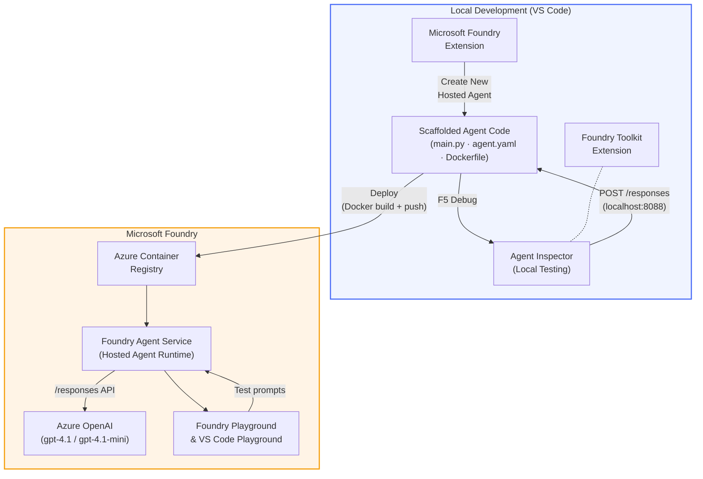

# Εργαστήριο Foundry Toolkit + Foundry Hosted Agents

[](https://www.python.org/)
[](https://learn.microsoft.com/agent-framework/)
[](https://learn.microsoft.com/azure/foundry/agents/concepts/hosted-agents)
[](https://ai.azure.com/)
[](https://learn.microsoft.com/azure/ai-services/openai/)
[](https://learn.microsoft.com/cli/azure/install-azure-cli)
[](https://learn.microsoft.com/azure/developer/azure-developer-cli/install-azd)
[](https://www.docker.com/)
[](https://marketplace.visualstudio.com/items?itemName=ms-windows-ai-studio.windows-ai-studio)
[](LICENSE)

Κατασκευάστε, δοκιμάστε και αναπτύξτε AI agents στο **Microsoft Foundry Agent Service** ως **Hosted Agents** - εξολοκλήρου από το VS Code χρησιμοποιώντας την **Microsoft Foundry επέκταση** και το **Foundry Toolkit**.

> **Οι Hosted Agents βρίσκονται προς το παρόν σε προεπισκόπηση.** Οι υποστηριζόμενες περιοχές είναι περιορισμένες - δείτε [διαθεσιμότητα περιοχών](https://learn.microsoft.com/azure/foundry/agents/concepts/hosted-agents#region-availability).

> Ο φάκελος `agent/` μέσα σε κάθε εργαστήριο **δημιουργείται αυτόματα** από την επέκταση Foundry - στη συνέχεια προσαρμόζετε τον κώδικα, δοκιμάζετε τοπικά και αναπτύσσετε.

### 🌐 Υποστήριξη Πολλών Γλωσσών

#### Υποστηρίζεται μέσω GitHub Action (Αυτοματοποιημένο & Πάντα Ενημερωμένο)

<!-- CO-OP TRANSLATOR LANGUAGES TABLE START -->
[Arabic](../ar/README.md) | [Bengali](../bn/README.md) | [Bulgarian](../bg/README.md) | [Burmese (Myanmar)](../my/README.md) | [Chinese (Simplified)](../zh-CN/README.md) | [Chinese (Traditional, Hong Kong)](../zh-HK/README.md) | [Chinese (Traditional, Macau)](../zh-MO/README.md) | [Chinese (Traditional, Taiwan)](../zh-TW/README.md) | [Croatian](../hr/README.md) | [Czech](../cs/README.md) | [Danish](../da/README.md) | [Dutch](../nl/README.md) | [Estonian](../et/README.md) | [Finnish](../fi/README.md) | [French](../fr/README.md) | [German](../de/README.md) | [Greek](./README.md) | [Hebrew](../he/README.md) | [Hindi](../hi/README.md) | [Hungarian](../hu/README.md) | [Indonesian](../id/README.md) | [Italian](../it/README.md) | [Japanese](../ja/README.md) | [Kannada](../kn/README.md) | [Khmer](../km/README.md) | [Korean](../ko/README.md) | [Lithuanian](../lt/README.md) | [Malay](../ms/README.md) | [Malayalam](../ml/README.md) | [Marathi](../mr/README.md) | [Nepali](../ne/README.md) | [Nigerian Pidgin](../pcm/README.md) | [Norwegian](../no/README.md) | [Persian (Farsi)](../fa/README.md) | [Polish](../pl/README.md) | [Portuguese (Brazil)](../pt-BR/README.md) | [Portuguese (Portugal)](../pt-PT/README.md) | [Punjabi (Gurmukhi)](../pa/README.md) | [Romanian](../ro/README.md) | [Russian](../ru/README.md) | [Serbian (Cyrillic)](../sr/README.md) | [Slovak](../sk/README.md) | [Slovenian](../sl/README.md) | [Spanish](../es/README.md) | [Swahili](../sw/README.md) | [Swedish](../sv/README.md) | [Tagalog (Filipino)](../tl/README.md) | [Tamil](../ta/README.md) | [Telugu](../te/README.md) | [Thai](../th/README.md) | [Turkish](../tr/README.md) | [Ukrainian](../uk/README.md) | [Urdu](../ur/README.md) | [Vietnamese](../vi/README.md)

> **Προτιμάτε να κάνετε κλώνο τοπικά;**
>
> Αυτό το αποθετήριο περιλαμβάνει πάνω από 50 μεταφράσεις γλωσσών που αυξάνουν σημαντικά το μέγεθος λήψης. Για να κλωνοποιήσετε χωρίς τις μεταφράσεις, χρησιμοποιήστε sparse checkout:
>
> **Bash / macOS / Linux:**
> ```bash
> git clone --filter=blob:none --sparse https://github.com/microsoft-foundry/Foundry_Toolkit_for_VSCode_Lab.git
> cd Foundry_Toolkit_for_VSCode_Lab
> git sparse-checkout set --no-cone '/*' '!translations' '!translated_images'
> ```
>
> **CMD (Windows):**
> ```cmd
> git clone --filter=blob:none --sparse https://github.com/microsoft-foundry/Foundry_Toolkit_for_VSCode_Lab.git
> cd Foundry_Toolkit_for_VSCode_Lab
> git sparse-checkout set --no-cone "/*" "!translations" "!translated_images"
> ```
>
> Αυτό σας δίνει όλα όσα χρειάζεστε για να ολοκληρώσετε το μάθημα με πολύ πιο γρήγορη λήψη.
<!-- CO-OP TRANSLATOR LANGUAGES TABLE END -->

---

## Αρχιτεκτονική



**Ροή:** Η επέκταση Foundry δημιουργεί τη βάση του agent → εσείς προσαρμόζετε τον κώδικα & τις οδηγίες → δοκιμάζετε τοπικά με το Agent Inspector → αναπτύσσετε στο Foundry (εικόνα Docker αποστέλλεται στο ACR) → επαληθεύετε στο Playground.

---

## Τι θα κατασκευάσετε

| Εργαστήριο | Περιγραφή | Κατάσταση |
|-----|-------------|--------|
| **Εργαστήριο 01 - Μοναδικός Agent** | Κατασκευάστε τον **"Εξήγησε σαν να είμαι Εκτελεστικό Στέλεχος" Agent**, δοκιμάστε το τοπικά, και αναπτύξτε στο Foundry | ✅ Διαθέσιμο |
| **Εργαστήριο 02 - Ροή Πολλαπλών Agents** | Κατασκευάστε τον **"Αξιολογητή Φύλλων Βιογραφικού → Κατάλληλης Θέσης"** - 4 agents συνεργάζονται για να αξιολογήσουν το βιογραφικό και να δημιουργήσουν έναν εκπαιδευτικό οδικό χάρτη | ✅ Διαθέσιμο |

---

## Γνωρίστε τον Executive Agent

Σε αυτό το εργαστήριο θα κατασκευάσετε τον **"Εξήγησε σαν να είμαι Εκτελεστικό Στέλεχος" Agent** - έναν AI agent που παίρνει περίπλοκη τεχνική ορολογία και τη μετατρέπει σε ήρεμες, έτοιμες για το διοικητικό συμβούλιο περιλήψεις. Γιατί, ας είμαστε ειλικρινείς, κανείς στο C-suite δεν θέλει να ακούσει για "εξαντλημένη πισίνα νημάτων λόγω συγχρονισμένων κλήσεων που εισήχθησαν στην έκδοση v3.2."

Κατασκεύασα αυτόν τον agent μετά από πολλές περιπτώσεις όπου το τέλεια διαμορφωμένο μου post-mortem πήρε την απάντηση: *"Άρα... είναι κάτω το site ή όχι;"*

### Πώς λειτουργεί

Του δίνετε μια τεχνική ενημέρωση. Απαντά με μια εκτελεστική περίληψη - τρία σημεία, χωρίς ορολογία, χωρίς ίχνη στοίβας, χωρίς υπαρξιακό άγχος. Απλώς **τι συνέβη**, **επιχειρησιακό αντίκτυπο**, και **επόμενο βήμα**.

### Δείτε το στην πράξη

**Εσείς λέτε:**
> "Η καθυστέρηση του API αυξήθηκε λόγω εξάντλησης της πισίνας νημάτων από συγχρονισμένες κλήσεις που εισήχθησαν στην έκδοση v3.2."

**Ο agent απαντά:**

> **Εκτελεστική Περίληψη:**
> - **Τι συνέβη:** Μετά την τελευταία κυκλοφορία, το σύστημα επιβραδύνθηκε.
> - **Επιχειρησιακό αντίκτυπο:** Ορισμένοι χρήστες βίωσαν καθυστερήσεις κατά τη χρήση της υπηρεσίας.
> - **Επόμενο βήμα:** Η αλλαγή έχει ανακληθεί και ετοιμάζεται διόρθωση πριν από την επαναφορά.

### Γιατί αυτός ο agent;

Είναι ένας απλός, μοναδικής χρήσης agent - τέλειος για την εκμάθηση της ροής εργασίας των hosted agents από την αρχή μέχρι το τέλος χωρίς να μπλέκεστε σε περίπλοκες αλυσίδες εργαλείων. Και ειλικρινά; Κάθε ομάδα μηχανικής θα μπορούσε να χρησιμοποιήσει έναν τέτοιο.

---

## Δομή εργαστηρίου

```
📂 Foundry_Toolkit_for_VSCode_Lab/
├── 📄 README.md                      ← You are here
└── 📂 workshop/
    ├── 📂 lab01-single-agent/        ← Full lab: docs + agent code
    │   ├── README.md                 ← Hands-on lab instructions
    │   ├── 📂 docs/                  ← Step-by-step tutorial modules
    │   │   ├── 00-prerequisites.md
    │   │   ├── 01-setup.md
    │   │   ├── 02-create-hosted-agent.md
    │   │   ├── 03-configure-and-code.md
    │   │   ├── 04-test-locally.md
    │   │   ├── 05-deploy-to-foundry.md
    │   │   ├── 06-verify-in-playground.md
    │   │   ├── 07-summary.md
    │   │   └── 08-troubleshooting.md
    │   └── 📂 agent/                 ← Reference solution (auto-scaffolded by Foundry extension)
    │       ├── agent.yaml
    │       ├── Dockerfile
    │       ├── main.py
    │       └── requirements.txt
    └── 📂 lab02-multi-agent/         ← Resume → Job Fit Evaluator
        ├── README.md                 ← Hands-on lab instructions (end-to-end)
        ├── 📂 docs/                  ← Step-by-step tutorial modules
        │   ├── 00-prerequisites.md
        │   ├── 01-understand-multi-agent.md
        │   ├── 02-scaffold-multi-agent.md
        │   ├── 03-configure-agents.md
        │   ├── 04-orchestration-patterns.md
        │   ├── 05-test-locally.md
        │   ├── 06-deploy-to-foundry.md
        │   ├── 07-verify-in-playground.md
        │   ├── 08-troubleshooting.md
        │   └── 09-summary.md
        └── 📂 PersonalCareerCopilot/ ← Reference solution (multi-agent workflow)
            ├── agent.yaml
            ├── Dockerfile
            ├── main.py
            └── requirements.txt
```

> **Σημείωση:** Ο φάκελος `agent/` μέσα σε κάθε εργαστήριο είναι αυτό που η **Microsoft Foundry επέκταση** δημιουργεί όταν εκτελείτε `Microsoft Foundry: Create a New Hosted Agent` από την Command Palette. Τα αρχεία προσαρμόζονται με τις οδηγίες, τα εργαλεία, και την διαμόρφωση του agent σας. Το Εργαστήριο 01 σας καθοδηγεί στη δημιουργία αυτού από την αρχή.

---

## Ξεκινώντας

### 1. Κλωνοποιήστε το αποθετήριο

```bash
git clone https://github.com/microsoft-foundry/Foundry_Toolkit_for_VSCode_Lab.git
cd Foundry_Toolkit_for_VSCode_Lab
```

### 2. Ρυθμίστε ένα εικονικό περιβάλλον Python

```bash
python -m venv venv
```

Ενεργοποιήστε το:

- **Windows (PowerShell):**
  ```powershell
  .\venv\Scripts\Activate.ps1
  ```
- **macOS / Linux:**
  ```bash
  source venv/bin/activate
  ```

### 3. Εγκαταστήστε εξαρτήσεις

```bash
pip install -r workshop/lab01-single-agent/agent/requirements.txt
```

### 4. Διαμορφώστε τις μεταβλητές περιβάλλοντος

Αντιγράψτε το παράδειγμα αρχείου `.env` μέσα στον φάκελο του agent και συμπληρώστε τις τιμές σας:

```bash
cp workshop/lab01-single-agent/agent/.env.example workshop/lab01-single-agent/agent/.env
```

Επεξεργαστείτε το `workshop/lab01-single-agent/agent/.env`:

```env
FOUNDRY_PROJECT_ENDPOINT=https://<your-account>.services.ai.azure.com/api/projects/<your-project>
AZURE_AI_MODEL_DEPLOYMENT_NAME=<your-model-deployment-name>
```

### 5. Ακολουθήστε τα εργαστήρια του workshop

Κάθε εργαστήριο είναι ανεξάρτητο με τα δικά του modules. Ξεκινήστε με το **Εργαστήριο 01** για να μάθετε τα βασικά, στη συνέχεια συνεχίστε με το **Εργαστήριο 02** για ροές εργασίας πολλαπλών agents.

#### Εργαστήριο 01 - Μοναδικός Agent ([πλήρεις οδηγίες](workshop/lab01-single-agent/README.md))

| # | Ενότητα | Σύνδεσμος |
|---|--------|------|
| 1 | Διαβάστε τις προϋποθέσεις | [00-prerequisites.md](workshop/lab01-single-agent/docs/00-prerequisites.md) |
| 2 | Εγκατάσταση Foundry Toolkit & επέκτασης Foundry | [01-setup.md](workshop/lab01-single-agent/docs/01-setup.md) |
| 3 | Δημιουργία έργου Foundry | [01-setup.md](workshop/lab01-single-agent/docs/01-setup.md) |
| 4 | Δημιουργία hosted agent | [02-create-hosted-agent.md](workshop/lab01-single-agent/docs/02-create-hosted-agent.md) |
| 5 | Διαμόρφωση οδηγιών & περιβάλλον | [03-configure-and-code.md](workshop/lab01-single-agent/docs/03-configure-and-code.md) |
| 6 | Τοπική δοκιμή | [04-test-locally.md](workshop/lab01-single-agent/docs/04-test-locally.md) |
| 7 | Ανάπτυξη στο Foundry | [05-deploy-to-foundry.md](workshop/lab01-single-agent/docs/05-deploy-to-foundry.md) |
| 8 | Επαλήθευση στο playground | [06-verify-in-playground.md](workshop/lab01-single-agent/docs/06-verify-in-playground.md) |
| 9 | Περίληψη & επόμενα βήματα | [07-summary.md](workshop/lab01-single-agent/docs/07-summary.md) |
| 10 | Επίλυση προβλημάτων | [08-troubleshooting.md](workshop/lab01-single-agent/docs/08-troubleshooting.md) |

#### Εργαστήριο 02 - Ροή Πολλαπλών Agents ([πλήρεις οδηγίες](workshop/lab02-multi-agent/README.md))

| # | Ενότητα | Σύνδεσμος |
|---|--------|------|
| 1 | Προϋποθέσεις (Εργαστήριο 02) | [00-prerequisites.md](workshop/lab02-multi-agent/docs/00-prerequisites.md) |
| 2 | Κατανόηση αρχιτεκτονικής πολλαπλών agents | [01-understand-multi-agent.md](workshop/lab02-multi-agent/docs/01-understand-multi-agent.md) |
| 3 | Δημιουργία βασικών στοιχείων έργου πολλαπλών agents | [02-scaffold-multi-agent.md](workshop/lab02-multi-agent/docs/02-scaffold-multi-agent.md) |
| 4 | Διαμόρφωση agents & περιβάλλοντος | [03-configure-agents.md](workshop/lab02-multi-agent/docs/03-configure-agents.md) |
| 5 | Μοτίβα ορχήστρωσης | [04-orchestration-patterns.md](workshop/lab02-multi-agent/docs/04-orchestration-patterns.md) |
| 6 | Τοπική δοκιμή (πολλαπλών agents) | [05-test-locally.md](workshop/lab02-multi-agent/docs/05-test-locally.md) |
| 7 | Ανάπτυξη στο Foundry | [06-deploy-to-foundry.md](workshop/lab02-multi-agent/docs/06-deploy-to-foundry.md) |
| 8 | Επαλήθευση στο playground | [07-verify-in-playground.md](workshop/lab02-multi-agent/docs/07-verify-in-playground.md) |
| 9 | Επίλυση προβλημάτων (πολλαπλών agents) | [08-troubleshooting.md](workshop/lab02-multi-agent/docs/08-troubleshooting.md) |
| 10 | Περίληψη & επόμενα βήματα | [09-summary.md](workshop/lab02-multi-agent/docs/09-summary.md) |

---

## Υπεύθυνος Συντήρησης

<table>
<tr>
    <td align="center"><a href="https://github.com/ShivamGoyal03">
        <br />
        <sub><b>Shivam Goyal</b></sub>
    </a><br />
    </td>
</tr>
</table>

---

## Απαιτούμενα δικαιώματα (γρήγορη αναφορά)

| Σενάριο | Απαιτούμενοι ρόλοι |
|----------|---------------|
| Δημιουργία νέου έργου Foundry | **Azure AI Owner** στο πόρο Foundry |
| Ανάπτυξη σε υπάρχον έργο (νέοι πόροι) | **Azure AI Owner** + **Contributor** στην συνδρομή |
| Ανάπτυξη σε πλήρως διαμορφωμένο έργο | **Reader** στον λογαριασμό + **Azure AI User** στο έργο |

> **Σημαντικό:** Οι ρόλοι Azure `Owner` και `Contributor` περιλαμβάνουν μόνο δικαιώματα *διαχείρισης*, όχι δικαιώματα *ανάπτυξης* (ενέργειες δεδομένων). Χρειάζεστε **Azure AI User** ή **Azure AI Owner** για να δημιουργήσετε και να αναπτύξετε παράγοντες.

---

## Αναφορές

- [Ξεκινώντας γρήγορα: Αναπτύξτε τον πρώτο σας φιλοξενούμενο παράγοντα (VS Code)](https://learn.microsoft.com/azure/foundry/agents/quickstarts/quickstart-hosted-agent)
- [Τι είναι οι φιλοξενούμενοι παράγοντες;](https://learn.microsoft.com/azure/foundry/agents/concepts/hosted-agents)
- [Δημιουργία ροών εργασίας φιλοξενούμενων παραγόντων στο VS Code](https://learn.microsoft.com/azure/foundry/agents/how-to/vs-code-agents-workflow-pro-code)
- [Ανάπτυξη φιλοξενούμενου παράγοντα](https://learn.microsoft.com/azure/foundry/agents/how-to/deploy-hosted-agent)
- [RBAC για Microsoft Foundry](https://learn.microsoft.com/azure/foundry/concepts/rbac-foundry)
- [Παράδειγμα Αντιπροσώπου Ανασκόπησης Αρχιτεκτονικής](https://github.com/Azure-Samples/agent-architecture-review-sample) - Πραγματικός φιλοξενούμενος παράγοντας με εργαλεία MCP, διαγράμματα Excalidraw και διπλή ανάπτυξη

---


## Άδεια

[MIT](../../LICENSE)

---

<!-- CO-OP TRANSLATOR DISCLAIMER START -->
**Αποποίηση ευθυνών**:
Αυτό το έγγραφο έχει μεταφραστεί χρησιμοποιώντας την υπηρεσία μετάφρασης με τεχνητή νοημοσύνη [Co-op Translator](https://github.com/Azure/co-op-translator). Ενώ επιδιώκουμε την ακρίβεια, παρακαλούμε να έχετε υπόψη ότι οι αυτοματοποιημένες μεταφράσεις ενδέχεται να περιέχουν λάθη ή ανακρίβειες. Το πρωτότυπο έγγραφο στη μητρική του γλώσσα πρέπει να θεωρείται η αυθεντική πηγή. Για κρίσιμες πληροφορίες, συνιστάται επαγγελματική ανθρώπινη μετάφραση. Δεν φέρουμε ευθύνη για τυχόν παρεξηγήσεις ή λανθασμένες ερμηνείες που προκύπτουν από τη χρήση αυτής της μετάφρασης.
<!-- CO-OP TRANSLATOR DISCLAIMER END -->