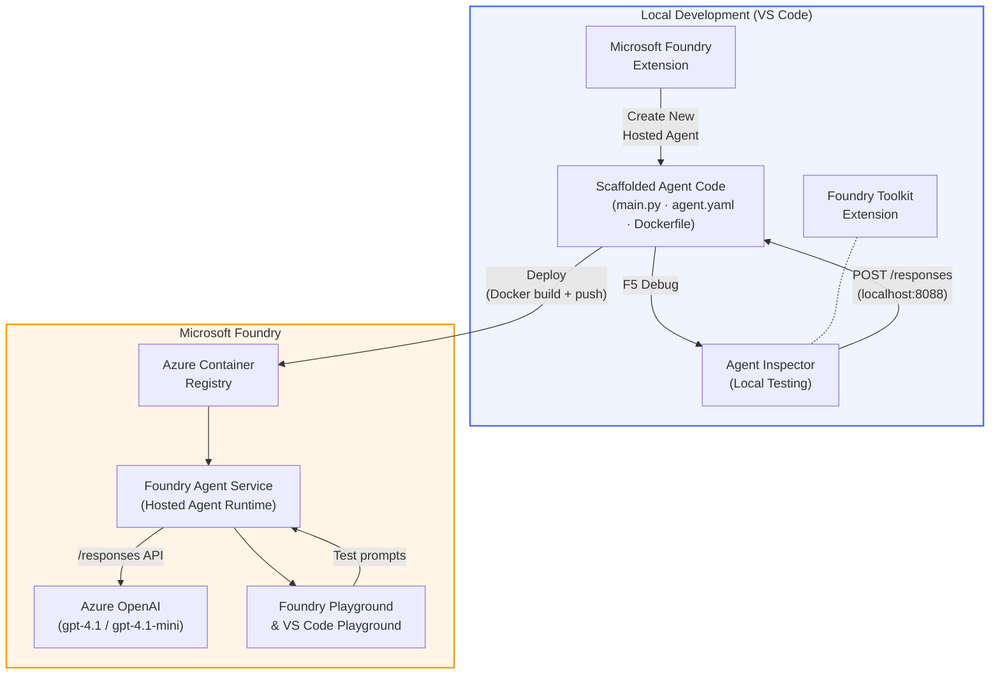

# Foundry Toolkit + Foundry Hosted Agents Εργαστήριο

[](https://www.python.org/)
[](https://github.com/microsoft/agents)
[](https://learn.microsoft.com/azure/foundry/agents/concepts/hosted-agents)
[](https://ai.azure.com/)
[](https://learn.microsoft.com/azure/ai-services/openai/)
[](https://learn.microsoft.com/cli/azure/install-azure-cli)
[](https://learn.microsoft.com/azure/developer/azure-developer-cli/install-azd)
[](https://www.docker.com/)
[](https://marketplace.visualstudio.com/items?itemName=ms-windows-ai-studio.windows-ai-studio)
[](../../LICENSE)

Κατασκευάστε, δοκιμάστε και αναπτύξτε πράκτορες AI στην **Microsoft Foundry Agent Service** ως **Hosted Agents** - εξ ολοκλήρου από το VS Code χρησιμοποιώντας την επέκταση **Microsoft Foundry** και το **Foundry Toolkit**.

> **Hosted Agents are currently in preview.** Οι υποστηριζόμενες περιοχές είναι περιορισμένες - δείτε [διαθεσιμότητα περιοχής](https://learn.microsoft.com/azure/foundry/agents/concepts/hosted-agents#region-availability).

> Ο φάκελος `agent/` μέσα σε κάθε εργαστήριο **δημιουργείται αυτόματα** από την επέκταση Foundry - στη συνέχεια προσαρμόζετε τον κώδικα, δοκιμάζετε τοπικά και αναπτύσσετε.

### 🌐 Υποστήριξη πολλαπλών γλωσσών

#### Υποστηρίζεται μέσω GitHub Action (Αυτοματοποιημένο & Πάντα Ενημερωμένο)

<!-- CO-OP TRANSLATOR LANGUAGES TABLE START -->
[Αραβικά](../ar/README.md) | [Μπενγκάλι](../bn/README.md) | [Βουλγαρικά](../bg/README.md) | [Βιρμανικά (Μιανμάρ)](../my/README.md) | [Κινέζικα (Απλοποιημένα)](../zh-CN/README.md) | [Κινέζικα (Παραδοσιακά, Χονγκ Κονγκ)](../zh-HK/README.md) | [Κινέζικα (Παραδοσιακά, Μακάο)](../zh-MO/README.md) | [Κινέζικα (Παραδοσιακά, Ταϊβάν)](../zh-TW/README.md) | [Κροατικά](../hr/README.md) | [Τσέχικα](../cs/README.md) | [Δανέζικα](../da/README.md) | [Ολλανδικά](../nl/README.md) | [Εσθονικά](../et/README.md) | [Φινλανδικά](../fi/README.md) | [Γαλλικά](../fr/README.md) | [Γερμανικά](../de/README.md) | [Ελληνικά](./README.md) | [Εβραϊκά](../he/README.md) | [Χίντι](../hi/README.md) | [Ουγγρικά](../hu/README.md) | [Ινδονησιακά](../id/README.md) | [Ιταλικά](../it/README.md) | [Ιαπωνικά](../ja/README.md) | [Κανάντα](../kn/README.md) | [Κμερ](../km/README.md) | [Κορεάτικα](../ko/README.md) | [Λιθουανικά](../lt/README.md) | [Μαλαικά](../ms/README.md) | [Μαλαγιαλάμ](../ml/README.md) | [Μαραθί](../mr/README.md) | [Νεπαλικά](../ne/README.md) | [Νιγηριανό Pidgin](../pcm/README.md) | [Νορβηγικά](../no/README.md) | [Περσικά (Φαρσί)](../fa/README.md) | [Πολωνικά](../pl/README.md) | [Πορτογαλικά (Βραζιλίας)](../pt-BR/README.md) | [Πορτογαλικά (Πορτογαλίας)](../pt-PT/README.md) | [Πουντζάμπι (Gurmukhi)](../pa/README.md) | [Ρουμανικά](../ro/README.md) | [Ρωσικά](../ru/README.md) | [Σερβικά (Κυριλλικά)](../sr/README.md) | [Σλοβακικά](../sk/README.md) | [Σλοβενικά](../sl/README.md) | [Ισπανικά](../es/README.md) | [Σουαχίλι](../sw/README.md) | [Σουηδικά](../sv/README.md) | [Ταγκαλόγκ (Φιλιππινικά)](../tl/README.md) | [Ταμίλ](../ta/README.md) | [Τελούγκου](../te/README.md) | [Ταϊλανδικά](../th/README.md) | [Τουρκικά](../tr/README.md) | [Ουκρανικά](../uk/README.md) | [Ουρντού](../ur/README.md) | [Βιετναμέζικα](../vi/README.md)

> **Προτιμάτε να κάνετε κλωνοποίηση τοπικά;**
>
> Αυτό το αποθετήριο περιλαμβάνει 50+ μεταφράσεις γλωσσών που αυξάνουν σημαντικά το μέγεθος λήψης. Για να κλωνοποιήσετε χωρίς τις μεταφράσεις, χρησιμοποιήστε sparse checkout:
>
> **Bash / macOS / Linux:**
> ```bash
> git clone --filter=blob:none --sparse https://github.com/microsoft-foundry/Foundry_Toolkit_for_VSCode_Lab.git
> cd Foundry_Toolkit_for_VSCode_Lab
> git sparse-checkout set --no-cone '/*' '!translations' '!translated_images'
> ```
>
> **CMD (Windows):**
> ```cmd
> git clone --filter=blob:none --sparse https://github.com/microsoft-foundry/Foundry_Toolkit_for_VSCode_Lab.git
> cd Foundry_Toolkit_for_VSCode_Lab
> git sparse-checkout set --no-cone "/*" "!translations" "!translated_images"
> ```
>
> Αυτό σας παρέχει ό,τι χρειάζεστε για να ολοκληρώσετε το μάθημα με πολύ πιο γρήγορη λήψη.
<!-- CO-OP TRANSLATOR LANGUAGES TABLE END -->

---

## Αρχιτεκτονική



**Διαδικασία:** Η επέκταση Foundry δημιουργεί το σκελετό του πράκτορα → προσαρμόζετε τον κώδικα & τις οδηγίες → δοκιμάζετε τοπικά με το Agent Inspector → αναπτύσσετε στο Foundry (εικόνα Docker προωθείται στο ACR) → επαληθεύετε στο Playground.

---

## Τι θα κατασκευάσετε

| Εργαστήριο | Περιγραφή | Κατάσταση |
|-----|-------------|--------|
| **Εργαστήριο 01 - Μονός Πράκτορας** | Δημιουργήστε τον **"Explain Like I'm an Executive" Agent**, δοκιμάστε τον τοπικά, και αναπτύξτε στο Foundry | ✅ Διαθέσιμο |
| **Εργαστήριο 02 - Ροή πολλαπλών πρακτόρων** | Δημιουργήστε το **"Resume → Job Fit Evaluator"** - 4 πράκτορες συνεργάζονται για να βαθμολογήσουν την καταλληλότητα βιογραφικού και να δημιουργήσουν ένα σχέδιο μάθησης | ✅ Διαθέσιμο |

---

## Γνωρίστε τον Executive Agent

Σε αυτό το εργαστήριο θα δημιουργήσετε τον **"Explain Like I'm an Executive" Agent** - έναν πράκτορα AI που παίρνει δύσκολη τεχνική ορολογία και τη μεταφράζει σε ήρεμες, έτοιμες για το διοικητικό συμβούλιο περιλήψεις. Γιατί, ας είμαστε ειλικρινείς, κανείς στην C-suite δεν θέλει να ακούσει για "thread pool exhaustion caused by synchronous calls introduced in v3.2."

Δημιούργησα αυτόν τον πράκτορα μετά από πάρα πολλά περιστατικά όπου το τέλεια διατυπωμένο post-mortem μου απέσπασε την απάντηση: *"Λοιπόν... η ιστοσελίδα είναι κάτω ή όχι;"*

### Πώς λειτουργεί

Του παρέχετε μια τεχνική ενημέρωση. Επιστρέφει μια εκτελεστική περίληψη - τρεις κουκκίδες, χωρίς ορολογία, χωρίς stack traces, χωρίς υπαρξιακό πανικό. Μόνο **τι συνέβη**, **επιπτώσεις στην επιχείρηση**, και **επόμενο βήμα**.

### Δείτε το σε δράση

**Εσείς λέτε:**
> "The API latency increased due to thread pool exhaustion caused by synchronous calls introduced in v3.2."

**Ο πράκτορας απαντά:**

> **Εκτελεστική Περίληψη:**
> - **Τι συνέβη:** Μετά την τελευταία έκδοση, το σύστημα επιβραδύνθηκε.
> - **Επιπτώσεις στην επιχείρηση:** Μερικοί χρήστες αντιμετώπισαν καθυστερήσεις κατά τη χρήση της υπηρεσίας.
> - **Επόμενο βήμα:** Η αλλαγή έχει επαναφερθεί και ετοιμάζεται μια διόρθωση πριν την εκ νέου ανάπτυξη.

### Γιατί αυτός ο πράκτορας;

Είναι ένας απλός, μονοσκοπικός πράκτορας - ιδανικός για να μάθετε τη ροή εργασίας hosted agents από άκρη σε άκρη χωρίς να μπλεχτείτε σε πολύπλοκες αλυσίδες εργαλείων. Και ειλικρινά; Κάθε ομάδα μηχανικών θα μπορούσε να χρησιμοποιήσει έναν από αυτούς.

---

## Δομή εργαστηρίου

```
📂 Foundry_Toolkit_for_VSCode_Lab/
├── 📄 README.md                      ← You are here
└── 📂 workshop/
    ├── 📂 lab01-single-agent/        ← Full lab: docs + agent code
    │   ├── README.md                 ← Hands-on lab instructions
    │   ├── 📂 docs/                  ← Step-by-step tutorial modules
    │   │   ├── 00-prerequisites.md
    │   │   ├── 01-setup.md
    │   │   ├── 02-create-hosted-agent.md
    │   │   ├── 03-configure-and-code.md
    │   │   ├── 04-test-locally.md
    │   │   ├── 05-deploy-to-foundry.md
    │   │   ├── 06-verify-in-playground.md
    │   │   ├── 07-summary.md
    │   │   └── 08-troubleshooting.md
    │   └── 📂 agent/                 ← Reference solution (auto-scaffolded by Foundry extension)
    │       ├── agent.yaml
    │       ├── Dockerfile
    │       ├── main.py
    │       └── requirements.txt
    └── 📂 lab02-multi-agent/         ← Resume → Job Fit Evaluator
        ├── README.md                 ← Hands-on lab instructions (end-to-end)
        ├── 📂 docs/                  ← Step-by-step tutorial modules
        │   ├── 00-prerequisites.md
        │   ├── 01-understand-multi-agent.md
        │   ├── 02-scaffold-multi-agent.md
        │   ├── 03-configure-agents.md
        │   ├── 04-orchestration-patterns.md
        │   ├── 05-test-locally.md
        │   ├── 06-deploy-to-foundry.md
        │   ├── 07-verify-in-playground.md
        │   └── 08-troubleshooting.md
        └── 📂 PersonalCareerCopilot/ ← Reference solution (multi-agent workflow)
            ├── agent.yaml
            ├── Dockerfile
            ├── main.py
            └── requirements.txt
```

> **Σημείωση:** Ο φάκελος `agent/` μέσα σε κάθε εργαστήριο είναι αυτό που δημιουργεί η επέκταση **Microsoft Foundry** όταν τρέξετε `Microsoft Foundry: Create a New Hosted Agent` από το Command Palette. Τα αρχεία στη συνέχεια προσαρμόζονται με τις οδηγίες, τα εργαλεία και τη διαμόρφωση του πράκτορά σας. Το Lab 01 σας καθοδηγεί να αναδημιουργήσετε αυτό από την αρχή.

---

## Ξεκινώντας

### 1. Κλωνοποιήστε το αποθετήριο

```bash
git clone https://github.com/microsoft-foundry/Foundry_Toolkit_for_VSCode_Lab.git
cd Foundry_Toolkit_for_VSCode_Lab
```

### 2. Ρυθμίστε ένα εικονικό περιβάλλον Python

```bash
python -m venv venv
```

Ενεργοποιήστε το:

- **Windows (PowerShell):**
  ```powershell
  .\venv\Scripts\Activate.ps1
  ```
- **macOS / Linux:**
  ```bash
  source venv/bin/activate
  ```

### 3. Εγκαταστήστε τις εξαρτήσεις

```bash
pip install -r workshop/lab01-single-agent/agent/requirements.txt
```

### 4. Διαμορφώστε τις μεταβλητές περιβάλλοντος

Αντιγράψτε το παράδειγμα `.env` αρχείο μέσα στο φάκελο του πράκτορα και συμπληρώστε τις τιμές σας:

```bash
cp workshop/lab01-single-agent/agent/.env.example workshop/lab01-single-agent/agent/.env
```

Επεξεργαστείτε `workshop/lab01-single-agent/agent/.env`:

```env
AZURE_AI_PROJECT_ENDPOINT=https://<your-account>.services.ai.azure.com/api/projects/<your-project>
AZURE_AI_MODEL_DEPLOYMENT_NAME=<your-model-deployment-name>
```

### 5. Ακολουθήστε τα εργαστήρια

Κάθε εργαστήριο είναι αυτοτελές με τις δικές του ενότητες. Ξεκινήστε με το **Lab 01** για να μάθετε τα βασικά, και μετά προχωρήστε στο **Lab 02** για ροές εργασίας πολλαπλών πρακτόρων.

#### Lab 01 - Single Agent ([πλήρεις οδηγίες](workshop/lab01-single-agent/README.md))

| # | Ενότητα | Σύνδεσμος |
|---|--------|------|
| 1 | Διαβάστε τις προαπαιτήσεις | [00-prerequisites.md](workshop/lab01-single-agent/docs/00-prerequisites.md) |
| 2 | Εγκαταστήστε το Foundry Toolkit & την επέκταση Foundry | [01-setup.md](workshop/lab01-single-agent/docs/01-setup.md) |
| 3 | Δημιουργήστε ένα έργο Foundry | [01-setup.md](workshop/lab01-single-agent/docs/01-setup.md) |
| 4 | Δημιουργήστε έναν hosted agent | [02-create-hosted-agent.md](workshop/lab01-single-agent/docs/02-create-hosted-agent.md) |
| 5 | Διαμορφώστε οδηγίες & περιβάλλον | [03-configure-and-code.md](workshop/lab01-single-agent/docs/03-configure-and-code.md) |
| 6 | Δοκιμάστε το τοπικά | [04-test-locally.md](workshop/lab01-single-agent/docs/04-test-locally.md) |
| 7 | Αναπτύξτε στο Foundry | [05-deploy-to-foundry.md](workshop/lab01-single-agent/docs/05-deploy-to-foundry.md) |
| 8 | Επαληθεύστε στο playground | [06-verify-in-playground.md](workshop/lab01-single-agent/docs/06-verify-in-playground.md) |
| 9 | Επίλυση προβλημάτων | [08-troubleshooting.md](workshop/lab01-single-agent/docs/08-troubleshooting.md) |

#### Lab 02 - Multi-Agent Workflow ([πλήρεις οδηγίες](workshop/lab02-multi-agent/README.md))

| # | Ενότητα | Σύνδεσμος |
|---|--------|------|
| 1 | Προαπαιτήσεις (Lab 02) | [00-prerequisites.md](workshop/lab02-multi-agent/docs/00-prerequisites.md) |
| 2 | Κατανοήστε την αρχιτεκτονική πολλαπλών πρακτόρων | [01-understand-multi-agent.md](workshop/lab02-multi-agent/docs/01-understand-multi-agent.md) |
| 3 | Δημιουργία σκελετού έργου πολλαπλών πρακτόρων | [02-scaffold-multi-agent.md](workshop/lab02-multi-agent/docs/02-scaffold-multi-agent.md) |
| 4 | Διαμορφώστε τους πράκτορες & το περιβάλλον | [03-configure-agents.md](workshop/lab02-multi-agent/docs/03-configure-agents.md) |
| 5 | Πρότυπα ορχήστρωσης | [04-orchestration-patterns.md](workshop/lab02-multi-agent/docs/04-orchestration-patterns.md) |
| 6 | Δοκιμή τοπικά (πολλαπλοί πράκτορες) | [05-test-locally.md](workshop/lab02-multi-agent/docs/05-test-locally.md) |
| 7 | Ανάπτυξη στο Foundry | [06-deploy-to-foundry.md](workshop/lab02-multi-agent/docs/06-deploy-to-foundry.md) |
| 8 | Επαλήθευση στο playground | [07-verify-in-playground.md](workshop/lab02-multi-agent/docs/07-verify-in-playground.md) |
| 9 | Επίλυση προβλημάτων (πολλαπλοί πράκτορες) | [08-troubleshooting.md](workshop/lab02-multi-agent/docs/08-troubleshooting.md) |

---

## Συντηρητής

<table>
<tr>
    <td align="center"><a href="https://github.com/ShivamGoyal03">
        <br />
        <sub><b>Shivam Goyal</b></sub>
    </a><br />
    </td>
</tr>
</table>

---

## Απαιτούμενες άδειες (σύντομη αναφορά)

| Σενάριο | Απαιτούμενοι ρόλοι |
|----------|---------------|
| Δημιουργία νέου έργου Foundry | **Azure AI Owner** στον πόρο Foundry |
| Ανάπτυξη σε υπάρχον έργο (νέοι πόροι) | **Azure AI Owner** + **Contributor** στη συνδρομή |
| Ανάπτυξη σε πλήρως διαμορφωμένο έργο | **Reader** στον λογαριασμό + **Azure AI User** στο έργο |

> **Σημαντικό:** Οι ρόλοι Azure `Owner` και `Contributor` περιλαμβάνουν μόνο *δικαιώματα διαχείρισης*, όχι *δικαιώματα ανάπτυξης* (ενέργειες δεδομένων). Χρειάζεστε **Azure AI User** ή **Azure AI Owner** για να δημιουργήσετε και να αναπτύξετε πράκτορες.

---

## Αναφορές

- [Γρήγορη εκκίνηση: Αναπτύξτε τον πρώτο σας φιλοξενούμενο agent (VS Code)](https://learn.microsoft.com/azure/foundry/agents/quickstarts/quickstart-hosted-agent)
- [Τι είναι οι φιλοξενούμενοι πράκτορες;](https://learn.microsoft.com/azure/foundry/agents/concepts/hosted-agents)
- [Δημιουργήστε ροές εργασίας φιλοξενούμενων πρακτόρων στο VS Code](https://learn.microsoft.com/azure/foundry/agents/how-to/vs-code-agents-workflow-pro-code)
- [Αναπτύξτε έναν φιλοξενούμενο πράκτορα](https://learn.microsoft.com/azure/foundry/agents/how-to/deploy-hosted-agent)
- [RBAC για το Microsoft Foundry](https://learn.microsoft.com/azure/foundry/concepts/rbac-foundry)
- [Δείγμα Agent Αναθεώρησης Αρχιτεκτονικής](https://github.com/Azure-Samples/agent-architecture-review-sample) - Φιλοξενούμενος agent πραγματικού κόσμου με εργαλεία MCP, διαγράμματα Excalidraw, και διπλή ανάπτυξη

---


## Άδεια

[MIT](../../LICENSE)

---

<!-- CO-OP TRANSLATOR DISCLAIMER START -->
**Αποποίηση ευθυνών**:
Αυτό το έγγραφο έχει μεταφραστεί χρησιμοποιώντας την υπηρεσία μετάφρασης με τεχνητή νοημοσύνη [Co-op Translator](https://github.com/Azure/co-op-translator). Ενώ επιδιώκουμε την ακρίβεια, παρακαλούμε να έχετε υπόψη ότι οι αυτοματοποιημένες μεταφράσεις ενδέχεται να περιέχουν λάθη ή ανακρίβειες. Το πρωτότυπο έγγραφο στη μητρική του γλώσσα πρέπει να θεωρείται η αυθεντική πηγή. Για κρίσιμες πληροφορίες, συνιστάται επαγγελματική ανθρώπινη μετάφραση. Δεν φέρουμε ευθύνη για τυχόν παρεξηγήσεις ή λανθασμένες ερμηνείες που προκύπτουν από τη χρήση αυτής της μετάφρασης.
<!-- CO-OP TRANSLATOR DISCLAIMER END -->
