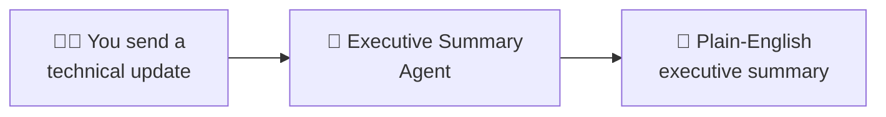

# Ενότητα 0 - Εισαγωγή

⏱️ ~10 λεπτά

> [!WARNING]
> **Προεπισκόπηση & Περιορισμοί:** [Φιλοξενούμενοι Πράκτορες](https://learn.microsoft.com/azure/foundry/agents/concepts/hosted-agents) βρίσκονται επί του παρόντος σε **δημόσια προεπισκόπηση** - δεν συνιστάται για παραγωγικά φορτία εργασίας. Λάβετε υπόψη τα εξής:
> - **Οι υποστηριζόμενες περιοχές είναι περιορισμένες** - ελέγξτε τη [διαθεσιμότητα περιοχών](https://learn.microsoft.com/azure/foundry/agents/concepts/hosted-agents#region-availability) πριν δημιουργήσετε πόρους. Εάν επιλέξετε μια μη υποστηριζόμενη περιοχή, η ανάπτυξη θα αποτύχει.
> - Το πακέτο `agent-framework-foundry-hosting` είναι προ-έκδοση - τα API μπορεί να αλλάξουν μεταξύ εκδόσεων.
> - Όρια κλιμάκωσης: οι φιλοξενούμενοι πράκτορες υποστηρίζουν 0–5 αντίγραφα (συμπεριλαμβανομένου του scale-to-zero).
> - Ορισμένες δυνατότητες που εμφανίζονται σε αυτό το εργαστήριο μπορεί να αλλάξουν καθώς η υπηρεσία προχωρά προς την GA.

## Τι θα κατασκευάσετε

Σε αυτό το εργαστήριο, θα κατασκευάσετε έναν πράκτορα **"Εξήγησέ το σαν να είμαι Εκτελεστικός"** - έναν φιλοξενούμενο AI πράκτορα που παίρνει σύνθετες τεχνικές ενημερώσεις και τις επαναδιατυπώνει ως απλές εκτελεστικές περιλήψεις στα αγγλικά.

**Ο πράκτορας χρησιμοποιεί:**
- **Microsoft Agent Framework** - για τη λογική και τη δομή του πράκτορα
- **Foundry Toolkit για VS Code** - για το σκαρίφημα, τη δοκιμή τοπικά και την ανάπτυξη
- **Ένα μοντέλο AI** (π.χ., `gpt-4.1-mini/gpt-5-mini`) - για τη δημιουργία των περιλήψεων

Μέχρι το τέλος αυτού του εργαστηρίου, θα έχετε έναν λειτουργικό πράκτορα που μπορείτε να δοκιμάσετε τοπικά μέσω του Agent Inspector και προαιρετικά να αναπτύξετε στο cloud.

---

## Τι είναι οι φιλοξενούμενοι πράκτορες;

Ένας **φιλοξενούμενος πράκτορας** είναι ένας AI πράκτορας που εκτελείται ως διαχειριζόμενη υπηρεσία στο Microsoft Foundry. Αντί να διαχειρίζεστε τη δική σας υποδομή, πακετάρετε τον κώδικα του πράκτορά σας σε ένα container και το Foundry αναλαμβάνει την κλιμάκωση, τη φιλοξενία και την έκθεση μέσω ενός τυπικού HTTP endpoint.

| Έννοια | Τι σημαίνει |
|---------|--------------|
| **Πράκτορας** | Ο κώδικας Python σας που λαμβάνει ένα μήνυμα χρήστη, καλεί ένα μοντέλο AI και επιστρέφει μια δομημένη απάντηση |
| **Φιλοξενούμενος** | Το Foundry τρέχει το container για εσάς - χωρίς VM, χωρίς Kubernetes, χωρίς υποδομή για διαχείριση |
| **Πρωτόκολλο απαντήσεων** | Ένα τυπικό HTTP API (`POST /responses`) που μπορεί να καλέσει οποιοσδήποτε πελάτης για να αλληλεπιδράσει με τον πράκτορά σας |
| **Agent Inspector** | Μια τοπική διεπαφή δοκιμής (ενσωματωμένη στο Foundry Toolkit) που σας επιτρέπει να συνομιλήσετε με τον πράκτορα πριν την ανάπτυξη |

Σε αυτό το εργαστήριο, θα μεταβείτε από το μηδέν σε έναν πλήρως φιλοξενούμενο πράκτορα - ή μπορείτε να σταματήσετε στη τοπική δοκιμή αν προτιμάτε.

---

## Επιλέξτε τη διαδρομή σας

> ⚠️ **Επιλέξτε μία διαδρομή πριν προχωρήσετε.** Η επιλογή σας καθορίζει ποια εργαλεία θα εγκαταστήσετε και ποια modules εφαρμόζονται. Μπορείτε να αλλάξετε από τη Διαδρομή Β → Διαδρομή Α αργότερα εάν αποκτήσετε συνδρομή.

<strong>🅰️ Διαδρομή Α - Azure cloud (απαιτεί συνδρομή Azure)</strong>

| | Λεπτομέρειες |
|---|---|
| **Για ποιον είναι;** | Έχετε ενεργή συνδρομή Azure και μπορείτε να δημιουργήσετε πόρους Foundry |
| **Μοντέλο** | Azure OpenAI μέσω Foundry (π.χ., `gpt-4.1-mini/gpt-5-mini`) |
| **Καλυπτόμενα modules** | Όλα τα modules (00–07) |
| **Ανάπτυξη στο cloud;** | ✅ Ναι - πλήρης ανάπτυξη από άκρο σε άκρο |

<strong>🅱️ Διαδρομή Β - Τοπικά / δωρεάν επίπεδο (δεν απαιτείται συνδρομή Azure)</strong>

| | Λεπτομέρειες |
|---|---|
| **Για ποιον είναι;** | MVPs, φοιτητές ή οποιοσδήποτε χωρίς πρόσβαση Azure |
| **Μοντέλο** | **Foundry Local** (δωρεάν, εκτελείται στη μηχανή σας) |
| **Καλυπτόμενα modules** | Modules 00–04 (παράλειψη deploy & cloud verify) |
| **Ανάπτυξη στο cloud;** | ❌ Όχι - μόνο τοπικός έλεγχος μέσω Agent Inspector |

---

## Όλα τα μονοπάτια: Απαιτούμενα εργαλεία

Εγκαταστήστε το κάθε εργαλείο παρακάτω. Μετά την εγκατάσταση, επαληθεύστε ότι λειτουργεί εκτελώντας την εντολή ελέγχου.

| # | Εργαλείο | Έκδοση | Εγκατάσταση | Επαλήθευση (Αναμενόμενο αποτέλεσμα) |
|---|------|---------|---------|---------------------------|
| 1 | **Visual Studio Code** | Τελευταία | [code.visualstudio.com](https://code.visualstudio.com/) | Ανοίγει χωρίς σφάλματα |
| 2 | **Python** | 3.12 ή νεότερη | [python.org/downloads](https://www.python.org/downloads/) | `python --version` $\rightarrow$ `Python 3.12.x` |
| 3 | **Foundry Toolkit για VS Code** | Τελευταία | Extension ID: `ms-windows-ai-studio.windows-ai-studio` | Εικονίδιο Foundry στη γραμμή δραστηριότητας |
| 4 | **Python extension για VS Code** | Τελευταία | Extension ID: `ms-python.python` | Εγκατεστημένο στον πίνακα Επεκτάσεων |

> [!TIP]
> **Επαγγελματικές συμβουλές για εγκατάσταση:**
> - **Python PATH (Windows):** Ελέγξτε πάντα **"Προσθήκη Python στο PATH"** στην πρώτη οθόνη του εγκαταστάτη Python. Χωρίς αυτό, `python` δεν θα αναγνωρίζεται στο τερματικό σας.
> - **Πολλαπλές εκδόσεις Python:** Αν έχετε εγκατεστημένες τις Python 3.10 και 3.12, χρησιμοποιήστε `python3.12 -m venv .venv` για να βεβαιωθείτε ότι χρησιμοποιείται η σωστή έκδοση για το εικονικό περιβάλλον σας.
> - **Docker WSL 2 (Windows):** Κατά την εγκατάσταση του Docker Desktop, βεβαιωθείτε ότι είναι επιλεγμένο το **WSL 2 backend**. Το Docker με Hyper-V είναι πιο αργό και μπορεί να προκαλέσει προβλήματα με τα builds container του Foundry.
> - **Δεν ξεκινάει το Docker;** Περιμένετε 30–60 δευτερόλεπτα μετά την εκκίνηση του Docker Desktop. Εκτελέστε `docker info` - αν δείτε "Cannot connect to the Docker daemon," το Docker εξακολουθεί να αρχικοποιείται.
> - **Δεν φορτώνονται οι επεκτάσεις του VS Code;** Μετά την εγκατάσταση των επεκτάσεων, ξαναφορτώστε το παράθυρο: `Ctrl+Shift+P` → `Developer: Reload Window`.

> **Χρήστες Windows:** Ελέγξτε **"Προσθήκη Python στο PATH"** κατά την εγκατάσταση της Python.

**Επόμενο:** [01 - Setup →](01-setup.md)

---

<!-- CO-OP TRANSLATOR DISCLAIMER START -->
**Αποποίηση ευθυνών**:
Αυτό το έγγραφο έχει μεταφραστεί χρησιμοποιώντας την υπηρεσία μετάφρασης με τεχνητή νοημοσύνη [Co-op Translator](https://github.com/Azure/co-op-translator). Ενώ επιδιώκουμε την ακρίβεια, παρακαλούμε να έχετε υπόψη ότι οι αυτοματοποιημένες μεταφράσεις ενδέχεται να περιέχουν λάθη ή ανακρίβειες. Το πρωτότυπο έγγραφο στη μητρική του γλώσσα πρέπει να θεωρείται η αυθεντική πηγή. Για κρίσιμες πληροφορίες, συνιστάται επαγγελματική ανθρώπινη μετάφραση. Δεν φέρουμε ευθύνη για τυχόν παρεξηγήσεις ή λανθασμένες ερμηνείες που προκύπτουν από τη χρήση αυτής της μετάφρασης.
<!-- CO-OP TRANSLATOR DISCLAIMER END -->