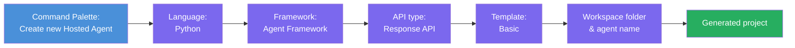
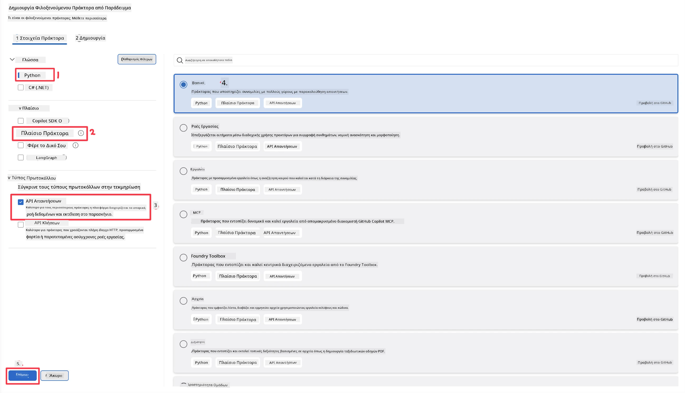
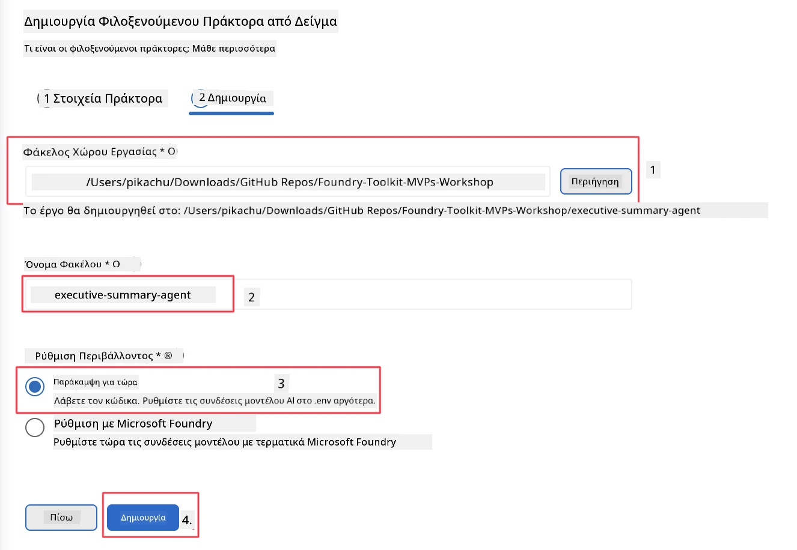

# Ενότητα 2 - Δημιουργία νέου φιλοξενούμενου πράκτορα

⏱️ ~5 λεπτά

Σε αυτή την ενότητα, χρησιμοποιείτε το Foundry Toolkit για να **δημιουργήσετε το σκελετό ενός project φιλοξενούμενου πράκτορα**. Ο σκελετός παράγει την πλήρη δομή του project - `agent.yaml`, `main.py`, `Dockerfile`, `requirements.txt`, και τη ρύθμιση αποσφαλμάτωσης στο VS Code - ώστε να μπορείτε να εστιάσετε στην προσαρμογή της συμπεριφοράς του πράκτορα.

> **Κύρια έννοια:** Ο φάκελος `agent/` σε αυτό το εργαστήριο είναι ένα παράδειγμα αυτού που παράγει το Foundry Toolkit. Δεν γράφετε αυτά τα αρχεία από την αρχή.

### Ροή οδηγού δημιουργίας σκελετού



---

## Βήμα 1: Άνοιγμα του οδηγού Δημιουργίας Φιλοξενούμενου Πράκτορα

1. Πατήστε `Ctrl+Shift+P` για να ανοίξετε το **Command Palette**.
2. Πληκτρολογήστε: **Foundry Toolkit: Create new Hosted Agent** και επιλέξτε το.

> **Εναλλακτικά: Δημιουργία μέσω Foundry Portal**
> Αν προτιμάτε τον φυλλομετρητή, μπορείτε να δημιουργήσετε το project σας στο [https://ai.azure.com](https://ai.azure.com). Μόλις το project ετοιμαστεί, επιστρέψτε στο VS Code και χρησιμοποιήστε την πλαϊνή μπάρα του **Foundry Toolkit** για να συνδεθείτε σε αυτό.

> **Εναλλακτικά:** Στην πλαϊνή μπάρα του Foundry Toolkit, περάστε τον κέρσορα πάνω από το **Agents** κάτω από το project σας, κάντε κλικ στο εικονίδιο **+**, και επιλέξτε **Create in Code With Template**.

## Βήμα 2: Επιλογή ρυθμίσεων



1. Στην αριστερή ενότητα πλοήγησης/επιλογών επιλέξτε τα εξής:

| Μενού | Επιλογή | Σημειώσεις |
|--------|-----------|-------|
| **Γλώσσα** | Python | Υποστηρίζεται και C# |
| **Πλαίσιο** | Agent Framework | Απλό σημείο εκκίνησης με το Agent Framework SDK |
| **Τύπος API** | Response API | `POST /responses` - συνομιλητικό, με ιστορικό διαχειριζόμενο από την πλατφόρμα |
| **Πρότυπο** | Basic | Απλό σημείο εκκίνησης με το Agent Framework SDK |

2. Μόλις ολοκληρώσετε την επιλογή, κάντε κλικ στο **Επόμενο**



3. Στο επόμενο παράθυρο, επιλέξτε τα εξής:

| Μενού | Επιλογή | Σημειώσεις |
|--------|-----------|-------|
| **Φάκελος εργασίας** | Επιλέξτε φάκελο προορισμού | π.χ., `/workspace/Foundry_Toolkit_for_VSCode_Lab/` ή υποφάκελος σε αυτό το repo |
| **Όνομα πράκτορα** | Πληκτρολογήστε όνομα | π.χ., `executive-summary-agent` |
| **Ρύθμιση περιβάλλοντος** | παραλείψτε τη ρύθμιση προς το παρόν |  |

Κάντε κλικ στο **create** για να δημιουργήσετε τον πράκτορα. Ένας νέος φάκελος θα δημιουργηθεί με το όνομα του φιλοξενούμενου πράκτορα.

## Βήμα 3: Επισκόπηση του παραγόμενου project

Μετά την ολοκλήρωση του σκελετού, βεβαιωθείτε ότι βλέπετε αυτά τα αρχεία στον Explorer (`Ctrl+Shift+E`):

```
📂 executive-summary-agent/
├── .env                ← Environment variables (placeholders)
├── .vscode/
│   ├── launch.json     ← Debug config (F5 → run + Agent Inspector)
│   └── tasks.json      ← VS Code task definitions
├── agent.yaml          ← Agent definition (kind: hosted)
├── Dockerfile          ← Container config for deployment
├── main.py             ← Agent entry point (your main code)
└── requirements.txt    ← Python dependencies
```

### Επεξήγηση βασικών αρχείων

| Αρχείο | Σκοπός |
|------|---------|
| `agent.yaml` | Δηλώνει τον πράκτορα ως `kind: hosted`, χαρτογραφεί μεταβλητές περιβάλλοντος, ορίζει το πρωτόκολλο `/responses` |
| `main.py` | Δημιουργεί έναν `FoundryChatClient` → τον περικλείει σε έναν `Agent` με οδηγίες → εξυπηρετεί μέσω `ResponsesHostServer` στην θύρα 8088 |
| `Dockerfile` | Χρησιμοποιεί `python:3.12-slim`, εγκαθιστά εξαρτήσεις, εκθέτει τη θύρα 8088, τρέχει `main.py` |
| `requirements.txt` | `agent-framework-foundry`, `agent-framework-foundry-hosting`, `mcp`, `debugpy` |

> **Σημαντικό:** Ανοίξτε απευθείας τον φάκελο του σκελετωμένου πράκτορα στο VS Code (τον ίδιο τον φάκελο `agent/`) ώστε `.vscode/launch.json` και `tasks.json` να λειτουργούν σωστά στον αποσφαλματωτή F5.

---

### ✅ Σημείο ελέγχου

- [ ] Δημιουργήθηκε το project με τον σκελετό με όλα τα αναμενόμενα αρχεία
- [ ] `agent.yaml` εμφανίζει `kind: hosted` και `protocol: responses`
- [ ] `main.py` εισάγει `Agent`, `FoundryChatClient`, `ResponsesHostServer`
- [ ] Ο φάκελος του πράκτορα είναι ανοιχτός στο VS Code ως ρίζα χώρου εργασίας

---

**Προηγούμενο:** [01 - Ρύθμιση](01-setup.md) · **Επόμενο:** [03 - Διαμόρφωση και Κώδικας →](03-configure-and-code.md)

---

<!-- CO-OP TRANSLATOR DISCLAIMER START -->
**Αποποίηση ευθυνών**:
Αυτό το έγγραφο έχει μεταφραστεί χρησιμοποιώντας την υπηρεσία μετάφρασης με τεχνητή νοημοσύνη [Co-op Translator](https://github.com/Azure/co-op-translator). Ενώ επιδιώκουμε την ακρίβεια, παρακαλούμε να έχετε υπόψη ότι οι αυτοματοποιημένες μεταφράσεις ενδέχεται να περιέχουν λάθη ή ανακρίβειες. Το πρωτότυπο έγγραφο στη μητρική του γλώσσα πρέπει να θεωρείται η αυθεντική πηγή. Για κρίσιμες πληροφορίες, συνιστάται επαγγελματική ανθρώπινη μετάφραση. Δεν φέρουμε ευθύνη για τυχόν παρεξηγήσεις ή λανθασμένες ερμηνείες που προκύπτουν από τη χρήση αυτής της μετάφρασης.
<!-- CO-OP TRANSLATOR DISCLAIMER END -->