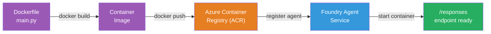
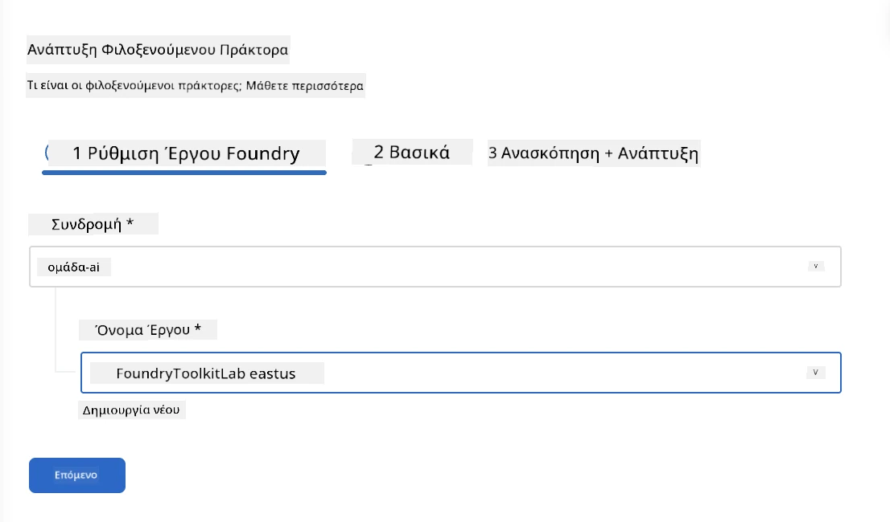
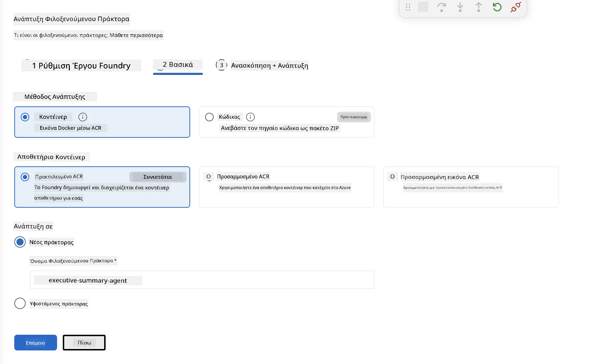
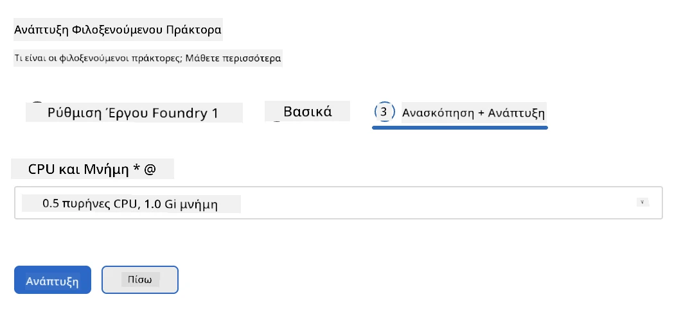
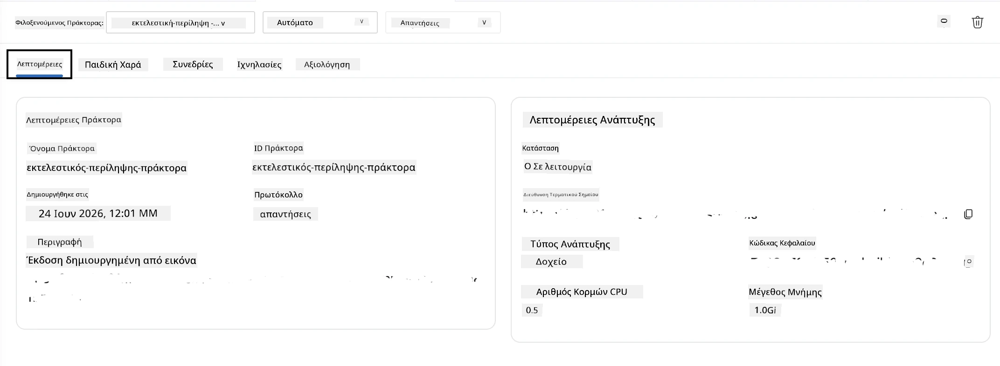

# Ενότητα 5 - Ανάπτυξη στην Υπηρεσία Agent Foundry

⏱️ ~10 λεπτά

> ⚠️ **Χρήστες διαδρομής B:** Αυτή η ενότητα απαιτεί συνδρομή Foundry. Εάν χρησιμοποιείτε το Foundry Local, προχωρήστε απευθείας στην [Ενότητα 07 - Περίληψη](07-summary.md). Έχετε ολοκληρώσει με επιτυχία τη ροή εργασίας τοπικής ανάπτυξης!

Σε αυτήν την ενότητα, αναπτύσσετε τον τοπικά ελεγμένο agent σας στο Microsoft Foundry ως **Hosted Agent**. Η ανάπτυξη κατασκευάζει μια εικόνα κοντέινερ, την αποστέλλει στο Azure Container Registry και ξεκινά τον agent στην διαχειριζόμενη υποδομή του Foundry.

### Ροή εργασίας ανάπτυξης

---

## Έλεγχος προαπαιτήσεων

Πριν από την ανάπτυξη, επιβεβαιώστε:

- [ ] Ο agent περνά όλα τα 3 τοπικά σενάρια από την [Ενότητα 04](04-test-locally.md)
- [ ] Έχετε τον ρόλο **Azure AI User** στο επίπεδο του έργου ([Ενότητα 01, Ανάθεση RBAC](01-setup.md#deploy-a-model--assign-rbac))
- [ ] Έχετε συνδεθεί στο Azure μέσω του VS Code (το εικονίδιο λογαριασμού δείχνει το όνομά σας)

---

## Βήμα 1: Ξεκινήστε την ανάπτυξη

### Επιλογή A: Ανάπτυξη από τον Agent Inspector (συνιστάται)

Εάν ο Agent Inspector είναι ανοιχτός (από το τεστ):
1. Κάντε κλικ στο κουμπί **Deploy** στην επάνω δεξιά γωνία (εικονίδιο σύννεφου ↑).

### Επιλογή B: Ανάπτυξη από Command Palette

1. Πατήστε `Ctrl+Shift+P` → **Foundry Toolkit: Deploy Hosted Agent**.

---

## Βήμα 2: Διαμορφώστε την ανάπτυξη

Ο οδηγός σας ζητά τα εξής:

| Ερώτηση | Επιλογή |
|--------|-----------|
| **Συνδρομή** | Η Συνδρομή σας στο Azure |
| **Στοχευόμενο έργο** | Το έργο Foundry σας (π.χ., `workshop-agents`) |

Κάντε κλικ **επόμενο** για να διαμορφώσετε τον agent σας.

| Ερώτηση | Επιλογή |
|--------|-----------|
| **Μέθοδος Ανάπτυξης** | Κοντέινερ |
| **Κατάστημα κοντέινερ** | **Προεπιλεγμένο ACR** (η Microsoft Foundry δημιουργεί και διαχειρίζεται ένα για εσάς) |
| **Ανάπτυξη σε** | Νέος Agent (όνομα, `executive-summary-agent`) |

Κάντε κλικ **επόμενο** για να ελέγξετε και να αναπτύξετε τον agent σας.

| Ερώτηση | Επιλογή |
|--------|-----------|
| **CPU και μνήμη** | **0.5 πυρήνες CPU, 1.0 Gi μνήμη** (η προεπιλογή - επαρκές για το εργαστήριο) |

---

## Βήμα 3: Αναπτύξτε και παρακολουθήστε

1. Κάντε κλικ στο **Deploy**.
2. Παρακολουθήστε τον πίνακα **Έξοδος** (επιλέξτε **Microsoft Foundry** από το αναπτυσσόμενο).
3. Η ανάπτυξη περνά τα εξής στάδια:
   - **Δημιουργία Docker** - κατασκευάζει το κοντέινερ από το Dockerfile σας
   - **Αποστολή Docker** - αποστέλλει την εικόνα στο ACR (1–3 λεπτά στην πρώτη ανάπτυξη)
   - **Εγγραφή Agent** - δημιουργεί τον hosted agent στο Foundry
   - **Εκκίνηση κοντέινερ** - ξεκινά με διαχειριζόμενη ταυτότητα συστήματος

4. Όταν ολοκληρωθεί, εμφανίζεται μια ειδοποίηση:
   > **ο executive-summary-agent αναπτύχθηκε με επιτυχία.** `View logs` `Run agent`

5. Κάντε κλικ **Run agent** για να ανοίξετε το Agent Playground.

### Τιμές κατάστασης ανάπτυξης

| Κατάσταση | Σημασία |
|--------|---------|
| **Εκτελείται** | Το κοντέινερ είναι έτοιμο, ο agent ανταποκρίνεται |
| **Εκκρεμεί** | Το κοντέινερ ξεκινά - περιμένετε 30–60 δευτερόλεπτα |
| **Απέτυχε** | Ελέγξτε τα αρχεία καταγραφής (βλ. αντιμετώπιση προβλημάτων παρακάτω) |

---

## Συνηθισμένα σφάλματα ανάπτυξης

| Σφάλμα | Βασική αιτία | Επιδιόρθωση |
|-------|-----------|-----|
| `agents/write` άδεια απορρίφθηκε | Λείπει ο ρόλος **Azure AI User** σε επίπεδο έργου | [Module 01, Assign RBAC](01-setup.md#deploy-a-model--assign-rbac) |
| Το Docker δεν τρέχει | Το Docker Desktop δεν ξεκίνησε | Ξεκινήστε το Docker Desktop → επαληθεύστε `docker info` |
| Εξουσιοδότηση ACR | Η διαχειριζόμενη ταυτότητα δεν μπορεί να τραβήξει εικόνα | Δείτε [Module 08 - Troubleshooting](08-troubleshooting.md) |

---

### ✅ Σημείο ελέγχου

- [ ] Η ανάπτυξη ολοκληρώθηκε χωρίς σφάλματα
- [ ] Ο πράκτορας εμφανίζεται στην καρτέλα **Hosted Agent** όταν κάνετε κλικ στο **Agents** κάτω από το έργο σας στην πλαϊνή μπάρα Foundry Toolkit
- [ ] Η κατάσταση του κοντέινερ εμφανίζει **Running**
- [ ] Η καρτέλα Agent Playground άνοιξε δείχνοντας λεπτομέρειες πράκτορα και URL τελικού σημείου

---

**Προηγούμενο:** [04 - Δοκιμή τοπικά](04-test-locally.md) · **Επόμενο:** [06 - Επαλήθευση στο Playground →](06-verify-in-playground.md)

---

<!-- CO-OP TRANSLATOR DISCLAIMER START -->
**Αποποίηση ευθυνών**:
Αυτό το έγγραφο έχει μεταφραστεί χρησιμοποιώντας την υπηρεσία μετάφρασης με τεχνητή νοημοσύνη [Co-op Translator](https://github.com/Azure/co-op-translator). Ενώ επιδιώκουμε την ακρίβεια, παρακαλούμε να έχετε υπόψη ότι οι αυτοματοποιημένες μεταφράσεις ενδέχεται να περιέχουν λάθη ή ανακρίβειες. Το πρωτότυπο έγγραφο στη μητρική του γλώσσα πρέπει να θεωρείται η αυθεντική πηγή. Για κρίσιμες πληροφορίες, συνιστάται επαγγελματική ανθρώπινη μετάφραση. Δεν φέρουμε ευθύνη για τυχόν παρεξηγήσεις ή λανθασμένες ερμηνείες που προκύπτουν από τη χρήση αυτής της μετάφρασης.
<!-- CO-OP TRANSLATOR DISCLAIMER END -->