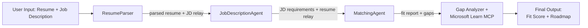

# PersonalCareerCopilot - Αξιολογητής Καταλληλότητας Βιογραφικού για Θέση Εργασίας

Μια εφαρμογή με πολλούς πράκτορες που βασίζεται σε ροές εργασίας και αξιολογεί πόσο καλά ταιριάζει ένα βιογραφικό σε μια περιγραφή θέσης εργασίας, στη συνέχεια δημιουργεί έναν εξατομικευμένο οδικό χάρτη μάθησης για την κάλυψη των κενών.

---

## Πράκτορες

| Πράκτορας | Ρόλος | Εργαλεία |
|-------|------|-------|
| **ResumeParser** | Εξάγει δομημένες δεξιότητες, εμπειρία και πιστοποιήσεις από το κείμενο του βιογραφικού | - |
| **JobDescriptionAgent** | Εξάγει απαιτούμενες/προτιμώμενες δεξιότητες, εμπειρία και πιστοποιήσεις από μια περιγραφή θέσης εργασίας | - |
| **MatchingAgent** | Συγκρίνει το προφίλ με τις απαιτήσεις → βαθμολογία καταλληλότητας (0-100) + ταιριαστές/ελλείπουσες δεξιότητες | - |
| **GapAnalyzer** | Δημιουργεί έναν εξατομικευμένο οδικό χάρτη μάθησης με πόρους Microsoft Learn | `search_microsoft_learn_for_plan` (MCP) |

## Ροή εργασίας



---

## Γρήγορη εκκίνηση

### 1. Ρύθμιση περιβάλλοντος

Αυτός ο φάκελος είναι η αναφορά υλοποίησης για το σκελετό ροής εργασίας του Lab 02. Το `main.py` του χρησιμοποιεί τα υπάρχοντα μπλοκ prompt μαζί με `WorkflowBuilder` για να συνδέσει τους τέσσερις πράκτορες.

```powershell
cd workshop\lab02-multi-agent\PersonalCareerCopilot
python -m venv .venv
.\.venv\Scripts\Activate.ps1          # Windows PowerShell
# source .venv/bin/activate            # macOS / Linux
pip install -r requirements.txt
```

### 2. Διαμόρφωση διαπιστευτηρίων

Δημιουργήστε ένα αρχείο `.env` σε αυτόν τον φάκελο:

```powershell
copy .env .env.bak 2>$null; echo $null > .env
```

Επεξεργαστείτε το `.env`:

```env
FOUNDRY_PROJECT_ENDPOINT=https://<your-account>.services.ai.azure.com/api/projects/<your-project>
AZURE_AI_MODEL_DEPLOYMENT_NAME=gpt-4.1-mini
```

| Τιμή | Πού θα τη βρείτε |
|-------|------------------|
| `FOUNDRY_PROJECT_ENDPOINT` | Πλευρική μπάρα Foundry Toolkit → δεξί κλικ στο έργο σας → **Αντιγραφή Τερματικού Σημείου Έργου** |
| `AZURE_AI_MODEL_DEPLOYMENT_NAME` | Πλευρική μπάρα Foundry → αναπτύξτε το έργο → **Μοντέλα + τερματικά σημεία** → όνομα ανάπτυξης |

### 3. Εκτέλεση τοπικά

```powershell
python -m debugpy --listen 127.0.0.1:5679 main.py --port 8088
```

Ή χρησιμοποιήστε την εργασία VS Code: `Ctrl+Shift+P` → **Εργασίες: Εκτέλεση Εργασίας** → **Εκτέλεση Διακομιστή HTTP Πράκτορα**.

Για αποσφαλμάτωση με F5, χρησιμοποιήστε **Αποσφαλμάτωση Τοπικού Διακομιστή HTTP Πράκτορα**.

### 4. Δοκιμή με Agent Inspector

Ανοίξτε τον Agent Inspector: `Ctrl+Shift+P` → **Foundry Toolkit: Άνοιγμα Agent Inspector**.

Επικολλήστε αυτό το test prompt:

```
Resume:
Jane Doe
Senior Software Engineer with 5 years of experience in Python, Django, and AWS.
Built microservices handling 10K+ requests/second. Led a team of 4 developers.
Certifications: AWS Solutions Architect Associate.
Education: B.S. Computer Science, State University.

Job Description:
Senior Cloud Engineer at Contoso Ltd.
Required: Python, Azure, Kubernetes, Terraform, CI/CD pipelines.
Preferred: Go, monitoring (Prometheus/Grafana), cost optimization.
Experience: 5+ years in cloud infrastructure.
Certifications: Azure Solutions Architect Expert preferred.
```

**Αναμενόμενο:** Μια βαθμολογία καταλληλότητας (0-100), ταιριαστές/ελλείπουσες δεξιότητες και ένας εξατομικευμένος οδικός χάρτης μάθησης με URL του Microsoft Learn.

### 5. Ανάπτυξη στο Foundry

`Ctrl+Shift+P` → **Foundry Toolkit: Ανάπτυξη Φιλοξενούμενου Πράκτορα** → επιλέξτε το έργο σας → επιβεβαιώστε.

---

## Δομή έργου

```
PersonalCareerCopilot/
├── .env                ← Your credentials (git-ignored)
├── agent.yaml          ← Hosted agent definition (name, resources, env vars)
├── Dockerfile          ← Container image for Foundry deployment
├── main.py             ← 4-agent workflow (instructions, MCP tool, WorkflowBuilder)
└── requirements.txt    ← Python dependencies
```

## Βασικά αρχεία

### `agent.yaml`

Ορίζει τον φιλοξενούμενο πράκτορα για την Υπηρεσία Πράκτορα Foundry:
- `kind: hosted` - εκτελείται ως διαχειριζόμενο κοντέινερ
- `protocols` - πρωτόκολλο `responses` με `version: 2.0.0`, εκθέτοντας το τερματικό σημείο HTTP `/responses`
- `environment_variables` - δηλώνεται εδώ το `AZURE_AI_MODEL_DEPLOYMENT_NAME`; το `FOUNDRY_PROJECT_ENDPOINT` εισάγεται αυτόματα κατά την ανάπτυξη

### `main.py`

Περιέχει:
- **Οδηγίες πράκτορα** - τέσσερις σταθερές `*_INSTRUCTIONS`, μία για κάθε πράκτορα
- **Εργαλείο MCP** - `search_microsoft_learn_for_plan()` καλεί `https://learn.microsoft.com/api/mcp` μέσω Streamable HTTP
- **Δημιουργία πράκτορα** - τέσσερις στιγμιότυπα `Agent()` + `AgentExecutor()` που μοιράζονται ένα `FoundryChatClient`
- **Διάγραμμα ροής εργασίας** - `WorkflowBuilder` συνδέει τους πράκτορες ως διαδοχικό pipeline: ResumeParser → JD Agent → MatchingAgent → GapAnalyzer
- **Εκκίνηση διακομιστή** - `ResponsesHostServer` τρέχει στη θύρα 8088

### `requirements.txt`

| Πακέτο | Σκοπός |
|---------|----------|
| `agent-framework-foundry` | Βασική εκτέλεση: `Agent`, `AgentExecutor`, `WorkflowBuilder`, `@tool`, `FoundryChatClient` |
| `agent-framework-foundry-hosting` | Ενοποίηση φιλοξενίας Foundry + `ResponsesHostServer` |
| `mcp<2,>=1.24.0` | Πελάτης MCP για GapAnalyzer (`streamable_http_client`) |
| `debugpy` | Αποσφαλμάτωση Python (F5 σε VS Code) |

---

## Επίλυση προβλημάτων

| Πρόβλημα | Επιδιόρθωση |
|-------|-----|
| `KeyError: 'FOUNDRY_PROJECT_ENDPOINT'` ή `KeyError: 'AZURE_AI_MODEL_DEPLOYMENT_NAME'` | Δημιουργήστε `.env` με ρυθμισμένα τα `FOUNDRY_PROJECT_ENDPOINT` και `AZURE_AI_MODEL_DEPLOYMENT_NAME` |
| `ModuleNotFoundError: No module named 'agent_framework'` | Ενεργοποιήστε το venv και εκτελέστε `pip install -r requirements.txt` |
| Δεν εμφανίζονται URLs Microsoft Learn στην έξοδο | Ελέγξτε τη σύνδεση στο διαδίκτυο προς `https://learn.microsoft.com/api/mcp` |
| Μόνο 1 κάρτα κενών (περικομμένη) | Επαληθεύστε ότι το `GAP_ANALYZER_INSTRUCTIONS` περιλαμβάνει το μπλοκ `CRITICAL:` |
| Η θύρα 8088 χρησιμοποιείται | Σταματήστε άλλους διακομιστές: `netstat -ano \| findstr :8088` |

Για αναλυτική επίλυση προβλημάτων, δείτε [Module 8 - Troubleshooting](../docs/08-troubleshooting.md).

---

**Πλήρης οδηγός:** [Lab 02 Docs](../docs/README.md) · **Επιστροφή στο:** [Lab 02 README](../README.md) · [Workshop Home](../../../README.md)

---

<!-- CO-OP TRANSLATOR DISCLAIMER START -->
**Αποποίηση ευθυνών**:
Αυτό το έγγραφο έχει μεταφραστεί χρησιμοποιώντας την υπηρεσία μετάφρασης με τεχνητή νοημοσύνη [Co-op Translator](https://github.com/Azure/co-op-translator). Ενώ επιδιώκουμε την ακρίβεια, παρακαλούμε να έχετε υπόψη ότι οι αυτοματοποιημένες μεταφράσεις ενδέχεται να περιέχουν λάθη ή ανακρίβειες. Το πρωτότυπο έγγραφο στη μητρική του γλώσσα πρέπει να θεωρείται η αυθεντική πηγή. Για κρίσιμες πληροφορίες, συνιστάται επαγγελματική ανθρώπινη μετάφραση. Δεν φέρουμε ευθύνη για τυχόν παρεξηγήσεις ή λανθασμένες ερμηνείες που προκύπτουν από τη χρήση αυτής της μετάφρασης.
<!-- CO-OP TRANSLATOR DISCLAIMER END -->